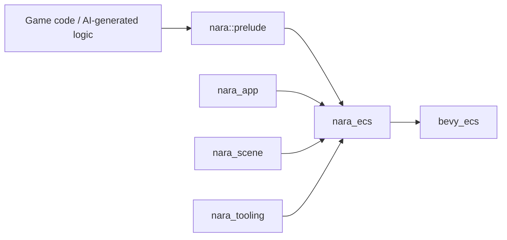

# ADR 0002: Use Bevy ECS as the ECS Substrate

**Status**: Accepted
**Date**: 2026-07-08

## Context

nara targets a strict data-driven runtime where components are pure data, systems are pure logic,
and scene hierarchy is represented by ECS relation components. The hard engineering question is
whether nara should self-build the ECS core or stand on an existing Rust-native ECS.

Rust makes ECS ergonomics expensive to implement correctly. A production ECS must handle typed
queries, mutable borrow conflicts, resources, commands, system parameter extraction, scheduling,
change detection, and parallel execution without leaking unsoundness into user code.

## Decision

Use `bevy_ecs` as nara's Phase 1 ECS substrate.

`nara_ecs` is a selected product-facing layer over `bevy_ecs`, not an independent ECS
implementation. Its ordinary authoring surface uses the original Bevy runtime types, including
`World`, `Entity`, `Query`, `Res`, `ResMut`, `Commands`, `Component`, `Resource`, and `Schedule`.
The root gameplay prelude selects from that surface according to ADR 0044.

The boundary is:

nara owns the product layer around the ECS:

- `nara_app` owns app lifecycle, plugin policy, schedules, and runner integration.
- `nara_scene` owns scene/prefab serialization semantics.
- `nara_asset` owns asset identity and typed handles.
- `nara_tooling` owns inspector and AI-facing metadata.
- `nara_render` owns extraction and renderer backend seams.

### Authoring And Upstream Responsibility

The ECS facade separates three responsibilities:

- The crate root and ECS prelude maintain an explicit selection for ordinary component/resource
  authoring, queries, commands, change detection and system/schedule composition. Common authoring
  traits are included so ordinary callers can compose native systems without learning an advanced
  import path. This selection does not automatically grow with Bevy's prelude or enabled features.
- `nara_ecs::upstream`, also available as `nara::ecs::upstream`, exposes the complete Bevy ECS
  substrate. Component metadata, custom parameter implementations, observer internals and raw
  schedule configuration use this explicitly version-coupled path. Its names and semantics follow
  the bound Bevy version, and callers accept the corresponding upgrade migrations.
- Hidden `__private` support is for generated code and internal cross-crate composition.
  Lifecycle-free transaction primitives belong there, not in the ordinary root or prelude. Hidden
  support is not an extension API or a promise of compatibility.

Selected authoring exports and `upstream` share the same types and system model. Do not wrap
`World`, `Query` or other substrate types to simulate an independent ECS. Nara remains responsible
for reviewing authoring behavior and documenting migrations when the substrate changes; a
maintained selection does not promise to make upstream semantics version-independent.

### Facade Derives

The supported authoring derives are `Component`, `Resource`, `Bundle`,
`SystemParam`, `ScheduleLabel` and `SystemSet`. They resolve a direct `nara_ecs`
or `nara` dependency by its Cargo package identity, including a renamed
dependency. Consumers do not need a direct `bevy_ecs` dependency or a local
`bevy_ecs` alias. Both the ECS root/prelude and the `bundle::Bundle` and
`system::SystemParam` module paths expose the adapted derives alongside the
upstream traits.

This is a selected public surface, not a claim that every macro available through
`upstream` supports Nara-only dependencies. Derives outside this set need their own path
adaptation and generated-code qualification before receiving that guarantee.

The selected derives preserve upstream storage, access, validation and deferred application
semantics, including supported generic, const and lifetime parameters. Generated implementation
paths use hidden substrate support rather than requiring ordinary exports of every upstream
module.

The runtime and derive implementation are one upgrade responsibility. Each substrate upgrade must
review its generated-code assumptions and qualify independent Nara-only and renamed-dependency
consumers. Selected derives must interoperate with the original runtime types; adapting dependency
paths must not create a second implementation of ECS semantics.

The current dependency versions, bounded source adaptations, provenance and concrete upgrade
checks are implementation records in the
[derive source notes](../../../crates/nara_ecs_derive/upstream/bevy-0.20.0/README.md).
Those details do not fix a substrate version or macro implementation strategy as a durable
architecture contract.

## Alternatives Considered

### Option A: Use `bevy_ecs` through `nara_ecs` (Chosen)

**Pros**: Mature Rust-native system model, strong query ergonomics, schedule support, resource
borrowing, commands, change detection, and a clear path to reflection integration.

**Cons**: nara inherits part of Bevy ECS's mental model, and deep future replacement becomes
harder once public APIs expose Bevy-shaped types.

**Decision**: Chosen. The ECS is not nara's differentiator in Phase 1; nara's differentiator is the
product boundary, scene/data workflow, AI-friendly schema, and focused 2D/3D runtime experience.

### Option B: Self-build a nara ECS

**Pros**: Full control over API shape, storage, schedule semantics, and serialization hooks.

**Cons**: High risk, long timeline, easy to underbuild query safety and scheduling, delays the
actual engine experience.

**Decision**: Rejected for Phase 1. Revisit only if a concrete nara requirement cannot be met by
`bevy_ecs` without unacceptable public API cost.

### Option C: Use a smaller ECS such as `hecs` or `shipyard`

**Pros**: Smaller dependency surface and more library-like feel, closer to EnTT's minimal runtime
style.

**Cons**: nara would still need to build more app scheduling, reflection, and tooling integration
itself.

**Decision**: Rejected for the default path, but useful as references for EnTT-like ergonomics.

### Option D: Bind to a C/C++ ECS such as Flecs-style APIs

**Pros**: Mature ECS runtime concepts and ecosystem experience outside Rust.

**Cons**: Weaker Rust-native type story, more FFI/runtime boundary complexity, and less natural
integration with Rust derives and reflection.

**Decision**: Rejected for nara's Rust-native product goal.

## Consequences

- `nara_ecs` should stop growing a separate placeholder ECS once this ADR is implemented.
- Public examples should teach the Bevy ECS system style through nara imports.
- nara should avoid pretending ECS internals are portable if it exposes `bevy_ecs` semantics.
- A future ECS replacement would be a major compatibility event, not an incidental refactor.

## Success Metrics

| Metric | Target | Measurement |
|---|---:|---|
| Authoring ergonomics | User can write `fn system(q: Query<...>, commands: Commands)` | Example compiles |
| Dependency scope | Only ECS-related crates depend on `bevy_ecs` directly | `cargo tree` / `rg "bevy_ecs"` |
| Runtime health | Workspace checks and tests pass | `cargo check --workspace`, `cargo nextest run --workspace` |
| Product ownership | `nara_app` does not depend on `bevy_app` | `cargo tree -p nara_app` |
| ECS replacement honesty | ADR documents compatibility cost | This ADR remains linked from docs |

## Risks and Mitigations

| Risk | Severity | Likelihood | Mitigation |
|---|---|---:|---|
| nara becomes a Bevy facade instead of its own engine | High | Medium | Do not adopt `bevy_app`, `bevy_render`, or `bevy_asset` by default |
| Public API leaks too many Bevy-specific names | Medium | Medium | Keep ordinary exports explicit and complete substrate access under `upstream` |
| Bevy ECS version churn affects nara users | Medium | Medium | Review runtime and derives together; qualify ordinary consumers and document upstream migrations |
| Self-built placeholder code diverges from the chosen substrate | High | Medium | Replace placeholder ECS code early with a thin `bevy_ecs` layer |

