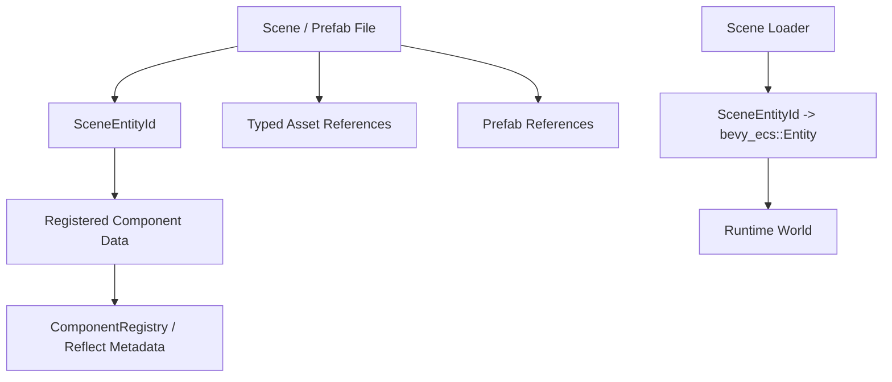

# ADR 0006: Scene and Prefab Data Model

**Status**: Accepted
**Date**: 2026-07-08
**Last Revised**: 2026-10-29
**Implemented Slices**: Scene/Prefab/Patch document foundation; RGF-U29 explicit persistent
composition and guarded target-World apply on 2026-07-18
**Refined By**: ADR 0038: Scene/Prefab Authoring Identity and Provenance; ADR 0043:
Scene, Prefab, and Patch Document Migration Policy; ADR 0049: Untrusted Project Input and Parse
Budget Policy; ADR 0051: Persistent File Envelope, Migration, and Golden Fixtures;
[ADR 0101](0101-ordered-persistent-placement-and-runtime-projection.md): Ordered Persistent
Placement and Runtime Projection

## Context

nara is code-first and data-driven. Scene and prefab files must support human-authored Rust workflows, AI-generated data, future visual tooling, hot reload, and stable serialization.

The scene model is also where several core decisions meet:

- `bevy_ecs` provides runtime `Entity` values, but those are not stable file identifiers.
- `bevy_reflect`-backed metadata can describe component fields for serialization and tooling.
- Scene hierarchy must remain ECS data, not a Godot-style object tree.
- 2D and future 3D should share the same scene/prefab format.

## Decision

nara scenes and prefabs are **dimension-neutral ECS data documents**.

They store stable scene-local entity identities, component data, hierarchy relationship components, asset handles, and prefab references. They do not store runtime `Entity` values.



Initial principles:

- `SceneEntityId` is stable within a scene or prefab document.
- Runtime `Entity` values are created during instantiation and stored only in an instantiate-time map.
- Hierarchy is represented by components such as `Parent`, `Children`, and `Name`; there is no runtime `Node` base type.
- Scene files are component-based, not 2D-specific or 3D-specific.
- JSON and RON should both be supported by the data model: JSON for AI/tooling interoperability, RON for Rust-native readability.
- Prefab nesting should be supported by the model, but complex override workflows can be phased in after the core instantiate path.

### Persistent Component Composition

After prefab expansion, the explicit stable-`ComponentTypeId` records on each
`SceneEntityRecord` are the complete durable persistent-component composition for that entity.
Scene loading must not infer an omitted persistent component from a Rust-local ECS requirement.

Bevy required-component declarations, component lifecycle hooks, and observers remain runtime ECS
mechanisms; they do not automatically become Nara scene, prefab, Inspector, undo, migration, or
export semantics. Canonical-v1 persistent bindings reject required-component and intrinsic
`ComponentHooks` metadata that can participate in insertion or removal. Runtime-only components
remain free to use those mechanisms.

World-local observers require a separate check because they may be registered after provider
freeze. Every persistent apply runs at an engine-owned quiescent boundary after pending deferred
work is flushed, records its post-flush rejection baseline, holds the target `World` exclusively,
and revalidates hooks dynamically registered against the target World's `ComponentInfo`. For a
fresh target, it also checks matching event-global and component-global
`Add`/`Insert`/`Discard`/`Remove`/`Despawn` observers before allocation and keeps the exclusive borrow
through target allocation and persistent insertion; no entity-scoped observer can be registered in
that interval. For a target that already exists or was reserved before the guard, it additionally
checks matching entity and entity+component registrations before the first persistent mutation.
An active matching lifecycle observer or dynamic hook rejects that apply and leaves the applicable
post-flush baseline unchanged.
Post-publication World-local hooks and observers remain valid runtime behavior. A later persistent
apply rejects while a matching hook remains installed; for a matching observer it may instead wait
for the Host to disable that observer at a safe point. Custom-event observers unrelated to
persistent insertion/removal are outside this restriction.

Runtime-only systems and components may derive transient state after spawn, but that state is not
written back as document truth merely because it exists in the `World`.

Any future derived persistent-component requirement must use stable `ComponentTypeId` values,
participate in the catalog generation and fingerprint, resolve as a bounded deterministic acyclic
closure, and produce the same result in Scene, Prefab, Inspector add-component, migration, and
direct persistent-spawn paths. OQ-043 gathers the comparison evidence; a separately Accepted ADR or
successor must select the public carrier and the remaining default, override, removal, and
unavailable-provider semantics.

Scene spawning still preflights all declared data and the target-World eligibility described above
before mutation. It does not claim that despawning new entities can roll back arbitrary hook effects
on resources, foreign entities, native services, or deferred queues.

### Explicit Native And Data Representations

The native registry retains its exact Rust-type binding contract. A separately admitted
`SceneComponentBindings` selection may combine that frozen native snapshot with disjoint
owner-local data Schema snapshots. Missing native bindings never implicitly choose data storage.
Data records require an explicit durable owner claim and current admitted Schema version.

The shared compiler and preflight validate both families through the same Schema, defaults and
declared-reference rules. One aggregate retained logical value allowance applies across entities
and both families before engine-owned copies/default materialization. Trusted codec and migration
internals keep their ordinary allocation and failure semantics.

Complete data groups are staged with native prepared values and installed through the existing
exclusive, lifecycle-free Scene publication tail. A carrier contains only current records and
their owner-local data snapshots, with exact World/entity-incarnation custody; it does not retain
native codecs, language runtimes or callbacks. Managed preparation, mutation and export require
the exact selection installed through App composition. Ordinary and advanced managed replacement
require the exact native definition too; explicitly selected independent preview projections
retain ADRs 0081/0098's separate definition contract.

Current-live export checks actual persistent membership for coverage before encoding. Selecting a
smaller native catalog or omitting encountered data members rejects the complete export rather
than producing a successful partial snapshot. A physically absent native member remains absent;
arbitrary runtime-only ECS components do not become persistent. Export of flattened live instances
is distinct from source Save. Data asset policy lowering uses admitted project metadata without
native handles or asset loading.

Guarded member enumeration, read, complete-value replacement and removal preserve sibling
members and validate exact owner, current payload, references and runtime target before a write.
Pure data retires through ordinary strict entity retirement with no carrier hook exemption.
Materialization does not establish language/module execution readiness. Executable publications,
owner migrations, dependency cohorts and physical code retirement remain separate proposed work
under ADR 0120. Implementation status and actual verification belong in the implementation ledger.

### Derived Runtime Scene Representation

Scene owns a distinct processed representation for source-free delivery. Cook consumes a complete
source-bound effective expansion under the selected native/data definitions. It preserves actual
containing-source identity and every entity's typed source/addition provenance, while removing
executable dependence on Prefab declarations, overlays, source migrations and authoring metadata.
The processed record has its own `runtime_scene` envelope and flat hierarchy/component payload;
it does not accept dormant source fields or disguise an expansion as a plain local document.

Containing-source local IDs remain unchanged. Projected IDs derive injectively from the complete
canonical logical address, including typed placement ancestry. Private expansion locators and
lookup aliases do not determine those IDs. Cook checks collisions with authored local IDs and
rewrites hierarchy and Schema-declared SceneLocal references through the complete mapping.
Lookup evidence remains inert provenance. Declared asset leaves become complete source/product
identities through admitted project metadata; existing complete product selections remain intact.
Ordinary strings are never treated as references.

Encoded/structural, aggregate value and modeled working/provenance limits apply before usable
candidate publication. The working ledger admits the processed owner's allocations and declared
reference work; existing validation and syntax scratch retain their own limits. It is not a
resident-memory bound. Runtime admission requires the expected containing source and selected current
Schema/owner definitions. Values contain their effective defaults explicitly. Declared references
close over the processed namespace. Runtime decoding neither migrates source values nor interprets
missing native bindings as data storage. The decoded document candidate alone grants no execution
authority.

A separate move-only Runtime candidate captures the exact definition witness. It enters the same
prepared native/data values, occurrence, hierarchy, product transaction and publication owners as
source-backed Scenes through a private closed input selection. It does not create another Scene
transaction or public generic provider interface. Runtime prepare and commit retain the existing
receiving-World/definition/native-claim checks and last-good replacement behavior.

Immutability and the exact witness carry the processed-value invariant into ordinary preflight;
preparation does not repeat the complete pure admission pass or reopen source migration.
Concrete content owners may stage newly admitted Product bindings through `SceneAssetBindings`
alongside their actual resource values in the existing product transaction. Native codecs resolve
only the supplied complete Product bindings. Unknown selections never become implicit reservations;
failure or cancellation does not publish the private catalogue or resource overlay. ADR 0122 owns
the identity/type contract, which alone proves neither membership nor residency.

This adopts only the Scene representation boundary needed by the ordered delivery workflow.
Catalog integrity, target/executable compatibility, expected digests, resource residency and actual
source-free startup/later acquisition belong to their Host and asset owners. Implementation and
qualification remain recorded separately; this section alone establishes neither a catalog nor
a completed source-free product.

## Data Shape

Conceptually:

```text
SceneDocument
  entities: Vec<SceneEntityRecord>
  roots: Vec<SceneEntityId>

SceneEntityRecord
  id: SceneEntityId
  children: ordered Vec<SceneEntityId>
  components: map ComponentTypeId -> SceneComponentRecord
  prefab: optional PrefabInstance

SceneComponentRecord
  owner: optional PersistentComponentSchemaOwnerId
  version: ComponentSchemaVersion
  value: ComponentValue

PrefabInstance
  source: AssetRef
  overrides: optional PrefabOverlay
```

The exact serialized syntax can evolve, but these semantic fields should remain.

Current source representation:

- `SceneEntityId` is a validated path-like stable ID.
- `SceneComponentRecord` stores declared owner, `ComponentSchemaVersion` and `ComponentValue`.
- The file envelope owns kind/version; Scene and Prefab payloads do not repeat them. Canonical
  source identity is supplied by the source owner separately from the lookup `AssetRef`.
- `PrefabInstance.overrides` retains declarative intent under ADR 0038. Exact transaction patches
  are separate from durable property/component/instance claims, additions and desired layout.
- Nested prefab expansion uses `PrefabSourceResolver`; the first adapter is
  `InMemoryPrefabSourceResolver`.
- A prefab instance remains as an anchor entity. Materialized locators are private and non-durable;
  typed source/addition ancestry carries identity. Effective roots precede the anchor's local children.

## Alternatives Considered

### Option A: Store runtime `Entity` IDs in scene files

**Pros**: Simple loader prototype.

**Cons**: Runtime entities are allocator-dependent and not stable across loads, hot reloads, prefab instantiation, or AI-generated edits.

**Decision**: Rejected.

### Option B: Godot-style node tree as the serialized model

**Pros**: Familiar editor model and direct parent/child structure.

**Cons**: Pulls nara toward object inheritance and callback-oriented architecture; conflicts with strict ECS.

**Decision**: Rejected. Hierarchy remains ECS relation data.

### Option C: ECS data document with stable scene IDs (Chosen)

**Pros**: Fits strict ECS, supports AI generation, enables prefab instantiation maps, and works for 2D and 3D.

**Cons**: Requires component registry, validation, and migration machinery before scene files can be stable.

**Decision**: Chosen.

### Option D: Inherit Bevy requirements and hooks as persistent document semantics

**Pros**: Rust-local component insertion can synthesize convenient defaults with little document
data.

**Cons**: The closure is absent from stable schema identity and migrations, insertion order can
change hook behavior, and arbitrary hook side effects cannot be covered by scene rollback.

**Decision**: Rejected. Nara may admit an explicit catalog-backed closure or authoring preset later,
but process-local ECS behavior is not implicit persistent meaning.

## Consequences

- Scene loading requires a validation phase before spawning into the runtime `World`.
- Component serialization depends on registered metadata, not arbitrary type names floating in files.
- Prefab instantiation must create an ID remap from `SceneEntityId` to runtime `Entity`.
- Editor/tooling can inspect and patch scene data without requiring runtime entities to exist.
- AI agents can generate scene documents that are checked against exported schemas before instantiation.
- Persistent composition remains identical across document validation, prefab expansion, Inspector
  edits, migration, and runtime spawn; runtime-derived components are a separate projection.

## Success Metrics

| Metric | Target | Measurement |
|---|---:|---|
| Runtime ID isolation | No scene/prefab file stores `bevy_ecs::Entity` | Schema/code review |
| Dimension neutrality | Same document model supports 2D sprite scene and future 3D mesh scene | Design test |
| AI validation | Invalid component fields are caught before spawning | Scene/prefab preflight and patch tests |
| Prefab mapping | Instantiation returns `SceneEntityId -> Entity` map | Scene spawn tests |
| Format flexibility | JSON and RON serialize the same semantic document | Scene/prefab and patch roundtrip examples |
| Composition identity | Scene, Prefab, Inspector, migration, and direct persistent spawn agree on the explicit persistent-component set | Composition conformance fixture |
| Hook honesty | A failed spawn is never reported as fully rolled back after a hook mutates state outside the managed entities | Hostile hook fixture |

## Risks and Mitigations

| Risk | Severity | Likelihood | Mitigation |
|---|---|---:|---|
| Component type IDs become unstable | High | Medium | Define stable nara component type IDs through `ComponentRegistry` |
| Prefab overrides become complex | Medium | High | Separate declarative inheritance intent from exact edit history; share Schema validation and explicit source ownership |
| JSON/RON divergence | Medium | Medium | Keep one semantic model and format adapters |
| Scene validation slows iteration | Medium | Low | Provide fast diagnostics and partial validation for tooling |
| AI emits structurally valid but bad scenes | Medium | High | Add schema constraints, defaults, and semantic validation passes |
| Rust-local component requirements drift from document meaning | Critical | Medium | Keep persistent composition explicit until a stable catalog-fingerprinted closure is admitted |
| Component hooks escape scene rollback | Critical | Medium | Reject hook-dependent persistent construction and never claim rollback of unowned side effects |

## Follow-Up Questions

- Should scene documents eventually contain an asset reference table, or keep inline `AssetRef`
  values per component?
- Which format is the default for hand-authored files: RON or JSON?

## Citations

- ECS substrate decision: [0002-use-bevy-ecs-as-ecs-substrate.md](0002-use-bevy-ecs-as-ecs-substrate.md)
- Reflection metadata decision: [0004-use-bevy-reflect-backed-component-metadata.md](0004-use-bevy-reflect-backed-component-metadata.md)
- Dimension-aware runtime decision: [0005-dimension-aware-runtime-with-2d-first-authoring.md](0005-dimension-aware-runtime-with-2d-first-authoring.md)
- Stable catalog and runtime binding: [0081-schema-source-stable-identity-catalog-and-runtime-binding.md](0081-schema-source-stable-identity-catalog-and-runtime-binding.md)
- Bevy required-component implementation: `repo-ref/bevy/crates/bevy_ecs/src/component/required.rs`
- Bevy component hook invocation: `repo-ref/bevy/crates/bevy_ecs/src/bundle/spawner.rs`
- RGF-U29 verification:
  `docs/knowledge/engineering/verification/2026-07/2026-07-18T102650Z-rgf-u29-explicit-persistent-composition-verification-57a04a45133744909a7c43441c99c9e0.md`
- RGF-U29 implementation: commit `e95cd4b`
