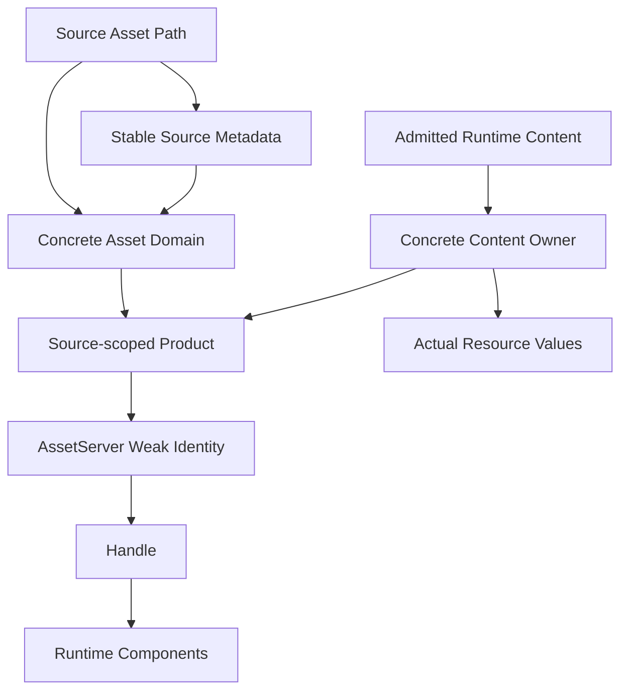

# ADR 0007: Asset Identity and Import Pipeline

**Status**: Accepted
**Date**: 2026-07-08
**Last Revised**: 2026-10-29
**Refined By**: ADR 0049: Untrusted Project Input and Parse Budget Policy; ADR 0050: Asset Root,
Symlink, Junction, and Package Trust Policy; ADR 0051: Persistent File Envelope, Migration, and
Golden Fixtures; ADR 0080: Domain-Owned TaskUpdate Integration Sets;
[ADR 0103](0103-concrete-domain-owned-asset-import-execution.md): Concrete Domain-Owned Asset
Import Execution;
[ADR 0122](0122-scoped-imported-product-identity-and-authored-continuity.md): Scoped Imported
Product Identity And Authored Continuity

## Context

nara scenes and prefabs need stable references to textures, audio, tilemaps, scripts, prefabs, and future meshes/materials. Asset identity affects hot reload, import caches, AI-generated scene data, editor workflows, and package portability.

Authoring source paths, stable source identity, imported products, runtime handles and resource
residency have different equality and authority. Processed Runtime consumption cannot depend on
reconstructing authoring paths or metadata merely to resolve an already admitted product.

## Decision

nara uses **typed process-local handles with complete source-scoped Product identity**.

`AssetProductRef` binds a non-nil stable source and explicit primary/auxiliary product ID under
ADR 0122. `AssetServer` owns that Product-to-runtime-ID relation. Source paths are authoring aliases
of primary products. A Runtime content owner can bind admitted products without source metadata;
resolving an unknown Product never invents a runtime identity or claims resource residency.

Core rules:

- User code and scene data refer to assets through typed `Handle<T>` or serialized asset references, not raw filesystem access.
- Runtime `AssetId` allocation is process-unique, checked, monotonic, and never reused or wrapped.
  `AssetServer` clones are isolated catalogue snapshots: existing bindings are copied, while new
  allocations from divergent snapshots remain distinct. Allocator progress is not persistent
  asset identity and does not participate in catalogue equality.
- One complete Product identity has at most one Rust asset type per catalogue. Explicit source-record
  identity reservation may create an unclaimed ID; typed reservation or `AssetServer::claim` establishes
  the type. Incompatible claims reject before changing bindings. Catalogue equality includes
  type claims and anonymous identities, so rejected staged work cannot publish them.
- Runtime IDs and typed handles have no public raw constructor or retype operation.
  `AssetServer::get_handle` retrieves an existing matching claim. Render domains may allocate
  fresh anonymous typed identities without source-catalog membership; these are neither
  residency leases nor GPU ownership authority.
- Source-record binding validates its actual path and primary Product before adding either alias.
  Stable-source helper lookups mean primary only; reverse conversion preserves auxiliary products
  and primary products without source paths. Nil source records reject before binding.
- A concrete owner can reserve complete products; native Runtime resolution looks up existing
  bindings and checks type agreement. Actual product membership, codec compatibility, values and
  publication remain the concrete content owner's responsibility.
- Hot reload changes asset versions behind stable handles; it should not require all scenes to rewrite references.
- Source assets and imported artifacts are distinct concepts.

### Explicit Source Execution Facets

`AssetPlugin` owns native identities, value-independent states/events and public asset phase
ordering. It does not install a source database, source-change queues or source execution.
`AssetSourcePlugin` explicitly installs the actual source database, source dependency graph,
change resolution, reload requests/generations and unclaimed-request finalization. Resolution
requires its real resources; an absent database never means that queued changes may be discarded.

`ImagePlugin` owns native Image storage. `ImageSourcePlugin` explicitly adds the importer,
directory capability and reload tasks, requiring Asset source execution and Tasks. Image prepare
remains independently selected. Watchers require Asset source execution and retain their own
physical-close obligation. Source reload tasks continue to return through the existing Tasks
owner; dropping a request or job handle does not establish physical completion.

Default Runtime and presentation composition can therefore execute processed or procedural
content without source resources or I/O authority. A source Host may own a real database and use
its own typed import driver without selecting queued reload execution. Processed Host admission
refuses an explicitly selected source-execution plugin before constructing the candidate App;
it neither strips a resolved contribution nor fabricates an empty database.

## Alternatives Considered

### Option A: Path-only identity forever

**Pros**: Simple, human readable, easy for AI to generate.

**Cons**: Rename/move breaks references; import cache identity is fragile; editor workflows become difficult.

**Decision**: Rejected as a long-term model.

### Option B: Source UUID As The Only Stable Product Key

**Pros**: Stable primary references and source rename continuity.

**Cons**: Cannot distinguish a source's auxiliary products; retaining a source database as the
only native handle resolver couples processed Runtime loading to authoring metadata.

**Decision**: Insufficient for the complete product model.

### Option C: Complete Product Identity With Source Aliases (Chosen)

**Pros**: Distinct source/product/runtime identities, authoring aliases and source-independent
typed Runtime bindings share one catalogue and transaction baseline.

**Cons**: The content owner must separately admit actual product membership and resources;
weak handle identity alone cannot authorize loading or residency.

**Decision**: Chosen.

## Consequences

- `AssetRef` in scene data supports path and stable source forms. [ADR 0122](0122-scoped-imported-product-identity-and-authored-continuity.md)
  adds a complete source-scoped product form through the same asset-reference Schema leaf.
  Source-only resolution does not prove that the selected product exists, and primary-only
  source consumers refuse auxiliary selection. Complete Runtime Product bindings support explicitly
  admitted primary and auxiliary resources without a source database.
- `Handle<T>` should remain stable across reloads; asset data may carry an internal generation/version.
- Import cache design is deferred but not ignored.
- Acquisition, immutable encoded content, typed decode and native residency remain separate
  owners; choosing a synchronous caller does not merge their identities or lifetime contracts.

### Verified Local Runtime Bases

The root content Host owns a concrete `runtime_content_catalog`, canonical version 1, and an
immutable local encoded base. The Host supplies the expected catalog content digest and selected
target/profile independently of package bytes. Catalog data cannot select Rust code or authorize
itself. Its admitted Runtime configuration is composed with the executable's selected recipe
through the same capability, plugin and native/data Schema closure as source-backed composition,
without manufacturing a source manifest, project lineage or authoring Schema-bundle receipt.
The catalog's plugin-plan, Schema and Runtime-codec fingerprints must agree with that executable
composition. The plugin-plan fingerprint describes plugins, not the complete product recipe.

The admitted Runtime configuration plan owns the frozen compiled codec selection independently
of source importers and ECS plugins. Each contribution binds a typed family and concrete codec to
a package-owned stable definition ID/revision, accepted format kind/version, concrete operation
role and actual frozen codec limits. The current codec contract has no instance settings; arbitrary
unused configuration bytes cannot stand in for configuration actually consumed by the decoder.
Definition revisions declare executable meaning; they are not Rust binary hashes. Canonical
selection fingerprints exclude Rust type names, TypeIds and function addresses. Process-local
binding checks retain the exact typed implementation in the original plan.

One family may select several formats or versions. A member's kind/version must match exactly one
selected definition across the whole plan. Duplicate definitions and ambiguous selectors refuse
composition; missing selectors refuse base admission. Package bytes only index and verify code
already selected by the trusted recipe. They cannot discover code, choose between competing
decoders or cause source fallback. Generic typed acquisition also requires that exact family/codec
binding in the original selection before invoking any decoder callback. Its predecode reservation
uses the frozen limits included in the agreement.

CPU, Image and TileSet contributions have explicit roles. Image and TileSet facets bind their
concrete native family and reuse existing resource publication owners; returning the same Rust
product type from an unrelated CPU family grants no native publication authority. Native and CPU
views can share the same admitted acquisition. In one prepared generation, decode each selected
member once per exact family/definition and map all its complete Products to that retained owner.
Several codecs serving one family aggregate into one typed collection. Independent public
acquisitions remain independently charged; this does not introduce a global cache.
Family preparation follows canonical definition order and members follow canonical catalog order,
so equivalent recipe selections do not change shared-budget admission through insertion order.

Each complete `AssetProductRef` maps to exactly one bounded member and its declared Runtime
format. Several products may share one compound member. Member paths, encoded digests, logical
products, executable definitions and native handles remain separate identities. Required edges
must close within the base; soft references do not implicitly acquire absent content. Startup,
later Scene roots and explicitly addressable roots are declared, rather than inferred from file
names. Duplicate mappings, incompatible path aliases and invalid roots reject admission.

Opening the base captures and verifies every declared member before publishing the immutable
base. Later acquisition uses only those captured bytes and the original exact executable plan;
it does not reopen changed files, create a source database, import metadata or fall back to cache.
Content mutation after capture cannot redirect an existing base. This eager local capture is an
implementation policy, not a requirement that future container or streaming providers merge
membership, readiness and residency.
Startup and later first-party Scene preparation retain the original base and plan. Equal catalog
bytes or fingerprints from a separately opened base do not establish that same owner or exact
executable selection.

Required closure distinguishes data readiness from Scene instantiation. A persistent Door or
similar reference can require another Scene member; that member is admitted against the original
definitions and retained as data in the same finite closure. Only the requested root Scene is
materialized into ECS. Visit each member once, including Scene cycles, and retain dependency
Scenes in a flat collection without mutually owning Scene objects. Required membership does not
grant public travel authority: a Scene present only as a dependency remains unavailable to an
explicit Scene request unless it is also declared as an acquisition root. Sequential Scene/asset
decoders reuse released work allowance; graph indices and admitted data retain their own charges.

Scene acquisition admits the actual processed Scene against the catalog's containing identity
and the original exact definitions. It traverses declared effective asset leaves through Reflect
and checks complete Product membership and required dependency declarations. A claimed dependency
table alone does not prove that the Scene payload is closed. Concrete resource acquisition checks
the selected codec kind/version and the actual decoded products. `RuntimeAssetCodec` supplies
required pure queries for complete identity, actual required Product references and retained cost.
The identity query includes the enclosing source; an equal auxiliary ID from another source cannot
adopt the catalog's identity. The required-reference visitor borrows the actual decoded value,
including nested compound products. The Host checks each visited Product against the same base's
membership and this member's Required declarations before returning a candidate. A codec without
required references implements an explicit empty inventory; Soft edges cannot satisfy this check.
These queries neither load dependencies nor select their Rust codecs, native values or residency.
Concrete owners still admit the required resource's actual family, descriptor and publication.
Failure or panic publishes no typed product or World
mutation, and its reservations return through the same owner.

The immutable base and decoded candidates retain explicit encoded, work and logical retained-byte
bounds. Compiled recipe/Schema construction and domain codec promises keep their existing limits;
these ledgers do not intercept arbitrary native allocations or measure RSS. Encoded integrity,
typed candidate readiness, native resource publication and physical retirement are separate facts.
Concrete Runtime codecs report a bounded borrowed retention cost for their actual decoded value,
including the inline product and its owned allocations. The Host reserves the codec's complete
maximum work/output promise before decode, checks actual retention against that original promise,
then releases unused output and temporary work. Wrapper/base storage remains the Host's charge;
the inline product is not counted twice. Failure, a cost-query panic or an exceeded promise
publishes nothing and cannot borrow capacity after allocation. Shared acquisition/pixel owners
retain the same admitted charge through their existing custody; independent decodes are charged
independently even when they select the same logical Product. Cost queries grant no I/O,
dependency acquisition, publication or native residency authority.
This adopts only local capture/acquisition and shared composition/Scene retention. Automatic
resource residency, a packaged Player entry, target cooking/stripping, input-map delivery, CAS,
resolver replacement, patch/DLC and remote trust still need their complete workflows and evidence
under the ordered delivery plan. Proposed ADR 0088 is not accepted wholesale.

## Implementation Notes

- `nara_asset` now separates persistent identity (`AssetRef`, `AssetPath`, `StableAssetId`,
  `AssetProductRef`, `.meta`, and `ProjectAssetDatabase`) from runtime identity (`AssetId`,
  `Handle<T>`, and `AssetVersion`).
- Runtime IDs come from one checked process allocator. A discarded staged catalogue may consume an
  opaque ID, but it cannot publish a binding, value, state, or event; later work never reuses that
  ID. Equality for catalogue snapshots compares Product/path bindings and type claims, not allocator
  progress. Source-bound runtime IDs and detached render identities share that allocator.
- Source changes enter asset loading through `AssetSourceChanges` and `SourceChangeResolver`.
  The resolver coalesces source changes, maps `.meta` updates to source assets, walks source
  dependency edges, and emits `AssetReloadRequest` values.
- Same-frame source changes coalesce by logical path with the last semantic event winning. This keeps
  atomic-save sequences such as remove-then-modify from being permanently interpreted as deletion.
- Dependency-triggered reload walks source dependency edges transitively with de-duplication, so a
  changed source can enqueue directly and indirectly dependent runtime assets.
- Asset reload requests carry `AssetLoadGeneration` values. Apply systems must ignore stale task
  results when a newer generation has been requested for the same asset.
- Domain apply systems also check the request's expected `AssetVersion` before committing successful
  first-load results or failure states. Generations reject superseded requests; expected versions
  reject older task completions after any other state mutation advanced the asset.
- Concrete asset domains own their complete import transaction and use owned, domain-specific task
  inputs and typed results. The Image domain accepts immutable bytes or a Host-authorized file
  capability, applies its own budgets, and produces backend-neutral CPU image data without
  allocating GPU resources.
- `AssetPlugin` installs native identity/state resources and the chained `AssetTaskUpdateSet`
  ordering. The separately selected `AssetSourcePlugin` runs source-change resolution in
  `AssetTaskUpdateSet::ResolveSourceChanges`. Source-domain plugins claim their concrete reload
  consumer and join the asset-owned spawn/apply phases. As refined by ADR 0103, `nara_asset`
  exposes no generic importer registry or erased decoder executor.

## Success Metrics

| Metric | Target | Measurement |
|---|---:|---|
| Typed handles | Asset references are typed in Rust APIs | API review |
| Complete identity | Primary/auxiliary and enclosing source survive native binding and export | Public source/Runtime consumers |
| Reload stability | Handle identity survives asset content reload | Future test |
| Source/artifact split | Import cache can be added without changing source asset references | Design review |
| AI usability | JSON scene can still express readable asset references | Example scene |

## Risks and Mitigations

| Risk | Severity | Likelihood | Mitigation |
|---|---|---:|---|
| Path-first leaks into stable file format | High | Medium | Define `AssetRef` as an enum-like semantic model, not just `String` |
| Product binding mistaken for admission | High | Medium | Require actual content-owner membership, codec and resource checks separately |
| Hot reload invalidates handles | High | Medium | Separate handle identity from loaded asset version |
| AI emits broken paths | Medium | High | Validate asset references before instantiation |

## Follow-Up Questions

- Which concrete import inputs and target facts belong in each artifact recipe identity?
- Which additional content families qualify source-independent Runtime preparation and publication?
- What project-level diagnostics should be emitted for repeatedly failing hot reloads?

## Citations

- Scene/prefab decision: [0006-scene-and-prefab-data-model.md](0006-scene-and-prefab-data-model.md)
