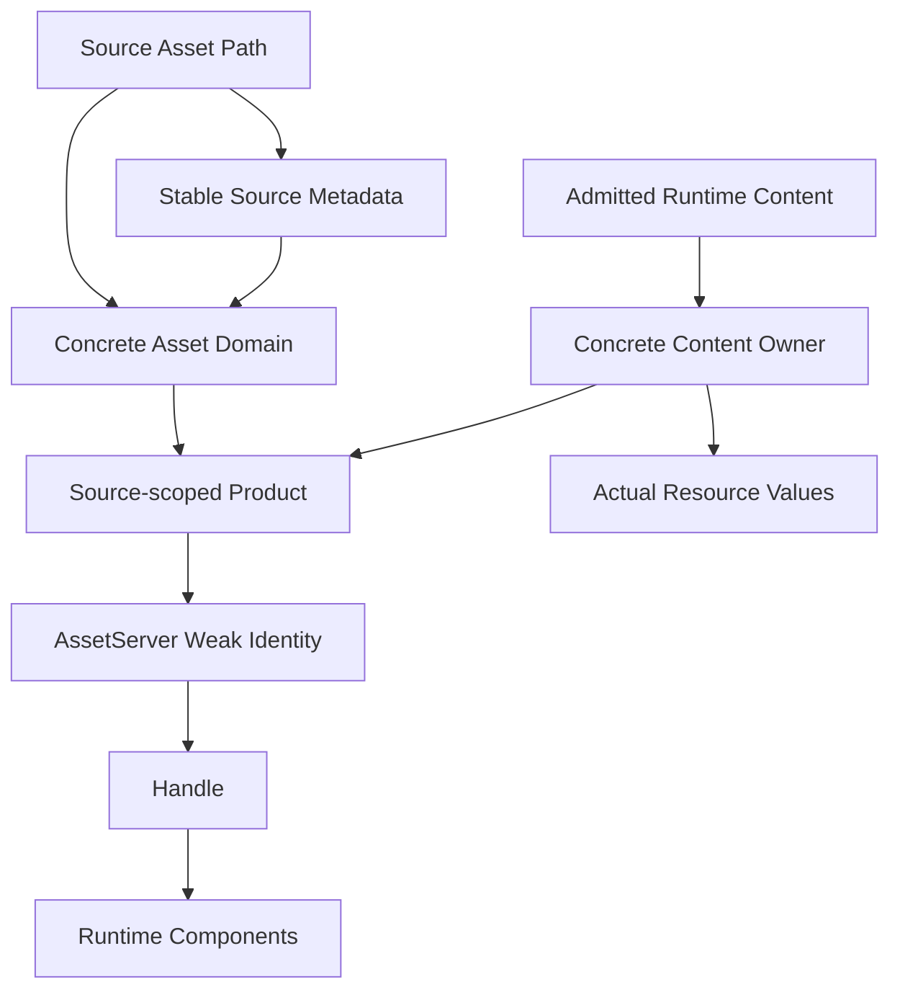

# ADR 0007: Asset Identity and Import Pipeline

**Status**: Accepted
**Date**: 2026-07-08
**Last Revised**: 2026-10-29
**Refined By**: ADR 0049: Untrusted Project Input and Parse Budget Policy; ADR 0050: Asset Root,
Symlink, Junction, and Package Trust Policy; ADR 0051: Persistent File Envelope, Migration, and
Golden Fixtures; ADR 0080: Domain-Owned TaskUpdate Integration Sets;
[ADR 0103](0103-concrete-domain-owned-asset-import-execution.md): Concrete Domain-Owned Asset
Import Execution;
[ADR 0122](0122-scoped-imported-product-identity-and-authored-continuity.md): Scoped Imported
Product Identity And Authored Continuity

## Context

nara scenes and prefabs need stable references to textures, audio, tilemaps, scripts, prefabs, and future meshes/materials. Asset identity affects hot reload, import caches, AI-generated scene data, editor workflows, and package portability.

Authoring source paths, stable source identity, imported products, runtime handles and resource
residency have different equality and authority. Processed Runtime consumption cannot depend on
reconstructing authoring paths or metadata merely to resolve an already admitted product.

## Decision

nara uses **typed process-local handles with complete source-scoped Product identity**.

`AssetProductRef` binds a non-nil stable source and explicit primary/auxiliary product ID under
ADR 0122. `AssetServer` owns that Product-to-runtime-ID relation. Source paths are authoring aliases
of primary products. A Runtime content owner can bind admitted products without source metadata;
resolving an unknown Product never invents a runtime identity or claims resource residency.

Core rules:

- User code and scene data refer to assets through typed `Handle<T>` or serialized asset references, not raw filesystem access.
- Runtime `AssetId` allocation is process-unique, checked, monotonic, and never reused or wrapped.
  `AssetServer` clones are isolated catalogue snapshots: existing bindings are copied, while new
  allocations from divergent snapshots remain distinct. Allocator progress is not persistent
  asset identity and does not participate in catalogue equality.
- One complete Product identity has at most one Rust asset type per catalogue. Explicit source-record
  identity reservation may create an unclaimed ID; typed reservation or `AssetServer::claim` establishes
  the type. Incompatible claims reject before changing bindings. Catalogue equality includes
  type claims and anonymous identities, so rejected staged work cannot publish them.
- Runtime IDs and typed handles have no public raw constructor or retype operation.
  `AssetServer::get_handle` retrieves an existing matching claim. Render domains may allocate
  fresh anonymous typed identities without source-catalog membership; these are neither
  residency leases nor GPU ownership authority.
- Source-record binding validates its actual path and primary Product before adding either alias.
  Stable-source helper lookups mean primary only; reverse conversion preserves auxiliary products
  and primary products without source paths. Nil source records reject before binding.
- A concrete owner can reserve complete products; native Runtime resolution looks up existing
  bindings and checks type agreement. Actual product membership, codec compatibility, values and
  publication remain the concrete content owner's responsibility.
- Hot reload changes asset versions behind stable handles; it should not require all scenes to rewrite references.
- Source assets and imported artifacts are distinct concepts.

## Alternatives Considered

### Option A: Path-only identity forever

**Pros**: Simple, human readable, easy for AI to generate.

**Cons**: Rename/move breaks references; import cache identity is fragile; editor workflows become difficult.

**Decision**: Rejected as a long-term model.

### Option B: Source UUID As The Only Stable Product Key

**Pros**: Stable primary references and source rename continuity.

**Cons**: Cannot distinguish a source's auxiliary products; retaining a source database as the
only native handle resolver couples processed Runtime loading to authoring metadata.

**Decision**: Insufficient for the complete product model.

### Option C: Complete Product Identity With Source Aliases (Chosen)

**Pros**: Distinct source/product/runtime identities, authoring aliases and source-independent
typed Runtime bindings share one catalogue and transaction baseline.

**Cons**: The content owner must separately admit actual product membership and resources;
weak handle identity alone cannot authorize loading or residency.

**Decision**: Chosen.

## Consequences

- `AssetRef` in scene data supports path and stable source forms. [ADR 0122](0122-scoped-imported-product-identity-and-authored-continuity.md)
  adds a complete source-scoped product form through the same asset-reference Schema leaf.
  Source-only resolution does not prove that the selected product exists, and primary-only
  source consumers refuse auxiliary selection. Complete Runtime Product bindings support explicitly
  admitted primary and auxiliary resources without a source database.
- `Handle<T>` should remain stable across reloads; asset data may carry an internal generation/version.
- Import cache design is deferred but not ignored.
- Asset loading can begin synchronous/path-based, but the API must allow asynchronous load states later.

## Implementation Notes

- `nara_asset` now separates persistent identity (`AssetRef`, `AssetPath`, `StableAssetId`,
  `AssetProductRef`, `.meta`, and `ProjectAssetDatabase`) from runtime identity (`AssetId`,
  `Handle<T>`, and `AssetVersion`).
- Runtime IDs come from one checked process allocator. A discarded staged catalogue may consume an
  opaque ID, but it cannot publish a binding, value, state, or event; later work never reuses that
  ID. Equality for catalogue snapshots compares Product/path bindings and type claims, not allocator
  progress. Source-bound runtime IDs and detached render identities share that allocator.
- Source changes enter asset loading through `AssetSourceChanges` and `SourceChangeResolver`.
  The resolver coalesces source changes, maps `.meta` updates to source assets, walks source
  dependency edges, and emits `AssetReloadRequest` values.
- Same-frame source changes coalesce by logical path with the last semantic event winning. This keeps
  atomic-save sequences such as remove-then-modify from being permanently interpreted as deletion.
- Dependency-triggered reload walks source dependency edges transitively with de-duplication, so a
  changed source can enqueue directly and indirectly dependent runtime assets.
- Asset reload requests carry `AssetLoadGeneration` values. Apply systems must ignore stale task
  results when a newer generation has been requested for the same asset.
- Domain apply systems also check the request's expected `AssetVersion` before committing successful
  first-load results or failure states. Generations reject superseded requests; expected versions
  reject older task completions after any other state mutation advanced the asset.
- Concrete asset domains own their complete import transaction and use owned, domain-specific task
  inputs and typed results. The Image domain accepts immutable bytes or a Host-authorized file
  capability, applies its own budgets, and produces backend-neutral CPU image data without
  allocating GPU resources.
- `AssetPlugin` installs the asset resources, configures the chained `AssetTaskUpdateSet` ordering,
  and runs source-change resolution in `AssetTaskUpdateSet::ResolveSourceChanges`. Domain plugins
  claim their concrete reload-consumer authority and join the asset-owned spawn/apply phases. As
  refined by ADR 0103, `nara_asset` exposes no generic importer registry or erased decoder executor.

## Success Metrics

| Metric | Target | Measurement |
|---|---:|---|
| Typed handles | Asset references are typed in Rust APIs | API review |
| Complete identity | Primary/auxiliary and enclosing source survive native binding and export | Public source/Runtime consumers |
| Reload stability | Handle identity survives asset content reload | Future test |
| Source/artifact split | Import cache can be added without changing source asset references | Design review |
| AI usability | JSON scene can still express readable asset references | Example scene |

## Risks and Mitigations

| Risk | Severity | Likelihood | Mitigation |
|---|---|---:|---|
| Path-first leaks into stable file format | High | Medium | Define `AssetRef` as an enum-like semantic model, not just `String` |
| Product binding mistaken for admission | High | Medium | Require actual content-owner membership, codec and resource checks separately |
| Hot reload invalidates handles | High | Medium | Separate handle identity from loaded asset version |
| AI emits broken paths | Medium | High | Validate asset references before instantiation |

## Follow-Up Questions

- Which concrete import inputs and target facts belong in each artifact recipe identity?
- Which additional content families qualify source-independent Runtime preparation and publication?
- What project-level diagnostics should be emitted for repeatedly failing hot reloads?

## Citations

- Scene/prefab decision: [0006-scene-and-prefab-data-model.md](0006-scene-and-prefab-data-model.md)
