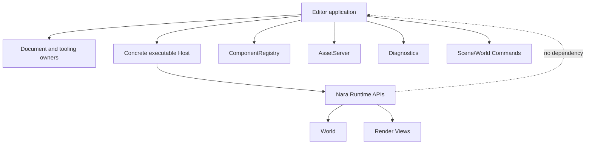

# ADR 0015: Editor, Tooling, and Dogfooding Boundary

**Status**: Accepted
**Date**: 2026-07-08
**Last Revised**: 2026-10-23
**Refined By**: ADR 0044: Root Facade and Prelude Layering Policy; ADR 0045: Component Schema
Capability Metadata; ADR 0047: Editor Workspace and Scene Document State; ADR 0095: Plugin-Owned
Specialized Domains and Project Configuration;
[ADR 0101](0101-ordered-persistent-placement-and-runtime-projection.md): Ordered Persistent
Placement and Runtime Projection;
[ADR 0104](0104-host-owned-editor-workspace-installation.md): Host-Owned Editor Workspace
Installation; [ADR 0118](0118-editor-workspaces-frontends-and-creation-templates.md): Editor Workspaces, Frontends, and Creation Templates
**Related Design Draft**: [UI Product Boundaries, Editor Dogfooding, and Porting
Strategy](../ui-product-boundaries-editor-dogfood-and-porting-strategy.md)
**Implementation Plans**: [Editor Authoring Loop v1](../../plans/2026-08-08-003-feat-editor-foundation-workflow-plan.md); [Editor Game View v1](../../plans/2026-08-16-2157-feat-editor-game-view-v1-plan.md)
**Implementation Evidence**: [EFI-U5 Editor authoring-loop
conformance](../../knowledge/engineering/verification/2026-08/2026-08-15T233000Z-efi-u5-editor-authoring-loop-conformance-b1cd751875db4d91958a0fb9e609a04d.md),
[EGV-U5 embedded Game View product conformance](../../knowledge/engineering/verification/2026-08/2026-08-17T100847Z-egv-u5-embedded-game-view-product-conformance-9d0b0a17beef4c39bea70a8d6f025455.md)

## ADR 0095 Refinement

Toolkit-neutral tooling models and commands are a product boundary, not proof that complete editor
toolkits are interchangeable. One panel implemented in a second toolkit proves only that panel's
model/command separation. A reusable toolkit Adapter or replacement Editor Shell needs evidence
for the workflows and native capabilities it claims. A second implementation is useful evidence
for sharing or portability, not a prerequisite for a first concrete owner API or semantic-tool tracer.

## ADR 0118 Refinement

[ADR 0118](0118-editor-workspaces-frontends-and-creation-templates.md) owns the private frontend/application split, stable panel instances, layout preferences, independent render views and controlled secondary-window delegation.
Its original direct dear-imgui-rs 0.20.0 study is historical research. Dear ImGui is the currently
selected Editor frontend; the [implementation ledger](implementation-status.md) records the
actual migration and qualification scope. Toolkit selection is not evidence for untested native
platforms, OS IME candidate windows, accessibility or additional extension facets.

## Context

Nara's Editor validates the engine experience without making gameplay logic depend on Editor UI.
It is both an authoring client and an executable Runtime Host: document editing, runtime
construction and native lifecycle are different responsibilities within the integrated product.
Runtime/game UI and editor/tool UI serve different products. Permanent toolkit separation is a
legitimate design; shared fundamentals require concrete consumer evidence rather than an assumed
future common retained implementation.

The user wants nara to grow into a mature engine and asked whether the future editor UI should dogfood nara's own engine UI.

## Decision

The Editor is an **authoring client and executable Runtime Host**, not the owner of gameplay logic.
Its concrete Host constructs, drives and retires trusted in-process runtimes and supervises ordinary
external Play through the distinct placements in ADRs 0082/0084/0116/0117. Authoring and toolkit
code do not thereby gain unrestricted World, process or native-service authority.

Dogfooding policy:

- Runtime/game UI and editor/tool UI are separate product layers. They may share narrow services or
  proven text/semantics/rendering fundamentals, but neither product requires a shared widget tree,
  authoring model or toolkit, now or eventually.
- The editor should dogfood nara runtime concepts: ECS world inspection, scene/prefab data model, asset handles, render views, diagnostics, and command/patch application.
- The editor should dogfood nara rendering where practical, especially viewport rendering, gizmos, overlays, scene preview, and in-engine debug panels.
- Dear ImGui is the selected Editor frontend. egui belongs to the historical authoring baseline.
  A future Nara UI panel is optional, not a required milestone or an implied convergence decision.
  Success with one panel proves that panel's tooling-model/command separation, not complete toolkit
  replaceability or ecosystem parity.
- Docking, panel catalogs, workspace layout, and detached-window intent belong to the Editor Shell.
  Event-loop, native-window, surface, and GPU submission authority remain with the selected
  platform/window and render-execution authorities. ADR 0118 permits explicit Host delegation to
  the selected platform/renderer adapter; ordinary panel contributions never gain that authority.
- Runtime crates must not depend on editor crates.
- Editor mutations should go through explicit commands/patches and validation, not direct private storage access.
- UI adapters should render UI-agnostic tooling models and submit tooling commands. They should not
  own scene mutation semantics.
- Domain draft basis, validation and exact results remain UI-neutral. The frontend owns invalid
  text, caret, selection, composition and scrolling; the Host/platform owns window/seat focus,
  capture, clipboard and native IME arbitration. Editor controls need not route through game ECS
  actions, and IME preedit is not a document mutation.

### Semantic tools and qualification

An independent semantic tool can use the selected Dear ImGui panel or a window-free project
session to plan a currently legal patch, preview its intent, submit through the document owner,
and observe the exact action result, Undo and Save/Reopen. Ordered actions are not an atomic
transaction; a cohesive edit must use an already admitted atomic patch. A tool preview does not
claim a public owner-held prepared candidate, selection-independent query API or new mixed
structural transaction. Those extensions require their own scoped contracts and evidence.

Keep queries and semantic proposals with their domain owners and frontend facets optional; do not
introduce a universal Automation service or Widget trait. A pure semantic tracer need not wait for
complete Nara UI, native accessibility parity or an installable-package product. Public API,
native input/rendering and platform claims remain separately qualified under ADR 0014.

## Historical Implementation Evidence

The following notes describe the 2026-08-15 authoring slice, not the current frontend or a universal
single-window topology. ADR 0118 and the implementation ledger own later frontend/view evidence:

- `nara_tooling::SceneInspectorState` remains the UI-agnostic inspector controller while
  `EditorWorkspace` owns document identity, selection, history, dirty state, and exact mutation
  authority.
- `SceneInspectorModel` combines authoring entity rows, selected component schema fields,
  `ComponentSchemaCatalog`, `WorldSnapshot`, undo/redo status, live dirty state, and diagnostics.
- `SceneInspectorCommand` converts selected field and ordered placement edits into
  `ScenePatchDocument` transactions applied through `SceneAuthoringSession`.
- The private `nara-editor` application owns one native Winit window and its egui/WGPU lifetimes,
  consumes one immutable `EditorFrameModel`, and returns only ordered UI-neutral actions.
- The first bounded authoring trajectory proves exact edit, stale rejection, Undo/Redo,
  receipt-backed Save, Close/Reopen/Close, project check, generated-product run, and
  source-carrying export against the same starter source change.
- That slice established the semantic model/action seam rather than a requirement to build a
  Nara UI Inspector or another document/persistence state machine.
- This evidence is an authoring-slice conformance baseline, not the complete Editor
  Product-Validated Baseline; Viewport, IME, semantic output, and native accessibility remain
  focused successors.

The current responsibility split is:

## Alternatives Considered

### Option A: Editor owns runtime state directly

**Pros**: Fast editor development.

**Cons**: Couples runtime to editor assumptions and weakens code-first philosophy.

**Decision**: Rejected.

### Option B: Build editor UI only with nara UI from day one

**Pros**: Maximum dogfooding.

**Cons**: Blocks editor progress on a mature UI system that does not exist yet.

**Decision**: Rejected for early phases.

### Option C: Authoring client and Runtime Host with independent UI products (Chosen)

**Pros**: Validates runtime mechanisms while allowing pragmatic UI tech choices.

**Cons**: Requires explicit semantic actions and Host handoffs; separate toolkits can duplicate
some implementation work.

**Decision**: Chosen.

## Success Metrics

| Metric | Target | Measurement |
|---|---:|---|
| Dependency direction | Runtime crates do not depend on editor crates | Dependency review |
| Runtime dogfooding | Editor uses real scene/asset/diagnostic APIs | Code review |
| Safe mutation | Editor changes flow through commands/patches with validation | `scene_inspector` and `scene_authoring_session` tests |
| UI flexibility | A complete panel can use another adapter without changing its tooling model, commands, validation, or undo semantics | Cross-adapter fixtures and architecture review |
| Host authority | Native ownership is Host-controlled, including explicitly delegated adapter ownership; panels cannot create competing authority | Dependency/API audit and Host integration tests |
| Semantic tool independence | A current legal edit, exact result, Undo and persistence can be exercised without complete Nara UI | Scoped panel or window-free consumer tests |
| Viewport fidelity | Editor view uses same render backend path as runtime where practical | Future integration test |

## Risks and Mitigations

| Risk | Severity | Likelihood | Mitigation |
|---|---|---:|---|
| Editor becomes a separate engine | High | Medium | Force editor to use runtime APIs and diagnostics |
| UI dogfooding slows core runtime | Medium | Medium | Keep the selected Dear ImGui frontend independent of Runtime UI completion |
| Premature toolkit convergence pollutes game UI or editor delivery | High | Medium | Allow permanent separation and share only fundamentals justified by concrete consumers |
| Editor needs private access | High | Medium | Add explicit inspection/patch interfaces instead of breaking encapsulation |

## Consequences

The application and toolkit adapter must coordinate without sharing document mutation ownership.
ADR 0118 permits breaking private frontend interfaces and removing superseded production paths
after matching parity qualification. Historical egui evidence retains only its recorded scope.
Widgets and toolkit layout remain replacement work; the reusable contract is semantic authoring
and Host-owned lifecycle, not a universal UI abstraction or mandatory toolkit convergence.
