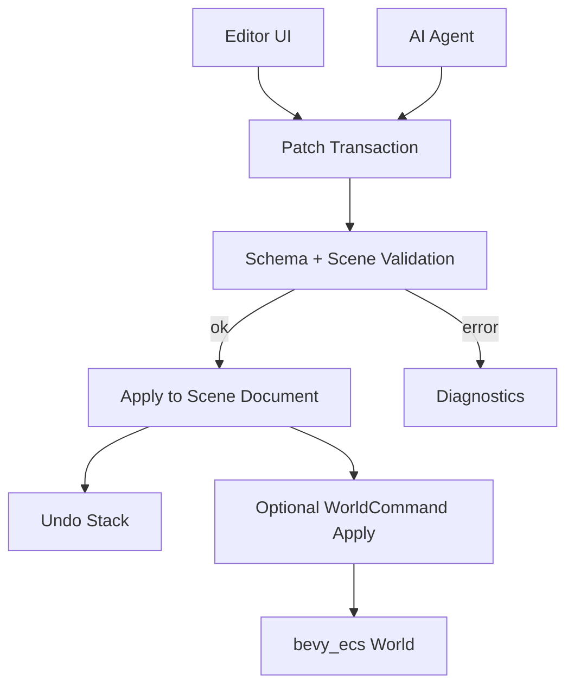

# ADR 0026: Editor Command, Patch, and Undo Model

**Status**: Accepted
**Date**: 2026-07-08
**Last Revised**: 2026-10-18
**Amended**: 2026-08-15 to require exact mutation preconditions and independently bounded,
branch-aware authoring history
**Refined By**: ADR 0043: Scene, Prefab, and Patch Document Migration Policy; ADR 0047:
Editor Workspace and Scene Document State;
[ADR 0101](0101-ordered-persistent-placement-and-runtime-projection.md): Ordered Persistent
Placement and Runtime Projection; [ADR 0104](0104-host-owned-editor-workspace-installation.md):
Host-Owned Editor Workspace Installation

## Context

nara's editor is a client of runtime APIs. Scene/prefab files are data documents with stable `SceneEntityId` values, component schema IDs, diagnostics, and validation. AI agents should also be able to modify scenes and prefabs safely.

The missing layer is a consistent authoring mutation model:

```text
Editor / AI operation -> patch/command -> validate -> apply -> undo/redo -> diagnostics
```

## Decision

nara authoring tools will use **validated patch transactions** for scene/prefab editing and **deferred world commands** for runtime world mutation.

Rules:

- Editor and AI tools do not mutate private ECS storage directly.
- Scene/prefab edits are represented as `ScenePatch` operations over stable document IDs.
- Runtime world edits are represented as `WorldCommand` operations applied at explicit schedule boundaries.
- Undo/redo is built on patch transactions.
- Every workspace document mutation, Undo, and Redo carries an exact document identity and base
  `SceneAuthoringRevision`. Missing or stale preconditions reject before the document, selection,
  history, or dirty state changes.
- `SceneAuthoringSession` admits inverse history against fixed per-session record,
  operation-equivalent structural-item, value-node, and logical-byte ceilings before document
  publication. Embedded entity records, child edges, component records, nested patch operations,
  and their stable identifiers are charged rather than hidden inside one compound operation. Undo
  and Redo share the same retained budget, and total pressure evicts only the oldest eligible Undo
  records.
- Revisions remain monotonic conflict identities. A separate opaque content-state identity follows
  Undo, Redo, and divergent branches so returning to saved content does not require document
  hashing or revision rollback.
- Diagnostics are returned for validation and application failures.
- Patch paths are stable and schema-aware: `SceneEntityId + ComponentTypeId + field path`.
- Patches should be serializable so AI tools, editor UI, and tests can share the same mutation format.



## Patch Model

Implemented Rust types:

```text
ScenePatchDocument
  operations: Vec<ScenePatchOperation>

ScenePatchOperation
  AddEntity { entity, placement }
  RemoveEntity { entity, from }
  RestoreEntity { entity, descendants, placement }
  AddComponent { entity, component, value }
  RemoveComponent { entity, component }
  ReplaceComponent { entity, component, value }
  SetField { entity, component, component_version, field, value }
  RemoveField { entity, component, component_version, field }
  MoveEntity { entity, from, to }
  SetAssetRefField { entity, component, component_version, field, asset_ref }

ScenePlacement
  owner: Root | Parent { parent }
  anchor: First | Last | Before { sibling } | After { sibling }
```

Patch operations serialize as `op + args` so JSON and RON roundtrip with the same semantic shape.
Payloads use `ComponentValue`, stable `ComponentTypeId`, and structured `ComponentFieldPath`.

Implementation notes as of 2026-07-08:

- Patch apply is document-first and atomic: operations are applied to a scratch `SceneDocument`,
  validated, canonicalized, then committed only if the full transaction succeeds.
- Operation-local path, schema, owner, version, capability, topology and work-budget checks apply
  to each intermediate candidate. Component business invariants and native document preflight
  apply to the canonical final candidate, allowing coupled field edits whose intermediate values
  are temporarily inconsistent. A final rejection publishes no document, revision or history.
- The same validation boundary applies to Scene and Prefab transactions. A private consumption-only
  helper may mutate a disposable unpublished candidate before failure; it is not an alternative
  mutation path for a published document or authoring session.
- Patch diagnostics include operation index plus entity/component/field context when available.
- Successful patch apply returns an inverse `ScenePatchDocument` for transaction-level undo.
- Ordered add, move, remove, and restore operations share `ScenePlacement`; source placement is an
  explicit precondition rather than inferred mutable context.
- `RemoveEntity` removes the subtree and returns one `RestoreEntity` inverse containing the exact
  root record, descendant records, and prior placement. Delete and restore therefore consume the
  same bounded validation-work shape instead of expanding one deletion into many intermediate
  operations.
- `RemoveField` is only allowed for optional fields or fields with registered defaults.
- Prefab overrides reuse `ScenePatchDocument`; overrides are applied relative to source prefab IDs
  before prefab expansion namespaces them.
- `SceneAuthoringSession` wraps a `SceneDocument`, records admitted inverse patches with their
  two-way history cost and content-state transition, tracks whether its live projection is dirty,
  and exposes sync methods for plain scenes, asset-aware scenes, and prefab-resolved scenes.
- The first live sync implementation is rebuild-style: spawn the current document projection,
  reject it if diagnostics contain errors, then despawn only the previous entities owned by the
  session. Unrelated runtime entities are preserved.
- Incremental `WorldCommand` synchronization remains a later optimization. Spawning still
  preflights expanded documents before mutating the ECS `World`.

## Undo / Redo

Undo/redo should be transaction-based:

- A user action creates one transaction.
- The editor/session stores inverse patches generated by successful patch application.
- Multi-operation edits must undo atomically.
- Failed patches do not enter undo history.
- Diagnostics should identify the failed operation and field path.
- History cost reserves the maximum of the forward and inverse patch for structural items, value
  nodes, and logical bytes. A patch that cannot retain its inverse rejects before publication.
- Undo and Redo move one admitted record between stacks without allocating another history budget.
- Clearing or evicting inverse records never changes the current content-state identity.

## Continuous Interaction Transactions

Long-running slider, gizmo, curve, drag, and text-composition edits use one toolkit-neutral
authoring transaction:

```text
Begin -> bounded Preview* -> Commit(one patch + inverse) | Cancel
```

- `Begin` captures stable targets, the base document revision, authorization scope, and restorable
  state.
- `Preview` updates are bounded and cancellable. They create no undo entries and do not become
  persistent document commits.
- `Commit` emits exactly one validated atomic `ScenePatchDocument` plus its inverse through the
  normal workspace command path.
- Explicit cancel, pointer-capture or focus loss, window/tool close, target deletion, and revision
  conflict must restore, reject, or report the transaction explicitly. None may silently commit a
  partial preview.
- First-party and third-party tools use the same command/validation path.

This decision does not select a public gesture trait, toolkit event model, preview storage format,
or edit-while-playing merge policy.

## Alternatives Considered

### Option A: Editor mutates ECS World directly

**Pros**: Fast to prototype.

**Cons**: Hard to validate, serialize, undo, replay, or share with AI tools.

**Decision**: Rejected.

### Option B: Editor mutates scene files directly with ad hoc JSON/RON edits

**Pros**: Simple file-level editing.

**Cons**: Weak schema validation and poor undo/redo semantics.

**Decision**: Rejected.

### Option C: Validated patch transactions (Chosen)

**Pros**: Supports editor, AI, diagnostics, undo/redo, tests, and future collaboration.

**Cons**: Requires a real patch data model and validation layer.

**Decision**: Chosen.

### Option D: Commit every preview and rely on toolkit-specific merge behavior

**Pros**: Individual widgets can implement dragging with their native undo facilities.

**Cons**: Undo history becomes frame-rate dependent, cancellation and revision conflicts diverge by
toolkit, and third-party tools bypass the document transaction authority.

**Decision**: Rejected. Continuous interaction is authoring semantics, not a widget implementation
detail.

## Consequences

- `nara_editor` should operate on scene/prefab documents through patch transactions.
- Runtime commands and authoring patches are related but not identical.
- Scene validation and component schema systems must support field paths and typed values.
- Hot reload and conflict handling can reuse patch diagnostics and validation.
- AI agents can propose patches instead of rewriting entire scenes blindly.
- GUI and AI mutations share the same exact document/revision precondition and typed stale-target
  rejection.
- History memory is bounded independently of serializer output, while content equality with a
  saved checkpoint survives history eviction.
- Continuous UI gestures produce one document commit and one inverse regardless of preview rate or
  UI toolkit.

## Success Metrics

| Metric | Target | Measurement |
|---|---:|---|
| Safe editing | Editor changes do not require private World access | Code review |
| Undo support | Multi-operation transaction can undo atomically | `scene_patch_transactions` and `scene_authoring_session` tests |
| AI compatibility | AI can emit JSON/RON patches and receive diagnostics | `scene_patch_roundtrip` example and patch diagnostics |
| Stable paths | Patch paths use `SceneEntityId`, `ComponentTypeId`, and `ComponentFieldPath` | Schema and patch tests |
| Validation | Invalid field edits fail before apply | patch and prefab override no-mutation tests |
| Live projection safety | Authoring sync does not remove unrelated runtime entities | `scene_authoring_session` tests |
| Exact mutation authority | Wrong-document and stale-revision actions reject before authoring state changes | Tooling workspace tests |
| Bounded history | Record, operation, value-node, and logical-byte ceilings reject or evict deterministically without changing current content state | `scene_authoring_session` tests |
| Continuous edit atomicity | A slider or gizmo sequence produces exactly one patch and inverse; every cancellation/conflict path leaves no partial document write or extra undo entry | Continuous transaction fixture |

## Risks and Mitigations

| Risk | Severity | Likelihood | Mitigation |
|---|---|---:|---|
| Patch model becomes too complex | Medium | Medium | Keep operations document-level and schema-aware; defer list splice and incremental live-world sync |
| Field paths break on schema migration | High | Medium | Run component migrations during scene/prefab preflight and version patch payloads if needed |
| Undo data is too large | Medium | Medium | Admit each two-way inverse against fixed operation/value ceilings and evict oldest Undo records under total pressure |
| Runtime command and scene patch diverge | Medium | Medium | Keep explicit conversion paths and tests |
| Continuous gestures add one undo record per preview | High | High | Keep previews outside undo history and commit one validated patch at the end |
| Lost focus or a deleted target leaves a partial edit | High | Medium | Make every interruption an explicit cancel/reject path tied to the base revision and stable targets |

## Remaining Follow-Up Questions

- How are patches versioned across component schema migrations?
- How does hot reload merge external file changes with editor undo history?
- What is the minimum patch op set for the first inspector?
- Which accepted patch operations deserve specialized incremental `WorldCommand` paths before
  rebuild-style projection becomes too expensive?

## Citations

- Scene/prefab data model: [0006-scene-and-prefab-data-model.md](0006-scene-and-prefab-data-model.md)
- Diagnostics decision: [0009-diagnostics-errors-and-logging.md](0009-diagnostics-errors-and-logging.md)
- Editor/tooling boundary: [0015-editor-tooling-and-dogfooding-boundary.md](0015-editor-tooling-and-dogfooding-boundary.md)
- Event/command model: [0023-event-message-and-command-model.md](0023-event-message-and-command-model.md)
- Godot undo merge semantics: `repo-ref/godot/core/object/undo_redo.h`
- Godot editor undo manager: `repo-ref/godot/editor/editor_undo_redo_manager.h`
- Implementation plan: [Editor Authoring Loop v1](../../plans/2026-08-08-003-feat-editor-foundation-workflow-plan.md)
