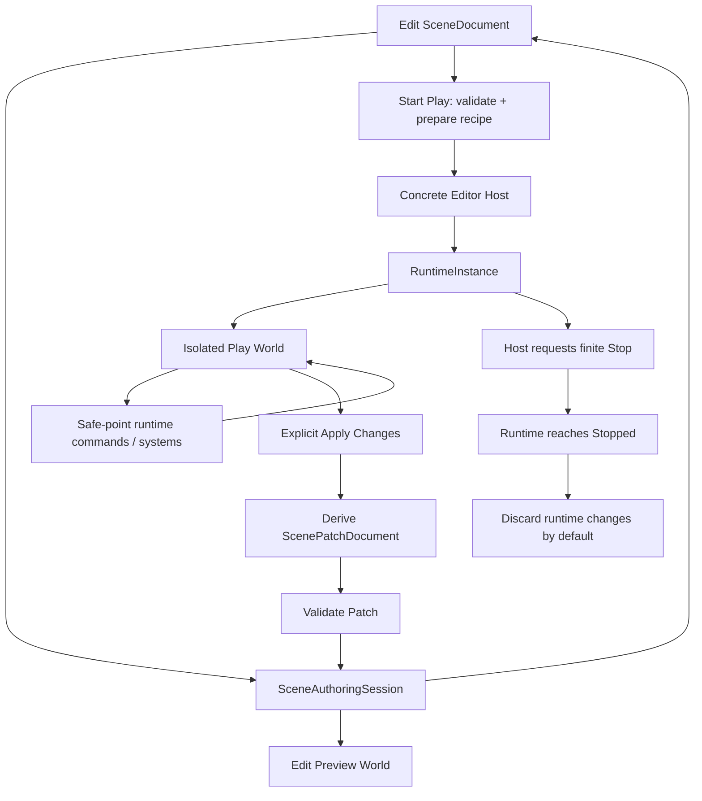
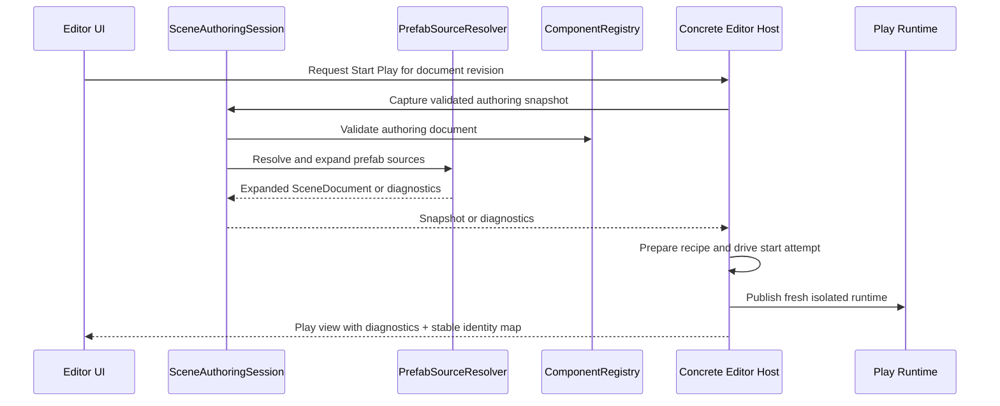
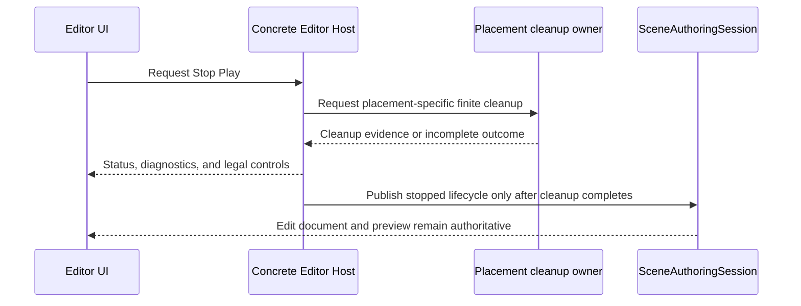
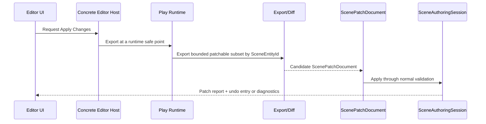

# ADR 0034: Editor Play Mode World Boundary

**Status**: Accepted
**Date**: 2026-07-08
**Last Revised**: 2026-10-23
**Refined By**: ADR 0047: Editor Workspace and Scene Document State; ADR 0058: Stable Runtime
Identity and Entity References; ADR 0076: Play Runtime Debug Control and Observation
**Current ownership and deployment**:
[ADR 0082](0082-process-host-authority-and-runtime-construction-topology.md): Process Host Authority;
[ADR 0084](0084-executable-runtime-ownership-and-isolation.md): Executable Runtime Ownership;
[ADR 0116](0116-standalone-supervised-editor-play.md): Standalone Supervised Editor Play;
[ADR 0117](0117-2d-foundation-ownership-and-authoring-contracts.md): Managed Execution and Authoring

## Context

The authoring stack separates persistent data from live projections:

- `SceneDocument` / `PrefabDocument` as persistent scene data.
- `ScenePatchDocument` as the editor/AI mutation format.
- `SceneAuthoringSession` as document-as-truth authoring state with undo/redo and live world
  projection.
- `SceneInspectorState` as a UI-agnostic inspector controller.

Play must separate authoring state from runtime simulation while keeping iteration useful. The
Editor is both an authoring client and an executable Runtime Host. Its trusted in-process placement
and ordinary supervised external placement have different source and control contracts, but neither
may silently turn transient runtime state into authoring data.

The core question:

```text
When the user presses Play, which World is running, and what can write back to the SceneDocument?
```

## Decision

nara will use **isolated Play Mode worlds**.

The editor has three distinct state categories:

1. **Edit document**: the authoritative `SceneDocument` / `PrefabDocument` plus undo/redo stacks.
2. **Edit preview world**: a live projection owned by `SceneAuthoringSession` for inspection,
   gizmos, preview rendering, and debug tooling.
3. **Play world**: a separate runtime `World` in an isolated executable Runtime. Its source is an
   explicitly admitted document snapshot for trusted in-process Play, or admitted saved source
   for ordinary external Play. These placements are not interchangeable fallbacks.

Rules:

- The edit document is the only persistent authoring truth.
- The edit preview world is disposable. It can be rebuilt from the edit document at any time.
- The Play world has its own World/runtime identity and generation. Numerically equal ECS `Entity`
  values in different Worlds are not shared identity or a persistence bridge.
- A Play request admits the exact source and executable composition for its placement before
  publishing a fresh runtime generation. Snapshot Play is not the ordinary external-Play source rule.
- The concrete Editor Host owns trusted in-process start attempts, published runtimes and
  stop-first replacement intent under Accepted ADRs 0082/0084, refined by ADR 0117. Under ADR 0116,
  the Editor supervises the external build/generation/process lifecycle while the child owns its
  executable Runtime. `nara_tooling` and frontends retain UI-neutral commands, views and results,
  not a competing live-runtime owner or unrestricted World/process authority.
- Pressing Stop discards the isolated Play world and runtime changes by default through finite
  shutdown with retained incomplete-shutdown ownership.
- Where a placement supports it, runtime changes write back only through an explicit **Apply Changes**
  operation that produces `ScenePatchDocument` values and runs the normal patch validation/undo
  path.
- Editor UI must show placement, mode and pending/fault/cleanup state honestly. Pause, Resume and
  Step are available only where the placement supports them; ADR 0116's external placement does not.
- Authoring Inspector commands target the document owner, including while an external child runs.
  Runtime Inspector commands, where supported by the placement, target runtime/debug surfaces and
  are not persistent unless converted into explicit scene patches.
- Save games remain separate from scene authoring data. Play Mode runtime state should not silently
  become scene data.

The following diagram describes the trusted in-process placement, not ordinary external Play.
RGF-U17 supplied the historical trial; RGD-U7 accepted the bounded Host/runtime ownership in
ADRs 0082/0084. Apply Changes is an explicit capability, not an automatic Stop effect.



## Source and Placement Admission

| Placement | Source authority | Execution and completion |
|---|---|---|
| Trusted in-process preview/Game View | Exact validated document snapshot, source revision and compiled composition | Concrete Editor Host owns isolated Runtime lifecycle; presentation/input follow the selected embedded-view contract |
| Ordinary external Play | ADR 0116's complete saved-source receipt and exact profile declaration | Editor supervises an immutable executable generation; child owns Runtime/window; Running requires first-present READY |

Ordinary project Open remains data-only and does not authorize loading project Rust into the
Editor. An external Play request never silently launches an unsaved document snapshot or falls
back to trusted in-process execution. Unsaved edits do not redefine saved-source identity.
Restart readmits actual saved source and requires receipt equality before retiring a running
child. Source divergence leaves the running generation intact and rejects Restart; explicit Stop
followed by Play targets current saved source. Build success alone is not Running or last-good.

Trusted snapshot preview must validate its own exact source/catalog and runtime admission; data
authoring success is not native readiness. Neither source placement implies that external live
edit, runtime inspection, frame transport or Apply Changes is available. ADR 0116 deliberately
adds no post-start command channel.

## Mode Model

Conceptual state:

```text
EditorMode
  Edit
  Play { placement, source_basis, runtime_generation, supported_controls }
```

This is a conceptual model, not a new public type. Trusted snapshot source basis includes the
document incarnation/revision; external basis uses its admitted saved-source receipt. Lifecycle
projections also retain preparation, faults and incomplete cleanup rather than reducing them to
`Edit`, `Play` and `Paused` labels alone.

Trusted in-process ownership and observation:

- `nara_scene::SceneAuthoringRevision` is the source revision stamp.
- `nara_tooling::EditorPlayCommand` and `EditorPlayView` expose UI-neutral lifecycle control/status.
- Root `EditorProjectSession` owns preparation, the unpublished start attempt, published runtime,
  controls, close evidence, and retirement for the concrete product path.
- Runtime generation plus source revision bind runtime edit and Apply Changes requests without
  exposing runtime `Entity` values or a mutable `World` command surface.

These owners follow Accepted ADRs 0082/0084/0117. External placement uses ADR 0116's separate
value-only request/observation seam; it does not transfer a child Runtime into the Editor process.

Important invariants:

- A trusted snapshot runtime records its source document basis; an external generation retains
  its complete admitted saved-source receipt. Process-local tokens are not cross-process authority.
- Edit document patches made while Play is running do not automatically mutate the Play world.
- If nara later supports "edit while playing", those edits must be mode-aware commands with clear
  diagnostics rather than accidental shared-world mutation.
- Runtime-only components may exist in the Play world without appearing in the edit document.
- Persistent scene IDs (`SceneEntityId`) are the only durable bridge for deriving apply-back
  patches; runtime `Entity` values never cross the persistence boundary.

## Host-Owned Start Flow

### Trusted in-process placement

The historical RGF-U17 flow below uses the Accepted concrete Host/runtime ownership. Snapshot
capture here is not a requirement to save, or permission to load arbitrary project code.



Failure rules:

- If validation, prefab resolution, asset resolution, or spawn preflight reports errors, Play does
  not start.
- Failed Play start must not mutate the edit document, undo stack, or existing edit preview world.
- Diagnostics should identify scene entity IDs, component IDs, field paths, and asset references.

### Ordinary external placement

ADR 0116 owns the exact protocol: admit saved-source receipt and execution declaration, build,
publish an immutable executable generation, launch with a fresh child-only context, and accept
Running only after the matching first-present READY. The child performs strict compiled admission;
neither an Editor document preview nor successful Cargo completion can substitute for it. Pending
work and terminal outcomes retain their original request/generation identity. Dispatch success
does not report eventual Play completion.

## Host-Owned Stop Flow

Stop discards transient Play state by default and never writes it into the edit document. The
trusted in-process owner requests finite runtime close at a safe point. The external owner uses
ADR 0116's platform-specific process/pipe cleanup; no runtime safe-point command is implied there.
Both retain incomplete physical custody and prevent conflicting replacement while cleanup is
incomplete. A Stop dispatch is not a successful cleanup receipt.



Default Stop never writes runtime state back to the edit document.

## Apply Changes Flow

Apply Changes is explicit and conservative in the trusted in-process placement. It exports a
bounded schema-aware subset at a generation-stamped safe point and submits a candidate patch
through the document owner. This is not a feature of ADR 0116's ordinary external placement and
does not establish an IPC, universal Automation service or generic runtime-session API.



Rules:

- The trusted in-process slice supports a narrow Apply Changes subset: one selected
  `SceneEntityId` plus explicitly requested registered scene/edit-capable component IDs.
- Runtime access follows the existing generation-stamped safe-point boundary, not direct
  frontend/tooling World access. Export returns a candidate `ScenePatchDocument` without mutating
  the authoring session. The exact document owner validates and publishes revision, inverse and
  history through the normal authoring path; tools do not construct a second inverse authority.
- Apply Changes never copies raw runtime `Entity`, `AssetId`, backend handles, task handles, GPU
  resources, timers, or transient events into scene documents.
- Apply Changes must be component-schema-aware. Only components with scene and edit capabilities,
  or explicitly authoring-mapped components, can produce scene patches.
- Unsupported runtime changes, runtime-only components, missing entities, prefab-expanded entities,
  and duplicate component requests produce diagnostics instead of best-effort serialization.
- Supported no-op requests return no patch and do not create undo entries.
- Apply Changes enters undo history as normal patch transactions.
- Where admitted by the placement, Runtime Inspector editing is separate from Apply Changes.
  It submits a one-shot, generation-stamped component patch at a runtime safe point; later
  simulation may overwrite the value. A retained override layer would require separate
  lifetime/priority/clear semantics and is not implied by this ADR.
- If the document incarnation or revision changed after Play started, apply-back must detect the
  mismatch and either reject with diagnostics or require a merge UI. It must not silently overwrite edits.
- Whole-scene runtime diffing, field-level diff minimization, prefab override write-back, and
  edit-while-playing merge UI remain future work.

Historical evidence, 2026-07-09: the selected-entity / explicit-component subset first lived in
`nara_tooling`, with `SceneEditorState::export_apply_changes*` encoding via `ComponentRegistry` and
`ComponentEncodeContext` and `apply_changes*` using `SceneAuthoringSession`. RGF-U17 and the later
Accepted Host/runtime decisions separated executable custody from tooling. These notes explain
the narrow patch-producing trajectory, not current permission for tooling to own a live World or
proof of external apply-back, new public APIs or native platform support. The
[implementation ledger](implementation-status.md) records actual qualification scope.

## Alternatives Considered

### Option A: Single shared World for edit and play

**Pros**: Fastest implementation, no world fork, runtime inspector always sees the same data.

**Cons**: High risk of runtime state leaking into authoring data, hard undo semantics, Play/Stop
becomes ambiguous, temporary components can pollute scene files, and bugs become difficult to
reproduce.

**Decision**: Rejected. It conflicts with code-first persistence and safe editor semantics.

### Option B: Isolated Play world with explicit apply-back

**Pros**: Clear mode semantics, safe Stop behavior, undoable authoring changes, clean separation of
runtime-only state, strong fit for AI-generated patches and future hot reload conflict handling.

**Cons**: Requires world fork/spawn infrastructure, mode-aware inspector behavior, and later
apply-back diff tooling.

**Decision**: Chosen.

### Option C: Isolated Play world with automatic write-back on Stop

**Pros**: User changes during play can feel convenient and persistent.

**Cons**: Surprising data loss/overwrite risk, difficult to explain which runtime systems are
allowed to modify scenes, weak undo boundaries, and poor compatibility with hot reload.

**Decision**: Rejected. nara can add explicit "Apply Changes" workflows later without making
automatic persistence the default.

## Consequences

- Concrete Hosts own executable lifecycle and physical retirement. `nara_tooling` exposes
  UI-neutral commands/views/results without a live runtime owner. This requires no universal
  `nara_editor` trait or public Host abstraction.
- Trusted snapshot preview and ordinary saved-source external Play retain separate source,
  controls, completion and cleanup contracts; neither silently falls back to the other.
- `nara_scene` should continue treating documents as persistent data and worlds as projections.
- `nara_tooling` must expose mode-aware models rather than assuming every inspector command is
  persistent.
- Typed generation-stamped runtime commands remain useful for safe-point mutation, but scene
  persistence still requires patches; no unrestricted mutable-World command surface is implied.
- Hot reload conflict handling can reason about source document revisions and Play world source
  revisions separately.
- Save-game systems stay separate from scene editing and Play Mode apply-back.

## Success Metrics

| Metric | Target | Measurement |
|---|---:|---|
| Play isolation | Play systems cannot mutate the edit preview world accidentally | Play Mode tests with distinct entity maps |
| Stop safety | Stop Play discards runtime-only changes by default | Play/Stop integration test |
| Source placement | Trusted preview uses its admitted snapshot; ordinary external Play uses exact saved source with no implicit fallback | Placement admission and saved-source/Restart tests |
| Explicit persistence | Trusted Apply Changes is explicit and schema-bounded; external placement does not imply apply-back support | Apply Changes export/apply and availability tests |
| Revision safety | Apply-back detects edit document changes made after Play started | Revision mismatch test |
| Persistence hygiene | Runtime `Entity`, `AssetId`, backend handles, and transient components never serialize into scene data | Serialization leak search and tests |

## Risks and Mitigations

| Risk | Severity | Likelihood | Mitigation |
|---|---|---:|---|
| World fork becomes expensive for large scenes | Medium | Medium | Start rebuild-style, add incremental spawn/cache later with the same mode contract |
| Users expect Play changes to persist | Medium | High | Make mode visible and require explicit Apply Changes with diagnostics |
| Apply-back diffs become too broad | High | Medium | Start with explicit scene/edit-capable component subset and reject unsupported runtime state |
| Edit while playing creates merge conflicts | High | Medium | Track source revisions and reject ambiguous apply-back until merge tooling exists |
| Runtime-only components leak into scenes | High | Low | Keep scene export/schema filters strict and test for handle/entity serialization leaks |
| Snapshot preview is mistaken for ordinary external Play | High | Medium | Keep source receipts, control availability and placement-specific completion explicit |

## Follow-Up Questions

- When should Apply Changes produce field-level patch operations instead of whole-component
  replacements?
- How should prefab source override write-back work for selected expanded entities?
- How should a Play world receive hot reloaded assets without mutating the edit document?
- Should Play Mode support multiple simultaneous worlds later for multiplayer/local simulation
  debugging?

## Citations

- Editor/tooling boundary: [0015-editor-tooling-and-dogfooding-boundary.md](0015-editor-tooling-and-dogfooding-boundary.md)
- Event/command model: [0023-event-message-and-command-model.md](0023-event-message-and-command-model.md)
- Editor patch and undo model: [0026-editor-command-patch-and-undo-model.md](0026-editor-command-patch-and-undo-model.md)
- Save-game persistence boundary: [0027-save-game-and-runtime-persistence.md](0027-save-game-and-runtime-persistence.md)
- Concrete Host authority: [0082-process-host-authority-and-runtime-construction-topology.md](0082-process-host-authority-and-runtime-construction-topology.md)
- Executable lifecycle: [0084-executable-runtime-ownership-and-isolation.md](0084-executable-runtime-ownership-and-isolation.md)
- Ordinary external Play: [0116-standalone-supervised-editor-play.md](0116-standalone-supervised-editor-play.md)
- Managed execution and authoring: [0117-2d-foundation-ownership-and-authoring-contracts.md](0117-2d-foundation-ownership-and-authoring-contracts.md)
