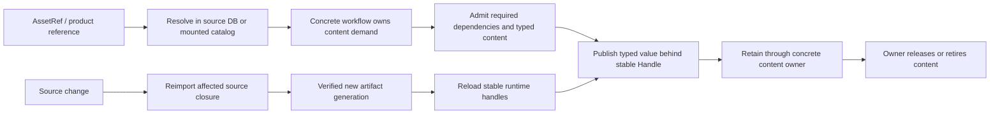
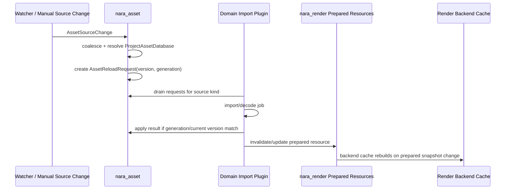

# ADR 0037: Runtime Asset Acquisition, Reload, and Lifetime Policy

**Status**: Accepted
**Date**: 2026-07-09
**Amended**: 2026-10-23 for managed mutation baselines, retained desired observations, owned rescan,
and separate identity, residency ownership and policy
**Refines**: ADR 0033: Asset Import and Render Resource Preparation Seam
**Refined By**: ADR 0040: Render Resource Lifetime and Submitter Ownership; ADR 0050: Asset Root,
Symlink, Junction, and Package Trust Policy; ADR 0051: Persistent File Envelope, Migration, and
Golden Fixtures

## Context

ADR 0033 defined the asset import to render-resource preparation seam. The implementation now has
stable asset IDs, `.meta` records, deterministic import artifact identity, typed `Assets<T>`,
`LoadState`, reload generations, dependency-aware reload requests, concrete async Image import, and
backend GPU caches.

The lifetime contract must distinguish runtime acquisition from source reload, expose failures,
name the owner of retained content, and reject stale task results. Concrete Scene and domain
owners already retain content. That evidence does not yet select a generic acquisition lease API
or a shared eviction executor.

## Decision

`nara_asset` owns source asset identity, request scheduling, runtime load state, reload
generations, source-change diagnostics, and typed runtime asset tables. Domain asset crates own
decode/import logic and typed value application. Render crates own prepared render resources and
backend GPU caches.

Runtime acquisition and source reload are separate operations:

The accepted identity, ownership and reload contract is:

- `Handle<T>` is a copyable runtime identity. Copying or dropping it neither acquires nor releases
  content residency. It is stable across reloads but not persistent scene data, a strong owner, or
  proof that a typed value is currently available.
- Runtime handles use process-unique asset identities. A cloned `AssetServer` is a private
  catalogue snapshot for transactional staging, not a shared allocator; independent snapshots
  cannot issue the same new runtime identity for different sources.
- `AssetRef` is persistent semantic identity. Authoring hosts resolve it through the project asset
  database; packaged runtimes resolve it through a validated mounted content catalog. Resolution
  does not itself imply residency.
- Runtime acquisition expresses demand for usable content. The concrete workflow owns resolution,
  dependency admission, materialization, publication and retention. Its content owner may retain a
  receipt, lease or owned snapshot as required by that workflow; this ADR does not select a common
  public acquisition handle or execution pipeline.
- A source reload request represents an already known source/product whose authoring inputs or
  importer recipe changed. It is not the public runtime load request.
- `AssetSourceChange` values are coalesced into generation-stamped `AssetReloadRequest` values.
- Coalescing preserves metadata dirtiness independently from the latest explicit source existence.
  A metadata-only event does not resurrect a removed source; a later source recreation can replace
  removal without losing an earlier metadata change.
- Each reload request carries expected asset version and load generation. Domain apply systems must
  reject stale results.
- Metadata observations remain unresolved in the owning state until current desired metadata has
  published successfully. Retention precedes request queue admission, so rejection, supersession,
  decode failure, and a later source-only edit cannot silently restore last-good settings.
  Retained Image recipes bind the publication, value slot and latest metadata observation from
  which they were admitted. A later successful public importer publication supersedes that recipe;
  a new metadata observation invalidates an older task even before another request is admitted.
  Source-removal revocation is retained before request admission, including when no usable pixels
  exist yet. A rejected cleanup request cannot let stale desired settings reauthorize a source-only
  recreation; recovery requires the existing exact receipt or explicit current metadata admission.
  A metadata observation after the latest removal is retained even if its request is rejected;
  a later source-only request may retry full metadata identity/settings admission. Observations
  preceding that removal do not grant this recovery path. Loading/failure transitions preserve
  the relative observation fact without treating it as publication authority.
  Source-event coalescing retains the latest metadata/removal order as well as latest existence
  and metadata dirtiness. Same-frame batching and individual admission preserve the same fact;
  collapsing both orders to a single dirty boolean is insufficient.
- `Assets<T>::mutation_baseline` admits the actual value/state association, including a fresh empty
  initial slot, before capturing state and slot revisions. Both resources retain their association;
  replacing either resource, empty-slot ABA, or a raw slot write requires an explicit owner
  re-admission rather than a new baseline that legitimizes the mismatch. The owned baseline is
  consumed by success, failure, or removal. Synchronous `Assets<T>` owner operations remain explicit
  current writes; they cannot validate a delayed predecessor merely by checking its numeric version.
- Image reload registration supplies its Rust type check and first claim to source routing. An incompatible
  principal claim produces a bounded diagnostic before generation, state or event mutation.
  Routing secures the claim before publishing Loading; requests still carry identity only.
  The Image spawn phase retrieves and retains its typed handle through removal, success and failure;
  apply paths do not rebuild handles from request IDs.
- A failed first load stores no asset value and sets `LoadState::Failed`.
- A failed reload preserves the last good typed asset value when one exists, records
  `LoadState::Failed`, and emits a failure event.
- In a source-backed authoring database, removing a source clears typed runtime values and
  prepared render resources derived from that source generation.
- Image removal may retain one pixel-free recovery receipt per known identity, only after
  successfully revoking a current usable Image. A later source-only recreation must match the
  catalog, type, state and slot continuity before re-admitting current metadata. It does not grant
  first-load authority or reuse deleted pixels. Metadata-backed recovery requires Image's `serde`
  feature; without it, the existing metadata-support rejection remains explicit.
- Removing authoring source is distinct from unmounting a packaged generation. A runtime may keep
  using a verified mounted artifact even when no authoring tree is present.
- Source-change translation or scheduling failures produce structured diagnostics; they must not be
  silently dropped.
- Notify directory, unknown, ambiguous rename, and overflow observations create a sticky rescan
  obligation. Draining or reporting `RescanRequired` does not complete it. `AssetWatchRescan` starts
  a replacement watcher before Host reconciliation. A private runtime resource owns that watcher
  and its incremental tail; the Host holds only a weak confirmation/cancellation receipt. Dropping
  the receipt, superseding its session, or plugin shutdown retires that exact replacement watcher.
  A retained Host receipt cannot keep it alive after shutdown. Only the current World-bound receipt
  may acknowledge completed reconciliation and install the new queue; abandonment or overflow
  during reconciliation leaves the obligation outstanding. No scan executes in a watcher callback.
- Prepared render resources are backend-neutral cache entries. Backend-native GPU objects remain in
  backend caches and are invalidated from prepared resource identity/version changes.

## Origin, Residency Ownership, and Policy

These are independent dimensions:

| Dimension | Question | Contract |
|---|---|---|
| Origin | Where did the content come from? | Source-backed import, mounted content and runtime/editor generation describe provenance; they do not select retention policy. |
| Residency ownership | Who requires this content to remain usable? | A concrete Scene, domain, view or session owner retains and releases its content explicitly. A copied `Handle<T>` is insufficient. |
| Retention and eviction policy | When may unneeded content be retired, and under which budget? | The owning workflow names its budget, safe retirement point and outstanding consumers before selecting an implementation. |

Generated content can be retained for a whole session or used briefly, just as imported content can.
Those choices do not require one mixed cache-mode enum. This ADR reserves no `Automatic`, `Pinned`,
`Transient` or `Generated` cache modes.

Existing concrete content owners remain responsible for their current retention and retirement.
Import-work budgets, resident CPU content and prepared/backend resources have separate owners and
lifetimes; releasing an import-work budget does not prove that resident content can be destroyed.
A generic lease API, shared acquisition executor or eviction mechanism requires a complete
consumer workflow that demonstrates the missing ownership or policy. Shared execution additionally
requires evidence that concrete owners duplicate the same work.

## Rules

- Asset loading failures must be visible through `AssetEvents`, `LoadState`, diagnostics, or all
  three depending on failure class.
- Watcher adapters translate filesystem events into semantic source changes; `nara_asset` remains
  watcher-agnostic.
- Import artifacts are backend-neutral. GPU objects, bind groups, and render targets are not
  imported artifacts.
- Domain plugins should drain only the source kinds they own.
- Stale generation or expected-version mismatches must not overwrite newer runtime asset state.
- Cache eviction must not invalidate persistent scene data.
- Runtime acquisition and reload retain distinct intent, state, cancellation and diagnostics,
  whether or not a concrete workflow needs asynchronous queues. A load miss must not be fabricated
  as a source-change event. This semantic separation does not require a generic acquisition queue.
- A concrete acquisition workflow identifies required dependencies and admits them before usable
  content publication. Soft dependencies remain unresolved until explicitly requested by product
  policy.
- An in-flight acquisition uses one immutable source-database or mount-set snapshot for its
  dependency closure; a later publication cannot redirect it halfway through decode.

## Alternatives Considered

### Option A: Direct synchronous load on every `AssetRef`

**Pros**: Simple mental model.

**Cons**: Blocks hot reload, async import, dependency propagation, progress reporting, and editor
diagnostics.

**Decision**: Rejected.

### Option B: Renderer-owned asset cache

**Pros**: Easy texture upload path.

**Cons**: Leaks backend lifetime into asset identity and breaks non-render assets, scenes, prefabs,
audio, and future editor tooling.

**Decision**: Rejected.

### Option C: Asset-owned acquisition/reload state plus domain apply and backend caches

**Pros**: Matches ADR 0033, keeps backend isolation, supports reload failures and stale-task guards,
and lets concrete content owners express their own residency policy.

**Cons**: More state to test and document.

**Decision**: Chosen.

## Success Metrics

| Metric | Target | Measurement |
|---|---:|---|
| Stale task safety | Old generation results cannot overwrite newer asset state | Unit tests |
| Failure visibility | Source-change scheduling failures emit diagnostics | Unit tests |
| Last-good reload | Failed reload preserves previous typed value | Unit tests |
| Removal cleanup | Removed source clears typed value and prepared resource | Unit tests |
| Backend isolation | `nara_asset` never stores GPU objects | Dependency search |
| Request separation | Runtime acquisition neither creates nor consumes `AssetReloadRequest` | API and state-machine tests |
| Identity and ownership separation | Copying or dropping `Handle<T>` does not change concrete content ownership | Public API and content-owner fixtures |
| Snapshot consistency | One concrete acquisition resolves every required dependency against one immutable database/mount snapshot | Integration tests for the admitted workflow |

## Risks and Mitigations

| Risk | Severity | Likelihood | Mitigation |
|---|---|---:|---|
| Diagnostics become another event bus | Medium | Medium | Keep diagnostics observational and separate from load intent. |
| Origin becomes confused with residency policy | Medium | Medium | Keep provenance, content ownership and retention policy independent; reserve no mixed cache-mode enum. |
| Generic acquisition or eviction is designed before a consumer | Medium | Medium | Require a complete retention/release workflow and measured duplication before sharing execution. |
| Failed reload behavior surprises users | Medium | Medium | Document last-good preservation and expose failure state clearly. |
| Backend cache eviction drifts from asset state | High | Medium | Route backend invalidation through prepared resource snapshots and versions. |

## Consequences

- ADR 0033 remains the import/render seam. This ADR defines load request and lifetime policy inside
  that seam.
- `AssetSourceChange` resolution failures must become structured diagnostics.
- Public runtime load operations express demand through their concrete content owner. Source
  change lowers into reimport/reload generations. The two paths may share typed result and
  stale-generation helpers, but do not share request meaning.
- Existing Copy handles, concrete residency owners, desired metadata, managed mutation baselines,
  last-good publication and watcher/rescan custody remain in force. This refinement introduces no
  lease API, eviction executor or change to their runtime behavior.

## Open Questions

- Which complete consumer first needs residency ownership beyond the existing concrete Scene and
  domain owners, and what observable retention/release behavior does it require?
- Does that consumer need an owned receipt, lease, snapshot or another concrete representation?
- What memory pressure, sharing and safe-retirement evidence would justify an eviction policy or
  shared execution?
- Should asset progress be a diagnostic/status resource or a dedicated observable asset-load table?
