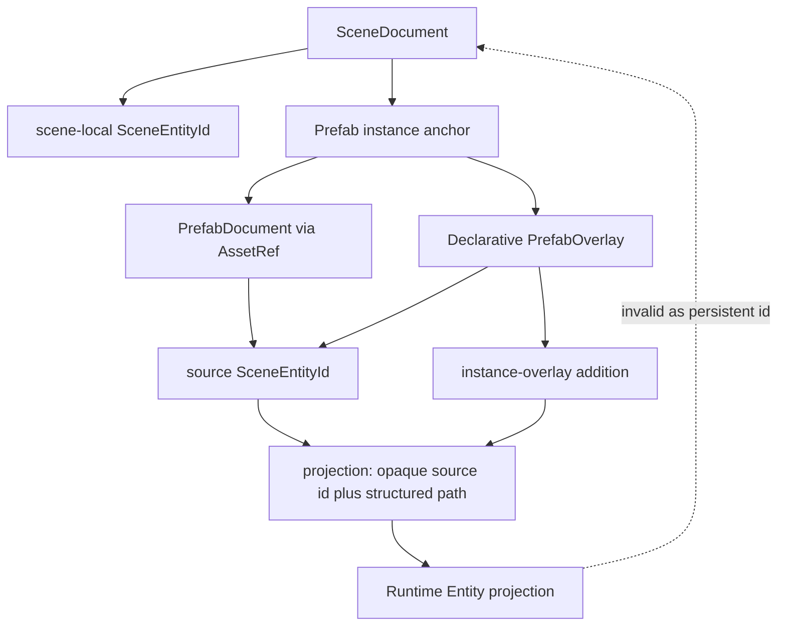

# ADR 0038: Scene/Prefab Authoring Identity and Provenance

**Status**: Accepted
**Date**: 2026-07-09
**Amended**: 2026-10-24 by production source admission, required Prefab/containing-source binding
and Scene-owned logical occurrence
**Amended**: 2026-10-25 by owned unbound ordinary Scene preparation
and complete Runtime/Canvas logical-key lowering
**Amended**: 2026-10-26 by explicit instance-addition origin throughout projection ancestry
and exact containing-source instance-declaration transactions, plus source-owned identity encoding
**Amended**: 2026-10-26 by declarative instance intent and selection before recursive activation
**Amended**: 2026-10-27 by source-owned declaration observation and exact selected-intent Revert
**Refines**: ADR 0006: Scene and Prefab Data Model
**Refined By**: ADR 0043: Scene, Prefab, and Patch Document Migration Policy; ADR 0047:
Editor Workspace and Scene Document State; ADR 0058: Stable Runtime Identity and Entity References;
[ADR 0101](0101-ordered-persistent-placement-and-runtime-projection.md): Ordered Persistent
Placement and Runtime Projection;
[ADR 0102](0102-renderer-neutral-ui-text-widget-and-presented-frame-topology.md): Renderer-Neutral
UI, Text, Widget, and Presented-Frame Topology

## Context

nara has stable `SceneEntityId`, `PrefabDocument`, `PrefabInstance`, nested prefab
resolution, isolated Play Mode, and a narrow Apply Changes subset. Earlier persistent overrides
reused exact Scene patches, which could lose durable leaf intent and retain obsolete edit bases.
The remaining high-cost ambiguity is provenance: when an entity appears in an authoring view or
runtime projection, which document owns it, how should prefab-expanded entities be written back, and
what happens when source prefab or scene references are renamed or moved?

If nara leaves this implicit, editor tooling, AI agents, hot reload, and Apply Changes will each
invent write-back rules.

## Decision

Scene/prefab authoring identity is document-relative and provenance-aware.

- `SceneEntityId` identifies an entity inside one authoring document.
- A scene-local entity is owned by the scene document that contains its record.
- A prefab source entity is owned by its prefab document.
- A prefab instance anchor belongs to its containing source. Expanded children retain either
  inherited source-entity origin or explicit instance-overlay addition origin; visual parentage
  does not transfer an addition into the base Prefab's source ownership.
- Scene projection exposes private instance-local materialization locators. They are not durable
  source identities; UI, session, semantics, selection and persistence keys must not parse or
  extend their generated encoding.
- Projection-aware Scene adapters receive the source `SceneEntityId` and a separate structured
  `PrefabProjectionPath`. ADR 0102 requires the UI adapter to lower canonical containing source,
  explicit logical occurrence and complete authored placement into opaque binary keys. The
  ECS-independent kernel does not expose Scene path types, inherit context from a root, or use
  lookup aliases as identity. ADR 0083 remains Proposed for broader asset/product identity.
- Persistent overrides are optional `PrefabOverlay` declarations bound to one canonical base.
  They retain property pins, component intent, complete additions, desired placement, suppression
  and optional-instance pins in typed source/addition target namespaces. Exact Scene patches remain
  revision-bound source edits and inverse history; they are not durable inheritance intent.
- Select complete instance declarations from inner to outer before resolving their nested sources.
  A complete replacement can repair a missing old nested source without requesting it. Traversing
  a nested target separately requires its per-hop canonical base. Compile ordinary component,
  property and layout intent by active layer after recursion; preserve the original binding scope.
- Source preservation admits bounded understood declarations without requiring every retained
  overlay to activate. Only selected surviving declarations determine activation semantics and
  actual source/asset demand. The Scene compiler owns selection; the Host owns bounded reads,
  immutable source/metadata receipts and revalidation. Superseded branch diagnostics do not make
  a valid replacement unsavable or force reads of its inactive dependencies.
- Projection ancestry is a sequence of typed instance-entry steps. `SourceEntity` binds the
  admitted canonical Prefab source and its local entity, retaining lookup spelling as evidence.
  `InstanceAddition` enters the preceding anchor's overlay-local namespace without claiming the
  overridden base as its owner. This distinction applies to every step, including an added
  entity which itself instances a Prefab, not only to terminal entities. The root anchor remains
  a local record of the containing source. An addition declared in a Prefab source retains that
  source's complete outer placement when the source is instantiated repeatedly.
- The terminal local ID is meaningful only with its typed provenance. Runtime `SceneEntitySource`
  retains the source owner's complete provenance as one value, rather than separately mutable
  local-ID/path fields. Materialized entity locators remain separate and non-durable.
- Runtime `Entity` values never become authoring identity.
- Prefab-expanded write-back must explicitly edit the true owning source, change the chosen
  containing instance's override, or convert the selected projection into local data. Each path
  needs its own qualified source transaction. Writing a whole expanded entity back as if it were
  a containing-source local record is invalid.
- Attaching, replacing or detaching an instance declaration uses the containing source's exact
  `SetPrefabInstance` transaction under ADR 0026. Expected declaration equality is separate from
  lookup resolution and activation. Source preparation may retain unresolved lookup/override
  intent without claiming an executable candidate. Local children and components are unchanged;
  detachment is not convert-to-local, and preservation of unavailable data remains mandatory.
  A complete explicit replacement is also the repair boundary for that anchor's old overlay:
  it compares and retains the complete old declaration in one inverse. Unrelated unavailable
  declarations and direct component records remain protected; a generic field/placement edit
  cannot acquire this repair authority by changing derived projection data.
- Cross-document references should use `AssetRef` plus document-relative `SceneEntityId` when they
  become necessary. They must not rely on runtime entity IDs or backend handles.
- Compilation failures retain their actual source declaration when established: the containing
  input or a resolved canonical Prefab, its local anchor, and the nested addition/instance-claim
  path. Declaration-array indices address one immutable snapshot, not durable entity identity.
  They require the owning source's current revision and Schema basis before editing. A canonical
  Prefab key alone cannot authorize a repair against another document's revision.
- A failure observation describes the first rejected compilation step, not an exhaustive conflict
  inventory. Its intent slot is present only when the compiler establishes that slot. Budget,
  loading and authority failures must not acquire a fabricated anchor or a guessed repair target.
  Source declaration discovery remains available independently of successful expansion.
- Property resolution and owned replacement receive the compiler's admitted residual value limits.
  Reflection's standalone arbitrary-value defaults do not impose a second hidden payload ceiling
  on a component that the composition owner already admitted. Selector/Schema admission and
  complete final value/reference validation remain mandatory under ADR 0011.
- Reverting one claim removes its authored intent rather than writing the current effective value.
  Removing the final property claim removes its empty property-intent container, but preserves an
  explicit empty overlay and its base pin. Explicit overlay removal sets `overrides` to `None`
  while retaining the source link. Reverting an instance claim restores inheritance; writing
  `None` into that claim remains explicit detachment. None of these operations is conversion.

## Provenance Classes

| Class | Owner | Persistent identity | Write-back policy |
|---|---|---|---|
| Scene local | Scene document | `SceneEntityId` | Patch scene directly |
| Prefab source | Prefab document | source `SceneEntityId` | Patch prefab source document |
| Prefab anchor | Containing Scene or Prefab source | Local entity address plus `PrefabInstance.source` | Edit the containing source's anchor or instance overrides |
| Inherited Prefab projection | Source Prefab document with explicit containing placement | Opaque source-local `SceneEntityId` plus typed `PrefabProjectionPath`; materialized locator is private | Write an explicit source/instance override or convert to local |
| Instance-overlay addition | Containing Scene or Prefab source's instance overlay | Explicit addition-local ID plus the owning anchor and complete typed placement ancestry | Edit the containing source's overlay or explicitly convert to local; never edit the base as if it owned the addition |
| Runtime-only | Runtime world | `Entity` | Never persistent by default |

## Rules

- Ordinary materialization exposes one move-only preparation stage owning actual unbound native
  values and the exact immutable definition, source and occurrence context. Preparation allocates
  no Scene target entities, and dropping it needs no World. First placement and exact replacement
  use the same kernel as immediate spawn and advanced product publication; they do not re-decode
  at commit. Commit consumes the ordinary token and revalidates current World, definition, touched
  assets, lifecycle and occurrence eligibility before binding fresh targets. A managed World must
  retain its required registry authority and match the prepared definition; standalone consumers
  may retain the definition without keeping the caller's registry variable alive. Target-bound
  native-retirement custody remains a later stage with its existing explicit cleanup obligation.
- Expanded materialization input binds the immutable document and its complete provenance in one
  owner-created candidate. Public spawn/replacement APIs do not accept independently assembled
  document/map pairs. The candidate also requires the containing `SourceDocumentKey`; a plain-scene
  constructor explicitly supplies that key and local provenance. Pure document expansion remains
  independent of runtime placement and yields an immutable expanded document that its source owner
  binds before materialization. No bare-document or optional-source persistent spawn path remains.
- First materialization requires an explicit logical occurrence namespace and slot. Runtime source
  records carry both the containing source and that occurrence alongside the existing exact
  activation and document-relative provenance. Exact replacement reuses the predecessor's
  Scene-owned occurrence association rather than asking callers to reconstruct it.
- Validate source coverage and projection association before allocation or retiring the previous
  instance. Install admitted source fields within the prepared commit, before hierarchy/identity
  retirement; do not apply a second provenance pass after publication.
- A retained startup view borrows the candidate without cloning its allocations independently of
  the source retention lease. Document allocation sharing remains private to the admitted owner.
- Scene and prefab documents must not store runtime `Entity`, runtime `AssetId`, or backend handles.
- Rename/move tools must preserve document-relative IDs unless the user explicitly requests an ID
  rename patch.
- `AssetRef::StableId` is preferred for robust prefab source identity when project databases are
  available; `AssetRef::Path` remains valid for hand-authored and AI-generated projects.
- Source prefab moves should update project asset metadata or path references through normal asset
  ref migration, not by changing expanded IDs.
- File-backed project content must admit a private-field `SourceDocumentKey` for each selected Scene and
  loaded Prefab before expansion. Stable-metadata policy requires and validates the exact sidecar;
  project-location policy binds the authored universe and complete project-relative path. A
  resolver lends the canonical key and immutable document together; callers must not assemble
  them from an `AssetRef` after lookup.
- Canonical Prefab binding is required for every resolver, including code-authored and
  document-only expansion. The resolver has one required operation returning the bound key and
  document. Every `SourceEntity` projection step retains that key; there is no source-keyless result or
  lookup-request fallback for cycle identity. In-memory authors supply the key explicitly, rather
  than having Scene infer it from a path, request, callsite or pointer. Aliases must resolve to the
  same key and immutable document; the source owner remains responsible for that association.
- The source owner provides one strict JSON/RON representation for `SourceDocumentKey`,
  preserving both document kind and the complete Named, ProjectLocation or StableAsset origin.
  Decoding rebuilds keys through the existing validated identity constructors. A decoded key is
  an identity claim, not evidence that a file, metadata record or immutable closure was admitted;
  only the actual source owner can establish that association. Containing formats retain their
  encoded-input preflight and aggregate budgets. Debug text, UI occurrence encodings and lookup
  aliases are not persistent canonical source identity.
- Projection origin is not a dependency-closure inventory. A resolved base remains captured and
  revalidated by its source/Host owner even if only additions survive and no source-entity step
  names that base. Stable addition identity across an explicit base replacement grants neither
  patch validity nor permission to silently retarget future durable intent.
- Requiring canonical Prefab sources does not assign the containing Scene's source identity or
  a logical occurrence. Those are separate obligations at the materialization boundary; editing
  and document-only expansion do not acquire a runtime occurrence to inspect source data.
- Metadata used for stable-reference lookup remains revalidated closure evidence even under
  location identity. Adjacent metadata does not silently promote a location-authored source.
  Stable native Prefab admission uses the existing catalogue's duplicate-identity rejection;
  partial catalogue discovery is not complete asset-reference admission.
- Native admission verifies stored path spelling through filesystem capabilities before assigning
  a location key. Content delivery checks stable source identities across its admitted union using
  full project-relative paths; a distinct path cannot silently claim an already admitted identity.
  Neither operation is a persistent project-wide registry or a namespace snapshot.
- Expansion admits modeled source-ancestry and provenance bytes before copying a source key or
  projection chain. Post-expansion retained-byte accounting cannot substitute for this bounded
  allocation admission. Limits model logical ownership, not allocator capacity or process RSS.
- Complete overlay additions retain explicit addition origin independently of source-local
  spelling, including an added anchor with its own nested declaration. Placements are their sole
  hierarchy authority. Bound declarations, targets, bindings, payload/default costs and provenance
  before copying or compiling. No generated-ID prefix encodes origin. ADR 0101's nested-root
  prefix and containing-layer child sequences still govern final order; `Parent::Root` means
  the declaring overlay's effective roots, not its eventual physical anchor's local children.
- Apply Changes may remain narrow. Any future prefab-expanded write-back must declare whether it is
  producing an override patch, editing the prefab source, or converting to local scene data.

## Alternatives Considered

### Option A: Treat expanded prefab IDs as scene-local IDs

**Pros**: Simple editor selection and patch application.

**Cons**: Loses source ownership, makes overrides ambiguous, and risks writing generated projection
IDs into scene documents.

**Decision**: Rejected.

### Option B: Runtime entity IDs as universal identity

**Pros**: Easy ECS lookup.

**Cons**: Runtime IDs are unstable, non-serializable as authoring truth, and incompatible with
document diffs, hot reload, and AI-generated patches.

**Decision**: Rejected.

### Option C: Document-relative IDs plus explicit provenance

**Pros**: Matches existing scene/prefab data, supports deterministic expansion, preserves source
ownership, and gives editor/AI write-back a clear contract.

**Cons**: Requires tooling to carry provenance alongside selected entities.

**Decision**: Chosen.

## Success Metrics

| Metric | Target | Measurement |
|---|---:|---|
| Persistent identity safety | Scene/prefab docs never contain runtime `Entity` or runtime `AssetId` | Serialization tests |
| Prefab projection clarity | Source entity identity and projection location are separate for every new consumer | Unit tests |
| Write-back safety | Prefab-expanded Apply Changes rejects or produces explicit override/localization flow | Tooling tests |
| Reference migration readiness | Cross-document references can be represented as `AssetRef` plus `SceneEntityId` | Design review |

## Risks and Mitigations

| Risk | Severity | Likelihood | Mitigation |
|---|---|---:|---|
| Tooling forgets provenance after projection | High | Medium | Carry provenance with inspector/editor selection models. |
| Override layers become hard to explain | Medium | Medium | Expose explicit declaring source, typed target, inheritance/pin state and conflicts; retain exact source transactions separately. |
| Path-based prefab refs break on rename | Medium | Medium | Prefer stable IDs when project databases exist; path refs remain hand-authoring friendly. |
| Conversion to local duplicates source data accidentally | Medium | Low | Make convert-to-local an explicit command with diagnostics. |

## Consequences

- ADR 0006 and ADR 0034 remain valid; this ADR defines the authoring identity/provenance contract
  they rely on.
- Future editor selection and Apply Changes expansions should carry provenance explicitly.
- Prefab-expanded entity write-back stays unsupported until it can produce source override patches
  or an explicit convert-to-local command.

## Open Questions

- What additional asset/product identity axes must join the minimum `PrefabProjectionPath` when
  ADR 0083 reaches its admission trigger?
- Should cross-scene references be accepted before scene streaming exists?
- How should ID rename patches update references inside the same document and across project files?
