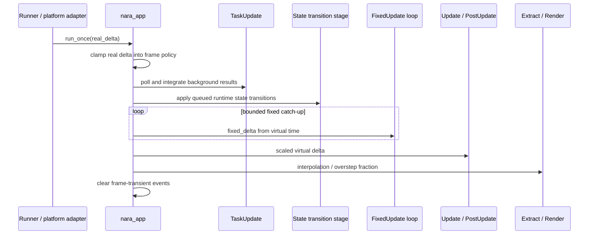

# ADR 0039: Main Loop, Time Domains, Pause, and Runtime State

**Status**: Accepted
**Date**: 2026-07-09
**Last Revised**: 2026-11-19
**Refines**: ADR 0013, ADR 0018, ADR 0024, ADR 0035, ADR 0036
**Refined By**: ADR 0041: Input Routing, Actions, Text Input, UI Focus, and Accessibility; ADR 0057:
Authoritative Fixed-Tick and Command Ingress; ADR 0076: Play Runtime Debug Control and Observation

## Context

ADR 0013 split runners from platform adapters, ADR 0018 selected fixed-step simulation, and ADR
0024 made fixed update the deterministic-friendly simulation path. The current implementation has
`run_once(delta)` plus `FixedTime`, which is enough for headless tests and the first runtime loop,
but it leaves high-cost semantics implicit:

- whether `delta` is real, scaled, paused, clamped, or fixed time;
- how pause affects fixed update, UI, assets, diagnostics, and rendering;
- where state transitions and `OnEnter` / `OnExit`-style hooks belong;
- how desktop redraw policy interacts with `Poll` / `Wait`, background throttling, and fixed-step
  catch-up;
- when transient frame resources such as window events are cleared.

Mature engine behavior needs these contracts before physics, UI text input, Play Mode, scripting,
audio, and networking each grow their own time model.

## Decision

nara will model the main loop through explicit time domains and runtime state transitions. A runner
submits real elapsed time; `nara_app` lowers that into virtual/game time and fixed simulation time
according to runtime settings.

The product contract is:

- **Real time** is unscaled wall-clock/runtime elapsed time. It drives task polling, diagnostics,
  window housekeeping, asset IO observation, and backend liveness.
- **Virtual time** is scaled and pausable game time. Gameplay `Update` systems that should obey
  pause read virtual time.
- **Fixed time** is the authoritative simulation tick domain. `FixedTime` exposes the current
  monotonic tick, per-tick delta, elapsed duration, whole-tick debt, and sub-tick remainder. It
  advances immediately before each fixed schedule run.
- **Render interpolation** reads the settled `RenderTime` sample. App publishes the completed
  fixed clock, its timestep, and its remainder and interpolation fraction together. A timestep
  change after the fixed schedule configures the next transaction and preserves this sample.
- Render extraction copies the settled fixed sample, real and virtual clocks, and time settings
  together with the validated presented-spatial sample and actual interpolation decision. Later
  preparation, target adaptation and replay keep the original clock observation. The clock
  remainder alone does not prove that spatial interpolation was applied. Exact Step does not
  run Extract, so the preceding captured sample
  remains intact until the next ordinary presentation extraction. App frame, fixed tick and
  render transaction counters remain distinct. The render owner defines the bounded GPU
  projection of these facts without becoming another time owner.
- Fresh-runtime continuation carries pending fixed scheduling phase and actual time policy
  through the original managed time owner. The receiver validates its own policy, preserves its
  local clock history and derives interpolation from the applied phase. Initialization is outside
  an active frame and invalidates the previous completed-paused boundary; the next full paused
  maintenance frame reestablishes it. ADR0024 owns the bounded continuation contract.
- `run_once(delta)` receives real elapsed time. It must not silently mean virtual or fixed delta.
- Managed `drive(delta)` accepts an explicit next interval. A native runner instead delivers
  already elapsed wall-clock intervals through `drive_elapsed(delta)`. When that interval began
  paused, applying Resume settles one original paused App transaction: RealTime receives the
  full interval, existing fixed debt/phase stay intact, and virtual advancement starts with the
  next interval. Stop creates no settling frame, and exact-step semantics remain unchanged.
  Neither path resets the native sampling baseline or silently drops elapsed time.
- `RuntimeFrameStatus::simulation_paused` records the pause mode actually used to settle that
  transaction. Publish it with the fixed status before variable update and Extract. Control
  settings may already describe a resumed next interval; presentation consumes the settled fact.
  An exact fixed step reports active simulation while retaining paused control settings and
  remaining a dedicated transaction without Extract.
- The managed path calls the same App-owned frame transactions through `RuntimeInstance::drive`.
  Platform adapters do not reconstruct clocks or invoke `App::run_once` behind runtime lifecycle
  state.
- `time_scale`, pause state, maximum frame delta, fixed step duration, maximum fixed steps per
  frame, and background policy come from effective runtime settings. File-backed projects lower
  these from `nara.toml`; embedded apps may configure equivalent resources directly.
- File-backed project input may request at most 256 fixed steps per app frame and retain at most
  16,384 whole fixed ticks of debt. Base manifests and profile overlays reject larger values rather
  than clamping them into a different runtime policy.
- Pause is a scheduler/time policy, not a hidden freeze of the `World`. Real-time services, input
  collection, task result integration, diagnostics, window event processing, asset reload
  scheduling, render backend health, and tooling observation continue unless explicitly disabled.
- Fixed simulation does not catch up without bound. `DiscardExcess` runs the per-frame cap, discards
  remaining whole ticks, and retains only the interpolation remainder. `PreserveDebt` retains whole
  ticks up to `max_debt_steps`; exceeding that bound rejects the frame before any clock or Core
  schedule mutation. Paused or zero-scale frames neither add virtual time nor consume existing debt.
- A managed paused frame forces paused execution from `RuntimeState::Paused`; mutating the public
  `RuntimeTimeSettings` resource cannot resume fixed or variable simulation behind the runtime
  control state.
- One accepted exact fixed-tick step is a dedicated App transaction, not a temporary resume or an
  ordinary elapsed-time frame. It advances real time by the supplied real delta, virtual and fixed
  time by exactly one fixed timestep, preserves pre-existing pending time, debt, remainder, render
  interpolation, time scale, and paused settings, runs the complete fixed transaction once, clears
  trackers once, and returns to paused only after success.
  The original App intent-preparation phase resolves pending input and runs registered local
  gameplay producers before command admission. It reuses their ordinary-frame system state;
  it does not run the general PreUpdate/Update schedules or repeat collection for catch-up ticks.
- Startup is a separate once-only committed lifecycle phase. On the first run it completes before
  frame planning, may configure time resources, and is not rolled back if the subsequent frame is
  rejected. A retry does not rerun Startup; it plans from the committed Startup state.
- Fixed schedules declare `Prepare`, `Simulate`, and `Finalize` sets with deferred-command flushes
  between them. The fixed status and interpolation data are published before variable update,
  extraction, and rendering.
- A successfully completed frame consumes exit requests and then calls `World::clear_trackers()`
  exactly once after `Last`, establishing Bevy removal/change tracker retention at the app boundary.
- App consumes required frame resources through fallible access after user schedules. A resource
  removed before its next App use returns the existing missing-resource time error through managed
  first-fault reporting and leaves Stop available. Completed user work is not rolled back. No
  blanket schedule-exit audit is required: removing a resource after its final use preserves the
  current frame's success and lets a later consumer report its absence.
- Runtime state is ordinary typed ECS state plus an explicit transition queue/stage. State
  transitions may run `OnExit`, transition, and `OnEnter` schedules, but they must not be coupled to
  a Godot-style scene tree or object lifecycle.
- Editor/tooling mode (`Edit`, `Play`, `Paused`) is separate from gameplay state. Tooling may map
  its mode into runtime pause/time policy, but it is not the global app state model.
- A game-owned menu may freeze virtual time with zero `time_scale` while retaining the prior
  positive scale; it does not take ownership of the Host's managed pause flag. Menu actions remain
  frame operations, independent of fixed-tick gameplay commands. If gameplay input is disabled
  across a menu, the game must reconcile already queued intent through its existing command
  transaction before accepting fresh gameplay. Context cancellation alone does not withdraw
  previously admitted commands. The opt-in Two-Level round flow is a concrete consumer of these
  boundaries, not a general state-machine or transition-hook API.
- The round consumer settles menu state and its visible projections before `Extract`. On entering
  Pause or Complete, clearing held movement and projecting the idle Sprite belong to the same
  transition. The HUD consumes the resulting state before extraction. `Last` can publish the
  game snapshot or refresh a Host-paused observation without mutating the state already drawn.

## Runner and Redraw Policy

Desktop adapters such as `nara_winit` remain responsible for platform event loops, but the policy
is explicit runtime settings:

- `Poll` favors low-latency continuous rendering.
- `Wait` favors idle efficiency and redraw-on-demand.
- A live native session may explicitly change between these policies through its original
  runner. Cadence is independent of Runtime pause: changing to Wait preserves pending frame
  demand and the elapsed-time baseline; changing to Poll requests original frame work. Native
  input/window demand and presentation maintenance keep their existing owners. Wait does not
  infer ECS dirtiness, supply arbitrary task-completion wakes, or promise real-time animation;
  the caller selects it only when its workload can tolerate those limits.
- An explicitly obtained native-session maintenance wake is a coalesced CPU notification bound
  to the original physical-loop session identity. It may make the original caller/maintenance
  boundary observable without requesting an App frame, changing time or authorizing input.
  Retiring that session revokes its handle; queued or late wakes cannot operate on a successor.
  The caller still validates and drains its actual work before waiting again.
- background/blurred windows may throttle real-time frames, pause virtual time, or keep running,
  depending on runtime settings.
- redraw requests should be driven by configured frame policy, dirty render state, visible windows,
  and backend readiness rather than hardcoded inside an opaque draw loop.
- The first-party Winit adapter drives `RuntimeInstance`, joins native target retirement with
  registered runtime close, and reports success only after both ownership domains reach their
  truthful terminal state. A terminal plugin-shutdown error may coexist with the runtime's
  `Stopped` ownership state after every registered waitable owner completes; Winit still returns a
  distinct teardown failure rather than treating that state as clean success.

`WindowEvents` and similar frame-transient resources follow ADR 0036: they are produced by the
platform adapter, consumed by same-frame systems, and cleared in a defined cleanup stage.

## Alternatives Considered

### Option A: Keep a single `delta` resource

**Pros**: Minimal API and easiest implementation.

**Cons**: Pause, fixed update, background throttling, animation, physics, and replay semantics
become ambiguous. Subsystems would infer different meanings from the same value.

**Decision**: Rejected.

### Option B: Godot-style per-node process modes

**Pros**: Mature pause/process control model and strong editor familiarity.

**Cons**: nara has no node tree as behavior owner. Per-object process flags would fight strict ECS
and make scheduling less transparent.

**Decision**: Rejected as the primary model.

### Option C: Explicit time domains plus ECS state transitions

**Pros**: Fits Rust ECS scheduling, keeps pause observable, supports deterministic fixed steps, and
remains compatible with headless tests and platform adapters.

**Cons**: Requires clearer schedule labels, resources, and tests than a single-delta loop.

**Decision**: Chosen.

## Success Metrics

| Metric | Target | Measurement |
|---|---:|---|
| Time clarity | Real, virtual, fixed, and interpolation time have distinct resources/API docs | API review |
| Pause semantics | Pausing virtual time does not stop task polling, diagnostics, or backend health updates | Unit/integration tests |
| Fixed catch-up bounded | Discard/preserve policies bound work and debt while interpolation stays in `[0, 1)` | Unit tests |
| ECS frame boundary | Removed/change trackers rotate once after every successful frame | Unit tests |
| State transitions | `OnEnter` / `OnExit`-style schedules can be driven without scene-tree lifecycle hooks | Schedule tests |
| Runner portability | Headless and winit runners both call the same app runtime tick contract | Runner tests |
| Exact paused step | One request advances one complete fixed/gameplay transaction without consuming retained debt or remainder | Runtime integration tests |

## Risks and Mitigations

| Risk | Severity | Likelihood | Mitigation |
|---|---|---:|---|
| Too many time resources confuse users | Medium | Medium | Keep gameplay prelude focused and document which schedule reads which time domain. |
| Pause policy becomes hidden run-condition magic | Medium | Medium | Make pause state and schedule membership explicit resources/sets. |
| Background throttling differs across platforms | Medium | Medium | Keep adapter policy configurable and observable through diagnostics/status resources. |
| State model overgrows into framework control flow | Medium | Low | Keep state as ECS resources and schedules; scenes/prefabs remain data documents. |

## Consequences

- `RealTime`, `VirtualTime`, `FixedTime`, and `RenderTime` are separate resources with explicit
  meanings.
- Invalid, zero, non-finite, overflowed, or debt-exceeding time configuration/state returns a
  structured error instead of being clamped into a different policy.
- `WindowEvents` and input event queues need defined cleanup stages instead of caller-owned
  clearing.
- Project manifest runtime settings in ADR 0035 lower into validated time resources before the
  selected product plugin bundle is installed.
- `RuntimeInstance` contributes lifecycle/control state but does not duplicate any time resource or
  frame schedule owned by `App`.

## Implemented Slice: RGF-U17 Editor Control

RGF-U17 routes Editor Pause, Resume, exact fixed-tick Step, Stop, and fresh Restart through the same
`RuntimeInstance` control contract used by headless and desktop hosts. A paused editor frame may
apply a generation-stamped tooling edit or export selected Apply Changes state at its safe point
without advancing a fixed tick. Terminal close failure stays observable and cannot be reported as a
successful Stop or followed by Restart. This slice does not implement the ordinary typed gameplay-
state transition schedules still required by this ADR.

## Open Questions

- Should runtime state support stacks, independent state domains, or only single typed states in the
  first implementation?
