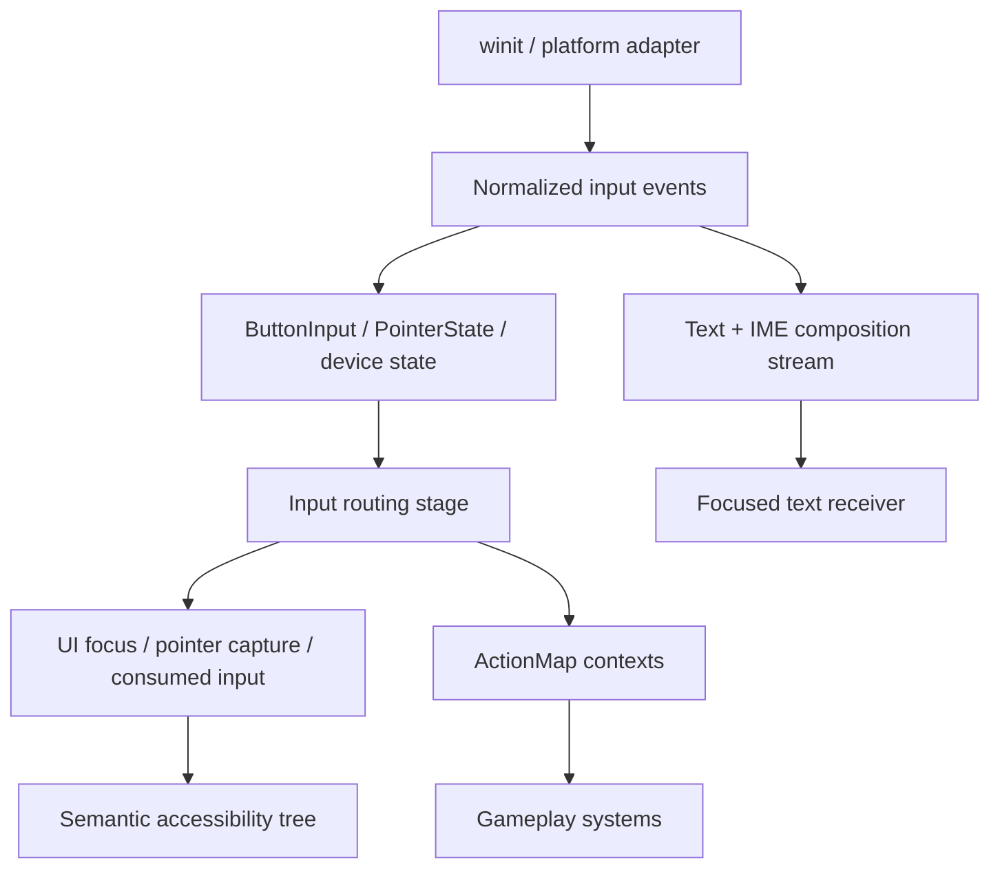

# ADR 0041: Input Routing, Actions, Text Input, UI Focus, and Accessibility

**Status**: Accepted
**Date**: 2026-07-09
**Last Revised**: 2026-10-30
**Refines**: ADR 0013, ADR 0025, ADR 0035, ADR 0036, ADR 0039
**Refined By**: ADR 0056: Headless Runtime and Dedicated Server Readiness; ADR 0095: Plugin-Owned
Specialized Domains and Project Configuration;
[ADR 0102](0102-renderer-neutral-ui-text-widget-and-presented-frame-topology.md): Renderer-Neutral
UI, Text, Widget, and Presented-Frame Topology; [ADR 0108](0108-ui-surface-presented-session-and-atomic-interaction.md):
UI Surface, Presented Session, and Atomic Interaction

## ADR 0095 Refinement

Platform ingress, focus/capture/IME ownership, transient lifetime, and the semantic gameplay-command
boundary are shared product contracts. Runtime gameplay, runtime UI, and editor/toolkit shortcuts do
not need one universal action model. Their owning plugins may use different typed policies after the
Host-level arbitration boundary.

## Context

The current `nara_input` foundation exposes button and pointer state, and `nara_ui` has basic
hover/press/focus state. That is a good first slice, but a mature engine needs a stronger contract
before runtime UI, editor shortcuts, gameplay actions, text fields, IME composition, gamepads, and
accessibility all compete for input semantics.

The most important distinction is that physical input, action mapping, UI routing, text input, and
accessibility are related but not the same thing.

## Decision

nara will route input through layered ECS data, not raw platform callbacks or editor-only shortcut
paths.

Rules:

- Platform adapters translate raw backend events into nara-normalized input events and state.
  Gameplay and UI do not depend on `winit` event types.
- `ButtonInput<KeyCode>`, `ButtonInput<MouseButton>`, and pointer state remain useful low-level
  observations, but semantic gameplay should prefer action maps once available.
- Action maps are project/runtime data. File-backed projects may source them from `nara.toml` or
  manifest-referenced action-map files; embedded apps may configure them directly.
- Action maps support named actions, binding contexts, device scopes, chords/modifiers, analog
  values, dead zones, and priority/enable state over time. The first implementation may be smaller,
  but it must not collapse actions into hardcoded key checks.
- Action maps should be able to produce semantic gameplay commands or action outcomes that can be
  consumed by replay, AI drivers, and future server-authoritative worlds without exposing raw
  device events.
- `ActionOutcomes` exposes ordered low-level edges for each enabled physical binding.
  `SemanticActions` separately owns aggregate held state for each action/context and exposes one
  `Started` edge when its first physical contribution begins and one `Released` edge when its final
  contribution ends. Gameplay command mapping consumes this semantic projection; releasing one
  of several held bindings or endpoints cannot stop the action.
- Disabling a context terminates its delivered semantic actions once. Re-enabling it while an
  input remains physically held leaves that action inactive until release and a fresh press.
  A mapping change ends the previous mapping lifetime with the same fresh-press requirement.
  Context/mapping lifetime identity survives deferred action resolution while paused, including
  disable/enable between resolution passes; an obsolete staged press cannot revive an old action.
  One staging owner issues these lifetime identities for both normalized timeline events and direct
  synthetic button mutations. Observed context/mapping exits cannot be erased by restoring a cloned
  or moved configuration snapshot. Synthetic edges capture identity at the same First staging
  boundary; later synthetic edges are captured at resolution, without changing physical observation
  retention or admitting an event-time configuration promise.
  Low-level binding outcomes retain their physical meaning and do not synthesize cancellation
  releases. Semantic cancellation identifies its context/mapping cause without physical provenance.
- UI routing happens before gameplay action delivery for inputs captured or consumed by focused UI,
  unless a context explicitly opts into global shortcuts.
- Text input and IME composition are separate from key/button actions. Composition text, commit
  text, caret movement, and editing commands are delivered to the focused text receiver, not to
  generic gameplay key actions.
- Pointer capture has a single owner per pointer/device stream. Dragging, sliders, scrollable
  panels, editor gizmos, and viewport tools must not infer capture from hover alone.
- Focus is explicit UI state. Keyboard/gamepad navigation targets focused widgets or focus scopes
  before falling back to gameplay contexts.
- The Platform/Editor Host owns raw native-window focus and IME sessions. Each input seat has at
  most one keyboard/text target, each view has an explicit focus domain, and a gameplay viewport
  receives gameplay input only after explicit activation. Pointer capture is bound to its source
  window/view and emits an observable cancellation on focus loss, tear-off, close, or target
  invalidation. Cross-window shortcuts are global only when declared as such.
- Runtime/game UI and editor/tool UI each own the accessibility outcome of their product surface.
  They may share semantic vocabulary or platform bridges, but neither may treat the other as an
  overlay that supplies accessibility after the fact. Runtime UI nodes and editor adapters should
  expose semantic role, label, value, state, bounds, and actions; both must preserve complete
  keyboard navigation, recoverable focus, text/IME behavior, and platform accessibility output.
- Input diagnostics and replay capture record normalized events, routing decisions, and semantic
  action outcomes at defined stages.
- Normalized window/seat/pointer identity survives button projection and semantic action delivery.
  Held physical state is owned per endpoint; the convenient `pressed(button)` observation is the
  aggregate of those memberships. Releasing or invalidating one endpoint cannot clear another.
  Timeline-derived action outcomes retain their event sequence and route stamp; direct unstamped
  low-level mutations are explicitly distinguishable. UI/gameplay release delivery follows the
  accepted press ownership even when a presented route changes before release.

Frame-transient input/window events follow ADR 0036 and ADR 0039 cleanup rules. Retained input
state such as pressed buttons, focused element, and pointer capture persists until changed.

### Immutable Definitions And Global Runtime Selection

`nara_input` owns one finite compiler for code-first and file-backed action definitions. An
`ActionMapDefinition` contains declared contexts, their initial enable state, ordered physical
bindings and compiled lookup data. It contains no mutable World state or execution authority.
The World-local `ActionMap` is move-only and owns context enable state and mapping lifetimes;
it is not a persistent authoring record. Unknown context operations fail without growing state.
Live `ButtonInput` and `SemanticActions` are likewise move-only: copying observations or outcomes
does not implicitly duplicate their private edge queues, held ownership or revision custody.
Replacing bindings consumes an already compiled definition and always begins a new mapping
lifetime, including restoration of previously used bindings. The fixed maximum-context allowance
covers this operation and retained old snapshots; rejected candidate compilation leaves the old
state unchanged, without a fictitious fallible installation step for an admitted definition.

An owning `ActionMapBindings` handle captures immutable compiled data and its actual shared owner
together. Owner projection runs once at construction; an owner returning another definition later
cannot change installed bindings. Compiled storage sharing remains private behind a move-only
definition wrapper, with no public borrowed-definition cloning operation.
Source ownership retains the compiled output and its original charge; processed ownership retains
the actual typed acquisition. Borrowing a definition cannot detach a clone of its allocation and
substitute an unrelated retention token. A second independently mutable World state has its own
finite context/revision allowance. These costs do not by themselves establish a bound for all
physical endpoints, semantic contributions or transient output in the ingress pipeline.

The canonical native source file is an `action_map` version-one JSON envelope with an intrinsic
complete primary Product, explicitly declared contexts and ordered bindings. It does not require
a second identity sidecar. An observed sidecar/catalogue identity must agree with the intrinsic
source UUID and actual canonical location; conflicting UUIDs or locations refuse admission.
The first source workflow supports current key/mouse bindings. Chords, analog bindings and an
action-map editor require their own complete consumer before implementation.

A manifest-selected global map is installed once through `RuntimeCandidateScope`, before Scene
materialization and Startup. The actual Input owner verifies its pristine resource identity and
rejects a competing explicit code configuration, including an explicit empty map. Missing Input
ownership, resource replacement and repeated selection refuse installation. No installation API
accepts an arbitrary World or a post-Startup runtime scope. With no file selection, code-first
configuration remains valid. Startup selection and later explicit runtime rebinding are separate
operations.

The global source owner survives Scene collection replacement and travel with the same World
state. Target preparation verifies the original file receipt and reuses that owner; changed or
missing source refuses the target. Using a changed global definition requires an explicit restart;
restoring the original admitted source permits a preparation retry. Ready publication consumes
captured facts rather than discovering or installing another map at commit. The definition/state and source workflow
are selected contracts; their implementation and actual qualification belong in the
[Input plan](../../plans/2026-10-30-input-definition-and-source-admission-plan.md) and ledger.

## Alternatives Considered

### Option A: Gameplay systems read raw keys and mouse state directly

**Pros**: Simple and ergonomic for tiny examples.

**Cons**: UI focus, rebinding, gamepad support, IME, replay, editor shortcuts, and accessibility all
become retrofits.

**Decision**: Rejected as the long-term contract.

### Option B: UI owns all input routing privately

**Pros**: Strong widget behavior and editor-like control.

**Cons**: Gameplay actions, replay, headless tests, and non-UI input become second-class.

**Decision**: Rejected.

### Option C: Engine-level normalized input, routing, action maps, text, and accessibility layers

**Pros**: Keeps platform adapters narrow, makes UI/gameplay conflict resolution explicit, and gives
AI/editor tooling structured data to inspect.

**Cons**: More up-front design than button state alone.

**Decision**: Chosen.

## Success Metrics

| Metric | Target | Measurement |
|---|---:|---|
| Platform isolation | Gameplay/UI crates do not import `winit` input types | Dependency search |
| UI consumption | Focused/captured UI can prevent gameplay actions in the same frame | Routing tests |
| Text correctness | IME composition is represented separately from key presses | Text input tests |
| Action maps | Actions can be rebound without changing gameplay systems | Unit tests |
| Accessibility readiness | Runtime UI and editor adapters can export semantic state and complete keyboard/focus behavior without making either product depend on the other's toolkit | API/design review |

## Risks and Mitigations

| Risk | Severity | Likelihood | Mitigation |
|---|---|---:|---|
| Input pipeline becomes too complex for simple games | Medium | Medium | Keep low-level button state available while documenting actions as the scalable path. |
| UI and gameplay both consume shortcuts unexpectedly | High | Medium | Make context priority, global shortcut rules, and consumed-input diagnostics explicit. |
| IME support is postponed too long | High | Medium | Keep text/IME as a first-class route even before full text widgets ship. |
| Accessibility is treated as late-only work | High | Medium | Require runtime UI and editor adapters to prove their own semantic output, keyboard path, focus recovery, and IME behavior at their first complete workflow. |

## Consequences

- `nara_input` should eventually grow normalized input event buffers, action maps, and routing
  diagnostics in addition to retained button/pointer state.
- `nara_ui` focus and pointer capture should become engine-level state consumed by the input router.
- Editor shortcuts and viewport tools should join the same Host-level focus/capture/IME arbitration
  boundary, but may use an editor/toolkit-owned typed shortcut policy rather than the runtime
  gameplay/UI `ActionMap`. Toolkit callbacks must not bypass tooling commands or Host arbitration.
- Editor adapters remain responsible for accessibility even while the final editor toolkit and
  any shared semantic bridge remain open design questions.
- Replay, AI-driver, and future server-authoritative boundaries should consume semantic gameplay
  commands/action outcomes rather than raw device events.

## Open Questions

- What is the smallest Phase 1 action-map schema that still supports rebinding and UI/gameplay
  context priority?
- Which platform text/IME features must be represented before the first text widget?
- Which concrete per-seat/view focus and capture carriers should implement the accepted
  multi-window invariants without coupling `nara_input` to one editor toolkit?
