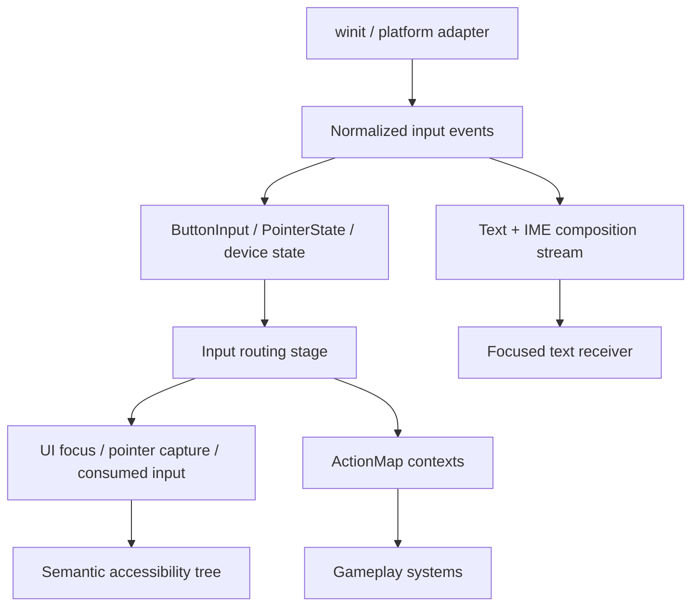

# ADR 0041: Input Routing, Actions, Text Input, UI Focus, and Accessibility

**Status**: Accepted
**Date**: 2026-07-09
**Last Revised**: 2026-11-04
**Refines**: ADR 0013, ADR 0025, ADR 0035, ADR 0036, ADR 0039
**Refined By**: ADR 0056: Headless Runtime and Dedicated Server Readiness; ADR 0095: Plugin-Owned
Specialized Domains and Project Configuration;
[ADR 0102](0102-renderer-neutral-ui-text-widget-and-presented-frame-topology.md): Renderer-Neutral
UI, Text, Widget, and Presented-Frame Topology; [ADR 0108](0108-ui-surface-presented-session-and-atomic-interaction.md):
UI Surface, Presented Session, and Atomic Interaction

## ADR 0095 Refinement

Platform ingress, focus/capture/IME ownership, transient lifetime, and the semantic gameplay-command
boundary are shared product contracts. Runtime gameplay, runtime UI, and editor/toolkit shortcuts do
not need one universal action model. Their owning plugins may use different typed policies after the
Host-level arbitration boundary.

## Context

The current `nara_input` foundation exposes button and pointer state, and `nara_ui` has basic
hover/press/focus state. That is a good first slice, but a mature engine needs a stronger contract
before runtime UI, editor shortcuts, gameplay actions, text fields, IME composition, gamepads, and
accessibility all compete for input semantics.

The most important distinction is that physical input, action mapping, UI routing, text input, and
accessibility are related but not the same thing.

## Decision

nara will route input through layered ECS data, not raw platform callbacks or editor-only shortcut
paths.

Rules:

- Platform adapters translate raw backend events into nara-normalized input events and state.
  Gameplay and UI do not depend on `winit` event types.
- `ButtonInput<KeyCode>`, `ButtonInput<MouseButton>`, and pointer state remain useful low-level
  observations, but semantic gameplay should prefer action maps once available.
- Action maps are project/runtime data. File-backed projects may source them from `nara.toml` or
  manifest-referenced action-map files; embedded apps may configure them directly.
- Action maps support named actions, binding contexts, device scopes, chords/modifiers, analog
  values, dead zones, and priority/enable state over time. The first implementation may be smaller,
  but it must not collapse actions into hardcoded key checks.
- Action maps should be able to produce semantic gameplay commands or action outcomes that can be
  consumed by replay, AI drivers, and future server-authoritative worlds without exposing raw
  device events.
- `ActionOutcomes` exposes ordered low-level edges for each enabled physical binding.
  `SemanticActions` separately owns aggregate held state for each action/context and exposes one
  `Started` edge when its first physical contribution begins and one `Released` edge when its final
  contribution ends. Gameplay command mapping consumes this semantic projection; releasing one
  of several held bindings or endpoints cannot stop the action.
- Disabling a context terminates its delivered semantic actions once. Re-enabling it while an
  input remains physically held leaves that action inactive until release and a fresh press.
  A mapping change ends the previous mapping lifetime with the same fresh-press requirement.
  Context/mapping lifetime identity survives deferred action resolution while paused, including
  disable/enable between resolution passes; an obsolete staged press cannot revive an old action.
  One staging owner issues these lifetime identities for both physical and synthetic ingress.
  Observed context/mapping exits cannot be erased by restoring a cloned or moved configuration
  snapshot. Both enter the same bounded Input owner and capture mapping/context identity at the
  defined staging boundary, without admitting an event-time configuration promise.
  Low-level binding outcomes retain their physical meaning and do not synthesize cancellation
  releases. Semantic cancellation identifies its context/mapping cause without physical provenance.
- UI routing happens before gameplay action delivery for inputs captured or consumed by focused UI,
  unless a context explicitly opts into global shortcuts.
- Text input and IME composition are separate from key/button actions. Composition text, commit
  text, caret movement, and editing commands are delivered to the focused text receiver, not to
  generic gameplay key actions.
- Pointer capture has a single owner per pointer/device stream. Dragging, sliders, scrollable
  panels, editor gizmos, and viewport tools must not infer capture from hover alone.
- Focus is explicit UI state. Keyboard/gamepad navigation targets focused widgets or focus scopes
  before falling back to gameplay contexts.
- The Platform/Editor Host owns raw native-window focus and IME sessions. Each input seat has at
  most one keyboard/text target, each view has an explicit focus domain, and a gameplay viewport
  receives gameplay input only after explicit activation. Pointer capture is bound to its source
  window/view and emits an observable cancellation on focus loss, tear-off, close, or target
  invalidation. Cross-window shortcuts are global only when declared as such.
- Runtime/game UI and editor/tool UI each own the accessibility outcome of their product surface.
  They may share semantic vocabulary or platform bridges, but neither may treat the other as an
  overlay that supplies accessibility after the fact. Runtime UI nodes and editor adapters should
  expose semantic role, label, value, state, bounds, and actions; both must preserve complete
  keyboard navigation, recoverable focus, text/IME behavior, and platform accessibility output.
- Input diagnostics and replay capture record normalized events, routing decisions, and semantic
  action outcomes at defined stages.
- Normalized window/seat/pointer identity survives button projection and semantic action delivery.
  Held physical state is owned per endpoint; the convenient `pressed(button)` observation is the
  aggregate of those memberships. Releasing or invalidating one endpoint cannot clear another.
  Action outcomes retain their accepted event sequence and route stamp; synthetic origin remains
  explicitly distinguishable without a second mutable button owner. UI/gameplay release delivery
  follows the accepted press ownership even when a presented route changes before release.

Frame-transient input/window events follow ADR 0036 and ADR 0039 cleanup rules. Retained input
state such as pressed buttons, focused element, and pointer capture persists until changed.

### Editor Text And Keyboard Handoff

The native Editor adapter distinguishes the focused keyboard control from the focused text
receiver. Moving from a field to its Apply button preserves control navigation while revoking
the field's IME lifetime. Presented-frame navigation and activation use the same kernel session
as pointer input. Ordinary editing shortcuts use the backend's logical key and current modifiers;
gameplay physical-key bindings retain their separate meaning. Clearing ordinary keys during
handoff preserves physically held modifier state for the receiving controls.

The Host shares one clipboard owner between its existing workspace shell and Nara-owned controls.
Cut changes the buffer only after a successful clipboard write. Paste passes through ordinary
bounded single-line text admission, and refusal preserves buffer, selection and local history.
Composition suppresses clipboard and control-navigation shortcuts until completion or explicit
cancellation. Local text Undo/Redo and explicit document history remain separate. These are concrete
Editor policies, not a shared gameplay action-map or platform accessibility capability; the
[editable-text guide](../../guides/editable-text.md) records their supported consumer scope.

### Bounded Ingress And Terminal Retirement

One Input owner admits connected window/seat records, pointer children, accepted physical/synthetic
members and their ordered event log. Configuration bounds persistent pools, indexes, prepared and
retiring records, projections and retained/transient outputs. Queued, held and terminal-pending
members stay admitted until every relevant internal consumer finishes. Read-only `ButtonInput`
observations and semantic contribution links derive from those members; they do not own separate
public mutation queues. Synthetic drivers use the same admission and termination path. The default
synthetic endpoint is established once by its owner, not reconstructed on every mutation.

Frame projections and action observations retain the original event while their internal copies
are live. Admission-time pinning alone is insufficient: an event arriving after this frame's
projection must reacquire the next frame's pin when it is actually copied. Only cleanup after
those copies clear releases that pin; physical loss or another cursor cannot reclaim their space
and admit another full frame of copies in the same frame.

Raw adapter labels remain the public delivery identity for this bounded workflow. Explicit
connection/retirement and private non-reused record/member identity protect internal lifetimes.
Retirement prevents label reuse while old internal consumers still pin the record. The adapter
drains or discards externally queued operations before reusing labels. A current-generation lookup
or a newly allocated public handle cannot recover an old event's missing origin. A future adapter
with asynchronous native recreation must establish its own origin/nonreuse proof before support;
the current source review does not qualify that broader behavior.

Coordinated owners capture an Input-issued private endpoint-incarnation claim when associating
with a connected endpoint. The claim retains original owner/identity, independently of the active
presentation route, and does not pin a retired mutable slot. Unbind/retire through that claim
settles an already ended incarnation without affecting a same-label replacement, including one
that has not published any UI route. A foreign owner refuses. This integration claim is not an
OS-event origin handle and does not change the raw platform ingress API.

Use one shared ordered log with reserved terminal credits. For every accepted operation, retained
records after its drafts plus all remaining terminal obligations fit the event capacity, and the
last sequence plus its drafts and obligations fits `u64`. Publishing a release, leave or lifecycle
control spends an existing obligation and retains the resulting record until actually reclaimed.
Advancing one cursor or clearing physical ingress is not reclamation. Count complete scope unions,
not independently acceptable subsets. FocusLost, CloseRequested and SurfaceRetired are distinct
obligations; geometry revocation and a held unpositioned pointer's future leave also require their
actual allowances. New activity explicitly rearms applicable obligations; repeated terminal
notifications cannot fabricate duplicate edges or spend the same credit twice.

An adapter consuming a batch must still deliver already observed terminal releases/loss after an
ordinary event in that batch is refused. Preserve the first refusal and truthful partial outcome,
skip later ordinary admissions as appropriate, and settle the actual terminal tail through the
same owner. Dropping the remaining batch because a new press or pointer move failed would bypass
the accepted members' terminal guarantees. Never synthesize a release for a refused press.

Ordinary rejection changes no topology, accepted ownership, sequence or observable edge. A new
press cannot evict an existing hold. Once platform loss has happened, terminate applicable accepted
members and revoke only its routing authority using reserved capacity, retaining original press
ownership through projections and semantic delivery. Presentation unbind preserves physical holds.
Revocation/unbind never allocate a new binding generation; exhaustion rejects a new publication
without preventing old work's termination. Global route poisoning is not the lifetime mechanism.

A prepared route pins an exact immutable declaration and a separate owner-side invalidation fact.
Platform loss can revoke it while the move-only token remains outstanding. Commit consumes that
token with a total Published/Invalidated outcome; invalidated completion cannot rearm routing.
UI presentation completion consumes the same fact without restoring prepared focus, capture or
reducers. Backend pixel acceptance remains a separate truthful outcome. The root must not publish
interactive receipt, observation or accessibility success for that invalidated candidate. No new
fallible admission is introduced after backend submission.

The [endpoint plan](../../plans/2026-10-30-input-endpoint-admission-and-retirement-plan.md) records
the selected raw-ID/private-lifetime and shared-credit comparison against public handles and a
dedicated terminal pool. Red regressions and private arithmetic controls establish the problem
and design selection. The separate
[production qualification](../../knowledge/engineering/verification/2026-10/2026-10-30T140508Z-bounded-input-ownership-and-total-ui-presentation-qualification-b97643044e4a4f92b892a3539d2ad415.md)
establishes finite topology/projections, actual consumer retention, independent gameplay workflows
and selected Windows/DX12 results. Its keyboard/mouse scope does not qualify future asynchronous
origin recovery, seat-scoped maps, gamepad/axis holds, replay or complete text/IME support.

### Immutable Definitions And Global Runtime Selection

`nara_input` owns one finite compiler for code-first and file-backed action definitions. An
`ActionMapDefinition` contains declared contexts, their initial enable state, ordered physical
bindings and compiled lookup data. It contains no mutable World state or execution authority.
The World-local `ActionMap` is move-only and owns context enable state and mapping lifetimes;
it is not a persistent authoring record. Unknown context operations fail without growing state.
Live `ButtonInput` and `SemanticActions` are likewise move-only: copying observations or outcomes
does not implicitly duplicate their private edge queues, held ownership or revision custody.
Replacing bindings consumes an already compiled definition and always begins a new mapping
lifetime, including restoration of previously used bindings. The fixed maximum-context allowance
covers this operation and retained old snapshots; rejected candidate compilation leaves the old
state unchanged, without a fictitious fallible installation step for an admitted definition.

An owning `ActionMapBindings` handle captures immutable compiled data and its actual shared owner
together. Owner projection runs once at construction; an owner returning another definition later
cannot change installed bindings. Compiled storage sharing remains private behind a move-only
definition wrapper, with no public borrowed-definition cloning operation.
Source ownership retains the compiled output and its original charge; processed ownership retains
the actual typed acquisition. Borrowing a definition cannot detach a clone of its allocation and
substitute an unrelated retention token. A second independently mutable World state has its own
finite context/revision allowance. These costs do not by themselves establish a bound for all
physical endpoints, semantic contributions or transient output in the ingress pipeline.

The canonical native source file is an `action_map` version-one JSON envelope with an intrinsic
complete primary Product, explicitly declared contexts and ordered bindings. It does not require
a second identity sidecar. An observed sidecar/catalogue identity must agree with the intrinsic
source UUID and actual canonical location; conflicting UUIDs or locations refuse admission.
The first source workflow supports current key/mouse bindings. Chords, analog bindings and an
action-map editor require their own complete consumer before implementation.

A manifest-selected global map is installed once through `RuntimeCandidateScope`, before Scene
materialization and Startup. The actual Input owner verifies its pristine resource identity and
rejects a competing explicit code configuration, including an explicit empty map. Missing Input
ownership, resource replacement and repeated selection refuse installation. No installation API
accepts an arbitrary World or a post-Startup runtime scope. With no file selection, code-first
configuration remains valid. Startup selection and later explicit runtime rebinding are separate
operations.

The global source owner survives Scene collection replacement and travel with the same World
state. Target preparation verifies the original file receipt and reuses that owner; changed or
missing source refuses the target. Using a changed global definition requires an explicit restart;
restoring the original admitted source permits a preparation retry. Ready publication consumes
captured facts rather than discovering or installing another map at commit. The definition/state and source workflow
are selected contracts; their implementation and actual qualification belong in the
[Input plan](../../plans/2026-10-30-input-definition-and-source-admission-plan.md) and ledger.

### Processed Startup Input

The `ActionMapAsset` CPU family carries a complete primary Product and immutable definition.
Its concrete `runtime_action_map` version-one codec shares finite declaration admission with
the source format but accepts only its own envelope kind. It explicitly declares no Required
references. The original compiled recipe selects the actual codec and frozen limits; no source
importer or Input registry is needed for this Runtime-only operation facet.

An optional Product in admitted Runtime configuration is a startup root independent of Scene
and addressable roots. The catalogue verifies its membership and format; composition requires
the actual Input plugin and selected typed decoder. Startup acquires through the original base,
retains the actual typed acquisition, separately admits mutable state and finalizes selection
through the existing candidate scope. Global startup Input is acquired and installed once for
the receiving World. Scene collection replacement cannot own its only custody or recreate that
World-local state. Explicit Scene Required references may independently acquire ActionMap products
as typed CPU data, retaining their own acquisition charges from the original base. These reads
grant no authority to reinstall or reconfigure global Input. When no Product is selected, explicit
code-first Input remains valid. An explicitly installed code map, including empty, competes with
a selected processed map.
Actual implementation and source-free physical process evidence follow the
[processed Input plan](../../plans/2026-10-30-processed-input-startup-and-process-proof-plan.md).

## Alternatives Considered

### Option A: Gameplay systems read raw keys and mouse state directly

**Pros**: Simple and ergonomic for tiny examples.

**Cons**: UI focus, rebinding, gamepad support, IME, replay, editor shortcuts, and accessibility all
become retrofits.

**Decision**: Rejected as the long-term contract.

### Option B: UI owns all input routing privately

**Pros**: Strong widget behavior and editor-like control.

**Cons**: Gameplay actions, replay, headless tests, and non-UI input become second-class.

**Decision**: Rejected.

### Option C: Engine-level normalized input, routing, action maps, text, and accessibility layers

**Pros**: Keeps platform adapters narrow, makes UI/gameplay conflict resolution explicit, and gives
AI/editor tooling structured data to inspect.

**Cons**: More up-front design than button state alone.

**Decision**: Chosen.

## Success Metrics

| Metric | Target | Measurement |
|---|---:|---|
| Platform isolation | Gameplay/UI crates do not import `winit` input types | Dependency search |
| UI consumption | Focused/captured UI can prevent gameplay actions in the same frame | Routing tests |
| Text correctness | IME composition is represented separately from key presses | Text input tests |
| Action maps | Actions can be rebound without changing gameplay systems | Unit tests |
| Accessibility readiness | Runtime UI and editor adapters can export semantic state and complete keyboard/focus behavior without making either product depend on the other's toolkit | API/design review |

## Risks and Mitigations

| Risk | Severity | Likelihood | Mitigation |
|---|---|---:|---|
| Input pipeline becomes too complex for simple games | Medium | Medium | Keep low-level button state available while documenting actions as the scalable path. |
| UI and gameplay both consume shortcuts unexpectedly | High | Medium | Make context priority, global shortcut rules, and consumed-input diagnostics explicit. |
| IME support is postponed too long | High | Medium | Keep text/IME as a first-class route even before full text widgets ship. |
| Accessibility is treated as late-only work | High | Medium | Require runtime UI and editor adapters to prove their own semantic output, keyboard path, focus recovery, and IME behavior at their first complete workflow. |

## Consequences

- `nara_input` should eventually grow normalized input event buffers, action maps, and routing
  diagnostics in addition to retained button/pointer state.
- `nara_ui` focus and pointer capture should become engine-level state consumed by the input router.
- Editor shortcuts and viewport tools should join the same Host-level focus/capture/IME arbitration
  boundary, but may use an editor/toolkit-owned typed shortcut policy rather than the runtime
  gameplay/UI `ActionMap`. Toolkit callbacks must not bypass tooling commands or Host arbitration.
- Editor adapters remain responsible for accessibility even while the final editor toolkit and
  any shared semantic bridge remain open design questions.
- Replay, AI-driver, and future server-authoritative boundaries should consume semantic gameplay
  commands/action outcomes rather than raw device events.

## Open Questions

- What is the smallest Phase 1 action-map schema that still supports rebinding and UI/gameplay
  context priority?
- Which platform text/IME features must be represented before the first text widget?
- Which concrete per-seat/view focus and capture carriers should implement the accepted
  multi-window invariants without coupling `nara_input` to one editor toolkit?
