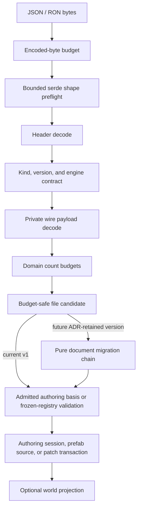

# ADR 0043: Scene, Prefab, and Patch Document Migration Policy

**Status**: Accepted
**Date**: 2026-07-09
**Amended**: 2026-07-10 for the unreleased canonical-version reset policy
**Amended**: 2026-10-26 for exact instance-declaration snapshot semantics
and source-owned canonical identity encoding
**Amended**: 2026-10-27 for composition selection before component interpretation
**Amended**: 2026-11-01 for explicit reviewed authored-data upgrades and history checkpoints
**Amended**: 2026-11-02 for headless recovery ownership and fresh model/native provenance
**Amended**: 2026-11-02 for the selected CP2 source/compiled representation and topology boundary
**Implemented Slice**: RGF-U1 on 2026-07-12
**Refines**: ADR 0006, ADR 0011, ADR 0026, ADR 0038
**Refined By**: ADR 0047: Editor Workspace and Scene Document State; ADR 0049: Untrusted Project
Input and Parse Budget Policy; ADR 0051: Persistent File Envelope, Migration, and Golden Fixtures;
[ADR 0101](0101-ordered-persistent-placement-and-runtime-projection.md): Ordered Persistent
Placement and Runtime Projection;
[ADR 0102](0102-renderer-neutral-ui-text-widget-and-presented-frame-topology.md): Renderer-Neutral
UI, Text, Widget, and Presented-Frame Topology

## Context

Scene, prefab, and standalone patch files now share the ADR 0051 envelope. `SceneDocument` and
`PrefabDocument` payloads intentionally carry no duplicate file version. `ScenePatchDocument`
retains a revision-bound transaction record version; Prefab instances instead contain optional
declarative overlays with no embedded patch version. Component-level migrations exist through `nara_reflect`; document-shape
migration remains a separate, currently empty compatibility mechanism.

If nara only migrates component values, it cannot safely rename document fields, change prefab
instance shape, change patch operation encoding, alter provenance records, or split/merge document
sections. A mature released engine needs explicit document migrations, but nara has not shipped a
persistent compatibility promise yet. Preserving prototype shapes now would turn known design debt
into a permanent reader and fixture burden.

## Decision

nara distinguishes document-format migration from component-value migration and distinguishes an
unreleased canonical reset from a real compatibility window.

Rules:

- The corrected scene, prefab, and standalone patch file envelopes are canonical
  `format_version = 1`. Superseded prototype readers are deleted; corrected Rust types use
  canonical unsuffixed names.
- Each document kind publishes a strict compatibility matrix. Until an ADR grants a compatibility
  window, the only readable version is canonical version 1.
- A document migration chain is added only when an ADR names the retained version, owner, fixtures,
  support window, and removal trigger.
- Document migrations are pure transformations from one known document version to the next. They do
  not mutate the live `World`, asset server, or source file in place.
- Component migrations run after the document shape has been migrated into a version whose component
  payload locations and patch operation payloads are known.
- Composition dependency admission and standalone source publication are separate products.
  Composition captures bounded decoded data with valid local structure and actual source
  identity/content evidence. The Scene compiler selects surviving component programs before
  migrating or interpreting their payloads; a complete replacement/suppression does not interpret
  the discarded payload. Standalone canonicalization and editable publication retain their strict
  semantic gates. Raw captured dependencies are not published editable documents or native values.
- Component migration results are revalidated iteratively against the candidate's depth, node,
  container, single-string, cumulative-string, and logical component-value budgets before
  publication. A migration cannot publish a value that the same file boundary would reject.
- Whole-component patch values may use the registered component migration chain. A field write from
  an older component schema version is rejected until an explicit field-value migration contract
  exists; a stable field ID proves identity, not that an old scalar or asset-reference value keeps
  the same semantics. Identity-only removal may resolve the stable ID against the current schema.
- Stable nested-property selectors also require a current-version admitted component value before
  resolution. A wire-layout migration may retain member IDs; changing keyed-item identity policy
  refuses the old selector's `by` member until an explicit address remap is supplied. A component
  migration does not implicitly migrate persistent selectors or manufacture a new overlay format.
- Unsupported future document versions fail with typed format errors.
- Prototype, unknown, and missing migration steps fail with typed format errors. nara must not
  best-effort guess unknown document shapes.
- Patch documents migrate before validation/apply. Undo/redo stacks should store current-version
  inverse patches once they are produced by the active editor session.
- Complete expected/replacement snapshots in `SetPrefabInstance` are exact transaction data,
  not values to migrate independently of their captured source basis. Native admission rejects
  snapshots requiring reinterpretation rather than silently rewriting their comparison or inverse.
  Schema-only source preservation may retain understood unavailable data under ADR 0090; that
  does not grant native activation or implicit destructive replacement of unavailable records.
  An explicit complete `SetPrefabInstance` replacement may repair that anchor's overlay while
  retaining the exact old snapshot in inverse history; unrelated unavailable data remains guarded.
- Migrations must preserve authoring identity and provenance. They may rewrite IDs only through an
  explicit documented migration that also updates references and overrides.
- A stored `SourceDocumentKey` uses the source owner's strict kind-and-origin representation in
  JSON or RON. It carries no independent file envelope, compatibility reader or source-admission
  receipt. Constructors validate its identity fields; the containing format and actual Host
  retain bounded file admission and immutable-source validation. This value codec alone does
  not itself grant activation of durable Prefab intent.
- Retained overlay declarations use the current containing file's grammar, without an operation
  patch reader or compatibility converter. Source preservation and activation are separate:
  bounded declarations and identity are admitted before instance selection; selected surviving
  payloads cross current selector/version/reference/native checks in the Scene compiler.
  Native file loading must not activate a discarded embedded overlay before a complete outer
  instance replacement can select its successor. Direct source component migration and exact
  transaction snapshot semantics retain their existing checks.
- AI/editor tooling emits canonical version 1. Loading another version is supported only when the
  compatibility matrix links to its authorizing ADR.
- Automatic write-back of migrated files is an explicit tool/editor action. Runtime loading should
  not rewrite source files silently.
- In-repository prototype source files are updated in the breaking implementation unit. External
  experimental files require the documented manual/offline source action; runtime does not carry a
  hidden prototype reader.

### Reviewed Authored-Data Upgrades

An explicit project operation may upgrade component semantics and their authored claims together.
This is distinct from generic Open, component-value loading migration and document-format
compatibility. A trusted project command computes a bounded data proposal under the captured old
Schema; the source owner validates it under one explicitly admitted successor. Catalogs, Adapter
receipts and recovery data carry no executable transformation authority.

The operation covers complete stored declarations, including direct records, nested/dormant
Prefab additions, component Set records and versioned Properties batches. Stable field identity
does not prove conversion semantics. Explicit selector/binding correspondence, checked value
conversion and full affected-version coverage are required; empty batches cannot hide old versions.
The Host independently constrains the actual change footprint, preserving out-of-scope records,
claims, bindings and topology by structural equality under the understood wire grammar. Affected
unknown semantics refuse; unavailable unrelated data remains preserved.

The selected first workflow saves reviewed participating working copies and establishes a new
per-document history checkpoint after complete adoption. It does not reinterpret old Undo/Redo
or `SetPrefabInstance` snapshots under the new Schema. Preparation/cancellation and pre-write
refusal preserve old histories. Successful adoption replaces source/classification/history and
their persistence bindings together under ADR0047. Retained-history migration would need its
own original-basis edge/inverse proof and is not implied by value conversion.

Before destructive publication, the operation retains bounded reviewed inputs and deterministic
outputs and publishes project Pending authority under ADR0110. Partial replacement and uncertain
publication are observed explicitly; fresh-process recovery reads and admits actual old/new facts,
never inventing lost receipts or rerunning conversion on already-upgraded bytes. Its finite owner
is independent of Editor/Workspace and retains one reviewed inventory, cumulative allowance and
actual file outcomes through confirmation and safe cleanup retry. New model admission and current
native observations have separate provenance; neither reconstructs an old nominal basis or history.
Already-new members require no replacement, and only the exclusive final Ready publisher supplies
that recovery's confirmed publication evidence. Ordinary fresh Open admits a new generation.
This selects
process-interruption recovery at the actual filesystem guarantee tier, not cross-file atomicity
or power-loss durability. The
[authored-upgrade unit](../../plans/2026-11-01-authored-schema-upgrade-plan.md) owns implementation
and qualification; this amendment alone establishes neither.

### Source Representation And Topology Operations

The [complete CP2 replacement](../../plans/2026-11-02-prefab-extraction-plan.md) changes the
unreleased source grammar together: source-owned typed placements replace authored roots/children,
inline reference values replace persistent payload-coordinate sidecars, and contextual
entity-reference defaults/input arguments remain explicit declarations. Direct records, additions,
complete Sets, property values and dormant branches all use the same value language. The flat
compiled hierarchy/reference result is a distinct owner-created representation. Rewrite current
fixtures and producers together; do not retain a prototype reader or sidecar-to-inline converter.

Ordinary value migration does not silently supply source-context or topology correspondence.
Schema upgrades include contextual default declarations and every affected inline reference in
their complete-tree proof, while preserving out-of-scope placements, instance topology, input
meaning and canonical source predicates. Reset/Absent exposes the proper declared default;
source movement cannot covertly turn omission into a fixed effective-value pin. Unknown affected
meaning refuses rather than being reinterpreted in a new source namespace.

Extraction is a separate topology operation under the unchanged actual Schema basis. It proves
declaration ownership and an injective old/new effective occurrence correspondence separately:
root contributor facets may share one canonical output entity, but originally distinct effective
entities cannot merge. Reusing publication kernels does not justify a fabricated Schema successor
or field-upgrade receipt. Recovery distinguishes modified original members from new observed-absent
Q/sidecar destinations, with fixed IDs/output bytes and actual per-file outcomes before final Ready.

Stored authored-only references are not Native values. Selected composition resolves them under
the original declaration scope; every direct Native admission rejects leftovers after defaults and
before codecs/World mutation. Grammar admission, lossless preservation and a pure canonical key
remain separate from that proof. Implementation and qualification remain in the CP2 plan; the
pure identity ownership prerequisite alone does not establish these selected contracts.

### Current Compatibility Matrix

| File kind | Envelope versions read/written | Payload version | Migration chain |
|---|---|---|---|
| `scene` | 1 | none | none |
| `prefab` | 1 | none | none |
| `scene_patch` | 1 | embedded patch record 1 | none |

Decode produces a `SceneDocumentCandidate`, `PrefabDocumentCandidate`, or
`ScenePatchDocumentCandidate`; it does not publish authoring or runtime state. Scene and Prefab
candidates enter source sessions after admission against an actual `AuthoringSchemaBasis` or a
frozen executable registry. One authoring capture shares the exact admitted basis across its
documents; source admission does not require fake native bindings. Prefab candidates
enter a resolver only after the resolver owner validates them. Patch candidates are validated in
the target document transaction and can enter authoring revision/undo history through the session
API. The top-level document types do not implement public `Deserialize`; direct Rust construction
remains a trusted programmatic path rather than a file loader.

RGF-U1 implements no non-v1 document migration registry because the matrix contains no retained
older version. Format errors are typed local errors; bridging them into the ADR 0048 runtime
diagnostic bus remains the consuming host's responsibility.

## Alternatives Considered

### Option A: Reject all non-current document versions forever

**Pros**: Simple validation and no migration bugs.

**Cons**: Cannot support real released projects when a future compatibility promise exists.

**Decision**: Rejected as the permanent policy.

### Option B: Handle migrations ad hoc inside each loader

**Pros**: Easy to add one-off fixes near parsing code.

**Cons**: Hard to audit, hard to test, and likely to diverge between scene, prefab, patch, JSON, and
RON loaders.

**Decision**: Rejected.

### Option C: Preserve every prototype version through formal migration chains

**Pros**: Avoids breaking any experimental file.

**Cons**: Freezes known prototype mistakes and creates compatibility code before there is a shipped
contract or user population.

**Decision**: Rejected.

### Option D: Canonical reset before release, explicit migration windows afterward

**Pros**: Ships one correct version-1 contract while preserving a rigorous migration mechanism for
future compatibility promises.

**Cons**: Experimental projects must perform an explicit source rewrite during foundation work.

**Decision**: Chosen.

## Success Metrics

| Metric | Target | Measurement |
|---|---:|---|
| Canonical loading | Corrected version-1 scene/prefab/patch fixtures load and reserialize canonically | Golden-file tests |
| Prototype rejection | Removed draft shapes fail instead of entering a hidden compatibility path | Negative fixture tests |
| Retained compatibility | Every non-v1 readable version has an authorizing ADR and pure chain | Ledger and golden tests |
| Future version safety | Future versions fail with typed local format errors | Unit tests |
| Component migration order | Component migrations run after document migration | Migration tests |
| Migration output safety | Scene, prefab, and patch migration growth cannot bypass any shape or value budget | Post-migration budget tests |
| Field-value safety | Old-version field writes fail instead of being reinterpreted as current values | Patch candidate tests |
| Source safety | Runtime load does not rewrite source files silently | Loader tests/review |
| Provenance preservation | Prefab overrides and source IDs remain valid after migration | Scene/prefab tests |

## Risks and Mitigations

| Risk | Severity | Likelihood | Mitigation |
|---|---|---:|---|
| Migration bugs corrupt authored data | High | Medium | Keep migrations pure, test golden inputs/outputs, and require explicit save action. |
| Prototype files are reused after the reset | Medium | Medium | Reject removed shapes strictly and document the required source rewrite. |
| Too many retained versions become maintenance burden | Medium | Medium | Add a chain only for an ADR-backed compatibility window with a removal trigger. |
| Patch migration changes undo semantics | Medium | Medium | Store active session undo entries in current-version inverse patch format. |
| Component and document migrations conflict | High | Low | Run document migration first and component migration only through registry-known payload paths. |

## Consequences

- `nara_scene` should expose migration registries only when the compatibility matrix contains an
  ADR-retained version; it must not retain prototype readers speculatively.
- Current hard rejection of prototype, unknown, and future versions remains valid.
- Component migration ADR 0011 remains valid but does not cover document shape evolution.
- The breaking unit updates all repository-owned source documents and records the source action in
  the migration guide instead of adding `V1`/`V2` APIs.
