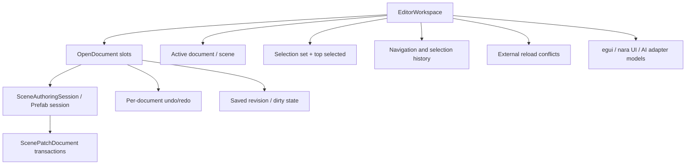

# ADR 0047: Editor Workspace and Scene Document State

**Status**: Accepted
**Date**: 2026-07-09
**Last Revised**: 2026-10-30
**Amended**: 2026-08-15 to make selection single-owner and separate monotonic revision from
receipt-backed content state
**Amended**: 2026-10-27 to capture actual open Prefab working copies for authoring Scene preview
with independent file evidence and complete content authorization
**Amended**: 2026-10-28 to require complete retained observations at public authoring preparation ingress
**Amended**: 2026-10-28 to retain finite trusted tool execution and review in the Project Session
**Amended**: 2026-10-28 to share complete tool observations and activation-bound actions across frontends
**Amended**: 2026-10-28 to separate code-free local release capture from installation and activation
**Amended**: 2026-10-28 to prepare additive Schema classification for the complete open set
**Refines**: ADR 0015, ADR 0026, ADR 0034, ADR 0038, ADR 0043
**Amended**: 2026-10-28 to retain installed-content protection independently of graph withdrawal;
management facts do not recover creation or deletion authority on Open
**Amended**: 2026-10-28 to protect accepted source changes before persistence or source release,
with separate in-memory facts and receipt-backed publication evidence
**Amended**: 2026-10-28 to replace mixed installed/project-content protection with managed
artifacts and explicit project-owned template import, removing optional-ledger persistence gates
**Amended**: 2026-10-30 to extend the working-copy contract to demanded open Scene dependencies
under the exact nominal Schema basis; implementation and qualification remain outstanding
**Refined By**: [ADR 0104](0104-host-owned-editor-workspace-installation.md): Host-Owned Editor
Workspace Installation

## Context

nara already has strong authoring foundations:

- `SceneDocument` and `PrefabDocument` are persistent data.
- `ScenePatchDocument` is the mutation/undo unit.
- `SceneAuthoringSession` treats the document as truth and projects into a managed live `World`.
- `SceneEditorState` owns Edit/Play/Paused flow and Apply Changes for a narrow safe subset.
- UI adapters render tooling models rather than owning scene mutation.

What is missing is the editor workspace layer. Mature editor behavior needs open documents, active
scene, selection sets, dirty/saved content state, external file reload conflicts, per-document undo, and
multi-document operations. If this stays implicit, egui, future dear-imgui, future nara UI editor
panels, and AI agents will each invent their own workspace state.

## Decision

`nara_tooling` owns a UI-agnostic editor workspace model above individual authoring sessions.

Rules:

- The workspace is UI-toolkit agnostic and lives in `nara_tooling`, not in egui/dear-imgui adapters.
- Open documents are explicit slots with document kind, stable document ID, optional source path or
  asset reference, loaded document value, source revision, saved revision, dirty state, diagnostics,
  and external reload status.
- `SceneAuthoringSession` remains the per-document scene authoring/live projection boundary. The
  workspace coordinates many sessions; it does not replace patch validation or direct document
  ownership rules.
- The integrated Scene preview owns a disposable materialization, not a second authoring session
  or document history. Requested source and accepted projection remain distinct. Scene owns exact
  epoch replacement under ADR 0058; preview changes do not restart the shared authoring Runtime or
  transfer its pending Save/import, task, image or filesystem responsibility. A refused candidate
  preserves last-good and does not mark the requested source revision accepted.
- Selection is workspace state: a selection set, top-selected item, selection history, and optional
  viewport/tool context. Selection targets use authoring identities and provenance, not runtime
  `Entity` values. Inspector state consumes that selection and does not retain a second durable
  selected entity.
- The current Scene viewport selects containing-source entities. A hit on Prefab-derived geometry
  selects the instance's root anchor through typed provenance; the materialized entity locator
  never becomes a Workspace entity ID. Independent inherited-entity selection and its Inspector
  require a separate provenance-aware target contract.
- Undo/redo is per document by default. Cross-document operations must be represented as explicit
  multi-document transactions with per-document patches and rollback diagnostics.
- Document mutations, Undo, and Redo target a non-optional document identity and exact base
  `SceneAuthoringRevision`. Active-document state is presentation/navigation context, never a
  mutation fallback.
- Read-only queries of an explicitly named open document do not change active tabs, selection,
  history or dirty state. Bounded entity enumeration binds continuation to its document,
  incarnation, revision and retained Schema admission. Scan work and returned row limits are
  distinct; truncating an eagerly constructed Inspector is not bounded query execution.
- The qualified authoring projection adds one direct Record-member level through the same exact
  document basis: durable `root + Member(id)` paths, current member kind/edit capability and
  retained direct tombstones. Schema members without durable IDs are not silently addressed by
  wire name. Member discovery is declaration-order, scan/row bounded and does not read values;
  recursive members, collection items and Prefab expansion remain separate contracts.
- Actual component inventory is distinct from catalog creation capabilities and from semantic
  readability. Scene/Prefab own classification, root declaration/default interpretation and
  source-relative lookup. Available/current records may expose borrowed roots; unavailable records
  retain presence/readiness without gaining editable payload access. Root reads distinguish an
  explicit value (including Null), a supplied default and an omitted declared value. A missing
  component, unknown root or incompatible path is not an omitted value.
- Selected value reads use the existing Schema-relative property selector; empty steps select
  the root. Default provenance propagates to a selected descendant without materializing a whole
  effective component. Missing is an omitted declared root with no default, not an invalid nested
  target. Optional absence, missing keys and retired selectors remain typed resolution failures.
  Finite selector scan work and copied output cost are independent limits; neither a scalar result
  nor an admitted source makes a keyed-list scan free.
- Reading a default does not itself publish authored source. A later prepared property mutation
  may privately initialize only its missing root under ADR 0026, then use the same complete
  candidate/inverse/history owner. Cancel, stale rejection and failed final operations retain
  absence; successful Undo restores it. Explicit values and missing storage parents remain distinct.
- Copied query observations admit aggregate metadata and requested value costs before cloning.
  Source-owned indexes may retain positions into the jointly published document/classification,
  not another document or history. Discovery must not read every value, and a selected root read
  must not materialize an unrelated sibling. The [bounded read design](../authoring-read-projection-design.md)
  develops the paged inventory/finite-read interface; its presence is not implementation evidence.
- Prepared edits remain owned by the document session. Workspace/Editor adapters carry their
  exact target and operation result without rebuilding validation, inverse or history logic.
- Prefab declaration observation is selection-independent and bound to the same exact document
  query basis. It includes structural and dormant intent, not only unavailable component facts.
  Bound scanning and copied declarations before allocation. Declaration review focus is local
  tool state, not a second selected-entity owner. A prepared source repair may commit while
  composition remains rejected; source, composition, native preview and Save outcomes are separate.
- Reviewed Prefab conversion retains its original nominal source candidate and actual dependency
  evidence through submission. Root incarnation/revision/Schema, accepted source receipt and the
  selected file or working-copy lineage for each demanded dependency must remain current.
  Source-owner semantic snapshot checks do not substitute for Host file/metadata observations.
  Stable lookups also need current resolution/ambiguity evidence, including changes introduced
  by newly appearing metadata. Unrelated open-document edits do not acquire participation merely
  because they share the project. A dedicated bounded Host operation ticket may transport this
  custody without exposing an extractable ordinary prepared edit or another document store.
  Pending validation and final publication are distinct outcomes; dispatch acknowledgement
  cannot claim commit. Undo/Redo remains source-local replay after the first accepted conversion.
  Review pagination reads the same fixed mapping and never recompiles or retargets the candidate.
  Commit starts fresh physical validation after review and rechecks actual participating session
  lineages on owner return. Cancel and whole-Session Close retain pending task custody until
  physical return; a cancellation acknowledgement alone cannot release the candidate or publish
  a conversion result. Review text, participant observations and source preparation copies are
  admitted against their owning budgets before the corresponding allocations.
- Observation-driven patch, property and construction preparation in Workspace, Project Session
  and Application accepts the complete retained document-query basis. These ingress points
  validate source incarnation, revision and exact Schema admission before interpreting intent.
  A caller must not refresh the basis of an older proposal. The source-local Scene/Prefab APIs
  retain their own revision/candidate contracts; tool code-publication/request identity is
  separately owned by the concrete tool.
- Finite trusted source tools supplied explicitly by a Host are Project Session operations.
  The Session probes the actual child against the complete selected owner catalog, captures the
  original document/Schema observation and copied inputs, and retains the exact owner-prepared
  candidate for review and acceptance. The child supplies bounded property proposals; it cannot
  choose a document, entity target, operation, source basis or publication identity. One accepted
  proposal is one ordinary source transaction with its existing inverse/history.
  An unsuccessful activation preserves the active predecessor. Successful replacement, disable
  and Session Close revoke old request/review authority independently of document revision.
  Attempt and request failures retain separate fixed observation slots with their exact IDs;
  a concurrent replacement probe cannot overwrite the predecessor request's outcome.
  Cancellation is logical: the existing Tasks activity retains late child acquisition, process
  reaping and pipe-worker completion until physical return. Owner-thread polling does not wait
  for a child or join its IO. The first implementation supervises a trusted direct child, not
  descendants or a sandbox. A launch path is explicit Host configuration, not an immutable
  executable package, automatic project-code authorization or install/update support.
  Pure tool observations, nominal activation/request identities, finite actions and exact
  outcomes belong to the UI-neutral tooling vocabulary. The immutable frame publishes the full
  view; the existing ordered action/result path also carries panel and inline tool operations.
  Deferred requests and disable carry the original activation explicitly. A stale event cannot
  acquire a successor merely because its document basis remains current. Process ownership and
  trusted command configuration remain in Project Session; no second frontend result bus or
  transaction owner is introduced.
  An owned, code-free local tool release candidate remains separate from this activation owner.
  Captured file bytes and admitted data-only Schema grant no execution or document publication
  rights. Installation selection and executable approval must bind to that same candidate before
  a future installed route may invoke the existing Session probe. Preparation alone does not
  register metadata into an open document or acquire a second request/review owner.
  A confirmed release artifact may publish its unready directory before committing a no-replace
  installation receipt last. Filesystem publication and successful artifact inspection remain
  separate from active tool routing. An incomplete or reconciliable artifact never becomes an
  activation through directory/receipt existence, and publication failure never changes document
  source, history or the current tool's authority. Installed execution still requires its future
  Host approval and the existing Session probe/preparation boundary.
  The concrete managed installed route passes captured assembly images through a trusted finite
  bootstrap before the unchanged proposal request. It never refreshes package bytes from an
  installation path during invocation. The bootstrap performs complete supported metadata and
  reference admission before package load; the same Session still probes declarations and owns
  source preparation, review and history. Pending native/input custody spans actual process and
  pipe return after logical cancellation. Runtime/bootstrap approval is a separate Host-issued
  prerequisite, not persistent package or document authority.
  Managed artifacts occupy the fixed store selected by ADRs 0020/0035. Their finite inventory
  uses the existing Session file publication/task custody; live installation handles retain
  actual objects, while serialized records grant no source edit, execution or deletion.
- Ordinary editable-source admission refuses that private store and actual protected-object
  aliases. A declared template becomes project-owned only through explicit import to an absent
  project destination outside the store. Preparation retains captured bytes, original Session,
  graph and actual project/source observations without writes. Confirmation consumes that
  candidate through existing Tasks and no-replace file publication. Physical return and actual
  publication remain independently observable after cancellation. The imported copy has its own
  source owner, history and persistence; update, withdrawal and reclamation never follow origin
  to overwrite or delete it. Native template identity/reference remapping requires its format
  owner; a bounded text import does not qualify arbitrary Scene/Prefab copying.
  Initial startup and each unclaimed source require strict single-link traversal and exact
  stored spelling, including every parent component. TrustedLocal path aliases cannot bypass
  the store boundary. Existing document ownership is checked before admitting a new source;
  a newly created alias remains a duplicate even after the original accepted object was moved.
  Trusted compiled Prefab content may retain its already-admitted directory through rename;
  exact leaf validation uses that original strict directory, without selecting another object
  at the former path.
- Retained construction uses that same source owner. Workspace routes the original complete
  query basis plus the draft's exact source/Schema basis, and carries a nominal prepared
  construction with its fixed local mapping. A new query cannot authorize an obsolete draft.
  No navigation change or generated-entity selection is implicit. Success returns the actual
  source IDs and exact report; rejection returns no successful mapping, including after Close,
  Reopen or replacement by another project's numerically equal document slot.
- Automatic entity creation uses the source owner's complete creation operation and returned ID.
  Workspace slots own no generated-ID ordinal, reservation or Reopen reset. Selection changes
  only after successful source publication; failed creation preserves the exact prior selection.
- Save, Reopen and document Close arbitrate their existing source/history/publication obligations.
  Optional artifact inventory failure does not gate them. Whole physical Session Close revokes
  tool admission and retains every already-admitted artifact/import task and file cleanup until
  actual return; it does not require a successful optional inventory repair before beginning.
  No artifact/source cross-file transaction or power-failure durability is implied.
- After physical Session close begins, ordinary mutations, Undo/Redo, gesture
  publication and prepared commits all reject new work at their owning ingress. Retained document observations
  do not reopen mutation admission while file Hosts and pending cleanup retire. Gesture rejection
  precedes draft consumption; explicit cancellation and existing retirement controls remain
  available. Application filtering does not replace the common Session workspace fence.
- Runtime Edit and Apply Changes cannot acquire new authoring work after that fence. A queued
  but unpublished Apply Changes request returns its explicit closing refusal instead of exporting
  or publishing later through a private bypass. This is distinct from already-admitted filesystem
  persistence, whose physical completion remains advanced and retained by the close owner.
- Stable field/widget identity is distinct from that mutation basis. Under ADR 0118, frontend
  drafts retain exact revision/schema/source facts independently; unrelated document changes
  require deliberate conflict recovery rather than destroying input or silently rebasing it.
  The owner exposes read-only binding facts; path equality alone cannot certify a replaced source.
  `SceneAuthoringRevision::source_id()` identifies the source incarnation; opaque
  `AuthoringSchemaBasis` identifies the retained immutable data-only schema/Adapter admission.
  Both survive ordinary edits and Save. Reopen changes the source incarnation even when it
  preserves the schema admission. Neither projection grants mutation or persistence authority.
- Additive Schema recovery prepares every open Scene and Prefab against one exact successor
  admission, including inactive dirty sources and retained Undo/Redo. The Workspace charges all
  incumbent source/classification/history retention before preparing its first successor and
  binds the exact open set, source incarnations/revisions, prior admissions and source bindings.
  A foreign workspace, changed set or stale source refuses the whole operation. Unsupported
  extension and native-only owners refuse explicitly. All source guards bind under exclusive
  Workspace access before an infallible classification-only swap; source Arcs, content states,
  history, selection, saved checkpoints and persistence custody remain in their owners.
  A bounded owned preparation request may share original immutable source/classification handles
  and copy exact retained history entries/scopes after admission, for the Session's finite Tasks.
  All live incumbents are charged before copied inputs or successor work. The request owns no live
  Workspace, source allocator or publication guard and creates no new source/content identity.
  Returned preparation pins original source snapshots for actual Host capture; those snapshots
  do not observe subsequent live edits or replace the original whole-set publication check.
  Dependency capture passes the corresponding prepared Scene and Prefab snapshots through the
  same source capture path under that exact nominal successor Schema basis.
  This source proof does not grant file publication, executable approval or current effective
  dependency validity. The Project Session must prepare those facts and its matching receipt
  before publishing, then adopt project and Workspace in the same owner turn. A known published
  bundle that cannot be adopted remains an explicit published-without-adoption outcome.
  Later source Undo/Redo may expose a composition conflict; ordinary revision-bound capture reports
  it and source repair can recover. History continuity does not promise all-history preview validity.
- Authoring revision remains monotonic for conflict detection. Dirty state compares the current
  opaque content-state identity with the receipt-backed saved content-state identity, with
  source-upgrade-required as an additional dirty condition.
- A successful save is proven by a non-cloneable, workspace-bound persistence checkpoint plus a
  consumed filesystem replacement receipt bound to the prior/candidate identity, captured
  revision, content-state identity, exact Scene snapshot, canonical content digest,
  post-publication content observation, and required guarantee tier. A UI/tooling command or an
  unhosted `EditorWorkspace` cannot advance saved state.
- Concrete file Hosts retain the accepted leaf capability alongside its observed digest. Open and
  Reopen preparation carry the actually read handle through owner admission; successful publication
  transfers the candidate's retained handle into the Host. Neither handoff leaves a bare native ID
  as the continuing source proof. An uncertain publication preserves the prior accepted object's
  custody but exposes no accepted observation until reconciliation. Ordinary read handles preserve
  object lifetime, not immutable bytes or stronger predecessor conflict protection. Native sharing
  rules can consequently refuse parent-directory rename while a document remains open; physical
  Close releases its custody before that operation is retried.
  Duplicate source admission protects both that retained object and the current bound
  parent/name. Renaming the prior object does not relinquish its owner; uncertainty does not
  suppress its alias protection. A fresh open of the bound name alone cannot prove that a
  candidate is unrelated to the retained source.
- Installed finite-tool selection is a separate concrete file lifecycle, never a Scene Save lane
  or document-history edit. After complete probe readiness, desired-selection publication precedes
  route promotion in the same Session owner. Filesystem publication and route promotion are not
  one atomic transaction: a published successor refused by current Session/Schema/attempt admission
  remains visible as disk successor / active predecessor, without automatic disk rollback.
  Uncertainty blocks blind retry until explicit data-only reconciliation. Durable disable revokes
  execution and review immediately, then persists Disabled; persistence failure does not restart
  execution. Close retires admitted IO and children without rewriting desired state. Fresh Open and
  reconciliation never recover Host approval or invoke a describe probe.
  Observe/Enable/Reconcile retain one named attempt observation; Disable retains a separate one.
  Each keeps pending or terminal state until the next explicitly accepted operation in its own
  lane. Co-terminal publication and Disable cannot overwrite each other's outcome, and a pending
  Disable refuses a duplicate. Cancelling a durable probe completes that original attempt even
  when Disable or Close initiated cancellation; cancelling a ready publication waits for its
  real IO outcome. Final file admission verifies the retained parent relationship as well as
  the leaf object and content, including after a same-object move into a replaced parent.
  Enable admission observes returned work before validating the caller's original selection basis and
  capturing its predecessor. Shared probe admission cannot implicitly advance another operation
  after that validation or replace a stale observation with a fresh fence.
- Save is an owned operation across frames. Admission captures the checkpoint and the matching
  authoring re-admission basis together. Encoding, preservation validation and file publication
  may run on the existing task pools; only the Workspace owner consumes the resulting receipt.
  Saving an older captured revision leaves later edits dirty. Navigation cannot replace its
  document/source, and runtime replacement waits until the operation has physically returned.
  Task cancellation or terminality does not prove that filesystem calls returned: retained runtime
  custody keeps the original Host and temporary cleanup alive through close or caller abandonment.
  Save exposes no public Cancel action. Reopen retains its separate exact-base-revision policy.
- Persistence observation has one concrete Idle/Pending/Terminal owner and one non-reused,
  session-provenanced attempt identity. Dispatch, pending work and terminal publication carry
  that same identity, including immediately published rejection. A nonpublishing refusal creates
  no attempt and preserves existing state; the reason code alone does not determine publication.
  Acknowledgment names the observed terminal attempt, never whichever result happens to be current.
  Old/foreign/duplicate acknowledgments cannot clear a successor; unrelated frame publication
  does not revoke an observation of the still-current exact result. Explicit retry policy may
  supersede a prior terminal with a new attempt. Read-only target normalization precedes that
  policy, but publishing a missing-target rejection cannot bypass retained-result admission.
- Terminal observation is not physical Host retirement. Preserve physical-return-aware worker
  polling, actual Save publication after cancellation, Completed-only Reopen publication and
  independent Host/task cleanup. Close/Exit retain the exact Save attempt they await: matching
  Close success retains its terminal, matching Exit success consumes only that attempt before
  advancing, and failure/uncertainty retains the result while refreshing the decision. Consuming
  an uncertain observation does not clear the file owner's uncertain-write state.
- Each Scene/Prefab document retains its own concrete file lane keyed by `EditorDocumentId`.
  Storage cardinality does not select active navigation, Scene preview or executable startup.
  Save admission captures the matching concrete Host together with its checkpoint and readmission
  basis; completion and uncertainty never look up a currently selected same-kind replacement.
  Reopen retains the original Host and verifies that the document still owns that exact Host
  before native admission, document publication and baseline reconciliation. Opening a distinct
  source adds a document; it does not close another document of the same kind. Explicit Close
  retains its own dirty decisions, persistence and physical-retirement obligations.
- Scene preview retains the last successfully explicitly selected Scene document. Startup and
  successful Scene Open/activation bind it; selecting Prefab/extension documents and non-active
  query/edit/Save/Reopen leave it unchanged. Only successful Close of the bound Scene clears it,
  without selecting another map entry. An explicit re-selection of an already active Scene may
  restore an empty binding. Project replacement starts with its own startup binding.
  Failed source publication removes only its candidate and restores the document active
  immediately before publication, without routing that rollback through explicit Scene selection.
  Preview selection never chooses executable startup or a retained Play source.
- Authoring Scene capture selects open Scene and Prefab working copies only when the shared
  source/compiler path actually demands their canonical sources. Unrelated open documents do not
  participate. Each selected working copy retains its exact session lineage, source
  incarnation/revision, canonical source identity, accepted file receipt and current Save/persistence
  observation, independently of its unsaved document bytes. It must share the root's exact nominal
  `AuthoringSchemaBasis`; equal Schema content alone is insufficient. Ambiguous, unavailable,
  stale or Schema-incompatible selected working-copy ownership rejects the capture without disk
  fallback. Disk-backed dependencies retain their own immutable source/metadata evidence. A Scene
  self-reference reuses the captured root. Dependency Scenes remain data; only the selected root
  is materialized.
- File-backed Check, source-carrying Export/delivery and Runtime capture retain their saved-source
  policies. Ordinary supervised Play retains ADR 0116's saved-source policy; this Authoring capture
  contract does not redefine trusted compiled Play source selection or ADR 0114's separate
  Authoring and Runtime admission products.
- Preview composition and source revalidation run as bounded background work. Before first
  materialization, verify the captured source and Schema evidence; the owner also checks the
  selected root and participating sessions before publication. A cancelled task remains owned
  until physical return before admitting its replacement. Subsequent background validation may
  detect external changes; its private scheduling policy is not a filesystem-watcher or latency
  guarantee.
- The complete preview content stamp includes actual dependency selection independently of the
  root Scene revision. Opening or closing a demanded Scene or Prefab, editing it, Save or a change
  to its persistence observation, Reopen or Schema-basis replacement invalidates the dependent
  capture and stamp even when the root is unchanged. Pending and terminal results must have distinct
  authorization. Native presentation, candidate consumption and picking require the same current
  stamp; last-good pixels may remain visible after revocation without retaining input authority.
  Preview assets resolve against the database admitted with that capture. Successful Image
  publication or retirement invalidates its prior captured asset evidence as well as the native
  content stamp; prepare and validate a successor capture before authorizing its projection.
- Previewing unsaved dependencies neither dirties nor saves the containing Scene. Saving Scene A
  persists only A's authored document and references; it does not save dependency B, whether Scene
  or Prefab. The frontend exposes the number of unsaved dependencies in the accepted capture;
  source Save, instance override, Apply and preview refresh retain their distinct owners. The
  [Unity/Godot study](../../research/2026-10-26-unity-godot-prefab-editor-ownership.md#5-follow-up-working-copies-save-and-preview-dependencies)
  records the saved-only alternative and the tradeoff behind this policy, without claiming the
  same working-copy behavior in either upstream.
- Prefab Save/Reopen source observations use the configured Prefab-domain path derived from the
  retained lane's project-relative publication path, not an arbitrary Workspace locator. Browser
  and anchored sources therefore share the same observation key. Browser documents outside that
  configured root remain independently persistent documents without an invented asset-domain key.
  ADR 0113 owns the outstanding saved-source obligations for trusted project-content refresh;
  document Close does not erase those obligations.
- Each private Scene/Prefab lane retains one concrete file Host for its entire lifetime, including
  idle periods after an operation failed. Its runtime retirement registration is independent of
  task results and remains accountable for temporary cleanup after session abandonment. Operations
  borrow that Host; completing Save does not remove its retirement registration. A successful
  authoring-runtime replacement transfers that registration once, after fallible preparation and
  before dropping the predecessor. A rejected replacement cannot retire the live lane. Closing a
  document still rejects while its cleanup is pending. Starting physical session close immediately
  rejects new file, Play and runtime-replacement admission, while previously admitted persistence
  may finish. A stopped runtime cannot acquire new file obligations.
- Reopen captures the exact source/document/revision and prepares a bounded read away from the
  Workspace owner. Pure authoring validation may run there; native registry codecs and migrations
  remain on owner admission. Before those callbacks or document replacement, the owner rechecks
  source binding, schema admission, original lane and the trusted Scene Runtime exclusion.
  An already failed pure preparation preserves its file/decode/validation outcome instead of
  being relabeled by an independent source probe. Successful candidates prove the exact admitted,
  actually read and current source identities before native callbacks and again before publication.
  A stale, cancelled, failed or rejected preparation cannot update the document or Host baseline.
  Only a Completed task after physical return may publish; unlike Save, read preparation has no
  irreversible file write to acknowledge. Reopen exposes no new public Cancel action.
- Explicit Reopen can discard unsaved structural changes in favor of exactly observed source bytes.
  The concrete file Host captures its current observed digest and, after uncertain publication,
  at most one fully authoring-validated candidate digest. A matching bounded read still decodes
  and classifies under the captured schema basis/limits; it need not reproduce the unsaved working
  topology. Unobserved external bytes retain exact unavailable-manifest preservation. A known
  failed/rejected publication clears its candidate proof; uncertainty/unwind retains it until
  successful Save binding or Reopen reconciliation. These private source proofs do not advance
  the saved checkpoint or bypass exact revision/source/schema publication checks.
- External file changes enter as conflict state, not silent overwrite. The editor may offer reload,
  merge, save-as, or keep-local actions, but these are explicit workspace commands.
- Play Mode is anchored to a document snapshot and workspace mode state. Stop Play still discards
  runtime changes by default; Apply Changes flows back through document patches and normal undo.
  Trusted Play retains its exact source document/incarnation/revision through Starting, Game target
  handoff, cancellation and physical retirement, including incomplete cleanup and retry. Closing
  another document restores that owner unchanged and proceeds with only the closing document's
  own persistence and cleanup obligations. It must not cancel a start reservation, consume a Game
  activation, replace a pending control/result or stop an unrelated Runtime. Closing the associated
  source, or whole-session Exit, still waits for its actual cancellation/Stop and physical return.
  A prepared Game activation already handed out must finish its exact handoff before associated
  Close can stop the Runtime. This source-local Close policy does not relax the current global
  trusted Scene Reopen-versus-Play exclusion, including completion-time admission.
- Workspace commands are explicit data values. UI adapters render workspace models and submit
  commands; they do not mutate documents or sessions through private paths.
- Under ADR 0104, the process Host constructs and owns the workspace. No runtime plugin installs it
  as an ECS resource; tooling models remain ordinary Host-owned data.

## Workspace State Vocabulary

| Concept | Meaning |
|---|---|
| `OpenDocumentId` | Stable editor-session ID for one open scene/prefab/asset document |
| `OpenDocumentSlot` | Document value plus path/source identity, revisions, diagnostics, and conflict state |
| `ActiveDocument` | Document currently receiving inspector, viewport, and command focus |
| `SelectionSet` | Ordered selected authoring targets plus top-selected target |
| `DocumentRevision` | Monotonic authoring revision for mutation preconditions and conflict checks |
| `ContentState` | Opaque branch-safe identity used to compare current content with a verified saved checkpoint |
| `ExternalReloadState` | Clean, changed-on-disk, deleted-on-disk, conflict, or reload-failed |
| `WorkspaceCommand` | UI/AI command that resolves to document patches, selection changes, mode changes, or save/reload actions |

## Alternatives Considered

### Option A: Let each UI adapter own workspace state

**Pros**: Fast for the first egui panel.

**Cons**: dear-imgui, nara UI, and AI adapters would diverge. Scene mutation and selection semantics
would leak into UI toolkit code.

**Decision**: Rejected.

### Option B: Use `SceneAuthoringSession` as the whole editor model

**Pros**: Reuses the existing deep module and avoids another layer.

**Cons**: A session is one document projection. It should not own multi-document workspace state,
selection history, save conflicts, or editor-wide mode/navigation concerns.

**Decision**: Rejected.

### Option C: UI-agnostic `EditorWorkspace` above authoring sessions

**Pros**: Preserves document-as-truth, supports multiple adapters, gives AI agents the same command
surface as editor UI, and keeps save/reload/conflict semantics centralized.

**Cons**: Adds a real tooling model before the visual editor exists.

**Decision**: Chosen.

## Success Metrics

| Metric | Target | Measurement |
|---|---:|---|
| UI adapter neutrality | egui and future nara UI editor panels consume the same workspace model | Adapter review |
| Multi-document readiness | Open scene/prefab documents have distinct dirty, saved, undo, and conflict state | Unit tests |
| Safe reload | External file changes never silently overwrite dirty local documents | Unit tests |
| Provenance safety | Selection targets use authoring identities/provenance, not runtime `Entity` | API review |
| Command consistency | UI and AI commands flow through workspace commands and scene patches | Unit/integration tests |
| Single selection authority | Inspector models project the workspace slot selection and retain no parallel selected entity | Tooling tests and API review |
| Clean-state recovery | Undo to a verified saved content state reports clean even though revision remains monotonic | Persistence integration tests |

## Risks and Mitigations

| Risk | Severity | Likelihood | Mitigation |
|---|---|---:|---|
| Workspace becomes a hidden editor runtime | Medium | Medium | Keep it as UI-agnostic state/commands; runtime logic stays in app/world systems. |
| Cross-document transactions overcomplicate early tooling | Medium | Medium | Start with per-document undo and reject unsupported multi-document writes with diagnostics. |
| External reload merge is hard | High | Medium | Model conflict state first; merging can be explicit later. |
| Selection state duplicates inspector state | Low | Medium | Keep the workspace slot as the only selection owner; Inspector receives selection as model input. |
| An old Save receipt marks newer edits clean | High | Medium | Commit only the content-state identity captured with the saved bytes, then compare it with the current state. |

## Consequences

- `nara_tooling` should grow `EditorWorkspace` / `OpenDocumentSlot` before editor dogfooding expands.
- `SceneInspectorState` and `SceneEditorState` remain UI-neutral model/command helpers, but selection
  is always supplied by the workspace slot rather than retained by those helpers.
- The process Host installs the workspace and any UI adapter deliberately; runtime Worlds receive
  only authorized Play inputs and never an Editor workspace resource.
- Save/reload/dirty/conflict behavior should be tested at the tooling layer before a visual editor
  depends on it.

## Implemented Slice: RGF-U17 Known-Schema Product Loop

`EditorWorkspace` now remains the UI-neutral authority for document slots, selection, dirty/saved
content state, source digest, undo, and external-conflict state. The concrete root `EditorProjectSession`
owns filesystem capability, persistence receipts, and the single Play lifecycle; tooling and egui
hold no `World`, `RuntimeStartAttempt`, or `RuntimeInstance`.

Known-schema Save captures the exact document identity, revision, content-state identity, and Scene
snapshot in one linear checkpoint through the workspace's non-cloneable
`EditorPersistenceAuthority`. The concrete Host writes through `nara_fs`, then consumes a
non-cloneable `ReplaceReceipt`; the receipt distinguishes bytes accepted by the temporary-file
capability from bytes rebound and observed through the published target name. Only matching,
identity-bound post-publication content creates an `EditorPersistenceCommit`. Failure, conflict, or
ambiguous publication leaves the saved checkpoint unchanged and the document dirty; ambiguous
publication additionally blocks retry until explicit Reopen reconciliation.

Browser document Open reserves one session-local request before immutable source reading,
decode, classification and persistence-Host binding on the existing task pools. Dispatch reports
Preparing, never Opened while that preparation is still pending. The exact
request retains a terminal Opened/Rejected/Cancelled result until matching acknowledgement.
Selection changes do not retarget it; a second Browser Open is refused while preparation
or an unacknowledged result occupies the slot. Cancellation of preparation revokes its
publication interest; physical worker return remains a separate admission/retirement condition.

Prepared Open publication requires the exact current source-index incarnation, captured target
source/Schema admission, an open session and current file-alias exclusion. It does not capture
an unrelated document's revision, binding or Schema as a predecessor. Editing A while preparing B
cannot stale B. Successful publication adds B with its concrete file Host; refusal retires only the
unpublished candidate and preserves existing documents and publication-time navigation.
Keep the bounded identity/digest read used to bind the prepared persistence Host. This admits an
immutable observed source snapshot, not a claim of latest disk bytes at publication. Future Save
continues to detect conflicting external changes through the existing Host observation.

An admitted explicit Close/Exit cancels pending Browser Open without claiming physical worker
return. A rejected intent cannot cancel it, and cancelling that Close does not revive the Open.
All Open ingresses reject a pending workspace intent, including anchored Prefab activation, so
Exit's captured document set cannot gain an unexamined source. Close Save failure retains its
own exact decision and issues a new prompt even while the cancelled Open worker is returning.

Dirty Close and Exit require Save, Discard, or Cancel and retain the document until the selected
persistence action plus runtime retirement complete. The Host issues a prompt token binding its
session, prompt generation and exact decision document. Resolve consumes that token once;
advancing to another document, cancelling, starting another intent or returning from failed Save
invalidates the old token. Stale decisions reject without changing the current prompt or document.
The native prompt identifies that document by title and admitted source locator, or an explicit
unsaved label. Explicit Reopen may replace a dirty authoring
session only through the same workspace-bound authority after bytes decode and validate; failed
open, read, decode, validation, or workspace publication preserves the prior slot. This is a
single-document `DetectOnly` policy, not a strong compare-and-swap claim against a non-cooperative
writer that changes the file after post-publication observation. It does not admit unavailable-
schema authoring, recovery journals, or multi-document atomic publication.

### RGD-U11 API Migration

The former public `EditorPersistenceCheckpoint { document, revision, digest }` construction and
`EditorWorkspace::__apply_persistence_checkpoint` mutation path are removed. Embedding Hosts now:

1. create the paired workspace/authority through `EditorWorkspace::new_hosted`;
2. capture one exact document revision, content-state identity, and Scene snapshot through
   `EditorPersistenceAuthority::capture`;
3. publish canonical bytes through a real `nara_fs` replacement operation;
4. consume its `ReplaceReceipt` through `EditorPersistenceCommit::from_publication`; and
5. advance saved state through the matching authority's `commit` method.

Ordinary UI/tooling consumers continue to use `EditorWorkspace::new` and cannot obtain persistence
authority. Opened-source digest binding and Reopen publication also require the paired authority.
Reload and Reopen publication name one non-optional document plus its captured
`SceneAuthoringRevision`; an active-document fallback or revision change rejects before replacing
the workspace slot. `#[doc(hidden)]` is used only to de-emphasize the Host embedding surface, not
as the capability boundary.

## Open Questions

- Should the first workspace support prefab documents directly, or only scenes plus linked prefab
  source metadata?
- What is the minimal external reload conflict workflow before the editor has a full UI?
- How should project-wide asset documents participate in the same workspace model?

## Implementation Plan

- [Editor Authoring Loop v1](../../plans/2026-08-08-003-feat-editor-foundation-workflow-plan.md)
