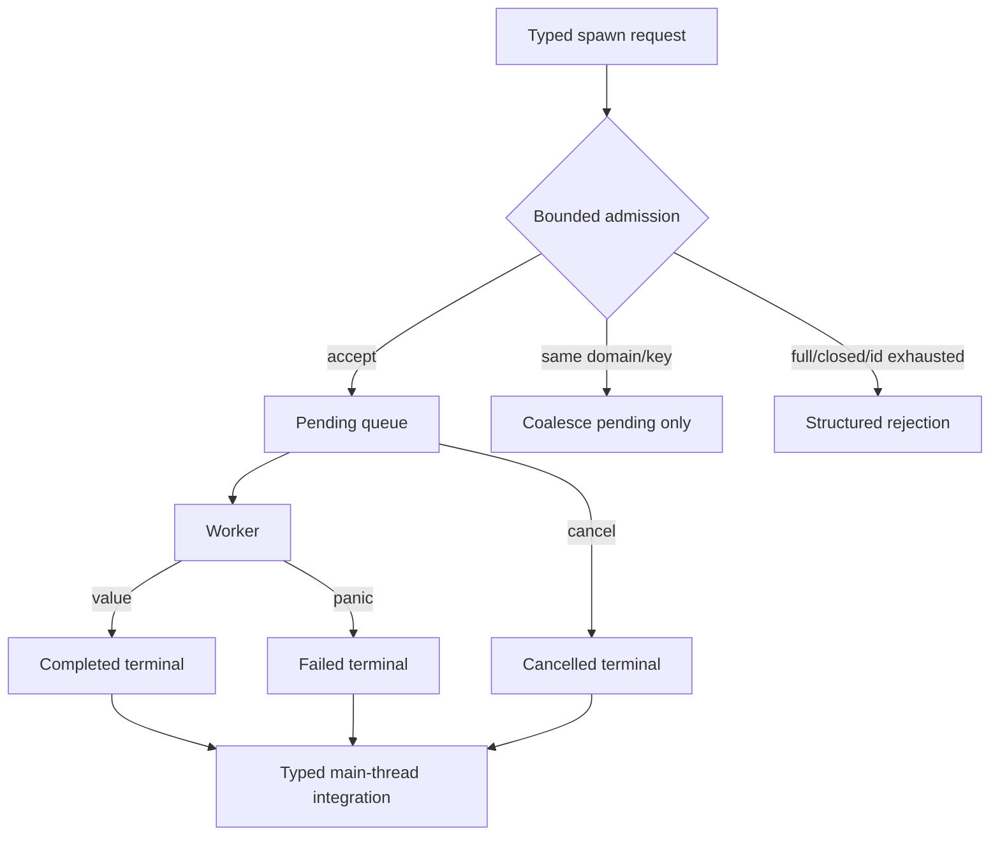

# ADR 0052: Task Backpressure, Cancellation, and Long-Running Diagnostics

**Status**: Accepted
**Date**: 2026-07-09
**Last Revised**: 2026-10-26
**Refines**: ADR 0008, ADR 0042, ADR 0048
**Refined By**: ADR 0080: Domain-Owned TaskUpdate Integration Sets

## Context

Asset reload storms, bulk import, image decoding, procedural generation, and editor jobs can submit
work faster than workers finish. An unbounded channel turns overload into memory growth and stale
work. Blocking submission freezes the main schedule. Running work inline after a channel failure
silently changes thread affinity and can execute expensive or untrusted work on the frame thread.

Cancellation, task panic, shutdown, and result ordering are also one state machine. If each caller
interprets those races independently, a completed value can be overwritten by late cancellation, a
worker panic can permanently reduce capacity, and shutdown can wait forever.

## Decision

`nara_tasks` owns bounded threaded pools, explicit admission outcomes, typed first-terminal handles,
and finite shutdown. Domains own typed result integration and overload policy.

### Configuration and admission

- IO, compute, and async-compute pools each have non-zero worker and pending-item limits. Per-kind and
  aggregate worker/pending maxima are validated before any thread is created.
- Optional lazy facilities keep those configured limits but activate only a used worker kind.
  First use may wait for OS thread creation on its submitter before queue admission; it is not
  part of accepted-admission-to-start timing. Partial startup rejects the closure with
  `WorkerStartupFailed`, closes that kind without implicit retry, and retains every successfully
  created worker for physical retirement. Other kinds remain independently usable. Eager
  construction remains available when startup must acquire worker capacity before publication.
- Submission never blocks for queue capacity and never falls back to caller-thread execution.
- Each request carries an admission tick, `TaskDomainKey`, overload policy, and receives a monotonic
  `TaskId`; together they form `TaskOrderKey`.
- Admission returns `Accepted`, `Coalesced`, or `Rejected`. A rejected closure is discarded without
  execution and the caller receives a typed reason.
- Coalescing matches `(activity identity, TaskDomainKey, TaskCoalesceKey)`, applies only to pending work, and replaces a
  match even when the queue is not full. The old handle becomes terminally cancelled with the
  replacement ID; running work is never coalesced.
- Scope admission and close use the same gate. Every accepted task registers physical-return
  custody before queue publication; a later close cannot miss a successful concurrent spawn.
  A closed activity refuses submission independently of the shared facility's lifecycle.
  Task IDs are facility-local; completion cutoffs retain activity-local identity and sequencing.

### Execution, cancellation, and statistics

- Tasks are owned `FnOnce(TaskCancellationToken) -> T` closures. Pool names, including
  `AsyncCompute`, select worker queues rather than a Future execution model. No task closure
  borrows the World or an owner-thread context across execution.
- Every task closure is individually unwind-isolated. Panic becomes the safe classification
  `TaskFailure::Panicked`; panic payload text is not retained in a handle, diagnostic, or dedupe
  key, and the worker continues serving work.
- Rust invokes the process-global panic hook before `catch_unwind`. `nara_tasks` does not replace or
  toggle that global hook. A host that may execute untrusted/recovery work must install a
  process-level redacting hook before starting workers; until that composition policy exists, task
  closures are trusted in-process code and must not place secrets in panic payloads.
- Completed, cancelled, and failed are mutually exclusive first-terminal states. Cancel-after-
  complete cannot erase a value; a detached or late closure cannot overwrite an earlier terminal.
- `TaskHandle::cancel` returns whether that call won the first-terminal transition. Dropping a
  handle only discards the caller's interest; it does not cancel queued or running work. This
  preserves Image's independent retirement of stale publication handles under ADR 0080.
- Cancellation is cooperative for running work. The handle may already be cancelled while the
  closure exits, but physical `running` count and age remain until the worker actually releases it.
  `TaskHandle::is_finished` describes terminal publication, including after the result is consumed;
  it does not prove that captured values, the closure, or a worker have physically retired.
- `TaskHandle::return_observer` observes executor-owned closure/capture disposal and any late result
  rejected by first-terminal publication. Its independent shared state does not retain task output
  storage. `Pending` lasts through disposal; `Returned` publishes successful disposal with
  Release/Acquire ordering; `CleanupFailed` reports a caught unwind only after the
  disposal path has returned. The execution boundary cannot distinguish a body panic from capture
  destruction panic, so either prevents proving successful cleanup. Neither terminal return state
  proves domain-native cleanup, worker joining, escaped Arc/child work or disposal of outputs
  already transferred to a terminal owner.
  A consumer must not interpret cleanup failure as successful resource cleanup.
  Rejected spawn disposes captures synchronously before returning and carries its final return
  state even when task-ID exhaustion prevented a handle. Queue/coalescing disposal may still block
  the submitter; this observation does not add a nonblocking disposal executor.
- Physical running count and age remain present while a worker disposes its pending task and
  control references, including an untaken completed output when its handle has already gone.
  The queue keeps only observation metadata during that disposal; destructors run outside its mutex.
- Admission never executes a rejected closure as an inline fallback. It can still run capture
  destructors while discarding rejected, replaced, or already-terminal pending work on the
  submitting thread. Dropping the last owner of an untaken completed result can similarly run its
  destructor on the dropping thread. These paths do not promise nonblocking submission or disposal.
- Stats expose admitted, rejected, coalesced, queued, running, started, completed, failed,
  cancelled, taken, oldest queued/running age, shutdowns, and shutdown timeouts. A detached-worker
  count is not exposed because dropping an unfinished `JoinHandle` is not a valid shutdown result.
  U18/U31 decide retention and diagnostic bridging; this crate does not log policy decisions.
- `live_workers` and other facade statistics describe the physical facility, including all its
  activities. `TaskHandle::admission_to_start` observes accepted queue publication through execution
  authorization, excluding submission setup and post-admission capture disposal. Work cancelled
  before start has no timing sample. These observations alone are not latency qualification.

### Result integration

- Background work never mutates `World`. Domains poll typed handles and apply typed terminals in
  their own declared integration sets. `nara_tasks` defines and configures no business-domain set;
  the asset domain's first concrete vocabulary is `AssetTaskUpdateSet` under ADR 0080.
- `OrderedTaskResults<T>` provides a cross-frame ordered-prefix policy: a larger key remains held
  until every smaller outstanding key is terminal. This makes application order independent of
  worker completion at the explicit cost of head-of-line blocking.
- Domains whose availability is intentionally asynchronous may instead sort one ready snapshot.
  That guarantees stable ordering only within that integration boundary, not across frames. Such a
  domain must not describe the policy as globally completion-order independent.
- Ordering streams should be partitioned by the smallest stable domain key that requires ordering;
  unrelated assets or jobs need not share one global head-of-line barrier.
- No global type-erased result bus exists.

### Test execution and shutdown

- Production and project settings create threaded pools. `TaskPools::inline_for_tests` and
  `run_pending_for_tests` are explicitly test-only drivers of the same bounded admission and terminal
  state machine; there is no production `Deterministic` execution mode.
- Plugin-created pools split the World-facing `TaskPools` facade from a move-only close owner that
  retains every worker `JoinHandle`. `TaskPlugin` registers that owner as an explicit runtime close
  participant; replacing or removing the World facade cannot make the original workers disappear
  from close evidence.
- Close linearizes with admission, closes queues, attempts deadline-bound drain, cancels remaining
  pending/running handles in bounded batches, and joins only workers already known to have exited.
  All three pool kinds begin closing together rather than serially consuming three complete timeout
  budgets.
- Physical close also prevents further lazy activation. An in-flight OS spawn remains in the
  same retained worker-custody object; close/Drop does not wait for its private startup mutex or
  take an incomplete handle snapshot. Completion requires startup to return and every created
  handle to join. Scope close need not wait for a first-use submission that has not been admitted;
  that later refusal and input disposal remain the submitter's responsibility.
- Removing previously admitted work for coalescing, reclamation or disposal transfers its custody
  under the queue lock before removal becomes visible. Destructors run outside that lock. Physical
  close also waits for these disposals to return, including on a submitting thread after workers
  have joined; timeout retains the same close owner for retry. A submission rejected after close
  disposes its own input synchronously but cannot reopen or expand the admitted close work set.
- Physical completion and successful cleanup are independent. A caught admitted cleanup unwind
  leaves bounded sticky failure evidence after custody ends, including close-owned control/result
  destruction and completed reaper receipts. The typed shutdown report retains that evidence;
  managed close completes physically with a terminal error, fails Stop and remains diagnosable by
  its Host. A normal task business `Err` alone is not cleanup failure. The existing unwind boundary
  cannot distinguish a task-body panic from captured-value destruction panic, so either prevents
  proving successful cleanup; no panic text or unbounded provenance log is retained.
- Reaching a drain, cancel, or join deadline records the historical timeout and yields an incomplete
  close while retaining the same owner and `JoinHandle` values. `RetryClose` polls only unfinished
  work; it does not repeat cancellation, increment shutdown counts, or invoke plugin shutdown
  again. A managed runtime reaches `Stopped` only after all registered owners complete.
- `TaskPools::shutdown_blocking` is the explicitly named standalone convenience driver over the same
  close state machine. It may return an incomplete report at the configured deadline, and a later
  call on the same pools continues the same owner.
- Drop closes admission and publishes cancellation for pending and running handles before moving
  unfinished handles plus pending-job destruction into a process-owned retained quarantine. A
  blocked capture destructor cannot delay another abandoned pending handle's logical cancellation.
  This visits the bounded pending queue in O(n) time. Pending capture disposal runs on internal
  drop lanes, and only finished workers are joined on the dropping thread. Running-control
  snapshots remain alive until all cancellation is published and pending captures have their
  retained disposal owner; a concurrently completed result's last snapshot therefore cannot delay
  those steps. Releasing a completed result's last owner can still run its user destructor on the
  dropping thread. Arbitrary result-destructor latency remains a G9 follow-up, and Drop does not
  promise constant time or bounded latency for user destructors. A small bounded set of internal
  drop lanes prevents one blocking pending destructor from monopolizing the owner coordinator.
  Physical disposal remains serial within each owner. An owner's receipt completes only after its
  pending queue, in-flight destructors, and worker handles are all complete. Lane saturation remains
  retained work rather than false `Stopped` evidence.
- `TaskPlugin` closes only pools it created. Externally inserted pools remain caller-owned; a
  completed plugin-owned close publishes the typed report in the world for inspection.

### Optional shared facilities and activity close

- `TaskFacilities` is an explicit Host-owned physical owner. `TaskScope` is move-only and produces
  activity-bound `TaskPools` submission facades. Those facades cannot mint another scope or close
  shared workers. Standalone pools remain a valid convenience composition.
- `TaskPlugin::shared` creates one activity, registers its owner before exposing the facade, and
  refuses an occupied facade. Replacing/removing that facade does not remove the registered close
  responsibility. The default plugin's physical-owner path and explicitly external standalone
  pools keep their existing contracts.
- Activity close immediately stops admission and requests cancellation; it has no whole-pool
  drain phase. It borrows queued/running task controls in place without retaining output-owning
  snapshots. Its queued captures transfer to the existing retained disposal lanes so they do not
  wait behind a sibling's uncooperative worker.
- Executor-owned return updates constant-space pending accounting after capture and rejected
  late-result disposal. Reclamation/coalescing disposal stays counted after queue removal.
  Rejected submissions are not admitted obligations. Nested work through the same facade is
  counted on admission and refused after close; independently escaped work needs another owner.
- `TaskScopeCloseReport` describes the registered Tasks activity, including sticky cleanup failure,
  not the Runtime's entire ledger or worker joining. Pending or uncooperative work keeps managed
  close incomplete; physically complete cleanup failure produces terminal close error. Published
  outputs remain caller-owned and are not retained by the scope.
- Scope Drop cancels and transfers pending disposal without waiting. The physical facility remains
  independently owned. Normal Host shutdown retires activities before joining workers; emergency
  physical shutdown can cancel all activities without manufacturing their physical completion.
- Shared bounded queues provide no per-activity fairness, reservation or latency guarantee.
  Default product deployment, lazy per-Runtime comparison and real workload policies remain open
  under [R4b](../../plans/2026-10-23-foundation-architecture-rebaseline-plan.md).

## Alternatives Considered

### Option A: Keep unbounded channels

**Pros**: Simple API and no immediate rejection handling.

**Cons**: Overload becomes unbounded memory/stale work, and shutdown has no finite work set.

**Decision**: Rejected.

### Option B: Block submission or run inline when full/closed

**Pros**: Avoids rejecting important work and can look reliable in small tests.

**Cons**: Freezes the frame thread, changes thread affinity, and bypasses cancellation/backpressure
contracts.

**Decision**: Rejected.

### Option C: Bounded queues with typed outcomes and integration policies (Chosen)

**Pros**: Makes overload observable, keeps the main loop responsive, preserves typed ownership, and
lets each domain choose the ordering strength it needs.

**Cons**: Callers must handle rejection/cancellation and ordered-prefix streams can block behind slow
work.

**Decision**: Chosen.

## Success Metrics

| Metric | Target | Measurement |
|---|---:|---|
| Bounded admission | Queue and worker counts never exceed validated limits | Unit tests |
| Explicit overload | Rejection/coalescing returns typed outcomes and updates stats | Unit tests |
| Panic isolation | A panicking task fails its handle and the worker runs later work | Threaded tests |
| Race safety | Exactly one terminal wins cancellation/completion races | Concurrency tests |
| Ordering | Ordered-prefix streams apply reverse completions by key | Typed integration tests |
| Truthful finite close | An uncooperative worker yields `CloseIncomplete`, retains its owner, and reaches `Stopped` only after retry joins the same handle; Drop remains nonblocking and one blocked destructor cannot monopolize another owner's receipt while a lane is available | Runtime/task shutdown tests |

## Risks and Mitigations

| Risk | Severity | Likelihood | Mitigation |
|---|---|---:|---|
| Rejection leaves a domain permanently loading | High | Medium | Require every domain to lower rejection/failure into its own terminal state and test it. |
| Ordered prefix causes head-of-line blocking | Medium | Medium | Partition streams narrowly and expose running age/cancellation; use snapshot policy only when semantically valid. |
| Capacity defaults oversubscribe the host | High | Medium | Validate aggregate worker/pending limits and apply project settings before plugin creation. |
| Retained uncooperative work outlives a runtime generation | High | Low | Jobs own inputs only, cancellation is cooperative, managed close remains `CloseIncomplete`, and abnormal Drop transfers the handle into process-owned quarantine rather than claiming completion. |
| Every bounded destructor lane is occupied by blocking user code | High | Low | Keep lane count internal, retain affected owners and receipts truthfully, and never run pending destructors on the coordinator or runtime driver thread. |
| Panic payload leaks secrets | Medium | Medium | Store a stable failure class only; U18 controls safe diagnostic fields. |
| Host panic hook prints a caught payload | High | Medium | Keep hook authority in host composition, require redaction before untrusted work, and never claim `catch_unwind` suppresses stderr. |

## Consequences

- Project task settings configure real `TaskPoolConfig` values before `TaskPlugin` installation.
- Server profiles use threaded bounded pools; deterministic-friendly simulation comes from typed
  admission/application order, not inline execution.
- Asset/import/editor domains must handle every spawn and terminal outcome and declare whether they
  use ordered-prefix or ready-snapshot integration.
- Shutdown timeout is observable history, while completion remains a separate fact. Managed runtime
  close retains the owner for retry instead of treating timeout or handle loss as success.
- The runtime's safe panic classification does not imply process stderr redaction; host composition
  owns that global policy and U18/U31 own its structured observability bridge.

## Open Questions

- Should real networking or scripting workloads introduce priority classes, or use separate bounded
  pools after latency evidence exists?
- Which domains require an ordered-prefix stream rather than snapshot-local ordering once their
  production workloads are measured?
