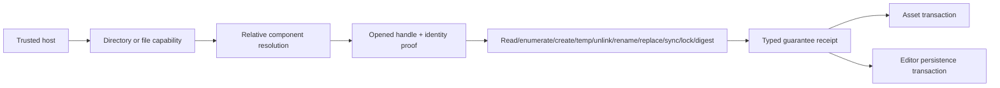

# ADR 0070: Capability-Oriented Filesystem Substrate

**Status**: Accepted
**Date**: 2026-07-10
**Last Revised**: 2026-10-28
**Refines**: [ADR 0035](0035-project-manifest-and-runtime-settings-authority.md),
[ADR 0049](0049-untrusted-project-input-and-parse-budget-policy.md),
[ADR 0050](0050-asset-root-symlink-junction-and-package-trust-policy.md)
**Refined By**: ADR 0079: Root Product Capabilities and Placeholder Domain Retirement;
[ADR 0110](0110-first-party-project-workflow-and-source-carrying-export.md): First-Party Project
Workflow and Source-Carrying Export

## Context

Assets, editor saves, recovery journals, import caches, and future exports need the same small set of
host filesystem primitives. Duplicating path containment, temporary-file, replacement, sync, lock,
and digest algorithms in each domain would reproduce security races and make durability claims
inconsistent.

A shared crate must not become a global virtual filesystem or own asset/editor transactions. It also
cannot promise one portable strength: Windows, Linux, macOS, BSD, network filesystems, and custom
mounts expose different identity, relative-open, replacement, and directory-sync guarantees.

## Decision

nara introduces `nara_fs`, a low-level platform adapter for capability-bound primitives. Domain
crates retain transaction state, retry policy, budgets, diagnostics, and publication semantics.

### Authority and path model

- A host issues opaque directory or file capabilities. Project content cannot construct, widen,
  serialize, or recover ambient authority from them.
- Relative inputs are non-empty validated components. Absolute paths, prefixes, `.`, `..`, empty
  components, embedded separators, and platform aliases are rejected before platform access.
- Capability methods return opened handles, identities, or typed receipts. No method returns a raw
  path carrying an authorization claim.
- Strict operations use handle-relative resolution with no-follow/reparse and beneath-root
  constraints. If the platform adapter cannot prove a required constraint, it returns
  `Unsupported` or `Unproven`; it never falls back to canonicalize-and-open.
- Adapter-wide capability matrices are conservative. Proof that depends on a concrete root handle,
  runtime kernel, sandbox, volume, or filesystem is stored on the issued capability and exposed by
  `DirectoryCapability::resolution_tier`; a compile-target check alone cannot report it as proven.
- `DirectoryCapability::same_object` returns `Result<bool, FsError>` by comparing proven native
  identity observations of two continuously live directory handles, including independent Host
  imports. It never reopens a pathname and fails closed when identity proof is unavailable. This
  lets a consumer bind a caller-issued strict installation capability to an already-opened project
  root without elevating either capability's authority. Equality does not equate session-scoped
  `FileIdentity` values or merge trust, rights, or generations. This is ordinary live-object proof,
  not immutable-content evidence or a persistent ID.
- `Unsupported` means the adapter, platform, or filesystem explicitly lacks the required primitive.
  `Unproven` means the primitive may exist, but sufficient evidence was unavailable for this object
  or runtime environment. Both fail closed for strict operations.
- Native lookup and exact stored spelling are separate operations. `open_file_exact` and
  `open_directory_exact` verify every descendant component without changing ordinary lookup
  behavior, folding names or reopening a returned ambient path. Windows local NTFS/ReFS uses a
  bounded normalized-name query on each opened handle; Linux uses a bounded native entry scan
  and no-follow device/inode association. Other adapters fail explicitly. These are per-component
  observations, not a frozen namespace, source identity or cross-file snapshot. Native source
  owners select this operation before assigning path-based semantic identity.

### Independent guarantee axes

One broad "safe" flag is forbidden. Results report independent guarantees:

| Axis | Required vocabulary |
|---|---|
| Resolution | `HandleBound`, `OpenedHandleOnly`, `CooperativeTrusted`, `Unsupported`, `Unproven` |
| Identity | live-handle/session object identity, capability generation, link count, object kind, and proof availability |
| Replacement parent authorization | `HandleBound`, `CooperativeTrusted`, `Unsupported`, `Unproven` |
| Replacement source binding | `HandleBound`, `NameBound`, `Unsupported` |
| Publication atomicity | `AtomicNameSwitch`, `NonAtomic`, `Unsupported`, `Unproven` |
| Conflict protection | `StrongCompareAndSwap`, `CooperativeLocked`, `DetectOnly`, `None`, `Unsupported`, `Unproven` |
| Durability progress | `DataSynced`, `FileMetadataSynced`, `NamePublished`, and `ParentDirectorySynced`, each achieved, unsupported, or unknown |
| Locking | advisory/cooperative or platform-enforced, with process scope and release ownership explicit |

These axes are independent. A handle-relative `renameat` may have handle-bound parent authorization
and atomic name publication while providing only detect-only conflict protection. Detect-only may
observe a stale expected identity before or after replacement, but it must not claim that it
atomically prevented overwriting a concurrent writer. Ordinary POSIX `renameat` plus a pre-check is
not compare-and-swap. Advisory locks provide cooperative protection only when all nara writers use
the same protocol. Durability receipts report completed OS-visible stages; they do not claim that
physical media has persisted data the operating system reported as synced.

### Borrowed file positions

A borrowed reader has its own logical position. A writable file capability separately owns one
logical write position, initially zero, which continues across writer borrows and lock/release.
Readers, reader seeks, bounded reads and digest inspection cannot reposition subsequent writes.
Writes use the exact authorized handle at that position and advance only by the actual returned
byte count. This is not append mode or a content snapshot: external growth does not move the
position, and concurrent foreign writes remain outside Nara's ownership guarantee. Requests beyond
the signed native offset range reject before I/O. No reopen-by-path or second lock owner implements
this cursor contract.

### Native lock ownership

- `FileCapability::try_lock(self, mode)` consumes the file and returns one non-cloneable
  `LockedFileCapability`. Rejection returns the original file together with `FsError`; it must
  not close the file merely because acquisition failed. There is no borrowed guard, reentrant
  acquisition, lock upgrade, or second acquisition path through the locked owner.
- Explicit `release(self)` returns the unlocked file on success. Failure returns the same locked
  owner together with its error so the domain can retain it and retry. No implicit retry or
  close runs before that error transfers ownership. Dropping a locked owner, including one in a
  discarded release error, attempts native unlock and closes the file without a success receipt.
- Reads, bounded reads, digests, and identity inspection use the exact owned handle. The locked
  surface exposes only the read and inspection operations required by its consumers; release
  restores the original file capability's rights. A `CapabilityReader` borrows that handle with
  an independent positional cursor; it never duplicates a descriptor, retains a lock after its
  owner closes, or grants a native unlock path. A live reader prevents consuming its owner for release.
- The locked owner exposes no raw handle, `FileCapability` reference, `Deref` escape, or native
  lease export. Successful native lease export from an unlocked file permanently marks that
  capability ineligible for subsequent acquisition; `try_lock` returns `Unproven` and the original
  file even after the lease is dropped, because its recipient may have duplicated it again.
  This also covers the executable lease. On Unix, a duplicate descriptor can change `flock`
  state on the same open-file description; hiding export only on the locked type is insufficient.
- `FileCapability::from_host_handle` cannot revoke or exclude aliases retained before import.
  Imported file capabilities therefore reject lock acquisition with `Unproven`, including a
  native lease duplicated and reimported as a new capability. Lock ownership requires a file
  independently opened or created through a directory capability without native handle export.
  Import still grants ordinary access to the exact host file. Nara's ownership contract covers
  its issued capabilities, not arbitrary foreign native operations.
- Windows continues to report platform-enforced byte-range locking; Unix continues to report
  advisory/cooperative `flock` with open-handle scope. Independent opens contend according to the
  native primitive. Rust ownership does not strengthen platform support, publication conflict
  protection, durability, or cross-process trust. Domain source-race and publication identity
  checks remain required.
- Long-lived generation markers store the locked capability directly. Deliberately forgetting
  a borrowed guard to keep a native lock alive is obsolete.

### Strict untrusted/recovery policy

- Open only regular files with a single link and directories needed for handle traversal.
- Reject symbolic links, junctions, magic links, and all reparse points by default. A reparse tag is
  accepted only after a tag-specific policy and adversarial tests prove that it cannot redirect,
  virtualize, or fetch content outside the capability contract. Unsupported network-volume identity
  and device/volume/mount transitions that cannot be proved absent also fail closed.
- Starting from the root capability, open each component handle-relative, validate the declared
  traversal constraints, and record scoped identity evidence for each opened object. The returned
  leaf handle is the access object; callers never reopen by name.
- Treat object identity as scoped to the live handle/session and capability generation. Native file
  IDs or inode values may be reused after deletion/close and must not become persistent trust IDs.
  A domain retaining an expected-object identity must retain the observed leaf or transfer custody
  continuously to another handle for that same object before closing it. Keeping only its parent
  or a copied identity does not extend the leaf's lifetime. A temporary publication consumer that
  needs the candidate identity after writer consumption must acquire and compare its retained
  handle while the original writer remains alive.
  Historical identity/digest observations may reject stale input; after their leaf has closed,
  subsequent publication needs a fresh read and domain admission, not asserted object continuity.
- Exclusive temporary creation occurs in the verified target directory and returns a handle.
- Cleanup must be bound to that same temporary handle. Unix has no portable unlink-by-handle
  primitive, so the foundation never emulates it with `stat(name)` followed by `unlink(name)`: explicit discard
  reports `Unsupported`, drop closes the handle, and the name remains a recoverable orphan. A later
  bounded recovery workflow may remove it only through a primitive whose guarantee is explicit.
- Streaming digest reads are bounded by the calling domain and compare length and digest without
  publishing partial output.
- Handle-bound authorization is not a content snapshot. A caller requiring immutable input verifies
  an expected digest during the read or copies into an engine-owned immutable candidate before use.

### Platform evidence matrix

- **Windows reference contract:** Windows 10 version 1809 or later, or the corresponding Windows
  Server 2019 or later API baseline, on x86-64 using local NTFS or ReFS volumes. Strict traversal
  uses `NtCreateFile` relative to a directory handle with
  `FILE_OPEN_REPARSE_POINT`; every reparse tag is rejected, including symbolic links and junctions.
  Live identity requires `FILE_ID_INFO`, `FILE_STANDARD_INFO`, attribute-tag inspection, absence of
  `FILE_REMOTE_DEVICE`, and an NTFS/ReFS filesystem name. Remote redirectors, local custom
  filesystems, missing identity queries, multi-link regular files, and cross-volume transitions are
  `Unproven`, never strict. Replacement uses `NtSetInformationFile` with
  `FileRenameInformationEx`; success binds the candidate handle and parent handle, while directory
  synchronization remains `Unsupported`. Older Windows releases are outside the supported matrix
  and a failed native replacement never produces a receipt. The default unprivileged gate injects
  symbolic-link, mount-point, and unknown reparse-tag facts at the platform seam and exercises the
  public capability-open validation chain. Live symlink and junction integration cases remain
  explicit privileged tests and must be run by the corresponding Windows job rather than silently
  skipped or treated as default-gate evidence.
- **Linux reference contract:** Linux kernel 5.6 or later on x86-64. The adapter-wide matrix reports
  strict resolution as `Unproven`; each root capability probes `openat2` with beneath-root,
  no-magic-link, no-symlink, and no-cross-device flags before strict authority is issued. `ENOSYS`,
  `EINVAL`, or `EOPNOTSUPP` is `Unsupported`; a runtime policy that returns `EPERM` is `Unproven`.
  Strict live identity is currently limited to local ext, XFS, Btrfs, tmpfs, OverlayFS, and NTFS3
  filesystem types. Other, remote, or custom filesystem types fail closed. `st_dev` is only a
  cross-check and never substitutes for `openat2` mount evidence. The currently implemented generic
  Unix replacement remains `NameBound`, so strict replacement remains rejected. CDPF-U2 implements
  a narrower dedicated no-replace directory-publication primitive; it does not upgrade the generic
  replacement tier.
- **CDPF directory-publication contract:** The first publicly supported same-capability directory
  no-replace implementation is narrower than the general reference matrices above. x86-64 Windows
  on a probed local NTFS workspace uses the handle-bound `FileRenameInformationEx` no-replace form
  against the live source and parent handles. x86-64 Linux 5.6 or later on a probed local ext4
  workspace uses `renameat2` with `RENAME_NOREPLACE` against the same live parent directory
  descriptor under the `TrustedLocal` cooperative-writer tier. Linux proves parent/mount authority,
  destination no-overwrite and atomic naming, but its source binding remains explicitly
  `NameBound`; it is not reported as handle-bound strict source publication. Receipts bind the
  caller-supplied high-entropy sibling staging observation, validated absent child name, parent capability
  generation/identity, same-volume or same-mount proof, and exact source-binding tier. Collision,
  identity drift, unsupported filesystem behavior, or any native result that cannot prove the
  claimed tier returns `Unsupported` or `Unproven`; neither adapter falls back to a destination
  precheck followed by ordinary rename. Hosted jobs must prove each exact combination before that
  tier is documented as available. ReFS, XFS, Btrfs, tmpfs, OverlayFS, NTFS3, macOS, and other
  combinations remain `Unsupported` or `Unproven` until dedicated live evidence exists; injected
  platform-seam tests alone do not broaden public support.
- **CDPF implementation status:** CDPF-U1 through CDPF-U3 implement capability-owned staging, exact
  consuming publication, truthful begin/publish terminal outcomes and an isolated external public
  consumer. The Windows x86-64 consumer has live local-NTFS evidence for handle-bound no-replace
  naming, collision, exact destination identity and complete reopen. The Linux
  `renameat2(RENAME_NOREPLACE)` implementation and external tests compile for x86-64 Linux, but
  ext4 remains unverified until a dedicated hosted filesystem job runs. A compile target, generic
  Linux runner or injected platform seam is not a hosted support claim. Verification record
  `1c01523e7462406dabf4a177cf64285c` owns the conformance baseline.
- **macOS and other Unix contract:** no current adapter proves absence of same-device mount
  traversal. Strict untrusted/recovery directory capabilities therefore return `Unproven`.
  Host-selected trusted mode may use no-follow `openat` and name-bound `renameat`, but receipts keep
  those weaker tiers explicit.
- **Other targets:** native filesystem authority is `Unsupported`; compiling the crate does not
  create a permissive path fallback.
- Directory flush support varies. Receipts report which data, file-metadata, name-publication, and
  parent-directory-sync stages completed, were unsupported, or remain unknown; callers do not infer
  directory durability from file flush success.

### Implemented foundation and downstream ownership

The implemented foundation supplies the shared authority substrate required to start downstream
work: host-handle import, validated relative components, capability-specific resolution evidence,
live identity, exclusive same-directory temporary creation, truthful replacement tiers,
capability-owned finite-directory staging, exact no-replace directory publication, typed terminal
cleanup/orphan outcomes, file/directory sync reporting, locking, positional reads, and bounded
digest verification. Windows handle-bound temporary discard is included; Unix discard deliberately
leaves a recoverable orphan rather than risking deletion of the wrong name.

One reserved public operation remains explicitly `Unsupported` and is not counted as implemented
foundation capability:

| Reserved primitive | First owning unit | Completion rule |
|---|---|---|
| Relative identity-guarded unlink and orphan reclamation | Proposed ADR 0091 persistence/recovery | Add a platform-specific exact-object or explicitly weaker recovery primitive in `nara_fs`; editor persistence/recovery must not reproduce `stat + unlink`. |

The completed [Editor Project Browser and Source Index v1](../../plans/2026-08-19-001-feat-editor-project-browser-and-source-index-v1-plan.md)
plan implements the previously reserved handle-bound enumeration primitive and its first Host and
Editor consumer. Its hosted product claim is limited to
Windows x86-64 on local NTFS with per-capability proof. Linux now implements independent cursors
through an identity-checked readable `openat(".")` relative to the live directory and `rustix::fs::Dir`.
Raw entry names remain observations; existing name budgets, strict child opens and identity checks
own admission. No ambient-path fallback, shared cursor offset or stronger unlink/publication claim
follows. Cross-compilation alone does not qualify the Linux hosted product; its runtime evidence
must be recorded separately. Other Windows filesystems, remote shares, macOS and other targets
remain `Unproven` or `Unsupported` until their own implementation and evidence exist.
`nara_fs` owns only bounded handle-relative enumeration and scoped entry
observations; root selection, traversal budgets, classification, immutable index publication, and
document admission remain Host responsibilities.

This deferral does not treat static `Unsupported` values as successful evidence. RGF-U3 is the
first production consumer of bounded host-issued file authority for `nara.toml`. RGF-U12 now reuses
the same root/open/identity boundary for the path-addressed startup content closure without ambient
path reopen or directory enumeration. CDPF-U1 through CDPF-U3 now own the first bounded
same-capability no-replace directory-publication implementation and its independent public consumer
baseline. That baseline permits a later registration to activate Fresh Project work; it does not
activate the successor automatically or claim hosted Linux/ext4 support. Future indexing, asset
rename, and ADR 0091 persistence/recovery work reuse or extend the primitives here; downstream
domain crates are prohibited from copying those platform algorithms.

## Alternatives Considered

### Option A: Keep platform code in each domain

**Pros**: Each domain can optimize its immediate workflow.

**Cons**: Security and durability algorithms drift, and fixes must be repeated across asset, editor,
cache, and export code.

**Decision**: Rejected.

### Option B: Adopt a portable capability crate as complete proof

**Pros**: Smaller local implementation and ergonomic ambient-authority isolation.

**Cons**: A portable facade alone cannot prove Windows reparse chains, same-device mounts,
replacement compare-and-swap, or directory durability for nara's strict policy.

**Decision**: Rejected as the proof authority; a dependency may assist implementation behind
`nara_fs` if each guarantee remains independently verified.

### Option C: Narrow platform adapter with explicit guarantee tiers (Chosen)

**Pros**: Centralizes dangerous primitives, exposes honest platform evidence, and lets domains build
transactions without duplicating native algorithms.

**Cons**: Some host/filesystem combinations must fail closed, and native integration tests are
required.

**Decision**: Chosen.

## Consequences

- `nara_fs` is the only shared owner of native relative open, identity, directory enumeration,
  temporary creation, relative unlink, same-capability rename/non-overwrite rename, replacement,
  sync, lock, and digest primitives. Directory entries pair relative names with scoped object
  observations; they are not ambient paths or durable identities.
- `nara_asset`, `nara_tooling_fs`, and future export code own their workflows but must not duplicate a
  platform algorithm already provided by `nara_fs`.
- Platform support is a matrix of proven capabilities, not a binary crate-compiles claim.
- A host may import an already-opened file into an `OpenedHandleOnly` capability when strict child
  resolution is unavailable; that grants access only to that object, not its siblings or parent.
- Tests must distinguish strict security evidence from trusted/cooperative functionality.

## Success Metrics

| Metric | Target | Measurement |
|---|---:|---|
| Ambient authority | Domain APIs cannot construct capabilities from unchecked paths | Compile/API tests |
| Honest support | Missing proof returns `Unsupported`/`Unproven` with no permissive fallback | Negative platform tests |
| Race resistance | Root/intermediate/leaf replacement cannot escape a handle-bound operation | Adversarial integration tests |
| Shared primitives | Asset and editor adapters reuse `nara_fs` without moving domain policy into it | Dependency review |
| Receipt truth | Replacement and durability receipts never overstate platform guarantees | Failure-injection tests |

## Risks and Mitigations

| Risk | Severity | Likelihood | Mitigation |
|---|---|---:|---|
| Native APIs are unstable or incompletely wrapped | High | Medium | Keep unsafe/native code isolated, test supported OS/filesystem pairs, and return unsupported elsewhere. |
| Capability API becomes a general VFS | Medium | Medium | Expose primitives and evidence only; keep source lookup and transactions in domain crates. |
| Cooperative lock is mistaken for exclusion | High | Medium | Encode the locking and replacement guarantee in types and receipts. |
| Directory sync differs by filesystem | Medium | High | Report the observed durability tier and let persistence policy decide whether it is sufficient. |
| Strict mode rejects developer setups | Medium | Medium | Permit host-selected trusted tiers without changing strict package/recovery defaults. |

## Revisit Triggers

- A macOS/BSD host broker or native mount-identity primitive can prove strict no-mount traversal.
- A supported Unix platform gains a practical unlink-by-handle primitive, or nara adopts unnamed
  temporary files plus handle-bound publication for that platform.
- Supporting a Windows filesystem beyond local NTFS/ReFS gains identity, reparse, replacement, and
  failure-injection evidence equivalent to the reference contract above.
