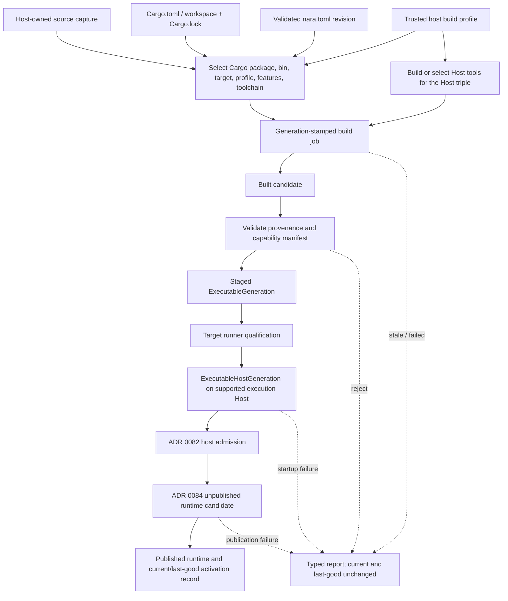

# ADR 0086: Rust Project Build and Executable Generation

**Status**: Proposed
**Date**: 2026-07-13
**Last Revised**: 2026-10-23
**Owner**: executable hosts, build tooling, and Rust project composition
**Admission Trigger**: Scoped fixtures separately prove Cargo-authoritative Host tool construction,
immutable target executable build/provenance, and target-runner activation/last-good behavior;
a foreign-target build does not require running that executable on the build Host
**Revisit Trigger**: A proven stable dynamic ABI, remote build system, or generic editor workflow
requires a different executable activation topology
**Related**: ADR 0010, ADR 0020, ADR 0035, ADR 0046, ADR 0052, ADR 0055, ADR 0056,
ADR 0068, ADR 0070, ADR 0079, ADR 0082, ADR 0084, ADR 0088, ADR 0093

## Context

Rust is Nara's complete game-authoring language. Data and asset edits can reload directly, but a
structural Rust edit changes code, layout, plugin topology, features, or dependencies and therefore
requires a new executable generation. Existing ADRs correctly reject a universal stable Rust ABI
and require fresh isolated runtimes for structural changes, but they do not yet define:

- whether Cargo or `nara.toml` owns the Rust package graph;
- how editor builds select a package, binary, target, profile, and feature ceiling;
- when compiled bytes become a validated executable generation;
- how an executable host generation differs from an ADR 0084 runtime generation;
- which failure point may advance current/last-good state.

Without one product contract, desktop, editor, headless, and exported builds could resolve different
dependency graphs or treat compile success as runtime publication. Copying Cargo data into
`nara.toml` would also create a second Rust package manager that inevitably drifts.

## Decision

If accepted, file-backed Nara applications will remain ordinary Cargo packages or workspace
members. Cargo metadata and the application lockfile own Rust dependency resolution; Nara tooling
owns bounded build and activation workflows around immutable executable generations. Host tool
construction, target executable construction, and target qualification/activation are separate
operations with separate results.

### Manifest Authority

- `Cargo.toml` or an owning workspace manifest declares the available Rust dependency graph,
  feature relationships, build scripts, and targets. The application `Cargo.lock` fixes package
  resolution only; it does not select enabled features.
- `nara.toml` owns Nara project settings, product capability requests, content roots, startup
  content, and product profile requests. It cannot inject Cargo arguments or enable compiled code.
- A trusted host/build profile selects an existing Cargo package, binary, target triple, Cargo
  profile, and explicit Cargo feature set. That selection produces the compiled capability ceiling.
  The normalized `nara.toml` product request must be a subset of that ceiling under ADR 0079.
- `nara.toml` does not restate source files, dependency constraints, feature definitions, or lock
  resolution. Mapping a named product profile to Cargo selection is trusted host/repository policy.
- Embedded applications may omit `nara.toml` and construct settings explicitly, but their code is
  still compiled by the caller's Cargo graph.
- Every executable-generation build, including development, uses the captured application lockfile
  with locked resolution. Dependency updates are an explicit authoring action that publishes a new
  lock revision before another build request. Toolchain acquisition, registry authentication, and
  dependency vendoring remain host/repository policy.
- Cargo owns dependency, feature and target resolution, including its Host/target treatment of
  build scripts and proc macros. Nara inspects Cargo metadata/artifact messages and selects trusted
  inputs; it does not add a resolver, compiler/name-resolution frontend, or duplicate feature graph
  in `xtask`. Fixed starter binary names, feature sets and file observations are starter-adapter
  policy, not the general project contract.

### Host Tools, Target Builds, and Target Qualification

A Host-side importer, cooker or build coordinator must run on its execution Host. A Player/server
executable is compiled for its selected target, which may differ from that Host. Each selection
explicitly names Cargo package/bin/profile/features/target/toolchain; a desktop label alone cannot
infer the flags, and tool and Player selections need not share a binary or feature set.

1. **Host tool build/selection** establishes runnable trusted tooling for the Host triple and
   records its implementation identity. It is not a Player build or runtime-readiness receipt.
2. **Target executable build** produces immutable bytes plus verified artifact/provenance facts
   for the chosen target. Compile/link success and integrity validation can finish on a different
   Host; a foreign binary need not and must not be executed there merely to declare build success.
3. **Target qualification/activation** runs on a supported native, remote or explicitly admitted
   emulated target runner. Its result records that runner and scope. Only actual Host/runtime
   admission can establish readiness or advance an activation last-good record.

An unavailable target runner leaves a valid built artifact `Unqualified`, not falsely `Ready` and
not a failed compilation. Cross-target build-plan validation is not native platform qualification.
Trusted selection of executable tools is separate from reading project configuration or content.

### Generation Axes

These generations are independent:

| Generation | Owns | Publication evidence |
|---|---|---|
| Host tool generation | Immutable Host tool bytes/implementation identity and Host-target selection | Host artifact validation and the tool operation's required qualification |
| `ExecutableGeneration` | Immutable target code artifact digest/length, provenance-manifest digest, target/profile, and compiled capability ceiling | Artifact/provenance validation; activation is a separate fact |
| `ExecutableHostGeneration` | One OS process or in-process host activation of an executable artifact | Host adapter reports admitted startup |
| ADR 0084 runtime generation | One isolated `App`, `World`, service sessions, and runtime lifecycle | Runtime candidate publishes `Ready` |

Compile/link success creates only a built candidate. Validated bytes may publish an immutable
executable artifact without publishing a Host/runtime or marking an activation last-good.

### Build Request and Candidate Publication

A build request captures immutable identities for:

- Host-owned source capture identity, its consistency envelope, and `Cargo.lock` digest;
- selected package and binary target;
- Rust target triple, Cargo profile, and toolchain identity;
- explicit normalized Cargo feature set selected by the trusted build profile and the resulting
  Nara compiled product capability ceiling;
- the relevant validated Nara project revision.

The staged generation identity binds the verified executable byte digest and length plus the
canonical provenance/capability manifest digest. A reused output path or matching request metadata
without matching bytes is not the same generation. Bit-for-bit reproducible compilation is not
required, but published bytes are immutable and integrity-verifiable.

Source capture binds the selected immutable inputs actually consumed, with per-member
identity/digest evidence, capture/revalidation policy, and explicit unsupported or untracked
inputs. It may be produced without the full Editor recovery journal. It is not a claim of an
instantaneous workspace-wide filesystem snapshot or a hermetic Cargo build: trusted build scripts,
proc macros and external tools may have ambient inputs unless a separately qualified mechanism
constrains them.

The build coordinator is host/tooling state, not an ECS resource, `nara_project` side effect, or
gameplay task pool. It owns compiler processes/jobs, diagnostics, staged artifacts, retention, and
current/last-good activation pointers.

Raw Cargo, rustc, build-script, linker, and external-tool output is a bounded, access-restricted,
short-retention local build artifact. It may contain absolute paths, source fragments, environment
values, private registry locations, or credentials and therefore never enters the ADR 0048 runtime
bus, remote tooling, package provenance/manifests, telemetry, or durable review evidence directly
or by default. Those sinks receive only structured summaries that follow ADR 0068 field
classification and retention policy. A future authenticated raw-log viewer requires its own
access, disclosure, transport, and retention contract.

1. resolve Cargo metadata from the trusted build profile and validate package/bin/profile/target;
2. preflight the captured lock revision, explicit feature set, toolchain, and compiled ceiling;
3. run a locked generation-stamped build job, reusing Cargo's build cache and staging final bytes
   separately rather than requiring a new Cargo target directory per generation;
4. validate artifact kind, target, provenance, and capability manifest;
5. stage an immutable executable generation;
6. return the validated target build result independently of a launch;
7. on a separate activation request, let a suitable target runner start an executable Host
   generation and run ADR 0082 admission plus ADR 0084 unpublished runtime startup;
8. advance activation current/last-good only after the runtime publishes successfully.

If source, lock, project, or selection state advances during a build, the old job may finish for
diagnostics/cache reuse against its original capture, but is `Superseded` for the current request
and cannot replace that request's selected artifact or activation. Cancellation is best effort;
a late compiler result cannot acquire current publication eligibility.

Editor Play and other integrated launchers expose which source/project/content revision is current,
which executable is building, which candidate is staged, which exact executable/host/runtime
generation is active, and which last-good record is available. Play must not silently run an older
generation. Building, build failure, candidate-start failure, explicit last-good launch, retry, and
cancel are distinct observable states and actions.

### Structural Change and Last-Good Policy

- Game code, engine crates, and native Rust plugins are statically linked in the normal production
  path. Nara does not promise a stable Rust dylib/plugin ABI.
- Compatible function-body patching remains an explicit development capability under ADR 0093.
  Structural, unknown, or capability-changing edits always build a new executable generation.
- If old and candidate hosts can coexist, the old runtime remains active until the candidate
  runtime is ready. If a platform forbids coexistence, the host retains a complete last-good
  activation record and the leases needed to launch it until replacement is proven.
- `LastGoodActivationRecord` binds one verified executable generation to the exact immutable ADR
  0082 runtime recipe/project revision and ADR 0088 content mount-set snapshot that previously
  completed startup. Executable bytes alone are code-last-good evidence, not proof that current
  mutable project/content inputs can launch them.
- Last-good does not mean restoring process memory or migrating native state.
- State restoration uses declared document/save/checkpoint contracts only. Failed candidates do
  not update current, last-good, or project saved state.
- Artifact/input retirement is reference/lease and budget aware. At least one complete launchable
  last-good activation record and its immutable inputs are retained unless the user explicitly
  invalidates it.

### Trust and Deliberately Unfrozen Scope

Cargo build scripts, proc macros, native dependencies, and game code execute as trusted author code.
A project data file cannot cause the host to download, compile, enable, or execute a missing plugin
without an explicit trusted host action.

This proposal does not choose distributed compilation, remote cache protocols, toolchain manager,
registry credentials, signing/notarization, bit-for-bit Rust binary reproducibility, a mandatory
child-process editor topology, or content cooking/package formats.

## Alternatives Considered

### Option A: Leave Builds as Manual `cargo run`

**Pros**: No engine build coordinator.

**Cons**: No stale-result guards, target/profile parity, last-good activation, or editor-facing
fault model.

**Decision**: Rejected as the product workflow; direct Cargo commands remain a supported adapter.

### Option B: Duplicate the Rust Graph in `nara.toml`

**Pros**: One apparent engine project file.

**Cons**: Creates a second package resolver and lock authority that drifts from Cargo.

**Decision**: Rejected.

### Option C: Load Every Game as a Stable Rust Dynamic Library

**Pros**: A permanent editor process could swap code in place.

**Cons**: Rust ABI, layout, dependency, and plugin topology are not stable; structural state and
native handles cannot be safely assumed compatible.

**Decision**: Rejected as the default. A future proven adapter may expose narrower capabilities.

### Option D: Cargo Applications with Immutable Executable Generations

**Pros**: Preserves Rust-native tooling, one dependency authority, fresh isolation, explicit
last-good behavior, and desktop/headless parity.

**Cons**: Structural iteration pays incremental compile and activation cost.

**Decision**: Proposed.

## Success Metrics

| Metric | Target | Measurement |
|---|---:|---|
| Independent workspace | Renamed Nara dependency builds locked desktop/headless dev and release bins | External fixture matrix |
| Host/target separation | A Host tool and foreign-target Player have independent explicit Cargo selections; building the Player does not execute it on the Host | Build-plan and artifact fixture |
| Qualification honesty | Built, integrity-verified, target-qualified and runtime-ready are distinct results; an absent runner never yields readiness | Runner-unavailable and target activation fixtures |
| Authority separation | Trusted build profile selects features/ceiling; `nara.toml` only validates as a subset | Metadata/composition tests |
| Structural safety | Layout/plugin/dependency/feature changes inject zero code into the active host | Capability and API audit |
| No partial publication | Build, validation, host, or runtime failure leaves current/last-good activation records and bytes unchanged | Fault-injection matrix |
| Last-good recovery | Failed candidate leaves old runtime active or the bound executable/recipe/content snapshot launchable | End-to-end test |
| Supersede safety | Of three edits during compilation, only the latest revision may publish | Concurrent build test |
| Capability parity | Artifact ceiling and ADR 0079 subset checks reject mismatch before `App` mutation | Composition tests |
| Release hygiene | Release dependency graph excludes editor/tooling/hot-patch/VM unless explicitly requested | Cargo metadata audit |
| Provenance | Every generation binds byte digest/length and manifest digest covering package/bin, target/profile, lock, toolchain, features, and request ID | Manifest fixture |
| Generation visibility | Integrated Play always identifies current source/content, building candidate, active executable/runtime, and explicit last-good use | Tooling state and failure-flow tests |
| Diagnostic privacy | Raw tool output remains local/restricted; every exported sink receives classified structured fields only | Sink boundary tests and canary scan |

## Risks and Mitigations

| Risk | Severity | Likelihood | Mitigation |
|---|---|---:|---|
| Incremental builds are too slow | High | Medium | Preserve Cargo units, stage only immutable results, measure before adding remote/distributed complexity. |
| Editor and exported builds diverge | Critical | Medium | Use one Cargo target/profile selection and the same ADR 0082/0084 startup path. |
| Build success is mistaken for runtime success | High | Medium | Publish artifact evidence separately; advance activation last-good only after target runtime publication. |
| Stale compiler result replaces newer code | High | Medium | Stamp every request and validate expected revision immediately before publication. |
| Native build code is mistaken for sandboxed content | Critical | Low | Declare trusted-code authority and require explicit host action before compilation/execution. |
| Raw build output leaks host or credential data | Critical | Medium | Keep raw output local, bounded, access-restricted, and short-lived; export only classified structured summaries. |
| Artifact/input retention grows without bound | Medium | High | Use leases, budgets, activation roots, and deliberate garbage collection. |

## Consequences

If accepted:

- ADR 0020's source layout includes Cargo authority without turning `nara.toml` into a package
  manager;
- ADR 0093 remains the iteration strategy and delegates structural edits to this generation flow;
- ADR 0079 continues to validate compiled ceiling, project request, and resolved plugin capability
  subsets before mutation;
- ADR 0082/0084 remain the host/runtime authority; the build coordinator cannot publish a raw
  runnable `App` through a parallel path;
- target content cooking and packaging remain independent. A last-good activation record may bind
  their immutable content snapshot without making content-only changes a new executable generation.

## Admission Evidence

Admission may select the Host tool and immutable target-build contracts before target activation
is qualified. Their evidence includes independent Cargo selections, locked builds, exact artifact
provenance, stale-result rejection and a Host/target-different plan/artifact fixture. No target
execution on the build Host is required. Source-capture evidence states its actual consistency
envelope and is independent of the full ADR 0091 journal.

The activation slice requires Accepted ADR 0082/0084 Host/runtime authority or named compatible
Accepted successors, plus an explicit native-code trust owner (or a scope limited to already
trusted code-first builds). Its editor/desktop/headless fixtures prove capability rejection,
observable active/candidate/last-good generations and the end-to-end last-good fault matrix on
the actual runner. Build-only evidence cannot qualify that slice or a foreign platform release.
Every slice with an external diagnostic sink must reject raw-output canaries. A `cargo build`
wrapper without immutable artifact/provenance validation is insufficient even for the build
slice; missing activation evidence does not invalidate an honestly scoped build result.

## Citations

- Cargo workspaces: <https://doc.rust-lang.org/cargo/reference/workspaces.html>
- Cargo lock files: <https://doc.rust-lang.org/cargo/guide/cargo-toml-vs-cargo-lock.html>
- Unity assembly definitions: <https://docs.unity3d.com/Manual/assembly-definition-files.html>
- Unity domain reload behavior: <https://docs.unity3d.com/Manual/domain-reloading.html>
- Godot editor game-run process: `repo-ref/godot/editor/run/editor_run.cpp`
