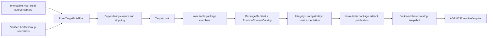

# ADR 0088: Target Build, Cook, Package, and Runtime Content Catalog

**Status**: Proposed
**Date**: 2026-07-13
**Last Revised**: 2026-10-23
**Owner**: product build hosts, `nara_asset`, cook providers, and runtime content adapters
**Admission Trigger**: A local immutable base catalog proves declared dependency closure, target
cooking/stripping, verified Runtime bytes and source-free boot; patch/DLC, remote authenticity,
resolver replacement and rollback qualify later rather than gating that first slice
**Revisit Trigger**: A real store, CDN, streaming-install, encrypted container, or platform signing
adapter proves that the logical package/mount-set model cannot express its requirements
**Related**: ADR 0020, ADR 0035, ADR 0037, ADR 0049, ADR 0050, ADR 0051, ADR 0055, ADR 0056,
ADR 0068, ADR 0070, ADR 0079, ADR 0082, ADR 0083, ADR 0084, ADR 0086, ADR 0087, ADR 0091

## Context

ADR 0020 intentionally owns only the source project layout. ADR 0087 proposes immutable imported
product groups. Neither defines the production path from a validated project revision to target-
specific runtime content:

```text
authored source -> imported products -> cooked members -> packages -> mounted runtime catalog
```

Godot export presets, Unity Build Profiles/Addressables, and Unreal cooking/Asset Manager all make
this a product-level contract. Without one, Nara could accidentally ship `.meta` and import-cache
internals, omit dynamically addressed content, include client-only assets in a server, or let one
runtime acquisition resolve through a mixed package set during a patch. A package container is an
implementation detail; dependency closure, identity, compatibility and Host-authorized catalog
admission are the first durable boundaries. Atomic resolver updates and overlay trust add further
obligations when those operations are introduced.

## Decision

If accepted, Nara will separate target planning, cooking, package generation, and runtime mount.
Every stage consumes immutable verified inputs and publishes a new immutable generation. The first
source-free slice is a Host-trusted local immutable directory plus base catalog; it does not need
an archive, patch/DLC system or remote package service.



### Stage and Identity Separation

| Value | Meaning | Not interchangeable with |
|---|---|---|
| Build-source capture digest | Host-retained immutable source closure and its explicit consistency envelope | Editor transaction commit, import or package generation |
| `ArtifactGroupManifest` digest | Verified source-import product group | Cooked/package identity |
| `TargetBuildPlan` digest | Pure target/profile/closure recipe | Executable or artifact bytes |
| `PackageManifestDigest` | One immutable package artifact and member table; initially a local base | Mount-set generation or residency |
| `MountSetGenerationId` | One validated package resolver snapshot; initially a singleton base | Package artifact or runtime handle |
| `RuntimeContentCatalogDigest` | Merged identity-to-member mapping bound to one mount set | Residency state |
| Optional `ExecutableGeneration` manifest digest | Compatibility input from ADR 0086 | Content/package identity |

These values may reference each other through manifests; they are never cast, reused, or inferred
from display names and timestamps. Non-authoritative release correlation metadata may link code,
content, symbols, and diagnostics, but a content-only patch does not create a new executable
generation.

### Pure Target Build Plan

`TargetBuildPlan` is side-effect-free inspectable data derived before cook work starts. It records:

- target triple/platform, build profile, and normalized product capabilities;
- immutable Host build-source capture, its consistency evidence, schema/catalog fingerprints and
  verified artifact-group snapshots;
- optional compatible ADR 0086 executable-generation manifest digest when the product couples code
  and content;
- engine/plugin/importer/cook-provider/toolchain provenance;
- startup scenes, always-include roots, explicitly addressable groups, and target-specific roots;
- client/server/headless/editor exclusions and required compatibility ranges;
- package assignment policy, with chunk/overlay policy only where that later scope is selected.

Release planning accepts a Host-owned immutable source capture plus verified artifact groups. The
capture binds selected roots, exact source/metadata/continuity and auxiliary member bytes/digests,
their identity evidence, and the admission/revalidation policy. A qualified ADR 0091 transaction
snapshot can supply it, but full Editor journaling is not a dependency of build-source capture.
An explicitly marked unsaved development capture cannot silently publish as saved release source.

Per-file capture does not prove that an entire mutable workspace existed at one instant. A build
requiring a cross-file invariant must obtain stronger evidence, such as an immutable source tree
or a qualified committed generation, or reject/retry that capture. The plan states this consistency
envelope and any untracked native-tool/environment inputs; immutable captured content is not a
claim of filesystem-wide atomicity or hermetic compilation.

Deterministic content recipes use canonical member identities, bytes/settings/continuity digests
and declared tool/target inputs. Capture-instance IDs, timestamps, absolute locations and live-file
identity receipts remain separate provenance, not accidental sources of a new content recipe.
Keeping those receipts does not assert that different capture instances are the same operation.

Host tool construction/selection, target executable build and target activation/qualification
remain separate under ADR 0086. Host cooker/importer tools use their Host selection, while the
Player has an explicit Cargo package/bin/profile/features/target/toolchain selection. Cargo remains
the code dependency authority; target content planning is not another resolver. A foreign-target
artifact can be built and verified without executing it on the build Host. Target-runner evidence
is required before readiness or a native platform support claim.

### Dependency Closure and Cooking

- Runtime-required edges enter the transitive closure. Runtime-soft/addressable edges enter only
  when selected by an explicit root/group. Build-only edges may influence cook without becoming
  runtime dependencies.
- Dynamic content that code cannot statically discover must be declared through explicit roots or
  addressable groups. Missing required dependencies fail the build; they are not silently stripped.
- Client, server, headless, and other capability profiles remove forbidden roots/members before
  package publication. Server content cannot depend on window, render, audio-device, editor, or raw
  input capabilities unless explicitly added by a different product.
- Cook providers transform backend-neutral imported products into target-specific runtime members.
  They consume only the immutable plan and verified artifact products; they do not reread mutable
  authoring source or bypass the import graph.
- A declared pass-through codec may preserve verified bytes as Runtime content. It still names a
  Runtime schema/decoder and belongs to the catalog; runtime boot cannot fall back to mutable source,
  `.meta` files, an importer or the import cache. Renaming a source-delivery directory is not
  source-free export.
- Cook inputs and outputs are bounded, generation-stamped, cancellation-aware, and deterministic
  for publishable builds. Stale or superseded results cannot enter a package artifact candidate.

### Package and Catalog Publication

A package manifest uses the ADR 0051 envelope and records:

- `kind`, `format_version`, `engine_min_version`, `generator`, package ID/version, and its canonical
  `PackageManifestDigest`;
- target/profile/capabilities and compatible engine/schema/plugin ranges;
- every member identity, size, content digest, Runtime schema/decoder and dependencies, plus any
  selected compression/encryption descriptor;
- runtime catalog/member-table digest, build/tool provenance, and optional base-manifest binding;
- privacy-safe relative logical names, never absolute author/cache paths or credentials.

`RuntimeContentCatalog` maps each `AssetProductRef` to exactly one verified package member and its
dependency metadata for the candidate mount set. Its digest is bound into that
`MountSetGenerationId`. It does not own `Handle<T>`, `LoadState`, leases, retention, decode, or
eviction; ADR 0037 owns those runtime concerns.

The initial base is one immutable directory/member set with a complete catalog. Each product maps
to one admitted member; duplicates reject, required dependencies close, and Host expectations bind
the selected base identity/digest and target/schema. Directory layout is not permission to access
authoring source. Patch/DLC overlay fields and algorithms are not prerequisites of this base format.

The persistent file kinds `nara.package-manifest`, `nara.runtime-content-catalog`, and any future
mount-set manifest begin at canonical version 1 with compatibility matrices and non-empty golden
fixtures. Package manifest, catalog, member table, and dependency graph enforce ADR 0049 encoded-
byte, shape, count, depth, string, dependency, time, and diagnostic budgets before signature work,
large allocation, member decode, or mount publication.

### Base Catalog Mount, Integrity, and Trust

- The runtime constructs and verifies the complete base catalog/member snapshot before boot.
- Wrong target/profile, incompatible engine/schema/plugin range, missing required member, digest
  mismatch or catalog collision rejects the candidate before runtime acquisition/publication.
- The Host supplies the expected local base identity/digest and allowed namespace independently
  of package bytes. A manifest cannot authorize itself. The first slice is trusted local build
  output, not proof of freshness/authenticity for remote or adversarial package delivery.
- Runtime acquisition resolves required/soft/addressable references through the admitted catalog.
  It succeeds with source, `.meta`, generated import cache and Cargo inaccessible on the run
  machine. Source-carrying Export remains a distinct supported mode, not evidence for this slice.
- In-flight loads capture the immutable base snapshot and retain their required members. Catalog
  integrity and Runtime decode/readiness remain separate observations under ADR 0037/0084.
- Content digest/integrity is separate from signature/authenticity. Signing keys, notarization,
  store credentials, and signature operations belong to trusted release/platform adapters.
- Package filesystem access follows ADR 0050/0070 containment and guarantee tiers. Native code
  packages remain explicitly trusted executable extensions, not sandboxed catalog content.

### Later Patch, DLC, and Resolver Qualification

These obligations apply when those operations are selected, not to first base-catalog admission:

- Base, patch, and DLC remain immutable artifacts. A patch binds the exact expected base manifest.
  Overlay precedence is explicit; unauthorized duplicate product mappings reject rather than
  becoming implicit last-writer-wins.
- Verify a complete candidate mount set before replacing active resolution. Invalid base binding,
  target/schema mismatch, member failure or catalog collision leaves the current resolver intact.
- Publication swaps one immutable active mount-set snapshot at a Host safe point. In-flight loads
  capture their original snapshot and cannot be redirected to mixed generations.
- Mount publication changes future resolution only. Already resident values may retain their
  origin `MountSetGenerationId`, so old and new resident values can coexist. Whole-runtime content
  activation requires a future ADR 0037 residency-closure transaction or a fresh ADR 0084 runtime;
  this proposal does not claim an atomic swap of all resident assets.
- An old mount-set snapshot and its required package members remain leased while any in-flight load
  or resident value depends on that origin generation. Unmount/garbage collection is budgeted and
  observable and cannot invalidate a live value's dependency closure.
- A package manifest cannot authorize its own package ID, base binding, product namespace,
  override/precedence, or version freshness. The Host supplies the expected package identity and
  digest plus allowed namespace/base/override policy independently of package bytes. Source
  substitution, unauthorized overlay, and rollback reject before mount publication.
- Remote/untrusted delivery adds independent authenticity, authorized update and freshness/rollback
  policy with explicit product evidence. An unsigned policy cannot omit authorization by letting
  supplied bytes select their own expectations.

Exact archive/container layout, compression algorithm, encryption, store SDK, CDN, install
streaming, shader pipeline cache layout, and world-partition algorithm remain deliberately
unfrozen.

## Alternatives Considered

### Option A: Ship the Project Directory or Import Cache

**Pros**: Minimal export implementation.

**Cons**: Leaks source/editor data, lacks target stripping and compatibility, and gives no atomic
catalog/mount contract.

**Decision**: Rejected as source-free delivery. The existing source-carrying Export mode remains
valid within its declared scope and evidence.

### Option B: Let an Opaque Packer Import, Cook, and Package Everything

**Pros**: One plugin and one command can hide complexity.

**Cons**: Hidden dependency reads, non-reproducible closure, identity drift, and no reviewable
boundary between source products and runtime members.

**Decision**: Rejected.

### Option C: Pure Target Plan plus Immutable Package/Catalog Generations

**Pros**: Makes target closure, provenance, stripping, patch compatibility, and runtime mount
publication inspectable while leaving container implementations replaceable.

**Cons**: Requires manifest schemas, deterministic cook providers and base-content corruption tests;
later resolver/overlay support additionally needs update fault and trust qualification.

**Decision**: Proposed.

## Success Metrics

| Metric | Target | Measurement |
|---|---:|---|
| Deterministic content | Equal declared captures/recipes produce equal canonical plan, package-manifest, member and catalog digests, not necessarily identical Rust binaries | Clean content build fixture |
| Closure correctness | Required, soft, addressable, dynamic-root, and missing-dependency cases match declared policy | Dependency fixture matrix |
| Server stripping | Server package contains zero forbidden client/editor capability members | Package audit |
| Runtime independence | Local base runtime boots with source tree, `.meta`, import cache and Cargo inaccessible | Base-catalog boot fixture |
| Capture honesty | Build consumes retained selected bytes under a stated envelope without requiring the full Editor journal or a global snapshot claim | Source drift and journal-absent fixtures |
| Target separation | Host tools and target Player use explicit separate selections; native qualification is not inferred from cross-compilation | Host/target-different plan and runner fixtures |
| Base corruption rejection | Wrong target/schema, damaged member/catalog or duplicate mapping rejects before boot publication | Hostile base-catalog tests |
| Base authorization | Local base bytes match independently supplied Host identity/digest and namespace expectations | Source-substitution fixture |
| Later mount authorization | Package bytes cannot self-authorize base/override precedence or rollback | Unauthorized-overlay and rollback fixtures |
| Later resolver atomicity | Every patch/mount fault point leaves a complete old or complete new mount resolver active | Update fault-injection matrix |
| Later snapshot consistency | In-flight load resolves all dependencies within one captured mount-set generation | Concurrent load/update test |
| Later residency provenance | Every resident value reports its origin mount-set generation across resolver updates | Runtime asset test |
| Privacy | Package bytes/manifests/diagnostics contain no absolute author paths, cache paths, or secrets | Artifact scanner |

## Risks and Mitigations

| Risk | Severity | Likelihood | Mitigation |
|---|---|---:|---|
| Dynamic references are stripped | Critical | Medium | Require explicit roots/addressable groups and emit closure audit reports. |
| Tool environment breaks reproducibility | High | Medium | Record and lock provider/toolchain provenance; reject untracked inputs. |
| Patch overlay creates two identity authorities | Critical | Medium | Bind exact base digest, validate collisions, and publish one mount snapshot. |
| Cook duplicates importer logic | High | Medium | Cook only verified artifact products; forbid mutable source reads. |
| Candidate plus active package exceeds memory/disk | High | Medium | Preflight dual-generation budgets and use bounded staged storage. |
| Signature is confused with content digest | High | Medium | Model integrity and trusted authenticity as separate verification steps. |

## Consequences

If accepted:

- ADR 0020 remains only the authoring source layout;
- ADR 0087 owns source import/product graphs; this ADR consumes immutable artifact-group snapshots;
- a Host source-capture owner produces immutable declared inputs with explicit consistency
  evidence; a qualified ADR 0091 transaction snapshot can supply them without making the full
  Editor journal a prerequisite;
- ADR 0086 owns executable code generations; an optional manifest compatibility link does not merge
  code/content identity or block content-only patching;
- ADR 0037 resolves runtime identity through the active content catalog and independently owns
  acquisition/residency;
- editor preview and packaged runtime use the same semantic asset/product resolution API with
  different source-database versus mounted-catalog providers;
- platform exporters may choose different containers/signing adapters without changing the logical
  closure, manifest, catalog, or mount invariants.

## Admission Evidence

The first slice requires an adopted identity semantic/continuity authority, a qualified source
capture contract and the import-publication contract actually consumed. ADR 0087 may supply
artifact-group publication once its relevant slice is Accepted/qualified, or a named compatible
Accepted owner must supply the narrower guarantees. This does not accept all of Proposed ADR
0083/0087/0091. Source capture may qualify independently of the full Editor journal; simple build
inputs do not acquire the entire project-migration protocol as a front gate.

Base qualification proves a local immutable directory catalog, required/soft/addressable closure,
the selected target's cook/stripping policy, canonical clean content rebuilds, independently
expected base identity, wrong-target/schema/member-digest rejection and actual Runtime boot with
source/cache inaccessible and no Cargo on the run machine. A Host/target-different build plan is
qualified separately from native execution. Desktop and headless/server support claims each need
their own matching target fixture; one does not gate a bounded first-target experiment.

Patch/DLC, remote authenticity/freshness, overlay rollback, resolver replacement, concurrent
load/update and resident-origin tests qualify those later operations only. They are not conditions
for adopting or implementing the bounded base slice. This ADR remains Proposed, and existing
source-carrying export evidence does not establish the source-free slice. Creating a zip file or
serializing a catalog map alone is insufficient for either boot or update qualification.

## Citations

- Godot export preset model: `repo-ref/godot/editor/export/editor_export_preset.h`
- Unity Addressables overview:
  <https://docs.unity3d.com/Packages/com.unity.addressables@2.7/manual/AddressableAssetsOverview.html>
- Unreal cooking content:
  <https://dev.epicgames.com/documentation/en-us/unreal-engine/cooking-content-in-unreal-engine>
- Unreal patching and DLC:
  <https://dev.epicgames.com/documentation/en-us/unreal-engine/patching-content-delivery-and-dlc-in-unreal-engine>
- Unreal asset management:
  <https://dev.epicgames.com/documentation/en-us/unreal-engine/asset-management-in-unreal-engine>
