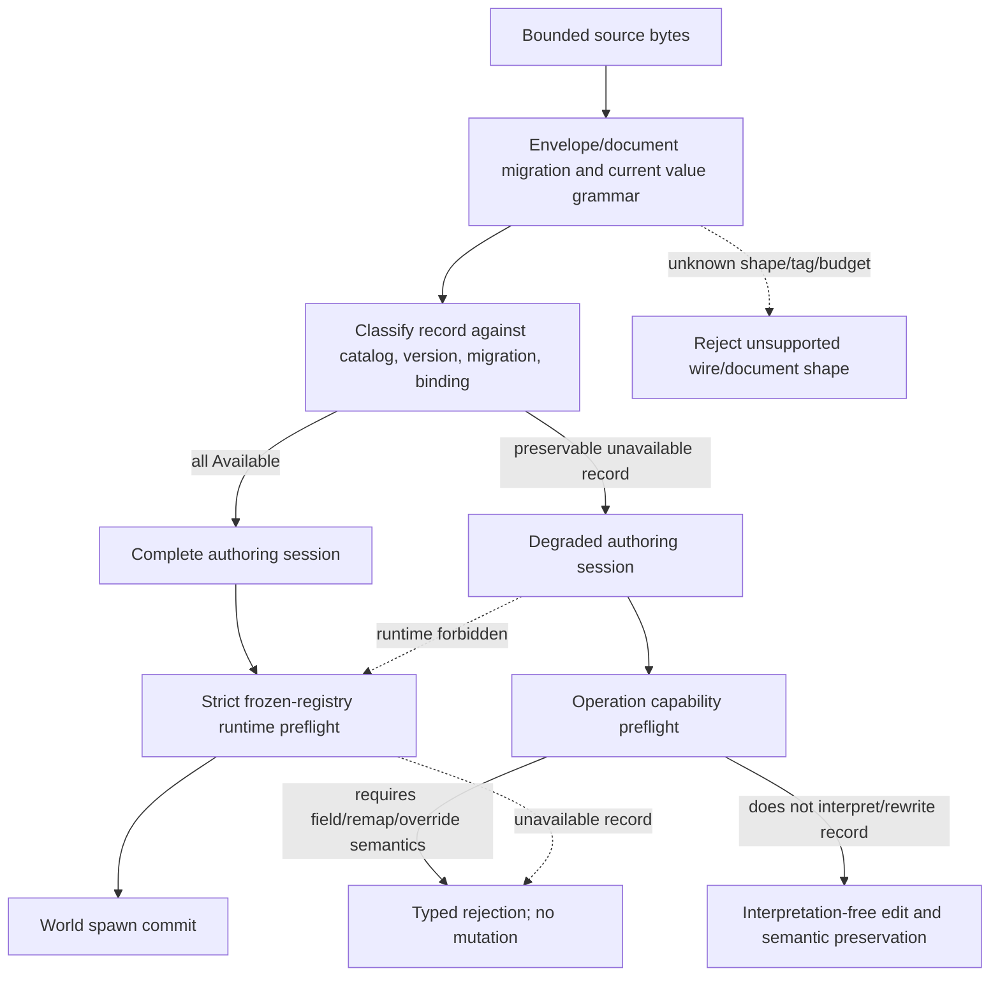

# ADR 0090: Unavailable Schema and Lossless Authoring

**Status**: Accepted
**Date**: 2026-07-13
**Accepted**: 2026-08-18
**Last Revised**: 2026-10-27 (explicit declaration repair and composition/source publication boundaries)
**Owner**: `nara_reflect`, `nara_scene`, `nara_tooling`, and persistent document owners
**Admission Trigger**: Scene/prefab fixtures with a missing provider, known schema without its
required native or Adapter-specific runtime binding, missing migration, and future component schema
open/save with semantic preservation in the editor while every runtime spawn rejects before `World`
mutation
**Revisit Trigger**: A second persistent value grammar, schema-only editor adapter, or concrete need
for lexical byte/comment preservation proves semantic record preservation insufficient
**Related**: ADR 0006, ADR 0011, ADR 0026, ADR 0034, ADR 0038, ADR 0043, ADR 0045, ADR 0047,
ADR 0049, ADR 0051, ADR 0068, ADR 0079, ADR 0081, ADR 0083, ADR 0084, ADR 0093, ADR 0095
**Refined By**: [ADR 0114](0114-standalone-generic-editor-authoring-and-execution-boundary.md) and
[ADR 0118](0118-editor-workspaces-frontends-and-creation-templates.md)

## Context

Rust-first strong typing and frozen admitted runtime definitions are runtime strengths. Native
bindings retain their exact Rust-type proof; ADR 0006's explicit pure-data family has separate
Schema/storage admission. Editors must also survive common authoring conditions:

- a project plugin is temporarily unavailable on one workstation or branch;
- a schema catalog describes a component whose native provider is not compiled into this editor;
- a gameplay-language assembly or declared type is missing or fails to compile while a scene still
  contains its last-known stable schema identity and value;
- a component record has a known older/future schema version without a complete migration;
- the editor needs to rename/reparent or edit unrelated known data without destroying the record.

Rejecting every such document prevents recovery and collaboration. Silently dropping the record is
unacceptable data loss. Creating a placeholder ECS component or invoking project-provided decode
code would weaken registry authority and turn untrusted data into code execution. The boundary must
also remain strict: an unknown top-level file version or unknown `ComponentValue` wire tag cannot be
preserved safely because the current engine does not know how to delimit or migrate it.

## Schema-only authoring refinement (2026-10-16)

The collection game's simple custom configuration triggers the schema-only Adapter
revisit. The Host may install an engine-owned data Adapter for a non-empty component
whose Scene/Inspect schema consists entirely of supported scalar fields.
First-party asset-reference authoring retains its existing native Adapter. The
data Adapter binds the exact persistent owner, catalog generation,
fingerprint and predecessor; it is not an executable-provider receipt.

An explicitly prepared creation-metadata-only owner successor retains the data Adapter's
implementation identity, version and complete coverage, but requires newly prepared evidence
for the validated successor catalog. Old opaque evidence cannot be relabeled, and matching is
never weakened. Unaffected owners retain exact evidence. Source reclassification distinguishes
this bounded intent from additive declaration extension and reuses the same complete current
source and retained-history proof. It grants no native binding or stored-value migration.

Such records become authoring `Available` only after complete value coverage,
required paths, kinds and finite numeric domains validate. Editing reuses the same
checks and atomic document transactions. Unsupported shapes and unavailable schema
versions retain the existing preservation gates. Hidden game-specific invariants
are outside this descriptor and remain subject to strict Check and Runtime.

Authoring availability does not imply a native preview binding. The typed preview
omits data-only records with an explicit reason while retaining their complete source
record. This refinement never adds a native binding or executes project codecs.

## Recursive schema refinement (2026-10-18)

The separately compiled nested-reference component extends the engine-owned data Adapter
to bounded closed records, typed lists, string-keyed maps, optional values, and declared
entity/asset reference leaves under ADRs 0011/0045/0081. A component is eligible only when
every field has a supported closed shape; opaque collections retain `KnownUnbound` without
a native Adapter. Complete recursive shape validation applies before availability and after
each final edit candidate. This adds no project-code execution or native preview binding.

Current Available records use the selected file policy for effective defaults and reference work.
Direct records validate local references against their source document namespace, including when
an unrelated Prefab anchor is present. ADR 0038 does not admit generated projection IDs as new
persistent identities. Override records belong to their declaring overlay's typed target and binding namespace,
so source classification does not interpret them against the outer document. Unknown, future and
unbound records retain their preservation boundary rather than acquiring typed remap authority.

Generic field writes accept editable closed shapes through the same bounded transaction
port. A field marked `EntityRef` may be changed when the candidate contains only durable
source-local references and the complete source-document namespace validates the target
closure. The inverse value must meet the same source-local policy so every admitted edit
can be undone. Persistent references, cross-source targets, and unresolved local targets remain
denied in this generic port; Prefab instance/projection remapping still requires its own
workflow contract. Reading declared references and native Prefab remapping use the shared
recursive visitor, and that visitor remains the authority for reference-closure validation.

The generic Inspector offers source-local targets from the current document projection, with
authored names, hierarchy paths and exact source IDs to distinguish equal names. Choosing a target
changes a field draft; Apply uses its captured document revision and the ordinary history port.
Escape cancels the choice. Optional shapes offer Null through their existing controls; required
references do not acquire a synthetic empty target. Nested closed shapes use the same choices.

The same port admits removing an authored map-member field when it is editable and either
optional or backed by a declared missing-field default. Reset removes the override rather than
storing that default. An already omitted field cannot be removed again. Root-value and terminal
list-index removal remain unavailable in this finite slice: shifting a list is not an override
omission with an inverse field Set. Setting an absent map member records inverse removal;
removing a present member records inverse Set, including an explicit Null. Forward and inverse
obey the same transaction budgets, complete candidate validation and unavailable-manifest
preservation before one history publication. No native codec or project callback is introduced.

Stable-property first writes may initialize only the selected missing declared root in the private
candidate under ADR 0026. The final complete root and its inverse still pass this port's existing
replay/reference/capability budgets. Defaults in other roots remain omitted, explicit/partial roots
are not merged, and missing storage parents/list positions do not become implicit source edits.
Temporary copying remains bounded by the admitted Schema/default contract, not by a claim that
all preparation allocation fits the much smaller final field-patch budget.

## Decision

### Additive source reclassification

An admitted authoring source may prepare a classification-only successor when every previously
selected current declaration, persistent owner and Adapter evidence is unchanged. The project
owner separately proves preservation of complete existing current/predecessor catalogs. This is
new metadata adoption, not migration, owner reassignment, native binding or executable approval.
Classify the unchanged source under one shared successor basis; recovery may shrink its unavailable
manifest. Source-semantic equality, rather than equality with the predecessor manifest, proves
preservation. Newly invalid known values/source-local references refuse. Dormant overlay and
actual-demand composition retain their existing boundaries; asset availability stays Host-owned.

Before accepting the source successor, its history owner proves every retained Undo and Redo edge
in both directions through actual history preparation and its original scope. Freeze each generated
inverse, require exact source restoration and regenerated patch equality, and preserve the original
two-way cost bound. Failure leaves the original source/classification/history intact. Preparation
has a distinct cumulative work allowance and peak logical-retention allowance, admitted before
owning copies; patch retention alone does not bound repeated document scans. Retain no snapshot
for every historical state and allocate no new history identities during the proof.
This logical preparation model excludes allocator capacity, shared catalogs and bounded terminal
refusal reporting. Diagnostic draft/report limits bound that refusal envelope even at exhaustion;
retained classification diagnostics and dynamic interpretation scratch remain admitted work.
This source proof preserves dormant overlay payloads and does not establish effective historical
composition. Project adoption separately prepares its actual current selected source/dependency
closure through the existing compiler before publishing the bundle. Ordinary Authoring admission
still applies: source/format/acquisition/budget failures refuse; returned Degraded composition,
unresolved dependencies and unavailable/native omissions remain explicit review/adopted facts.
Metadata recovery is not a complete Runtime gate and grants no preview, Play or Export readiness.

History preservation means exact source transactions remain replayable, not that every past
Scene/Prefab combination can materialize. ADR 0047 already permits valid source edits while
composition is rejected. Adoption keeps that boundary: a later Undo/Redo can expose a composition
conflict, which ordinary revision-bound capture diagnoses; Redo or explicit source repair may
restore it. The last accepted preview retains its existing stale-input rules. Do not reject useful
metadata recovery solely for an older repaired composition conflict or enumerate a Cartesian
history/dependency product. Source replay, current composition and executable/native readiness
remain distinct guarantees; metadata adoption grants no all-history preview promise.

The move-only candidate retains the original revision and exact predecessor/successor bases.
Commit changes classification only, preserving document/source identity, content state, source
upgrade status and history, while invalidating old basis-bound queries and prepared edits. Source
owners may lend exclusive validated commit guards so a Workspace can validate a complete set
before infallible classification swaps. A source helper does not itself qualify whole-Session
adoption, bundle publication, preview receipts or recovery after a published-but-unadopted bundle.
The [owner-adoption plan](../../plans/2026-10-28-authoring-owner-adoption-plan.md) owns that ordered
workflow and its implementation boundaries.

[ADR 0118](0118-editor-workspaces-frontends-and-creation-templates.md) admits generic empty-entity
insertion, current data-editable component addition/removal and an ordinary structural workflow.
Stable-ID reparent/reorder proves an operation-relative placement change while preserving the
complete record semantics. Explicit subtree deletion requires a Complete, source-local document
without Prefab instance anchors and validates surviving effective references. Unavailable records
remain a deletion barrier; broad reference remapping and unresolved Prefab closure are not admitted.

Nara authoring preserves a complete bounded semantic component record when the
file envelope, document shape, and generic `ComponentValue` grammar are understood but its schema,
migration, or required native/Adapter runtime binding is unavailable. Runtime admission remains
strict and fail-closed.

Declarative instance overlays retain complete understood claims, including obsolete selectors,
bindings and unavailable component payloads, with their exact source owner and value. Their
source classification is not eager activation. A superseded embedded declaration may remain
preserved while an outer complete instance pin selects a valid successor. The Scene compiler
validates selected surviving declarations and their actual reference/dependency closure; inactive
source inventory does not force successful Authoring or Runtime dependency reads. All retained declarations
still cross the file's raw shape, depth and aggregate budgets. Unknown grammar is not preservable
by guessing, and exact transaction snapshots retain ADR 0043's independent no-reinterpretation rule.

Classification may reuse an unchanged record's admission under the exact immutable source and
Schema basis. Per-record Schema/value traversal limits and aggregate retained-reference quotas
are separate: an earlier record's output cannot shrink another record's traversal allowance.
Retained references, including defaults and overlay inventory, still cross the complete document
quota. A prepared conversion must classify equivalently to a full readmission and remain
saveable/reopenable under the same file limits, independently of generated entity ordering.

The composition loader admits bounded decoded dependencies and their complete local structure
before effective component interpretation. It retains actual canonical source/content evidence
and the exact authoring basis, but does not claim standalone editable publication. A source payload
that an outer complete component replacement or suppression discards must not fail effective
composition merely because standalone semantic publication would reject that payload. Independent
Open still crosses the ordinary strict source classifier. Do not label raw dependency capture as
`Available`, manufacture an Adapter, or weaken standalone validation to repair compiler ordering.
Selected structural declarations and component-slot existence checks remain mandatory even when
later layers discard their values or entities.

An exact `SetPrefabInstance` source transaction under ADR 0026 is the explicit complete-declaration
repair boundary for its named anchor. Both snapshots are bounded input and the complete prior
declaration must match before replacement. The inverse retains that prior declaration, including
unavailable payloads and bindings. Only that anchor's embedded unavailable overlay may change;
direct unavailable records and other anchors retain their complete preservation manifest. A generic
field edit or readmission cannot acquire this repair permission. An unresolved lookup alone does
not prevent storing a syntactically understood declaration, and preparation does not resolve or
execute it. Source equality and activation readiness remain distinct.

A selected-intent Revert uses that existing complete-declaration transaction through a narrower
source-owned preparation path. It preserves the unselected portion of the same embedded overlay,
as well as the other protected records. Unresolved Schema classification and an effective target
or base conflict are different observations. A source declaration may be inspected or deliberately
removed without an inherited entity selection, native binding or successful composition.

Complete conversion requires interpretation only of surviving projected data that becomes local.
An unavailable projected survivor rejects the whole conversion; native-binding absence alone does
not. Unknown direct records on the retained anchor, ordinary local children and other sources
remain exact raw data and do not alone block the operation. Dedicated source preparation and its
closed history footprint preserve that scope on both directions. No conversion label grants
ordinary raw-record replacement or deletion authority. Current interpreted unclaimed records gain
the actual admitted Schema-owner claim only on their newly localized copies.

Unavailable component-targeting field writes retain their complete replacement payload, including
canonical asset-reference values. Preserving only the target/field identity does not preserve the
operation. Payload-free removal and an explicit Null replacement remain different declarations.

The source classifier publishes one borrowed declared-asset inventory covering complete records
and current-version property declarations, including recursive payloads and defaults exposed by
Absent. Exact transaction snapshots retain complete declarations; they are not active dependency
programs. Current known-but-unbound Schema can describe source inventory without acquiring an
Adapter/native binding; unknown or incompatible versions retain data without inferred assets.
Authoring and Runtime dependency capture use the shared Scene compiler's actual selected sources
and effective values/defaults. A raw inventory entry cannot trigger a read after its declaration or
component has been superseded or suppressed. The compiler receives the actual admitted Schema
basis, not a synthetic native registry. Data-adapted records participate in semantic compilation;
native preview omissions and strict executable publication remain separate admissions.
The retained reference projection has a document-wide node/logical-byte allowance using the
selected file policy's component-value ceilings. Each traversal receives the remaining allowance
before paths/references/defaults are copied. Payload budget and reference projection budget are
separate admissions. Field-only classification reuse must preserve this aggregate proof or use
the complete source classifier. Reference-bearing edits currently take that complete path; this
does not claim unchanged preparation latency.

### Readiness Vocabulary

Document readiness is `Rejected | Degraded | Complete`. Record readiness is:

| State | Meaning |
|---|---|
| `Available` | Compatible catalog schema, migration path, and the exact binding required by the current admission product are present; Authoring and Runtime classify independently |
| `KnownUnbound` | Catalog schema is known but its required native, authoring-Adapter, or other product-specific binding is unavailable |
| `UnknownSchema` | Stable component ID/version has no current catalog declaration |
| `Unmigratable` | Schema is known but no complete migration reaches the current version |
| `FutureSchema` | Record schema version is newer than the current catalog declaration |
| `UnresolvedOverlay` | A stored overlay record cannot be interpreted by its source-only Schema admission; its complete intent remains preserved without resolving or activating a base |

These are generation-local authoring/runtime classifications, not persistent ECS components,
placeholder Rust types, or a second schema authority.
`UnresolvedOverlay` is not evidence of a missing effective target or changed base. Those facts
require actual composition under the selected source closure, and a first compilation failure
does not classify unvisited declarations.

### Preservation Boundary

Unavailable preservation is permitted only when all of these are true:

- ADR 0051 envelope and ADR 0043 document shape/version are recognized or migrated to current;
- the complete generic `ComponentValue` grammar and record boundaries are understood;
- ADR 0049 byte, depth, count, string, value, time, and diagnostic budgets pass;
- stable component ID, schema version, complete payload, and source location can be
  retained without executing a missing provider.

An unknown/future top-level format version, document operation, or value tag remains `Rejected`.
Nara does not guess record boundaries or preserve arbitrary trailing bytes.

"Lossless" means equality of one canonical unavailable-record manifest after canonical
serialization. The manifest records total unavailable-record cardinality and, for each record,
source-document identity, owning entity or slot, semantic placement/order, component owner and ID,
schema version, complete bounded `ComponentValue`, stable entity/asset references, and unknown
fields representable by the current generic grammar. Catalog fingerprint and lineage remain
catalog-generation admission evidence under ADR 0081; version 1 does not add a trusted per-record
fingerprint. Preservation does not promise whitespace, comments, map spelling/order outside
canonical rules, or byte-identical JSON/RON round trips.

### Authoring Operation Gates

| Operation on a degraded document | Version 1 policy |
|---|---|
| Read metadata/readiness/diagnostics | Allow |
| Save/canonical reserialize without touching unavailable records | Allow with degraded report |
| Rename, reparent, reorder using stable IDs | Allow after proving records remain unchanged |
| Edit unrelated available component field | Allow after whole-document preflight |
| Delete one whole unavailable component | Allow only as explicit reversible transaction |
| Delete entity/subtree containing unavailable records | Allow only if complete inbound-reference, hierarchy, prefab-provenance, and remap closure is proven; otherwise reject |
| Undo whole-record deletion | Restore exact semantic record |
| Edit/add/replace a field inside unavailable record | Reject |
| Apply Changes or prefab override targeting unavailable record | Reject |
| Duplicate/remap/merge/convert requiring unknown reference interpretation | Reject unless complete closure is proven |
| Asset rename/delete/GC/prune or dependency-closure publication | Allow only for `KnownUnbound` under an immutable last-known catalog that fully declares `asset_ref`; reject for `UnknownSchema` |
| Cook/export/Play/runtime spawn | Reject unless every required record and binding is `Available` |

An allowed unrelated edit must prove that the complete canonical unavailable-record manifest is
identical before and after the unpublished candidate. Comparing only aggregate digests is
insufficient because it can hide placement, ordering, duplication, or cardinality errors. Saving
keeps the document `Degraded`; it does not silently declare it valid for runtime.

An explicit topology operation under ADR 0118 instead compares the candidate with the exact
operation-relative expected manifest. Only placement/anchor-placement consequences of that
operation are updated; identity, source, semantic location, owner, version, value, reference and
cardinality equality remain mandatory. A moved unavailable record is preserved, not interpreted or
rewritten. Ordinary Delete remains unavailable for Degraded documents, including empty targets,
because an unavailable survivor may contain an unprovable inbound reference.

Explicit Reopen may discard unsaved topology and restore bytes already admitted by the owning
persistence Host. An exact bounded read matching its observed source digest, or its retained
authoring-validated candidate digest after an uncertain publication, supplies that source proof.
The candidate still decodes and classifies against the captured schema basis and limits, followed
by the normal revision/source/schema owner checks. Externally changed bytes without that proof
retain the exact unavailable-manifest comparison. This does not make file hashes an independent
schema authority or ignore placement in ordinary transaction preservation.

Unavailable schema is also an asset/entity dependency barrier. `KnownUnbound` may perform schema-
only reference traversal against an immutable, authenticated last-known owner catalog without
executing provider code. `UnknownSchema` cannot distinguish ordinary strings/maps from references,
so asset rename/delete/GC, entity remap, prefab flatten, dependency closure, Cook, and export reject
rather than guessing.

When a current authenticated schema is known but its native binding is unavailable, Inspector may
project a bounded effective value by applying declared defaults through the schema-only Reflect
owner. The projection is read-only and keeps authored omission, explicit Null, and undo/history
source intact; it grants no codec, remap, or Runtime authority. Unknown, future, or mismatched
records remain interpretation-free and do not receive fabricated defaults.

For prefabs, an unavailable whole record may pass through an untouched source/instance projection.
Any override, merge, migration, or remap that targets the record rejects atomically. Silent strip is
never a fallback.

### Runtime and Registry Authority

- ADR 0081's Building-to-Frozen catalog/runtime-binding validation remains strict. Unavailable
  records never register dynamic placeholders or fake native/Adapter bindings into the runtime
  registry.
- Runtime scene/prefab preflight requires every record to be `Available`. Any unavailable required
  record rejects before identity claims, asset-server write-back, entity spawn, or runtime
  service/Adapter mutation.
- Changing the compiled native provider set produces a new ADR 0086 executable generation.
  Enabling, disabling, or recomposing native providers already inside the compiled ceiling produces
  a new ADR 0082 recipe and fresh ADR 0084 runtime generation without requiring recompilation. A
  future Adapter-managed assembly or module recovers through its separately admitted module
  generation/activation contract rather than masquerading as an ADR 0086 native executable
  generation. Every recovery path constructs a new frozen registry and runtime candidate; an active
  registry never unfreezes.
- Reopening/reclassifying a document after provider recovery may migrate in memory, but source
  rewriting still requires explicit save/migration policy.
- A scene file cannot authorize the host to download, compile, enable, or execute a provider.
  ADR 0079 composition remains the authority.
- Future build-time stripping of authoring-only unavailable records requires an explicit schema
  capability/cook transform. Runtime loading does not silently strip.

### Diagnostics and Workspace State

The workspace stores Complete/Degraded readiness, bounded issue counts/reasons, dirty/saved/source
revisions, and conflict state. Diagnostics expose engine-owned codes, validated stable IDs, reason,
and counts only. Raw component payloads, absolute paths, and project secrets do not enter summaries,
tracing, remote tooling, or dedupe keys.

## Alternatives Considered

### Option A: Reject Any Document with an Unavailable Component

**Pros**: Simplest runtime/editor model and strongest type certainty.

**Cons**: Temporary plugin/version gaps make unrelated source data uneditable and unrecoverable.

**Decision**: Rejected for authoring; retained for runtime spawn.

### Option B: Silently Drop or Strip Unknown Records

**Pros**: Documents continue to open and runtime may proceed.

**Cons**: Irreversible data loss, broken prefab/undo/reference semantics, and false success.

**Decision**: Rejected.

### Option C: Auto-Load Provider Code or Create Placeholder ECS Components

**Pros**: More records appear editable/runnable.

**Cons**: Grants code authority to untrusted files, weakens frozen registry guarantees, and invents
behavior for unknown data.

**Decision**: Rejected.

### Option D: Preserve Complete Semantic Records in Degraded Authoring

**Pros**: Protects source data, permits proven unrelated edits, and keeps runtime/native binding
strict.

**Cons**: Requires explicit operation gating, degraded UX state, canonical-manifest tests, and careful
prefab/reference handling.

**Decision**: Accepted.

## Success Metrics

| Metric | Target | Measurement |
|---|---:|---|
| Semantic preservation | Degraded open/save/reload keeps unavailable record ID/version/value/reference equality | Golden fixtures |
| Precise classification | Missing native/Adapter binding, unknown schema, missing migration, and future schema return distinct states | Classification tests |
| Runtime atomicity | Every unavailable class changes zero World/identity/asset scratch state on spawn failure | Fault tests |
| Unrelated edit safety | Editing a known field leaves the canonical unavailable-record manifest identical | Patch integration test |
| Operation gating | Field edit/override/Apply Changes/unproven remap reject without revision or dirty-state change | Command tests |
| Delete/undo | Explicit whole-record delete is one undo transaction and restores exact semantic data | Undo fixture |
| Provider recovery | Installing compatible provider/migration reclassifies Complete and permits spawn without automatic source rewrite | Generation test |
| Wire strictness | Unknown document version or value tag still rejects rather than degrading | Hostile fixture |
| Budget/privacy | Oversized record rejects within bounds and diagnostics contain no payload | Budget and snapshot audit |
| Registry strictness | No placeholder/dynamic component enters the frozen runtime registry | API/source audit |
| Dependency safety | Unknown schema blocks asset/entity closure operations; known-unbound traversal uses catalog declarations only | Asset/remap/cook integration tests |

## Risks and Mitigations

| Risk | Severity | Likelihood | Mitigation |
|---|---|---:|---|
| "Lossless" is mistaken for byte/comment preservation | Medium | High | Define semantic equality explicitly and keep lexical preservation out of version 1. |
| Unrelated operation rewrites, moves, duplicates, or drops hidden records | Critical | Medium | Gate by a preservation-safe whitelist and compare the complete canonical unavailable-record manifest before commit. |
| Degraded documents accidentally enter runtime | Critical | Medium | Separate authoring and runtime admission types; require Complete at spawn/build boundaries. |
| Opaque payload becomes an allocation/privacy channel | High | Medium | Apply normal parse budgets and never emit payload data to diagnostics/observation. |
| Missing provider triggers code download/execution | Critical | Low | Keep composition host-authorized and files non-authoritative for code installation. |
| Placeholder type becomes permanent compatibility layer | High | Medium | Preserve at document layer only; forbid registry/ECS placeholder publication. |

## Consequences

Therefore:

- ADR 0043 continues to reject unknown top-level/document/value grammar while permitting bounded
  current-grammar records to enter degraded authoring;
- ADR 0081 retains strict frozen schema/runtime-binding authority for runtime;
- ADR 0047 workspace state gains Complete/Degraded readiness and operation-gated commands;
- ADR 0026 undo can preserve an unavailable whole-record deletion without turning scene patches
  into an untyped universal editor format;
- provider/Adapter recovery recomposes a fresh runtime, rebuilds the native executable only when the
  compiled native provider set changes, and otherwise follows the owning Adapter's admitted module
  activation contract; active type bindings are never mutated.

This decision does not define dynamic ECS components, schema sidecar generation, automatic package
installation, lexical CST preservation, best-effort future-file parsing, or runtime placeholder
behavior.

## Implementation Evidence Required

Acceptance requires all four unavailable classifications across scene and prefab golden fixtures,
semantic save round trips, allowed/denied operation matrices, strict runtime preflight, provider
recovery, hostile wire/budget cases, and privacy snapshots. Preserving a raw JSON substring without
these gates is insufficient.

## Citations

- Unity missing-script detection:
  <https://docs.unity3d.com/ScriptReference/GameObjectUtility.GetMonoBehavioursWithMissingScriptCount.html>
- Unity asset/local object identity:
  <https://docs.unity3d.com/ScriptReference/AssetDatabase.TryGetGUIDAndLocalFileIdentifier.html>
- Godot missing-resource handling: `repo-ref/godot/core/io/missing_resource.h`
- Godot scene state serialization: `repo-ref/godot/scene/resources/packed_scene.h`
