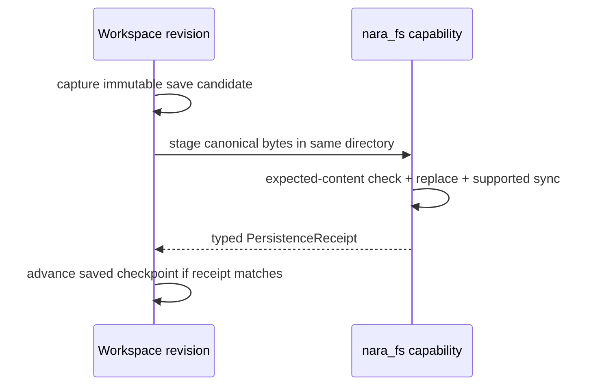

# ADR 0091: Editor Persistence, Recovery, and Concurrent Writer Policy

**Status**: Proposed
**Date**: 2026-07-13
**Last Revised**: 2026-10-23
**Owner**: `nara_tooling`, persistent document owners, `nara_fs`, and editor hosts
**Admission Trigger**: Qualify receipt-backed document Save, genuine cross-file transaction/recovery,
and Host build-source capture as separate slices, with evidence for each operation's actual
consistency and filesystem guarantee tier
**Revisit Trigger**: Real collaborative live editing, remote filesystems, or source-control checkout
policy proves that cooperative single-writer plus explicit external-conflict handling is insufficient
**Related**: ADR 0026, ADR 0034, ADR 0043, ADR 0047, ADR 0048, ADR 0049, ADR 0050, ADR 0051,
ADR 0068, ADR 0070, ADR 0082, ADR 0083, ADR 0084, ADR 0087, ADR 0088, ADR 0090

## Context

Nara's workspace already models revisions, dirty state, external changes, per-document undo, and
future multi-document transactions. `nara_fs` provides capability-scoped open, identity, compare,
temporary-file, replacement, synchronization, and guarantee receipts. The missing product contract
is how the editor turns an in-memory revision into durable authored files without lying about
success or losing concurrent changes.

Before RGF-U17, a command named `MarkSaved` could clear dirty state without proving which bytes
reached which file or durability tier. RGF-U17 removes that command and implements a bounded typed-
receipt single-document trial. Atomic rename alone still does not prove compare-and-swap,
directory durability, multi-file publication, or protection from another editor/Git/IDE writer.
Conversely, making an editor database the only source of truth would break code-first generation
and normal version-control workflows.

## Decision

If accepted, the editor will advance a saved checkpoint only from a matching typed persistence
receipt. File-backed workspaces use expected-digest conflict protection, cooperative writer
ownership, same-directory staging and explicit durability tiers. A cross-file identity/reference
rewrite additionally needs transaction fencing and bounded journal recovery; a Host source capture
for import/build is a separate read operation, not an implicit Save or project transaction.

| Operation | Required result/authority | Does not imply |
|---|---|---|
| Document Save | Matching document/revision/bytes/replacement receipt at the selected tier | Whole-workspace validation, cross-file atomicity or build capture |
| Cross-file transaction | Complete invariant closure, durable intent, receipts, read-admission fence and recovery result | Simultaneous physical replacement visible to external tools |
| Host build-source capture | Retained immutable selected inputs, member evidence and an explicit consistency envelope | Saved editor state, a recovery journal, global instantaneous snapshot or hermetic tool execution |



### Document Persistence State

Each open document slot tracks:

- stable document/source identity and current authoring revision;
- saved checkpoint revision and canonical semantic content digest;
- observed disk digest and scoped live-object identity evidence;
- external state (`Clean`, `Changed`, `Deleted`, `Conflict`, `RecoveryRequired`);
- undo/redo state and any active transaction/recovery record.

`OpenDocumentId` remains editor-session identity and never enters authored files.

A save captures an immutable candidate revision and canonical bytes. A
`PersistenceReceipt` binds document/source identity, authoring revision, content digest, observed
predecessor digest/identity, publication result, and the filesystem guarantee/durability tier
actually proven. Only a matching successful receipt may advance the saved checkpoint. There is no
public command that marks an arbitrary current revision saved without such evidence.

### Host Build-Source Capture

Import/build consumers need immutable inputs, but not necessarily an Editor-owned project commit
or the full recovery journal. A Host captures the selected operation's declared source closure:

```text
BuildSourceCapture {
    project_binding,
    capture_id,
    member_table: logical identity/path -> retained bytes + digest + identity evidence,
    consistency_envelope,
    capture_digest,
}
```

Names describe semantic roles, not an existing API. The Host bounds discovery and reads, retains
the actual immutable bytes consumed, and records the selected roots, metadata/continuity,
auxiliary inputs and relevant tool-selection inputs. Capture may use admitted saved documents,
an immutable checkout, an existing committed snapshot or capability-scoped observations with
explicit revalidation. A development capture containing unsaved data is marked as such and is
not silently promoted to saved release source.

The envelope states which consistency evidence was proven. Per-file identity/digest checks,
even with before/after revalidation, do not prove that all files existed together at one global
instant against non-cooperating writers. A request requiring a coherent cross-file invariant
needs a qualified committed generation, immutable source tree or other explicit evidence; it
fails/retries if that requirement cannot be met. Weaker captures remain labeled weaker. Neither
capture nor a cooperative lock proves hermetic compilation or constrains ambient reads by trusted
native tools.

Capture success/failure is independent of a prior document Save receipt. It does not mutate
documents or mark them clean, and does not force each Save to scan unrelated workspace files.
Source-free delivery can qualify this bounded capture contract before the Editor's cross-file
journal exists.

### Committed Transaction Snapshot

When a genuine multi-file transaction is selected, participating Nara consumers require one
coherent logical generation for the declared transaction/read-admission scope:

```text
CommittedProjectSnapshot {
    project_binding,
    authoring_commit_id,
    member_table: declared logical identity/path -> retained content + digest + identity receipt,
    snapshot_digest,
}
```

`AuthoringCommitId` and `snapshot_digest` identify this authored-source snapshot only; they are not
artifact-group, package, executable, or runtime generation IDs. An `AuthoringCommitIndex` is the
small durable publication record for the active snapshot. Authored member files remain source truth;
the index is coordination/recovery evidence that says which complete set Nara consumers may use.

- A multi-document transaction publishes one new snapshot after every replacement and the declared
  invariant closure verify. Reused members need valid retained evidence for the consistency claim;
  a whole-workspace scan is not the default unit of every operation.
- Ordinary single-document Save completes from its own receipt. An optional snapshot/index refresh
  is a separate result and cannot retroactively invalidate that Save or demand unrelated-file
  verification without an explicit consistency requirement.
- Non-editor Git/IDE/script changes invalidate relevant observations. Raw watcher events are
  coalesced and bounded, not treated as proof of complete bytes or a committed generation.
- Import/build/open consumers choose an admitted source capture or transaction snapshot that
  meets their own consistency requirement. They need not all depend on this journal protocol.
- Existing consumers retain their captured snapshot/bytes/handles. While a transaction fence is
  active, new reads overlapping that scope wait or receive a typed pending/recovery result; they
  never reopen a mixture of old and replaced member paths.

### Single-Document Save

The file-backed save path is:

1. preflight current document validation and canonical serialization budgets;
2. capture expected authoring revision, expected disk digest/identity, and target capability;
3. create an exclusive same-directory staged file and write bounded bytes;
4. flush/synchronize according to the configured supported tier;
5. revalidate expected revision and disk identity/digest;
6. replace through the strongest proven ADR 0070 primitive and synchronize parent metadata where
   supported;
7. return a typed receipt identifying publication and the durability/observation evidence actually
   proven; a failed or ambiguous post-replacement observation is not success;
8. advance the matching saved checkpoint only if document, revision, digest, and required tier all
   match. Later in-memory edits remain dirty.

A platform/filesystem that cannot prove the required tier fails closed or exposes an explicitly
weaker product mode. Advisory locks and canonicalize-then-open are not presented as strict CAS or
authorization.

An ordinary successful Save may emit a source-change observation bound to its exact receipt.
Import/reload then obtains its own admitted immutable inputs; the notification is not import or
runtime publication evidence. Cross-file transaction notifications are fenced until that
transaction publishes. This ADR never writes import-cache artifact groups, cooked packages, or
runtime save slots.

### Concurrent Writer and External Change Policy

- A file-backed project defaults to one cooperative editor writer. The host acquires a scoped
  workspace lease/lock with owner evidence and finite renewal/retirement.
- A second cooperative editor that cannot acquire the writer lease opens read-only. It does not
  silently fall back to last-writer-wins.
- Git, IDEs, scripts, and non-cooperating writers remain possible. Every save still validates
  expected disk identity/digest immediately before replacement.
- A clean local document may explicitly reload a validated external change. A dirty document plus
  external change enters `Conflict`; it is never overwritten or reloaded silently.
- Merge, keep-local, save-as, and discard are explicit commands. Semantic merge policy remains
  document-domain work; persistence only commits the validated result.
- Distinct typed results cover stale editor revision, changed bytes, replaced file identity,
  external deletion, lock loss, permission failure, and unsupported guarantee tier.

### Recovery Journal

The cross-file transaction/recovery slice uses a journal. Receipt-based document Save and read-only
build-source capture do not acquire that dependency merely by sharing filesystem primitives.
The recovery journal is local generated recovery material, not authored truth, source-control
content, permanent undo history, or a package artifact. Each record contains:

- ADR 0051 envelope fields (`kind`, `format_version`, `engine_min_version`, `generator`), checksum,
  recovery binding, and monotonic sequence;
- transaction ID, baseline digest(s), candidate digest(s), and staged relative locations;
- bounded operation list and a durable commit/abort record;
- no deliberately captured credentials, absolute paths in diagnostics, or unbounded component
  payload duplication. Recovery bytes and metadata are nevertheless potentially sensitive project
  data.

Journal, staging, and quarantine material inherits or tightens the project's local access
protection. It is excluded from source control, build/package inputs, and telemetry; Host-owned
locations or supported exclusion metadata keep it out of default sync discovery where possible.
Nara does not claim control over external backup/sync tools or secure erase where the platform
cannot prove either property. Retention is bounded and cleanup state remains observable.

Replay applies byte, record, depth, time, snapshot, and diagnostic budgets before any mutation.
Truncated, corrupt, incompatible, or over-budget journals are quarantined and open the affected
workspace read-only with `RecoveryRequired`; they do not partially replay.

`RecoveryRequired` exposes the reason and the provable old/new states. The user may inspect a
bounded diff, export or Save As without destroying evidence, retry a provably valid completion or
rebind flow, or explicitly abandon recovery. No journal, staged bytes, dirty state, or recovery
evidence is cleared before a matching receipt proves the chosen outcome; ambiguous rollback or
continue actions remain unavailable.

After a crash, recovery must prove one of:

- the old complete authored generation remains active;
- the new complete committed generation is finalized;
- the system is explicitly read-only/recovery-required with all evidence retained.

A committed record is never replayed twice. Recovery never silently invents a mixed project graph.

The first persistent coordination file kinds are `nara.authoring-commit-index` and
`nara.editor-recovery-journal`, both canonical version 1 with compatibility matrices and non-empty
golden fixtures. Both enforce ADR 0049 encoded-byte, shape, count, depth, string, time, and
diagnostic budgets before candidate publication. A `RecoveryBinding` contains a host-issued
project/session identity, manifest or baseline snapshot digest, root-capability generation/live-
object evidence, and journal-owner nonce.
Moving/copying a project or replacing the root capability does not authorize replay into the new
binding; the host requires explicit rebind/import or opens recovery evidence read-only.

### Multi-Document Transactions

`Save All` may report per-document success/failure because independent dirty documents do not
necessarily form one invariant. Operations that change cross-file identity/reference invariants use
an explicit `ProjectMutationTransaction`:

```mermaid
flowchart LR
    Preflight[Preflight declared invariant and reference closure]
    Old[Capture old bytes and digests]
    Stage[Stage every candidate]
    Intent[Durable transaction intent]
    Fence[Publish transaction fence to Nara consumers]
    Replace[Replace members with receipts]
    Verify[Verify complete member table]
    Commit[Durable AuthoringCommitIndex]
    Publish[Publish CommittedProjectSnapshot]
    Preflight --> Old --> Stage --> Intent --> Fence --> Replace --> Verify --> Commit --> Publish
```



The transaction records an `AuthoringCommitId`, distinct from artifact-group and package generation
IDs. It stages every candidate and a durable intent before replacing any member. Recovery either
finishes forward, restores the complete old graph when proven possible, or stays read-only with
evidence. Nara promises detectable/recoverable logical old-or-new publication, not magical physical
atomicity across arbitrary filesystems.

The transaction fence prevents participating Nara consumers from treating intermediate physical
replacements in its declared read scope as active. A source capture overlapping that scope waits,
retries or rejects; one with independent retained inputs need not be blocked globally. Raw watcher
events are quarantined/coalesced until the commit index publishes or recovery retains the old
snapshot. Non-Nara tools may still observe intermediate filesystem paths; that is why physical
cross-file atomicity is not claimed.

### Close and Runtime Interaction

Close is explicitly `SaveAndClose | DiscardAndClose | Cancel`. Save failure, runtime/Play stop
failure, lock loss, or recovery failure keeps the document visible and dirty. Editor exit drives
runtime close before releasing parent project/filesystem authority under ADR 0082/0084; destructor
completion is not save/close evidence.

## Alternatives Considered

### Option A: Overwrite Then Mark Saved

**Pros**: Minimal state and implementation.

**Cons**: Crash, short write, stale revision, concurrent writer, and sync failure can produce false
clean state or lost data.

**Decision**: Rejected.

### Option B: Depend Only on Atomic Rename or OS Locks

**Pros**: Uses familiar platform primitives.

**Cons**: Neither alone proves expected-content CAS, durability, external-writer safety, or
multi-file recovery across all supported filesystems.

**Decision**: Rejected.

### Option C: Make an Editor Database the Only Source of Truth

**Pros**: Central transactions and recovery are easier to control.

**Cons**: Breaks code-first/AI generation, normal source control, and direct file tooling.

**Decision**: Rejected.

### Option D: Typed Save Receipts, Explicit Cross-File Transactions, and Independent Source Capture

**Pros**: Keeps authored files authoritative while making save truth, conflicts, recovery, and
platform guarantees explicit and testable.

**Cons**: Requires platform-specific evidence, distinct operation results, fault injection and
read-only fallback; the cross-file slice additionally needs journal/transaction state.

**Decision**: Proposed.

## Success Metrics

| Metric | Target | Measurement |
|---|---:|---|
| Receipt-backed dirty state | Dirty clears only when receipt document/revision/digest/tier all match | Workspace tests |
| Single-file crash safety | Every stage/write/sync/replace/receipt failure reopens old, new, or explicit read-only state at the declared tier | Document Save fault matrix |
| Save locality | Saving one independent document validates that document and target, not every unrelated workspace file | Scoped read/write observation fixture |
| Conflict precision | Stale revision, changed digest, replaced identity, deletion, and second writer are distinct typed results | Conflict fixtures |
| Journal safety | Truncated/corrupt/oversized/timeout journals terminate within budget and publish no partial state | Hostile recovery tests |
| Multi-file coherence | No injected crash or raw watcher event publishes a mixed member table as the committed project snapshot | Transaction/watch fault matrix |
| Transaction snapshot | A genuine cross-file transaction publishes one complete snapshot of its declared invariant/read scope | Project transaction tests |
| Build capture honesty | Captured inputs remain immutable and have explicit consistency evidence without requiring the Editor journal | Source drift, retained-byte and journal-absent fixtures |
| Close safety | Save/Play-stop/cancel failure keeps document visible and dirty | Editor integration tests |
| Guarantee honesty | Platform tests report actual CAS/atomicity/durability tier, never a generic `safe` boolean | Filesystem matrix |
| Source notification | Single Save notifications bind receipts; cross-file notifications wait for transaction publication | Save/import and transaction integration tests |

## Risks and Mitigations

| Risk | Severity | Likelihood | Mitigation |
|---|---|---:|---|
| Network/removable filesystem lacks required guarantees | High | Medium | Fail closed or expose explicit cooperative/read-only tier. |
| Recovery journal leaks project data | High | Medium | Apply local access protection, exclude it from source/package/telemetry/sync paths, minimize payload, bound retention, and redact diagnostics. |
| Rollback fails after partial multi-file replace | Critical | Medium | Retain old/staged evidence and journal; enter recovery-required read-only instead of guessing. |
| Lock gives false confidence against Git/IDE | High | High | Treat lock as cooperative only and always enforce expected digest/identity. |
| Autosave competes with explicit save | Medium | Medium | Serialize persistence transactions per document and stamp expected revisions. |
| Saved checkpoint advances before true durability | Critical | Medium | Make typed receipt/tier the only transition authority. |
| Watcher exposes transaction intermediate state | Critical | Medium | Gate Nara consumers on the commit index and quarantine/coalesce raw events behind the transaction fence. |
| Every Save becomes a whole-workspace verification | High | Medium | Keep Save receipts local and make cross-file consistency/capture separate requested operations. |
| Per-file capture is advertised as a global snapshot | High | Medium | State the consistency envelope and require stronger evidence for cross-file invariants. |
| Journal replays into a copied/moved project | High | Medium | Verify `RecoveryBinding` root/session/baseline/owner evidence and require explicit rebind. |

## Consequences

If accepted:

- ADR 0047's saved revision becomes receipt-backed rather than a UI command assertion;
- ADR 0070 supplies the platform/filesystem capabilities and guarantee receipts while tooling owns
  document/workspace semantics;
- ADR 0083 multi-file identity rewrites use the same project transaction/recovery boundary;
- ADR 0088 consumes an immutable Host build-source capture with an explicit consistency envelope;
  a qualified transaction snapshot may supply that capture but is not its only authority;
- importer artifact publication and target package publication keep their own manifests/generation
  IDs and do not reuse the editor recovery journal;
- live multi-user editing remains a separate future session-authority/causal-order decision.

## Admission Evidence

Admission is per operation, not an indivisible project-persistence gate:

1. **Document Save** requires receipt-backed dirty state, scoped target validation, actual
   filesystem-tier evidence, concurrent/external-write cases, uncertain-result handling and
   close failure behavior. It must prove no unnecessary unrelated-workspace verification.
2. **Cross-file transaction/recovery** additionally requires complete invariant-closure preflight,
   second-writer policy, journal corruption/rebinding, snapshot/read-admission fences and every
   relevant filesystem failure/crash point. A sequence of independent Save receipts or a
   compensating Undo does not prove this contract.
3. **Host build-source capture** requires bounded closure discovery, retained immutable inputs,
   source-drift detection/rejection at its stated tier, explicit consistency limits and overlapping
   transaction-fence handling. It may qualify without the Editor journal and cannot claim a
   global instantaneous snapshot or hermetic tool execution without separate evidence.

An atomic rename helper or autosave timer alone is insufficient. Adopting one slice does not
accept the others or turn current limited Save evidence into general transaction qualification.

### RGF-U17 Trial Evidence

RGF-U17 implements only the bounded known-schema single-document subset. A concrete persistence Host
captures canonical scene bytes, document ID, source revision, semantic digest, observed content
digest, and scoped file identity; it accepts Saved only from a matching atomic name-switch receipt
with required file synchronization, publication, and candidate identity evidence. External change,
target deletion, lost cooperative lock, pre-publication failure, or mismatched evidence preserves
dirty state. A post-name-switch evidence failure becomes `PersistenceUncertain`, blocks blind Save,
and clears only after explicit Reopen bytes are decoded, validated, published into the workspace,
and committed as the observed baseline.

This trial deliberately does not implement a recovery journal, committed project snapshot,
multi-document old-or-new publication, general concurrent-writer policy, or crash-point matrix.
Its post-publication observation is `DetectOnly`, not strict CAS against a write after observation.
This documentation amendment does not expand that trial's implementation or guarantee tier. This
ADR remains Proposed; later slice adoption and implementation claims require their own evidence.

## Citations

- Godot undo/saved version management:
  `repo-ref/godot/editor/editor_undo_redo_manager.h`
- Unity Smart Merge: <https://docs.unity3d.com/Manual/SmartMerge.html>
- Unreal scoped transactions:
  <https://dev.epicgames.com/documentation/en-us/unreal-engine/API/Editor/UnrealEd/FScopedTransaction>
- Rust filesystem synchronization semantics: <https://doc.rust-lang.org/std/fs/struct.File.html>
