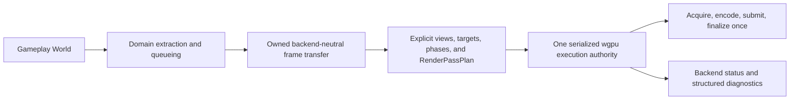

# ADR 0094: Minimal Render Execution Boundary and Evidence-Gated Extensions

**Status**: Accepted
**Date**: 2026-07-16
**Last Revised**: 2026-11-01 (original typed policy bindings and captured View/history transactions)
**Supersedes**: [ADR 0077](0077-render-pipeline-recipes-graph-compilation-and-backend-encoding.md)
**Refines**: [ADR 0012](0012-render-crate-boundaries.md),
[ADR 0016](0016-extension-seams-for-backends-and-domain-modules.md),
[ADR 0017](0017-render-graph-policy.md),
[ADR 0032](0032-render-backend-integration-boundary.md),
[ADR 0040](0040-render-resource-lifetime-and-submitter-ownership.md), and
[ADR 0078](0078-render-host-affinity-webgpu-initialization-and-device-recovery.md)
**Refined By**: [ADR 0096](0096-evidence-gated-render-scaling-and-upload-policy.md);
[ADR 0105](0105-closed-first-party-render-plan.md): Closed First-Party Render Plan; and
[ADR 0111](0111-editor-scene-view-execution-and-picking-authority.md)

## Context

ADR 0077 selected a complete future renderer taxonomy before Nara had production consumers for
most of it. The repository proves a narrower baseline: backend-neutral views, targets, phases,
domain batches, static `RenderPassPlan` ordering, a wgpu backend, safe surface ownership, and part
of the device-loss boundary. It does not yet prove public Pipeline Family or Render Feature
catalogs, persistent recipes, a retained logical render scene, a logical graph compiler,
`CompiledPipelineTemplate`, `FrameExecutionPlan`, raw-wgpu interop, or replacement Render Host
parity.

Bevy, Unity, and Godot demonstrate that these are real solution families, but they make different
trade-offs. Bevy exposes a render sub-application and ECS schedules; Unity provides Scriptable
Render Pipeline assets and RenderGraph; Godot keeps product-facing compositor effects separate
from lower-level RenderingDevice internals. Their existence is evidence that Nara must preserve
room for advanced extension, not evidence that Nara should accept one complete taxonomy before its
own workflows choose it.

This ADR keeps the proven, high-cost ownership boundaries and returns unproven extension mechanisms
to evidence-gated design work. It supersedes ADR 0077 rather than rewriting that historical
decision in place.

## Decision

Nara accepts a minimal backend-neutral frame boundary over one serialized wgpu execution authority.
The current static phase plan remains valid until a concrete workflow proves it insufficient.

### Backend-neutral authoring and render domains

- Gameplay, scene, asset, material, sprite, UI, text, tooling, and other domain-facing data do not
  contain wgpu objects, platform target handles, command encoders, or render-graph implementation
  details.
- `nara_render` owns backend-neutral views, targets, viewport/scissor intent, phases, frame
  lifecycle, `RenderPassPlan`, backend status, and skipped-frame reasons.
- Domain render crates own extraction, queueing, sorting, and batching. A backend consumes their
  backend-neutral outputs rather than reading gameplay components directly.
- GPU caches remain backend-owned and are keyed or invalidated by logical resource identity,
  generation, device epoch, and budget. Device setup does not permanently compile or activate every
  domain feature; this separation does not imply independently replaceable submitter plugins.

### wgpu is the only RHI

- Nara does not mirror wgpu with another public `Device`, `Queue`, `Texture`, `Buffer`, or command
  API.
- Exact wgpu features, limits, downlevel/surface capabilities, handles, allocation, encoding,
  submission, and presentation stay in `nara_render_wgpu` or a future separately admitted exact-
  wgpu integration boundary.
- Nara does not promise a generic multi-backend trait, a second production RHI, or a WebGL2
  compatibility pipeline. A different RHI requires a new ADR and concrete product evidence.

### Owned frame transfer

- Extraction must converge on an owned, backend-neutral frame transfer between the gameplay
  `World` and GPU execution authority. The transfer must not borrow the `World` or carry surfaces,
  devices, queues, encoders, backend cache entries, or platform windows.
- `RenderFramePacket` is an acceptable current implementation name, not a frozen public section
  registry, provider catalog, or second render ECS contract.
- The transfer declares producer, consumer, bounded size/work, generation, rejection, cleanup, and
  diagnostic behavior before it crosses an asynchronous or threaded boundary.
- A second render `World`, render worker, or retained scene is an internal or future design choice,
  not part of this accepted boundary.

### Static planning and graph admission

- The finite captured WGPU program refinement below admits the first measured resource graph and
  typed native contribution path. The existing closed stock plan remains a transition consumer
  until Sprite/UI, Runtime and Editor migrate through that same owner. Its historical restrictions
  cannot prohibit the explicitly admitted successor or justify a second native execution loop.
- `RenderPassPlan` is the current engine-owned static stock-phase order contract. It must not grow
  into an ad hoc partial resource graph, persistent project recipe, or arbitrary external-pass API.
- Views, targets, viewport/scissor semantics, phases, and target-frame lifecycle remain explicit
  and backend-neutral so a future graph can replace static planning without changing gameplay
  authoring data.
- ADR 0111 resolves the first cross-target dependency with one private serialized fixed
  transaction. A later intermediate/history resource or computed dependency that neither static
  planning nor that fixed model can express opens a new focused question. That workflow chooses
  the smallest sufficient resource and scheduling model; this ADR does not preselect a graph
  compiler or public execution kernel.

### GPU authority, target transaction, and epoch

- One serialized execution authority owns each live wgpu device domain. Ordinary runtime plugins
  do not acquire ambient Device/Queue access, target acquisition, submission, presentation, or
  recovery authority.
- Surface loss and unexpected device loss remain distinct. Device/Queue-dependent resources and
  asynchronous or encoded results carry a non-reused host/device epoch and cannot execute after
  that epoch is retired.
- For the currently admitted single-target frame, the execution authority acquires/imports the
  target at most once and presents, publishes, or discards it once after its final consumer.
- Multi-target global dependency ordering is not accepted by this ADR or ADR 0111. It requires a
  new focused decision when a real workflow cannot be represented by independent admitted target
  transactions or ADR 0111's single fixed edge.

### Evidence-gated extension freedom

- Nara preserves the product goal that advanced Rust packages should be able to reach sufficient
  renderer control without forking the engine. This goal does not itself freeze a public role,
  catalog, callback, or Host-replacement API.
- Ordinary gameplay and runtime plugins remain simple and do not receive hidden global GPU or Host
  authority.
- Each higher-authority mechanism requires its own production-shaped tracer, alternatives review,
  trust/lifecycle contract, and Accepted ADR or explicit revision before it becomes a supported
  product guarantee.
- First-party and external implementations should use the same supported path once a capability is
  admitted. Equality of every hypothetical future role is a validation target, not a current
  compatibility promise.

### Finite Captured WGPU Programs

The [complete comparison](../../benchmarks/2026-10-31-render-composition.md) executes branching
texture dependencies, preserved originals, compute statistics, storage-to-vertex drawing and
temporal controls against viable ordered, slot and schedule alternatives. It does not establish
a stable performance winner. Those dependency and retained-version workflows select a finite
resource graph with typed Features as the production replacement, under the
[implementation design](../render-program-production-design.md) and
[complete unit](../../plans/2026-10-31-render-composition-and-host-execution-plan.md).

This revision accepts the bounded program prerequisite, with implementation and qualification
tracked separately. Proposed0121 retains complete stock-policy, View/history, custom-Editor and
cross-owner composition work; this subsection does not promote that entire proposal.

- `nara_render_wgpu` owns the exact native program. `nara_render` continues to own backend-neutral
  Views, targets and mappings. WGPU descriptors, features and limits remain the native vocabulary;
  resource versions and semantic ports are ownership/dependency facts, not another RHI.
- A candidate owns unforgeable resource versions. Every local version has one writer, explicit
  whole-resource initialization and a stored postcondition. Read and preservation edges determine
  execution; stable operation keys only break ready ties. Reject foreign handles, duplicate or
  missing writers, cycles, feedback, invalid usages and incompatible semantic reads before native
  work. Initial shared scope is whole single-sample, single-mip 2D color textures and aligned
  unmapped buffers. Unsupported ranges or resolves refuse explicitly.
- Rust semantic marker types distinguish equal-shaped Scene/composite textures and raw/normalized
  buffers. A compatible explicit initialization copy may create a different semantic destination;
  that copy does not relabel its immutable predecessor or prove a shader conversion.
- An immutable Feature definition pairs a CPU capture type with its exact native adapter. One
  producer-owned instance has a non-reused incarnation. Host/epoch-local state, prepared work,
  capture and reports retain their original definition through actual cleanup. No current registry
  lookup can retarget old work. Closing an instance refuses new admission without invalidating
  another instance or releasing its submitted uses.
- Requirements aggregate before device acquisition, using WGPU's direction for every limit.
  Adapter support, requested and actually enabled capabilities remain distinct. A late subset may
  fit the original enabled request; a new requirement explicitly needs Host reconstruction or
  refuses. It cannot silently replace a healthy device or broaden recovery's original request.
- Preparation, including state creation, runs under original pre-upload custody. Private native
  allocations reserve the shared retained-byte budget and keep their guards with the allocation.
  Scoped uploads retain their actual destinations before enqueue. Encoding receives declared
  resources and a command encoder; ordinary Feature methods have no Queue, acquire, submit or
  present entry. Exact native Rust is trusted code, not a sandbox against handle cloning.
- All captured preflight runs before local native allocations, state creation or uploads. Its
  public context provides enabled capability facts only. First-party stock adapters join their
  complete Image working set and known automatic custody/engine records at this barrier. The
  native owner pre-reserves that complete table and its prefix observation; arbitrary external
  extra retention remains fallible dynamic work. A refused untouched capture cannot evict another
  instance's original native state. Shared cache maintenance uses the Host clock independently
  of producer capture sequence.
- Imports require exact Host-issued initialized output leases, checked against original Host,
  epoch, native shape, interpretation and usages before realization. No caller boolean or raw
  native handle establishes initialization. A successor allocates distinct storage while a
  predecessor remains leased. CPU inputs and reconstruction availability stay independent of
  published pixels/bytes.
- A separately admitted Host target reservation may realize one graph-local final texture.
  Physical storage must provide every declared usage; extra native usage flags grant no
  additional graph access. Logical descriptors, typed ports and owner/shape facts remain exact.
  This private physical binding is not an initialized import: the normal unique writer and
  initialization proof still apply. Graph output and image receipt share the same actual byte
  guard. Pure preflight/capacity refusal preserves the initial reservation; native preparation
  transfers that attempt to original-prefix custody even when later work fails. Successor output
  allocation follows complete preflight through the same program realization path.
- Ordinary Runtime windows use that same staged program transaction. The Host acquires the
  surface once and encodes its final physical-resolution image consumer into the program's
  original command encoder and submission. Known final-consumer metadata and retention admit
  before native work. A successful output submission does not establish surface presentation:
  the exact Runtime receipt, world-picking permission and one-shot UI completion still require
  successful present. Each producer owns and revokes its own world-presentation permission;
  producer Drop revokes it before returning, independently of Host maintenance. A successful
  present replacing another producer in the same physical window revokes the displaced frame;
  presentations in other windows remain valid. Close cannot revoke the target's successor.
  Capture identity comes from the managed Runtime owner, independently of replaceable World
  resources. Host cache age,
  App frame and render transaction clocks retain their separate meanings.
- Each candidate has one complete output group and one independently validated native submission.
  Failed preparation, encoding or submission publishes none of it and leaves its successful
  capture watermark unchanged. Even failures flush and retain original uploads through the
  original prefix. Output and typed reports become visible only after native admission and epoch
  revalidation; physical completion, presentation and UI settlement remain separate facts.
- Graph and derived scratch have checked finite metadata/count/resource allowances before growth.
  Host local allocations, adapter-private native payloads, retained outputs and submitted uses share
  explicit logical-byte accounting. These bounds exclude allocator/driver overhead and are not
  RSS or measured GPU-residency claims. After physical completion, published outputs retain only
  selected versions and reports, rather than all scratch or the original reconstruction input.
- Original submitted custody is a bounded flat container. It releases later prepared/native work
  before earlier capture/definition dependencies, without destructor recursion proportional to
  candidate size. Retention admission precedes each upload; a refused entry returns its original
  value outside the custody lock. A hard entry limit is a deterministic refusal, separately from
  temporary allocation pressure.

The selected typed policy capture refinement admits original-definition `Capture/Bindings/build`
through the same native Host. Policy installation owns new capture admission; accepted input owns
its original execution lease independently of installation withdrawal. Producer close still refuses
execution. Instance creation cannot broaden the definition's closed device request, and native
state remains Host/epoch-owned. Source/frame and logical target meaning survive physical image
adaptation. Exact UI operation/capture bindings remain a concrete completion sidecar. The finite
UI operation writes the selected final image, and its actual original typed report must validate
before group publication. A successfully drawn unrelated UI branch cannot settle that image's
presentation permissions. The
[production design](../render-program-production-design.md#selected-policy-capture-replacement)
owns the selected shape and complete replacement/deletion consumer; implementation and evidence
remain separately tracked. This refinement does not promote complete0121.

Static definitions and installed instances do not establish dynamic code unload, a persistent
renderer recipe or a public backend-neutral Feature ABI. The complete stock migration must preserve
cross-View/UI/material working-set preflight, replay packets versus one-shot UI permits, logical
target routing, full-resolution HUD and the existing native/READY/input/close consumers. Its
qualification belongs in the implementation ledger; displaced routes are removed with their
migrated consumers rather than retained as compatibility mechanisms.

### Captured View History Transactions

The finite program may own temporal outputs keyed by an original CPU history lineage, captured
View lifetime, logical Feature incarnation and code-owned slot. A lineage binds one source clock;
its Host realization owns successful-capture deduplication independently of current target, group
membership and reclaimable slots. Reset, regroup or complete instance replacement cannot clear
that watermark. Original declaration/input/candidate leases retain its realization; unused
lineages and inactive instance rows are reclaimable rather than lifetime registrations. Original
CPU topology also retains a concrete temporal View owner, separate from its copyable captured
View ID. Each slot observes both View and Feature declaration lifetimes. Sharing one effect
declaration across Views cannot keep every retired View's rows alive, and temporary extraction
absence alone cannot grant retirement.

Capture admission freezes original logical topology, exact Feature definitions, parameters and
members within the policy's already closed device request. Host preparation resolves an immutable
snapshot of actual Feature owners, pins complete predecessor/empty-slot revisions and builds the
program. A latest-instance map cannot reinterpret an older accepted input. Candidate-driven
membership changes publish with the candidate; failed preparation preserves last-good membership.
Explicit reset/revocation retains its separate invalidation meaning.

One opaque move-only candidate owns original input, program, bindings, history basis, target facts
and ordinary budget guards without borrowing the Host across calls. Retry returns that same value;
it does not rebuild against latest history. The Host revalidates its original identity, epoch,
producer and basis before native work and at final publication. Complete outputs, slot pointers,
membership and successful-capture watermark publish together after successful native admission.
No caller-side history commit or second renderer is introduced. Unbound native submission custody
cannot escape one serial native attempt; failed uploads retain their original prefix.

The production program builder has a hard 64 MiB modeled metadata ceiling, regardless of a
caller's larger `GraphLimits` allowance. Graph/access/scratch capacity admission precedes vectors
and compilation. Pending candidates reserve this full program envelope plus bounded inline
capture, binding and history metadata before policy execution. Arbitrary user indirect payloads
and unrelated caller-owned allocations remain outside this engine metadata model.

Publication consumes the candidate even if later presentation fails. It cannot be accumulated
again, rolled back after an output escapes, or used to claim UI/READY/picking success. Old-binding
destructor panics after publication are isolated cleanup observations; native target state and
the successful result are completed before that cleanup. They cannot transform a committed group
into a retryable refusal. Existing
transports retain original capture and UI responsibilities while retrying, or explicitly cancel.
On a replacement Host/epoch, temporal effects receive an explicit empty-history reset reason and
declare initialization. Current-sample CPU capture alone does not reconstruct old accumulated
pixels; exact temporal replay/checkpoints remain separate unimplemented capability.

These responsibilities are selected for the next bounded production unit. Current implementation
and actual evidence remain in the ledger; this does not qualify the complete Proposed0121 workload.

### Shared Stock Program Construction

The ordinary external Scene-effect workflow selects shared typed stock construction through the
existing `WgpuRenderPolicy`, rather than requiring each policy to reproduce Sprite, Canvas and UI
lowering. The default policy uses these same helpers. They retain original Feature declarations,
bind through the existing candidate context and build one finite program; they confer no native
execution authority or live World access. The full Proposed0121 remains unqualified.

World-raster color, Canvas-resolved Scene color and the final UI composite have distinct semantic
ports and actual extent/format/transfer/alpha facts. A composing policy explicitly wires an effect
before or after optional Canvas resolution. It may export the untouched original Scene as another
exact version. No implicit latest slot or universal pre-UI pixel space is introduced. Final UI
lowering selects the exact chosen Scene version, preserves full-resolution HUD drawing and supplies
the original UI binding validated by the existing Host.

Stock capture collection is independent of the selected policy type. An admitted handoff transfers
the immutable stock drawing and original optional move-only UI sidecar to its composing collector.
Unavailable or foreign routes cannot drain it. The collector uses the existing capture writer;
refusal retains the same sidecar, and logical Close terminalizes any unsubmitted responsibility.
Runtime product construction and Editor Scene/Canvas construction explicitly select their original
policy/capture adapter. Picking retains its own exact source geometry rather than requiring a
downcast to the default renderer. The [production unit](../render-program-production-design.md#next-production-unit-public-stock-composition)
owns implementation, independent blur/second-effect consumers and affected native qualification.
This accepted selection is not evidence that those consumers already pass.

## Candidate Extensions, Not Accepted Decisions

The following remain non-normative hypotheses in the render pressure matrix, render Interface
harness, and inactive render tracer plan:

| Candidate | Evidence required before admission |
|---|---|
| General provider catalog or dynamic contribution replacement | Beyond the admitted finite typed program: explicit withdrawal, retained-work and replacement ownership |
| Pipeline Family, Renderer Profile, or persistent Pipeline Recipe | A second materially different complete renderer plus an ordinary author selection workflow |
| Persistent pipeline templates or general execution kernel | Beyond the finite candidate graph: a concrete persistent authoring or scheduling workflow |
| Retained logical render scene/update protocol | Two production consumers that need persistent render-domain state and prove bounded gap/resync behavior |
| ViewFamily, auxiliary views, and history identity | A temporal, stereo, reflection, portal, or related-view workflow with explicit invalidation pressure |
| Shader artifact/interface, Material Technique, or Shader Graph convergence | Reusable materials plus two independent shader frontends or authoring routes |
| Editor semantic outputs, picking, and capture catalog | A real editor viewport whose tooling requirements cannot be met by the minimal target/output contract |
| External raw resources, vendor or whole-device integration | Beyond admitted Feature encoding of declared resources: original authority, initialization and teardown evidence |
| Replacement Render Host or alternate renderer runner | A production integration that must own target, submission, presentation, recovery, or placement and cannot fit an admitted lower-authority path |

No candidate in this table may be cited as current implementation authority. A tracer may compare
alternatives without creating production APIs; implementation begins only after the owning
decision and plan are explicitly activated.

## Alternatives Considered

### Option A: Keep ADR 0077's complete taxonomy Accepted

**Pros**: One ambitious destination, extensive terminology, and an implementation-ready-looking
render plan.

**Cons**: Treats speculative mechanisms as constraints, biases tracers toward proving a
preselected taxonomy, increases cognitive load, and can force first-party 2D work to implement
unused generality.

**Decision**: Rejected.

### Option B: Accept only today's concrete draw loop and expose no advanced direction

**Pros**: Smallest immediate documentation and implementation burden.

**Cons**: Encourages backend-local hooks and makes later renderer, editor, compute, or vendor
extension a costly ownership retrofit.

**Decision**: Rejected.

### Option C: Accept the minimal ownership boundary and gate mechanisms by tracers

**Pros**: Preserves wgpu isolation, owned transfer, target ownership, and epoch safety while letting
real workflows choose between static phases, typed providers, a render sub-app/kernel, or a graph.

**Cons**: Advanced extension parity remains an explicit non-claim until multiple focused decisions
and implementations land.

**Decision**: Chosen.

## Success Metrics

| Metric | Target | Measurement |
|---|---:|---|
| Backend isolation | No gameplay/domain persistent type imports wgpu or stores GPU handles | Dependency-boundary search and API review |
| Static-plan honesty | `RenderPassPlan` expresses only explicit phase order and is not serialized or expanded into a partial graph | Unit tests and source review |
| Owned transfer | GPU execution consumes an owned frame transfer with no gameplay `World` borrow or native/GPU handles | Boundary tests and type review |
| Single authority | Exactly one owner encodes/submits for each live device domain | Backend lifecycle and conflict tests |
| Target transaction | Each admitted target frame acquires and finalizes its target at most once | Surface integration tests |
| Epoch rejection | Old-epoch device resources and results never reach a replacement device | Device-loss fault tests |
| Evidence-gated growth | No candidate extension enters production API solely because it appears in a Design Draft | ADR/plan governance tests |

## Risks and Mitigations

| Risk | Severity | Likelihood | Mitigation |
|---|---|---:|---|
| Minimal baseline becomes a permanently closed renderer | High | Medium | Keep pressure tracers and open questions, and admit the lowest sufficient authority when a real workflow fails. |
| Backend-local hooks accumulate before a public extension path exists | High | Medium | Require explicit domain ownership and record each workaround as admission evidence; do not normalize hidden hooks. |
| `RenderPassPlan` grows into a partial graph | High | High | Keep its data model phase-only and replace it under pre-1.0 policy only after a new focused decision admits another model. |
| Raw wgpu is exposed casually to restore freedom | Critical | Medium | Require a separate trust, ordering, epoch, target, and teardown decision for exact-GPU access. |
| Tracers merely confirm the old taxonomy | High | Medium | Every tracer compares at least two viable shapes and includes reversal criteria before production APIs change. |

## Consequences

- ADR 0077 remains as historical context but is no longer authoritative.
- Current render work may complete the owned frame-transfer, single-target transaction, browser-
  affinity, and epoch-recovery baseline without implementing Pipeline Family, recipes, a retained
  scene, a public graph/compiler, interop, or replacement Host.
- ADR 0111 records the first concrete-pressure selection. Any future graph or execution shape is
  selected by a new focused question rather than by implementing a preselected compiler.
- The render pressure matrix and Interface harness remain useful design inputs, but their role
  taxonomy is explicitly hypothetical until admitted one capability at a time.
- The future render plan must be rebaselined after the reference-game release. Its existing units
  are candidate experiments, not an active instruction to implement the complete ADR 0077 system.

## References

- [ADR 0017: Render Graph Policy](0017-render-graph-policy.md)
- [ADR 0032: Render Backend Integration Boundary](0032-render-backend-integration-boundary.md)
- [ADR 0040: Render Resource Lifetime and Submitter Ownership](0040-render-resource-lifetime-and-submitter-ownership.md)
- [ADR 0078: Render Host Affinity, WebGPU Initialization, and Device Recovery](0078-render-host-affinity-webgpu-initialization-and-device-recovery.md)
- [ADR 0092: SDR Color Space, Alpha, and Output Encoding](0092-sdr-color-space-alpha-and-output-encoding.md)
- [Render Capability Demand and Pressure Matrix](../render-capability-pressure-matrix.md)
- [Render Extension Capability Interface Design](../render-extension-capability-interface-design.md)
- [Bevy renderer](../../../repo-ref/bevy/crates/bevy_render/src/lib.rs)
- [Godot RenderingDevice graph](../../../repo-ref/godot/servers/rendering/rendering_device_graph.h)
- [Unity RenderGraph introduction](https://docs.unity3d.com/6000.0/Documentation/Manual/urp/render-graph-introduction.html)
