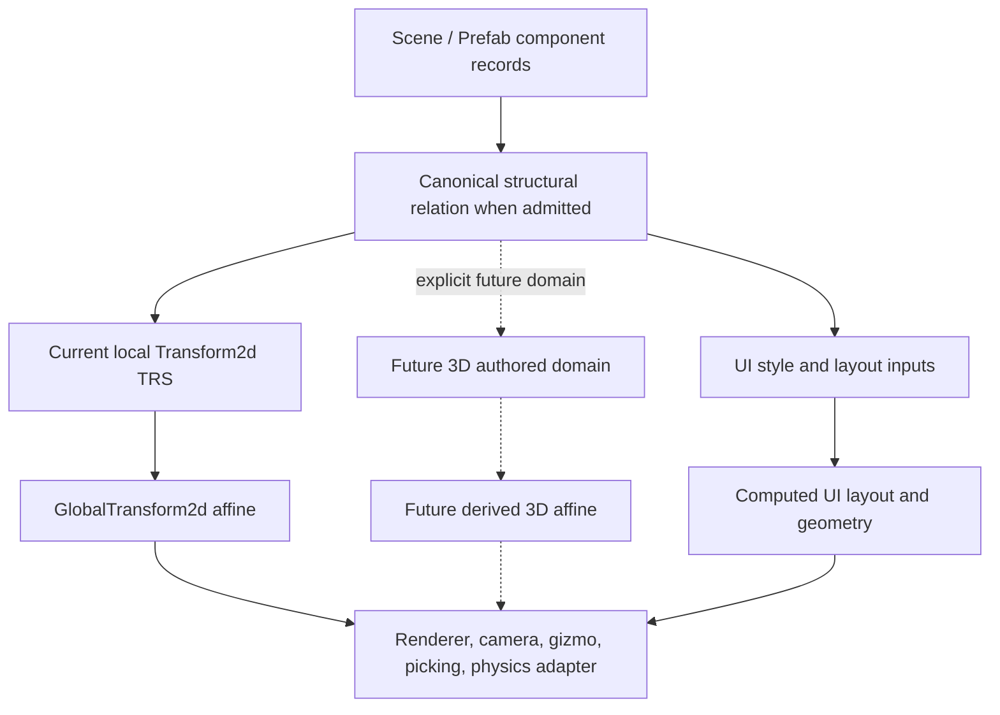

# ADR 0097: Future-Capable 2D and 3D Spatial Transform Model

**Status**: Accepted
**Date**: 2026-07-22
**Amended**: 2026-10-23 for private phase spatial snapshots, direct-parent domain boundaries, and
separation of accepted spatial invariants from candidate representations
**Refines**: [ADR 0005](0005-dimension-aware-runtime-with-2d-first-authoring.md),
[ADR 0018](0018-coordinate-units-and-time.md), and
[ADR 0022](0022-3d-coordinate-system.md)
**Refined By**: [ADR 0101](0101-ordered-persistent-placement-and-runtime-projection.md): Ordered
Persistent Placement and Runtime Projection
**Related**: [ADR 0025](0025-runtime-ui-system.md),
[ADR 0029](0029-animation-strategy.md),
[ADR 0032](0032-render-backend-integration-boundary.md),
[ADR 0033](0033-asset-import-and-render-resource-preparation-seam.md),
[ADR 0038](0038-scene-prefab-authoring-identity-and-provenance.md),
[ADR 0043](0043-scene-prefab-and-patch-document-migration-policy.md),
[ADR 0085](0085-hierarchy-transform-and-visibility-semantics.md) (Proposed),
[ADR 0095](0095-plugin-owned-specialized-domains-and-project-configuration.md), and
[OQ-035](../open-questions.md#oq-035-spatial-world-partition-streaming-and-origin-policy)
**Current 2D Completion Refinement**:
[ADR 0100](0100-runtime-structural-hierarchy-and-completed-2d-transform-projection.md) accepts the
dedicated non-linked runtime hierarchy ownership and completed `Transform2d` projection required by
the current product. This ADR accepts spatial domain boundaries and the supported 2D model.
Future affine authoring representations, 3D schema fields and world-preserving edit algorithms
remain Proposed in the [spatial affine representation design](../spatial-affine-representation-design.md).

## Context

Nara is 2D-first in authoring experience. Its spatial boundaries must also leave room for
imported node matrices, skew and shear, pivots, world-preserving edits, world-space UI, animation,
physics and a later 3D domain.

The supported 2D model has local authored `Transform2d` TRS and completed affine snapshots under
ADR 0100. Parent-child affine composition already preserves global shear produced by local TRS.
That does not by itself prove a particular persistent local-affine representation, 3D schema or
world-preserving edit algorithm.

The earlier revision selected optional post-affine residuals and future 3D fields before those
workflows were available. It also left a conflict between eliminating redundant residuals and
retaining existing authored base fields during exact reparenting. The candidate and its trade-offs
are retained in the Proposed design. Accepted domain boundaries should not depend on resolving
that representation choice prematurely.

Nara permits explicit source/schema migration when a complete workflow justifies a different
representation. This ADR does not promise that the current persistent source model will cover
every future spatial feature without change.

## Decision

Nara keeps **separate 2D and 3D authoring domains**, with UI layout as an independent domain.
Current 2D local authority is authored TRS. Global transforms are runtime-only derived affine
values. Cross-domain conversion is explicit, and unsupported or lossy operations fail visibly
rather than silently approximating.



### Authoring Domains

- `Transform2d` remains Nara's normal 2D authored local transform: translation `Vec2`, rotation
  in radians, and per-axis scale `Vec2`. Finite zero scale is valid visual data; an operation
  requiring an inverse must reject explicitly if the needed inverse cannot be admitted.
- A future 3D authored domain remains separate from 2D and follows ADR 0022's coordinate
  conventions. Its fields, rotation encoding, local-affine representation and schema are not
  selected here.
- `GlobalTransform2d` is a copyable opaque affine value, not an ECS Component, persistent record
  or publication capability. ADR 0100 owns private phase snapshots and their read-only access.
  The same derived-versus-authored distinction applies to a future 3D domain without selecting
  its concrete value type or storage mechanism.
- One entity has one selected spatial authority. A 2.5D game uses the 2D domain plus explicit
  render layer/sort data. A 3D billboard, 2D surface in a 3D world, or world-space UI requires a
  concrete feature-owned bridge; attaching two domains does not imply conversion or precedence.
- Future import and authoring operations must preserve their declared information or reject with
  an explicit reason. A new persistent representation requires its own schema and migration
  decision; optional residual components are a candidate, not a reserved extension to today's TRS.

### Propagation, Freshness, and Hierarchy

The local-to-global rule is always affine composition:

```text
root_global = local_affine
child_global = parent_global * local_affine
```

For the supported 2D domain, `local_affine` is derived from `Transform2d` TRS. It is not decomposed
back into TRS after composing ancestors. `nara_transform` owns propagation, dirty/cache
implementation, finite-value validation and named completion barriers. A future 3D domain must
define its corresponding completion contract. Private math or traversal may be shared after
measurement; two dimensions do not justify a generic `TransformDomain` trait, transform provider,
or shared mutable dirty-cache interface.

When a canonical structural hierarchy is admitted, a spatial projection crosses a parent only when
the parent participates continuously in that same domain. A missing or incompatible parent is a
domain boundary by default. A structural grouping entity that should carry spatial inheritance must
participate with an identity transform; future flattening, top-level, or cross-domain behavior is a
named concrete rule. No projection silently skips arbitrary ancestors.

Consumers requiring current values join after the owning completion barrier. A cached global is not
an immediate-read promise after arbitrary mutation. Exact authoring transactions may calculate the
affected chain privately against one validated revision, but render extraction, physics, picking,
and ordinary systems consume only the declared completed projection.

For the current 2D implementation, completion publishes an immutable cut with its own World,
runtime generation, phase, tick/frame and publication identity. Historical mutation, completed
fixed-tick and presentation reads have explicit roles. Source changes after publication belong to
the next cut; they do not change the meaning of a prior cut. Readers obtain the effective direct
parent frame from the same cut. In particular, a valid non-spatial structural grouping entity
terminates inheritance instead of rejecting the child or searching for a spatial ancestor.

### Reparenting and Persistence

The supported structural operation is `KeepLocal`: it changes topology and order while preserving
local component values. ADR 0101 owns ordered placement and exact inverse operations.

A future world-preserving operation must explicitly choose its retention semantics, calculate
against one validated revision, and either meet its declared precision contract or fail before
document mutation. It must not silently downgrade to local preservation. Persistent Scene/Prefab
patches contain the resulting placement and final local values, never a transient `KeepWorld`
instruction that replay would reevaluate against different ancestors.

This ADR accepts no `KeepWorldExact`, `KeepWorldTrs`, residual normalization or bake algorithm.
The candidate design retains those options and the unresolved priority between preserving
authored base fields and eliminating redundant residuals.

### Domain Boundaries

- Runtime UI owns layout inputs, anchors, sizing, clipping, interaction geometry, and its derived
  UI-global result. It never becomes a `Transform2d` specialization. World-space UI is a concrete
  Adapter that defines its chosen 2D/3D anchor and camera relation.
- Render features consume the completed global affine for their selected domain. `Camera2d` and
  future `Camera3d` remain distinct authoring components and lower into the shared render `View`.
  Sprite ordering remains explicit render-domain data; 2D does not acquire a hidden Z coordinate.
- Physics remains plugin-owned. A physics plugin explicitly declares which transform subset each
  body type accepts. Dynamic bodies initially remain supported roots with identity effective
  scale; non-uniform scale, shear and parented solver writeback require a concrete fixed-tick
  contract rather than an automatic transform sync.
- Future animation writes authored transform fields through its plugin-owned target/evaluation
  model. Animation of any new affine representation requires its own track/interpolation
  contract; generic reflection-based field animation is not admitted by this ADR.
- Asset import converts external coordinate conventions under ADR 0022. An importer that cannot
  represent source affine data without loss rejects explicitly until a suitable representation
  is admitted; it does not silently decompose or approximate. Transforms never contain backend/GPU
  handles.

### Crate and Extension Boundaries

`nara_transform` remains one deep Module for the shared transform contract and may organize
implementation as `two_d` and `three_d` submodules. It does not need separate dimension crates,
a generic cross-dimension Interface, or a transform backend registry. `nara_hierarchy` owns only
structural facts under ADRs 0100/0101; `nara_scene` owns persistent documents and patches;
`nara_tooling` compiles user intent; render, UI, physics, animation, and import domains consume or
adapt the selected transform domain.

Third-party plugins may own additional spatial semantics, but they either use Nara's concrete
2D/3D components or own a separate named domain and bridge. They do not register a replacement
implementation for `Transform2d`, `Transform3d`, or a universal affine provider.

## Alternatives Considered

### Option A: One Universal 3D Transform for Every Entity

**Pros**: Familiar Unity-like surface and one propagation implementation.

**Cons**: Assigns false spatial meaning to data/tooling entities, burdens 2D users with quaternion
and Z vocabulary, and collapses UI layout into world-space semantics.

**Decision**: Rejected. It contradicts ADR 0005's dimension-aware authoring model.

### Option B: Keep Current Local TRS and Define Spatial Domain Invariants

**Pros**: Preserves supported authoring and completed affine projection without selecting an
unvalidated future schema. Ordinary hierarchy-generated global shear already survives composition.

**Cons**: Exact local-affine import and world-preserving edits can require a later source-model
change and explicit migration.

**Decision**: Chosen for the accepted scope. TRS is the current supported representation, not a
permanent limit on future spatial workflows.

### Option C: Persist Full Raw Matrices for All Local Transforms

**Pros**: Directly represents every affine result, including singular matrices.

**Cons**: Makes ordinary authoring and animation matrix-oriented, obscures translation/rotation/
scale intent, and exposes a shallow numerical surface to every user.

**Decision**: Not selected for ordinary 2D authoring. A typed direct-affine option remains a
comparison in the Proposed design.

### Option D: Separate 2D and 3D TRS Bases with Optional Typed Post-Affine Residuals

**Pros**: Preserves simple common authoring, supports exact affine import/reparenting, keeps UI
separate, and provides an explicit contract for physics and animation restrictions.

**Cons**: Adds schema, codec, editor-mode, migration, and residual-normalization complexity.

**Decision**: Retained as a Proposed candidate, alongside direct-affine and explicit authoring
representations. Workflow evidence must resolve representation and normalization before acceptance.

## Success Metrics

| Metric | Target | Measurement |
|---|---:|---|
| Normal authoring simplicity | A supported 2D entity authors local TRS without matrix vocabulary | Scene/prefab fixtures and public API review |
| Affine composition | Nested local TRS, including rotated non-uniform scales, produces the expected affine result without TRS decomposition | Transform and extraction fixtures |
| Honest operation limits | An unsupported conversion or retention operation rejects explicitly; no operation silently loses data or downgrades policy | Fixtures for each admitted operation |
| Domain isolation | UI, 2D, 3D, physics, and render features cannot infer cross-domain inheritance or mutate another domain's local authority | Plugin and schedule integration tests |
| Freshness honesty | A declared fresh consumer never sees an old global after the owning completion barrier | Schedule-barrier fixtures |
| Physics safety | Unsupported scale/shear/parenting combinations fail at the physics domain boundary rather than producing an implied valid body | Concrete physics-plugin tracer |

## Risks and Mitigations

| Risk | Severity | Likelihood | Mitigation |
|---|---|---:|---|
| A candidate is mistaken for an accepted schema | High | Medium | Keep future representation and normalization in the explicitly Proposed design; accept only after complete workflow evidence. |
| Later affine needs require a format change | High | Medium | Permit explicit source/schema migration and validate import, editing, animation and history together before selecting representation. |
| Full affine leaks into physics implicitly | Critical | Medium | Physics plugins declare accepted subsets; dynamic bodies remain restricted until a fixed-tick tracer proves more. |
| Global cache becomes stale | High | Medium | Named propagation barriers and exact private calculation for transactions; never describe global cache as immediate truth. |
| Matrix-heavy feature work over-engineers the first game | Medium | Medium | Keep supported 2D TRS and snapshots; future fields and algorithms require concrete consumers before acceptance or implementation. |
| Cross-domain bridges become a universal framework | Medium | Medium | Admit only concrete feature-owned bridges; reject a generic bridge/provider Interface without two real consumers. |

## Consequences

- Current authored `Transform2d`, derived affine values and ADR 0100's phase snapshots remain
  supported. No residual component, 3D schema or new wire format is introduced by this amendment.
- Future representation changes may require explicit source/schema migration under ADR 0043.
  A pre-1.0 implementation can replace an unsuitable representation without compatibility aliases;
  its unit owns source/fixture rewrites and migration guidance. Runtime loading never silently
  rewrites project files.
- ADR 0085's remaining proposals must respect these spatial invariants, but do not inherit an
  accepted residual representation or KeepWorld algorithm. ADRs 0100/0101 continue to own the
  current runtime hierarchy, ordered placement and completion contracts.
- A later representation decision must compare the Proposed candidates using import, authoring,
  animation, precision and undo evidence. It may select a different source model.
- OQ-035 remains the owner of origin shifting, large-world partitioning, and cross-region spatial
  policy. This ADR chooses neither double precision nor streaming topology.

## Citations

- Nara baseline: `crates/nara_transform/src/lib.rs`,
  `crates/nara_transform/src/propagation.rs`, `crates/nara_hierarchy/src/lib.rs`,
  `crates/nara_scene/tests/structural_authoring.rs`, and
  `crates/nara_sprite_render/src/extract.rs`
- Nara hierarchy proposal: [ADR 0085](0085-hierarchy-transform-and-visibility-semantics.md)
- Representation candidates and original reference rationale:
  [Spatial affine representation design](../spatial-affine-representation-design.md) (Proposed)
