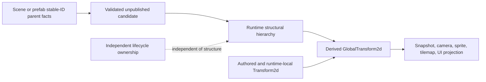

# ADR 0100: Runtime Structural Hierarchy and Completed 2D Transform Projection

**Status**: Accepted
**Date**: 2026-08-01
**Amended**: 2026-08-05 by NUI-U8 ordered runtime projection
**Amended**: 2026-10-23 by U4 private phase spatial snapshots
**Owner**: Runtime hierarchy, 2D transform projection, and consuming product hosts
**Related**: ADR 0005, ADR 0006, and ADR 0018
**Refines**: The current 2D completion slice of
[ADR 0097](0097-future-capable-2d-3d-spatial-transform-model.md)
**Extracted From**: [ADR 0085](0085-hierarchy-transform-and-visibility-semantics.md), which
remains Proposed for visibility, linked lifetime, physics, 3D, and broader hierarchy semantics not
owned by ADR 0100 or ADR 0101
**Refined By**: [ADR 0101](0101-ordered-persistent-placement-and-runtime-projection.md): Ordered
Persistent Placement and Runtime Projection
**Implementation Plan**:
[Reference-Game 2D Spatial Authority and Hierarchy Closure](../../plans/2026-08-01-002-refactor-reference-game-2d-spatial-authority-plan.md),
RGS-U2 through RGS-U5

## Context

Nara's current prototype places runtime `Parent` and mutable `Children` data in `nara_scene`,
rebuilds the reverse collection by scanning the World, and defines `GlobalTransform2d` without a
propagation owner. Sprite, tilemap, and camera extraction therefore read local transforms. The
reference game also duplicates spatial authority between gameplay components and `Transform2d`.

This is already a correctness and dependency problem for the current 2D product. It does not
require Nara to accept the much broader persistent-order, visibility, editor reparent, physics, or
3D model proposed by ADR 0085. The durable boundary can be fixed now while the exact Rust API and
future authoring semantics remain provisional.

## Decision

Nara owns one runtime structural hierarchy Module, separate from scene documents and transform
math, and one completed 2D local-to-global projection.

- Runtime structure belongs to a dedicated deep Module outside `nara_scene`, `nara_transform`, UI,
  render, and tooling. The active implementation plan places it in `nara_hierarchy`; this decision
  freezes the ownership boundary, not public identifier spelling or prelude placement.
- The runtime relation uses Nara-defined immutable ECS components with private fields. The forward
  parent relation is authoritative, and `nara_hierarchy` manually synchronizes the reverse ordered
  child projection. Neither public type implements Bevy's `Relationship` or `RelationshipTarget`;
  those traits would expose a second construction and mutation path outside the ordered writer.
- The relation does not opt into linked spawn or linked clone behavior. Structural ancestry does
  not grant despawn, Scene Instance membership, runtime-session ownership, UI layout, visibility,
  persistence, or prefab-provenance authority.
- Scene and prefab stable-ID parent facts are validated and lowered into the runtime relation before
  candidate publication. Runtime relation state never writes topology back into a document or
  advances a saved revision.
- `Transform2d` is the only authored and runtime-local 2D spatial authority. `GlobalTransform2d` is
  a copyable opaque affine value, with no Component identity. The transform Module privately owns
  completed immutable simulation and presentation cuts. A continuous direct-parent 2D chain
  composes affine values; a non-spatial direct parent starts a new spatial domain. Consumers never
  skip that parent to inherit from an earlier ancestor.
- Consumers that require current world-space data run only after a named semantic completion
  boundary. They do not independently walk parent chains or silently fall back to local or identity
  transforms.
- Read-only `HistoricalSpatialSnapshot2d`, `FixedSpatialSnapshot2d` and
  `PresentedSpatialSnapshot2d` SystemParams, and matching shared-World functions, expose
  `global`, `effective_parent`, captured structural `order`, O(1) `structural_index`, and `stamp`. A stamp is metadata,
  not transferable publication authority. Readers validate World, managed runtime generation and
  their phase/time role without requiring callers to join separate completion resources.
  Spatial publication identity is allocated independently from movable slots or rebuilt history
  owners and does not repeat across simulation/presentation payloads. Restoring an old slot cannot
  collide with the identity retained by source observations or a presentation source association.
- Startup seeds the historical simulation cut. During fixed mutation Historical reads the last
  completed simulation publication with its original stamp. Fixed Resolve runs after materialized
  deferred commands, completed hierarchy and Transform propagation, and before Finalize. Finalize
  Capture reads that same tick cut directly; it does not join the before-Finalize helper. PostUpdate
  and Extract publish explicitly named later cuts. Extract completes presentation before consumers.
- A source edit, spawn or retirement made after consuming a cut does not rewrite it. The next
  publication observes full Entity identity, finite local values, membership and direct-parent
  relation, including edits sharing one ECS change tick. Retained contiguous observation rows
  compare full Entity/value tuples; query/archetype order changes conservatively rebuild the cut.
  Candidate construction reuses this captured source data and the validated structural order rather
  than reconstructing a second adjacency graph. Unchanged sources reuse the private
  matrix payload. Changed sources build a complete linear candidate before atomic publication.
  Failed completion makes the requested slot unavailable; retained candidate or last-good bytes
  are not readable as a successful publication.
- Presentation interpolates fixed history against one captured simulation/local/topology cut.
  The fixed starting sample captures actual local/parent values after Prepare and its deferred
  commands; edits made before simulation are the starting frame, not artificial motion from an
  earlier publication. History and uncommitted starting samples retain World/runtime provenance;
  foreign or mismatched history is discarded before it can authorize a local publication.
  Paused and edited sources reset their history to the captured current value. Zero or multiple
  fixed steps retain the established fixed-pair policy. Presentation never combines live locals
  with earlier simulation matrices. New renderable entities absent from its cut have no spatial
  value and cannot fall back to local or identity transforms.
- Nara-owned placement and replacement paths validate the supported topology generation before
  derived publication. Immutable component insert/discard hooks invalidate completion immediately,
  including advanced raw component replacement or removal. A missing or divergent root resource
  also withholds completion. Direct reverse-collection mutation is unavailable; raw despawn never
  cascades and leaves the hierarchy fail-closed until its owning placement transaction runs.
- Ordinary owner-controlled writer batches may reuse a private validated baseline and resolve through
  a sparse touched-owner copy-on-write overlay. The baseline is invalidated by relation hooks and a
  private root-resource epoch; raw escapes and diagnostic/private construction paths retain complete
  validation. The overlay is dropped before a prepared batch crosses its prepare/commit boundary.
  Prepared batches still require the enclosing owner's no-flush/no-hierarchy-mutation window.
- Hierarchy completion associates its concrete order, private completion state and completion
  fact with one World-bound publication identity. Equal generation, root IDs and root epoch in a
  different World do not establish this association. Transform payload reuse includes that exact
  identity, so an unchanged local/parent set cannot conceal a replaced structural order.
- Structural ancestry never defines a retirement closure. Existing lifecycle owners must adapt
  their owned teardown paths to the hierarchy projection and continue retiring only their explicit
  memberships. This ADR does not accept a scene-session, scene-travel, candidate-initialization,
  or runtime-derived-entity ownership API.

ADR 0101 refines this decision with deterministic root/sibling order and exact runtime placement
operations. This ADR does not independently accept `KeepWorld`, visibility inheritance, UI tree
semantics, prefab ownership transfer, recursive destruction, physics synchronization, 3D
transforms, post-affine authoring mechanisms, or a generic hierarchy/provider abstraction. Those
decisions remain evidence-gated.

## Alternatives Considered

### Option 1: Keep runtime hierarchy in `nara_scene`

Rejected. It keeps scene-document ownership coupled to runtime structure and prevents
`nara_transform` from consuming hierarchy without a Cargo dependency cycle.

### Option 2: Use Bevy's built-in linked child hierarchy directly

Rejected. Its linked lifecycle behavior would make structural ancestry an implicit destruction and
cloning policy, conflicting with Nara's explicit lifecycle ownership.

### Option 3: Keep local-only extraction and let each consumer walk ancestors

Rejected. Consumers would disagree about freshness and domain boundaries, repeat work, and expose
partially updated frame data.

### Option 4: Use a Nara-owned non-linked relation plus a completed 2D projection

Selected. It fixes the current dependency and product correctness problem while leaving future
authoring and 3D decisions open.

## Consequences

- `nara_scene` continues to own persistent documents, prefab expansion, patches, and one-way
  materialization, but no longer owns the runtime relation implementation.
- The hierarchy Module owns structural facts and validation only; transform, UI, render, identity,
  and lifecycle domains consume them without transferring authority.
- `nara_transform` owns propagation and completion of the 2D global projection. Render and snapshot
  consumers migrate from local transforms to completed globals.
- RGS-U2 removes the full-scan child rebuild, independently mutable child collection, and scene
  transform re-export. RGS-U3 completes global propagation and render consumption; the
  reference-game aggregate-to-Transform projection remains transitional until RGS-U4.
- NUI-U8 removes the provisional public Bevy relationship escape hatch, publishes one validated
  depth-first structural order per topology generation, and keeps component lifecycle/observer
  preflight inside the hierarchy owner. `HierarchyWriter`, `HierarchyRoots`, and `HierarchyOrder`
  are the exercised ordered-relation anchors; broader UI and lifecycle semantics remain owned by
  their later product slices.

## Success Metrics

| Metric | Target | Measurement |
|---|---:|---|
| Runtime hierarchy authority | One forward authority and one derived reverse projection | Hierarchy relation and public-surface tests |
| Runtime structural order | One completed depth-first order shared by layout, hit testing, and rendering without entity-allocation fallback | Reverse-allocation hierarchy/UI integration test |
| Lifecycle separation | Parent loss detaches children; current Scene Instance replacement retires exact membership and never hierarchy closure | Scene replacement/unload fixtures |
| Publication atomicity | Invalid stable-ID topology publishes no partial runtime instance | Scene/prefab hostile fixtures |
| 2D projection correctness | Nested globals equal ordered affine composition before every declared fresh consumer | Transform and extraction tests |
| Static-frame cost | No hierarchy validation, graph rebuild, propagation or affine payload replacement when unchanged; one allocation-free local-value/membership comparison per publication remains while ordinary mutable ECS authoring is supported | Focused scan/traversal instrumentation and the before/after scale harness |
| Product proof | One authored reference-game child follows its parent across headless, desktop, and editor paths | Reference-game product tests and bounded manual journey |

## Risks and Mitigations

| Risk | Severity | Likelihood | Mitigation |
|---|---|---:|---|
| Structural hierarchy becomes an implicit lifetime owner | Critical | Medium | Use a non-linked relation and require existing lifecycle owners to retire only their explicit memberships. Do not infer or accept a session API here. |
| Advanced ECS mutation bypasses validation or dirty tracking | High | Low | Keep relation components immutable and privately constructed, reject foreign lifecycle hooks/observers before mutation, invalidate generations from owner hooks, and withhold completion when roots or projections diverge. |
| Global transforms are stale at startup, pause, or extraction | High | Medium | Provide bootstrap, frame, and pre-extraction completion points with a named freshness boundary. |
| The first implementation freezes an unnecessary public API | High | Medium | Keep API names and placement provisional and classify them only after the product journey. |
| The slice expands into the full ADR 0085 design | High | Medium | Keep ordering, reparenting, visibility, prefab transfer, UI details, physics, and 3D explicitly Proposed. |

## 2026-10-23 Refinement

This amendment replaces the transferable Global Component plus completion-token protocol. It does
not retain that protocol behind a freshness facade. The Reference Game consumes a selected spatial
cut and then spawns or retires entities; immutable phase publications describe that workflow without
claiming that subsequent source mutations are already projected. Only bounded owner slots,
candidate buffers and fixed interpolation samples are retained. Public arbitrary history and owned
snapshot retention remain outside this contract. Native World access remains trusted; a missing or
foreign private slot fails explicitly rather than creating an out-of-World service.

`add_fixed_transform_projection_systems` supplies both ends of the Resolve interval.
`add_presented_transform_projection_systems` orders Extract consumers after presentation.
The implementation applies actual deferred command boundaries before capturing a cut; a call to
`World::flush` alone is not a substitute for applying system-local command buffers.
