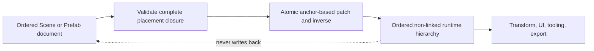

# ADR 0101: Ordered Persistent Placement and Runtime Projection

**Status**: Accepted
**Date**: 2026-08-04
**Amended**: 2026-08-15 to clarify the implemented Prefab-root projection order
**Amended**: 2026-10-23 to bind spatial consumption to captured structural order
**Owner**: Persistent Scene/Prefab/Patch documents, runtime hierarchy, authoring tools, and UI projection
**Refines**: [ADR 0005](0005-dimension-aware-runtime-with-2d-first-authoring.md),
[ADR 0006](0006-scene-and-prefab-data-model.md),
[ADR 0026](0026-editor-command-patch-and-undo-model.md),
[ADR 0038](0038-scene-prefab-authoring-identity-and-provenance.md),
[ADR 0043](0043-scene-prefab-and-patch-document-migration-policy.md),
[ADR 0097](0097-future-capable-2d-3d-spatial-transform-model.md), and
[ADR 0100](0100-runtime-structural-hierarchy-and-completed-2d-transform-projection.md)
**Extracted From**: [ADR 0085](0085-hierarchy-transform-and-visibility-semantics.md), which remains
Proposed for visibility, physics, 3D, and other unproven hierarchy semantics
**Implementation Plan**: [Ordered UI Kernel and Engine Boundary Correction](../../plans/2026-08-04-002-refactor-ordered-ui-kernel-and-engine-boundary-correction-plan.md), NUI-U6 through NUI-U8 and NUI-U13

## Context

Nara currently stores a parent on each persistent entity record, keeps root order implicit, and
uses a runtime reverse-child projection that does not promise sibling order. Scene patches can
reparent an entity but cannot describe or restore its exact placement. The proposed runtime-UI
patch added a UI-local numeric sibling rank, which would create a second structural authority and
make draw and hit behavior depend on data that Scene, Prefab, undo, and runtime hierarchy do not
own.

The reference game now requires deterministic UI structure, and the Editor/AI authoring path
already requires exact undo. This is enough evidence to extract ordered placement from ADR 0085
without accepting visibility, linked lifetime, physics, or a universal object tree.

## Decision

Scene and Prefab documents own one ordered placement closure. Runtime hierarchy is its ordered,
one-way projection.

- A document owns one ordered root list. Each parent record owns one ordered child list. Canonical
  entity records remain sorted by stable entity ID for lookup and serialization.
- Every entity occurs exactly once in either the root list or one parent's child list. Persistent
  entity records do not also store a parent field.
- Placement uses stable root-or-parent ownership plus `first`, `last`, `before stable sibling`, or
  `after stable sibling`. Add, move, reparent, reorder, remove, and restore share this vocabulary.
- Validation rejects missing, duplicate, dangling, cyclic, overlapping, or multiply owned
  placement before publication. A batch is all-or-nothing and every successful mutation has an
  exact inverse.
- Prefab expansion, overrides, copy/export, and nested instance projection preserve the ordered
  closure. They never reconstruct order from map iteration, a numeric rank, source order that is
  not part of the document, or runtime entity allocation.
- Expanding a prefab instance preserves the prefab's ordered roots and inserts their namespaced
  projections before children authored directly on the instance anchor. This makes base prefab
  content precede scene-local additions without deriving order from canonical entity-record
  sorting.
- `nara_hierarchy` owns the synchronized non-linked runtime parent/ordered-children projection.
  Supported first-party mutation goes through its writer/command transaction. Structure remains
  independent from lifecycle ownership, transform math, visibility, and UI state.
- Runtime UI consumes this structural order. It does not add `UiNode::sibling_order` or any other
  persistent ordering authority.
- Spatial snapshots capture this complete validated order, including non-spatial structural
  participants, alongside their local/global cut. Render extraction consumes the captured order
  rather than pairing earlier affine values with a newer live hierarchy. Spatial membership is
  separate from structural membership: `global` rejects a non-spatial entity in that order, and a
  non-spatial direct parent terminates transform inheritance under ADRs 0097/0100.
  A captured structural index provides constant-time membership/order lookup. An unplaced spatial
  entity may have a global affine value but has no structural index; render consumers that require
  ordered membership reject it explicitly. Completion binds the order to the actual World and an
  exact owner publication, not merely a generation/root-epoch equality test.
- Nara is pre-1.0. First-party sources are rewritten to the corrected canonical
  `format_version = 1`; the experimental parent-owned shape is rejected rather than guessed or
  compatibility-decoded.

## Alternatives Considered

### Option 1: Add a numeric sibling rank only to UI nodes

Rejected. It would not make Scene/Prefab/Patch order exact and would create conflicting hierarchy
authorities.

### Option 2: Preserve record-owned parents and add derived child arrays

Rejected. Two persisted directions can diverge, and validation cannot identify which value should
win without an arbitrary repair policy.

### Option 3: Own ordered roots and children with stable placement anchors

Selected. It gives documents, patches, runtime projection, tooling, and UI one structural fact and
supports exact inverse operations.

## Consequences

- Scene, Prefab, Patch, tooling, reference content, and runtime hierarchy formats and APIs break
  together; no compatibility shim remains.
- Document lookup order stays independent from structural order, so deterministic serialization
  does not require structural ranks on entity records.
- Runtime hierarchy writers become the only supported mutation boundary for ordered relations.
- Visibility, linked destruction, `KeepWorld`, physics, 3D, and generic hierarchy providers remain
  outside this decision.

## Success Metrics

| Metric | Target | Measurement |
|---|---:|---|
| Persistent placement authorities | 1 | Scene/Prefab schema and hostile-fixture inspection |
| Exact patch inverses | 100% of accepted placement operations | Patch round-trip and undo/redo tests |
| Order preservation | Identical across source, prefab expansion, runtime projection, export, and Retry | Cross-layer integration fixtures |
| Allocation-independent UI order | 100% | Unrelated-allocation and repeated-instance UI tests |
| Legacy ambiguity | 0 silent repairs | Canonical-format rejection tests and migration guide |

## Risks and Mitigations

| Risk | Severity | Likelihood | Mitigation |
|---|---|---:|---|
| A malformed document partially changes live structure | Critical | Medium | Validate the complete closure and prepare the writer transaction before any publication. |
| Anchor deletion makes undo ambiguous | High | Medium | Store the exact prior placement and reject an inverse whose stable context is no longer valid. |
| Runtime code bypasses the ordered writer | High | Medium | Keep mutable relation internals private and test ordinary public construction paths. |
| Ordering expands into lifetime or visibility authority | High | Medium | Retain the non-linked relation and keep those decisions under their separate triggers. |
| Canonical-v1 reset surprises early adopters | Medium | High | Rewrite all first-party sources atomically and document the intentional pre-1.0 break. |
