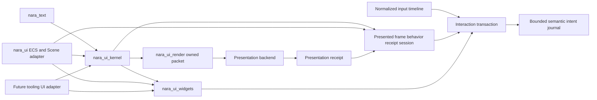

# ADR 0102: Renderer-Neutral UI, Text, Widget, and Presented-Frame Topology

**Status**: Accepted
**Date**: 2026-08-04
**Last Revised**: 2026-10-25
**Amended**: 2026-08-05 by the NUI-U8 post-decision checkpoint; 2026-08-06 by the NUI-U17 pre-implementation ownership checkpoint; 2026-08-07 by the NUI-U15A example-first interface-proof checkpoint; 2026-08-08 by the focused U15A focus-identity refreeze and UI Foundation rebaseline; 2026-08-10 by the UIF-U5 public-inventory and Host-authority audit; 2026-08-12 by the UIFD immutable dynamic-text projection correction; 2026-10-25 by the complete source/occurrence/placement key adoption
**Owner**: UI authoring, text, widget behavior, input routing, presentation packets, and platform adapters
**Refines**: [ADR 0012](0012-render-crate-boundaries.md),
[ADR 0025](0025-runtime-ui-system.md),
[ADR 0031](0031-text-and-font-strategy.md),
[ADR 0038](0038-scene-prefab-authoring-identity-and-provenance.md),
[ADR 0040](0040-render-resource-lifetime-and-submitter-ownership.md),
[ADR 0041](0041-input-routing-actions-text-focus-and-accessibility.md),
[ADR 0043](0043-scene-prefab-and-patch-document-migration-policy.md),
[ADR 0044](0044-root-facade-and-prelude-layering-policy.md),
[ADR 0056](0056-headless-runtime-and-dedicated-server-readiness.md),
[ADR 0095](0095-plugin-owned-specialized-domains-and-project-configuration.md), and
[ADR 0096](0096-evidence-gated-render-scaling-and-upload-policy.md)
**Refined By**: [ADR 0107](0107-shared-ui-foundation-and-independent-product-layers.md),
[ADR 0108](0108-ui-surface-presented-session-and-atomic-interaction.md), and
[ADR 0109](0109-root-local-ui-compilation-and-presentation-closure.md)
**Implementation Plans**: completed [UI Foundation Correction](../../plans/2026-08-08-001-refactor-ui-foundation-correction-plan.md) lineage and the current [Runtime UI Product Slice](../../plans/2026-08-08-002-feat-runtime-ui-product-slice-plan.md); the complete-key replacement follows the [foundation rebaseline](../../plans/2026-10-23-foundation-architecture-rebaseline-plan.md); execution continuity belongs in engineering memory rather than this ADR

The [complete persistent-key successor conformance](../../knowledge/engineering/verification/2026-10/2026-10-24T185535Z-complete-persistent-ui-identity-and-neutral-conformance-successor-0cf84bdfd2f54766be84f3ca206f7931.md) binds the current breaking
identity inventory, exact neutral assertions and scoped qualification to implementation `f7ab300`.
Historical inventories retain their recorded scope; this is not whole-toolkit qualification.

## Context

The current runtime UI combines persistent ECS components, renderer-owned view discovery, layout,
hit testing, and public extract/queue/batch stages. It has no stable logical widget identity, text
owner, semantic tree, or proof that input targets the frame whose exact packet the backend accepted
and submitted. Editor UI has a
different persistence and command authority, so a shared top-level object model would couple two
products while still leaving their common algorithms shallow.

Neutral layered conformance examples first prove the public text/frame, runtime interaction, and
presentation seams without product facts. The reference-game HUD, terminal overlay, Retry control,
packaged desktop path, and headless path then form one complete product consumer through those
frozen seams. The game may reveal a missing capability, but it cannot alone admit a public provider,
component, layout, or Editor-shell abstraction.

## Decision

Nara compiles bounded authoring snapshots into one immutable renderer-neutral frame. Text and
widget behavior are separate deep modules; Runtime and future Editor products use separate
adapters.

The 2026-08-08 rebaseline narrows this broad topology into three deep Interfaces: compile an
immutable candidate, present an owned capability-closed packet, and atomically dispatch against the
exact presented receipt. ADR 0107 owns the product-layer split, ADR 0108 owns Surface Slot/session
atomicity, and ADR 0109 owns root-local compilation and frame-global presentation closure. The
superseded master plan remains implementation history and no longer orders product integration.

- The physical dependency direction is `nara_text <- nara_ui_kernel <- nara_ui_widgets`.
  `nara_ui` is the ECS/Scene runtime adapter. `nara_ui_render` consumes the kernel frame and the
  text raster boundary. WGPU consumes only backend-neutral owned packets.
- `nara_ui_kernel` has no ECS, Scene, Host, Editor, window-backend, or WGPU dependency. It exposes
  one concrete fallible authoring-snapshot builder, compilation, read-only frame access, and
  presented-frame dispatch. Normalized IR, layout nodes, caches, fragments, and lifecycle stages
  remain private.
- Every root and stateful or interactive node has an exact stable logical key. Persistent Scene
  keys include canonical containing-document source, declared logical occurrence and complete
  authored placement, including source-local entity and canonical nested Prefab ancestry. Lookup
  request spelling is diagnostic evidence, not equality. Each node retains its complete address:
  a UI root is not a Scene-context boundary, and legal cross-source/runtime children do not inherit
  or omit identity axes. Runtime-created roots and
  nodes require explicit domain keys. Runtime entity bits, query order, sibling indexes, source
  locations, and `SceneInstanceId` are invalid logical identities.
- Kernel consumes bounded opaque binary context and placement values, not Scene/ECS types or a
  public Prefab-path model. Adapters own tagged, length-delimited canonical lowering, preserve
  original UTF-8 and raw UUID bytes, and explicitly share context during a projection. Persistent
  identity requires both values; there is no identity-free or implicit-root fallback. Root/local
  equality is content-based and independent of Arc sharing. Scoping clones complete typed
  addresses without allocating a new segmented local, interning globally or changing extraction
  and reconstruction semantics. The [storage comparison](../../benchmarks/2026-10-25-ui-key-storage.md)
  selects that initial representation without claiming a complete engine performance result.
- Exact key cost uses one canonical framing: root-only costs `3 + R`; scoped costs
  `7 + R + L - P`, with identity tags and two-byte field lengths included in the complete address
  lengths R/L and content-defined longest common prefix P. The 256-byte hard ceiling is unchanged.
  A complete identity encodes its tag, first-field length, first-field bytes, final-field bytes and
  trailing final-field length. The enclosing address length frames that final field. A variable
  leaf length must not precede and destroy otherwise shared placement bytes.
  Admission, `encoded_len` and reduced owner limits use the same function; storage shape cannot
  change eligibility. Canonical cost is not allocator footprint, and this internal representation
  does not promise a stable persistent/wire format or admission of every 32-step Prefab path.
- One immutable `UiFrame` owns resolved logical geometry, root layers, stacking, clipping, paint
  order, reverse hit order, focus/navigation facts, semantics, diagnostics, and its environment
  revision. Root compilation is bounded and failure-atomic.
- A presenter returns a `UiPresentationReceipt` only after the exact packet was accepted and
  submitted by the backend for the matching surface/environment revision. The receipt proves
  backend submission of that immutable packet; it does not claim that a player actually saw the
  pixels. Input dispatch targets one exact retained presented session containing the immutable
  frame, the immutable behavior snapshot compiled with it, and the receipt. Compilation alone never
  grants interaction authority. The adapter retains the current session plus two prior sessions and
  rejects routes that resolve to retired history.
- Runtime UI physically separates authoring projection, per-surface compiled candidates, presented
  history, one interaction transaction coordinator, and bounded intent-journal storage. These are
  concrete private modules inside `nara_ui` until dependency isolation or a second adapter justifies
  another crate. Presented history owns publication only. Intent-journal storage owns entries,
  cursors, acknowledgements, and reclamation only. The transaction coordinator is the sole owner of
  atomic interaction, reducer, journal-admission, and input-finalization commit.
- Every surface has independent candidate, presented-history, interaction, and widget-reducer state.
  A root-local compatible last-good visual may enter a newer candidate only as inert paint with no
  hit, focus, action, or semantic authority. A failed or unpresented candidate leaves the prior
  presented session unchanged and cannot replace its behavior. No hover, press, focus, enabled,
  reducer, or action state is shared across surfaces.
  ADR 0109 refines modal safety: current modal membership/barrier is root-envelope policy rather than
  cached body behavior. An inert retained modal visual still blocks underlay UI and gameplay; if the
  current candidate cannot establish a safe modal barrier/fallback, compilation rejects the complete
  candidate and retains the prior presented session.
- Timeline routing returns one closed disposition. `PassThrough` performs no UI mutation and keeps an
  event eligible for gameplay only when it is proven not to target UI. `Consumed` atomically commits
  interaction state, widget-reducer state, admitted intents, and input finalization.
  `RejectedClosed` commits no UI or intent state, records a bounded rejection, and finalizes the event
  so gameplay cannot consume it. Stale or retired history, route mismatch, invalid projection, route
  conflict, and capacity failure are rejected closed.
- Semantic intents enter a bounded monotonic journal with bounded registered consumers and
  independent cursors. Late registration begins at the current tail unless the owning product
  installs the consumer before input starts; no implicit replay exists. The journal reclaims only the
  prefix acknowledged by every registered consumer, never overwrites an unacknowledged entry, and
  preflights capacity before any interaction or reducer mutation. A slow consumer causes typed
  producer rejection rather than a silent gap. Pause retains both the consumer cursor and unobserved
  intents; explicit unregister releases only that consumer's retention obligation.
- A window/seat endpoint has at most one active surface owner. Republishing the same owner is
  idempotent. A different owner receives a typed conflict without changing the existing route,
  presentation epoch, or revision. Only retirement of the matching surface or endpoint detachment
  releases ownership; no insertion-order or implicit focus-stack policy exists.
- The first authoring vocabulary is closed: root, node/style, visual, display text, controlled
  button, optional semantics, immutable theme, bounded action ID, and typed semantic intent. It has
  no callback with World/Editor authority, property bag, generic Widget component, CSS selector
  language, or second retained object model. A product adapter may replace display content on the
  existing immutable text value, but logical size, brush, alignment, overflow and semantic-text
  policy remain authored facts rather than fields reconstructed from product defaults.
- `nara_text` owns bounded deterministic font admission, shaping, bidi/line layout, measurement,
  glyph keys/raster requests, and diagnostics without system-font discovery. Atlas allocation and
  GPU residency remain presentation-owner responsibilities.
- A node's own text uses the compiler's resolved content box for measurement, final shaping and
  paint origin/clip. Background, hit, focus and semantic facts retain the outer node box. Render
  lowering consumes that published content geometry instead of recomputing layout padding.
  The B10/U9 correction reopens the neutral conformance checkpoint for this invariant, supported by
  the independent Bevy/Godot comparison and the existing padded layout-gallery consumer. Its
  successor evidence must include auto-height Flow/Absolute layout, packet geometry and the
  amended neutral gallery before the shared change is closed.
- One immutable admitted `FontFace` is the source for both compiler shaping and presentation
  rasterization. Code-configured UI and presentation plugins capture that face in their frozen
  configuration identity; the bundled face is their convenience default. A planner rejects glyph
  runs from a different face before staged atlas or packet publication, retaining its last-good
  output. Packets remain resource-complete and do not consult a mutable font registry at submission.
- Kernel routing owns capture/target/bubble, pointer capture, focus scopes, modal inertness,
  navigation, semantics, and geometry-coupled session state. `nara_ui_widgets` owns controlled
  behavior reducers and emits typed intents only.
- Focus identity is distinct from current navigation and activation eligibility. A stable focused
  key that remains present in its active modal scope survives a temporary disabled state, while
  enabled-only navigation skips it and pointer, keyboard, gamepad, and semantic activation reject
  it as disabled. Hiding or removing the key, retiring its surface, invalidating its modal scope, or
  cancelling its seat still clears or restores focus through the ordinary session rules. This
  preserves pending-control continuity without making disabled controls interactive.
- Public scheduling exposes semantic registration for local command producers and only the immutable
  current-tick consume and post-consume capture anchors required by independent products. Input
  projection, UI route finalization, local-action mapping, command admission, acknowledgement, and
  other technical phases remain private or doc-hidden engine-integration details.
- Shared UI interfaces are proven before product integration by three thin neutral conformance
  executables plus one independent public consumer: a kernel layout/frame gallery, an ECS/Scene
  runtime interaction lab, a root-facade presentation gallery, and [`ui-module-consumer`](../../../tests/fixtures/ui-module-consumer/). The kernel
  gallery and independent consumer use only ordinary public modules. The runtime and presentation
  galleries isolate non-forgeable prepare/submit/commit authority in local first-party presenter
  glue that may use doc-hidden implementation seams; those seams are excluded from the frozen
  public inventory, cannot be re-exported, and cannot appear in product code. Requiring a public
  fake presenter would weaken receipt meaning and is rejected. The examples introduce no shared
  framework, registry, alternate authoring model, product vocabulary, or duplicate pixel/hash
  matrix.
- The conformance checkpoint freezes a recorded baseline: public-interface inventory, named shared
  semantic invariants, exact example assertions, and the commit that proved them. Product integration
  must reopen and refreeze this checkpoint before changing shared UI behavior or an assertion, even if
  signatures remain unchanged. A post-product neutral case may reproduce a gap but cannot alone admit
  a shared change; the focused amendment must cite a pre-freeze named invariant, independent
  comparative pressure, or a second independent consumer.
- After that checkpoint, the Reference Game consumes the frozen baseline; a shared gap stops for
  independent evidence and a focused plan amendment instead of silently widening the engine.
- Runtime and future Editor adapters share text, kernel, widget state machines, semantic
  vocabulary, canonical logical-address equality and presentation infrastructure. Equal complete
  coordinates lower to equal logical keys; raw Prefab Canvas and Scene-instanced placement are
  different coordinates. Adapters do not share document/source ownership, runtime activation,
  session persistence, Host authority, or domain commands.
- The semantic tree and typed accessibility actions are part of the formal `UiFrame` contract.
  AccessKit integration is a bounded desktop-adapter trial; AccessKit types and availability never
  enter the kernel, widget, packet, or headless contracts.
- Open-GPUI and other engines are behavioral evidence only. Nara does not adopt their App/Window/
  Entity/Element lifecycle or copy source without explicit provenance and license review.

## Alternatives Considered

### Option 1: Continue an ECS execution tree with public layout and render stages

Rejected. It couples compilation to runtime allocation and exposes implementation steps that no
real product needs to orchestrate.

### Option 2: Adopt one shared Runtime/Editor widget object model

Rejected. Game documents and Editor sessions have different identity, persistence, command, and
Host authorities.

### Option 3: Share a private frame kernel and controlled widget reducers through separate adapters

Selected. It concentrates layout/routing/semantic invariants while preserving product boundaries
and a narrow public API.

## Consequences

- The existing UI schema, renderer-bound roots, panels, computed layout resources, pointer routes,
  and public extraction/batching DTOs are replaced rather than wrapped.
- Three workspace-internal crates are admitted early to machine-enforce ownership in this
  AI-developed project. Their APIs remain consumer-driven and may break before 1.0.
- The runtime adapter uses several private lifecycle modules and one transaction coordinator rather
  than one state aggregate or a new public framework. The Reference Game migrates to the bounded
  intent cursor but does not define these shared contracts.
- Frame-local UI action buffers and silent window/seat route replacement are removed. Slow intent
  consumers produce typed backpressure; they cannot lose entries or leak rejected UI input into
  gameplay.
- Editable text, rich spans, localization, project fonts, virtual collections, docking, and native
  multi-window Editor policy remain deferred.
- Headless interaction and presentation conformance requires an explicit first-party test presenter.
  Its doc-hidden authority stays local to the conformance executable and is not ordinary consumer
  Interface. A compiled frame by itself is not submission evidence, and a receipt never attests
  human visibility.

## Success Metrics

| Metric | Target | Measurement |
|---|---:|---|
| Frame authorities for paint/hit/focus/semantics | 1 | Kernel snapshots and routing tests |
| Interaction against unsubmitted or stale geometry | 0 activations | Receipt-journal failure tests |
| Presented behavior taken from a newer unpresented candidate | 0 activations | Presented-session behavior tests |
| UI-targeted rejected input reaching gameplay | 0 edges | Routing-disposition and capacity-failure tests |
| Unacknowledged semantic intents lost across pause or capacity pressure | 0 intents | Journal cursor, backpressure, and resume tests |
| Active window/seat route overwritten by another surface | 0 routes | Route conflict, idempotent republish, retirement, and reclaim tests |
| Kernel dependencies on ECS/Host/Editor/WGPU | 0 | Cargo graph and independent-consumer checks |
| World-mutating widget callbacks | 0 | Public API inspection and compile tests |
| Product code binding to technical input/command phases | 0 systems | Schedule-extension consumer tests |
| Independent/public consumers importing Reference Game or private integration modules | 0 imports | Consumer manifest, public inventory, and focused execution |
| First-party conformance imports of private presentation authority | Named local presenter glue only; 0 re-exports and 0 product imports | Exact source scan and example execution |
| Reference product parity | HUD, terminal, Retry, accessibility, package, and headless gates pass | Reference-game verification contract |

## Risks and Mitigations

| Risk | Severity | Likelihood | Mitigation |
|---|---|---:|---|
| The neutral kernel becomes a public type warehouse | High | High | Expose only validated snapshot construction, compile, frame access, and dispatch; keep IR private. |
| Stable-key collisions route actions to the wrong node | Critical | Low | Compare bounded exact key content, diagnose duplicates, and exclude invalid nodes from interaction and semantics. |
| Last-good visuals remain accidentally interactive | Critical | Medium | Require a matching presentation receipt and make fallback visuals semantic/action inert. |
| Transaction ownership is split across presented history and intent storage | Critical | Medium | Give one private coordinator the only commit path; history and journal owners expose preflighted storage operations only. |
| A slow or abandoned consumer pins the intent journal | High | Medium | Use bounded registration, explicit unregister, typed producer backpressure, and reclaim only the globally acknowledged prefix. |
| Surface replacement cannot reclaim a window/seat route | High | Medium | Make same-owner republish idempotent and release ownership only on exact matching retirement or endpoint detach. |
| Editor requirements distort game persistence | High | Medium | Keep separate adapters and defer Editor migration until heterogeneous panel evidence exists. |
| Conformance examples become a second framework | High | Medium | Keep each example local to one owner, move reusable behavior into the deep module, and forbid shared scenario registries or alternate authoring lifecycles. |
| Product integration widens frozen seams opportunistically | High | Medium | Keep product facts in Reference Game data/adapters and require independent evidence plus a focused plan amendment for any shared interface change. |
| Text or atlas work becomes unbounded | High | Medium | Enforce owner-local input, glyph, page, upload, retention, and diagnostic limits. |
