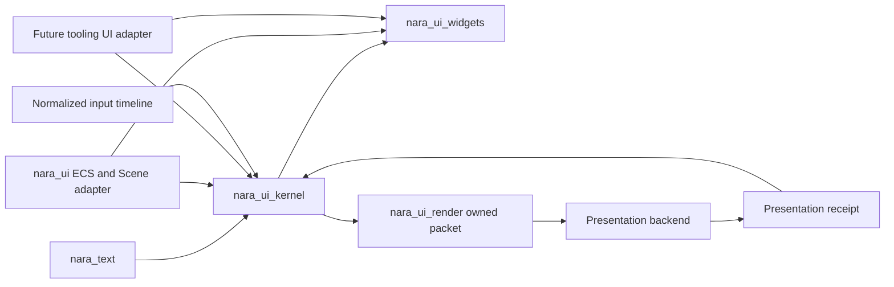

# ADR 0102: Renderer-Neutral UI, Text, Widget, and Presented-Frame Topology

**Status**: Accepted
**Date**: 2026-08-04
**Owner**: UI authoring, text, widget behavior, input routing, presentation packets, and platform adapters
**Refines**: [ADR 0012](0012-render-crate-boundaries.md),
[ADR 0025](0025-runtime-ui-system.md),
[ADR 0031](0031-text-and-font-strategy.md),
[ADR 0038](0038-scene-prefab-authoring-identity-and-provenance.md),
[ADR 0040](0040-render-resource-lifetime-and-submitter-ownership.md),
[ADR 0041](0041-input-routing-actions-text-focus-and-accessibility.md),
[ADR 0043](0043-scene-prefab-and-patch-document-migration-policy.md),
[ADR 0044](0044-root-facade-and-prelude-layering-policy.md),
[ADR 0056](0056-headless-runtime-and-dedicated-server-readiness.md),
[ADR 0095](0095-plugin-owned-specialized-domains-and-project-configuration.md), and
[ADR 0096](0096-evidence-gated-render-scaling-and-upload-policy.md)
**Implementation Plan**: [Ordered UI Kernel and Engine Boundary Correction](../../plans/2026-08-04-002-refactor-ordered-ui-kernel-and-engine-boundary-correction-plan.md), NUI-U9 through NUI-U15

## Context

The current runtime UI combines persistent ECS components, renderer-owned view discovery, layout,
hit testing, and public extract/queue/batch stages. It has no stable logical widget identity, text
owner, semantic tree, or proof that input targets the frame a player actually saw. Editor UI has a
different persistence and command authority, so a shared top-level object model would couple two
products while still leaving their common algorithms shallow.

The reference-game HUD, terminal overlay, Retry control, packaged desktop path, and headless path
form one complete consumer. They justify early physical boundaries for text, frame compilation,
and controlled widgets, but not a provider ecosystem or an Editor-shell migration.

## Decision

Nara compiles bounded authoring snapshots into one immutable renderer-neutral frame. Text and
widget behavior are separate deep modules; Runtime and future Editor products use separate
adapters.

- The physical dependency direction is `nara_text <- nara_ui_kernel <- nara_ui_widgets`.
  `nara_ui` is the ECS/Scene runtime adapter. `nara_ui_render` consumes the kernel frame and the
  text raster boundary. WGPU consumes only backend-neutral owned packets.
- `nara_ui_kernel` has no ECS, Scene, Host, Editor, window-backend, or WGPU dependency. It exposes
  one concrete fallible authoring-snapshot builder, compilation, read-only frame access, and
  presented-frame dispatch. Normalized IR, layout nodes, caches, fragments, and lifecycle stages
  remain private.
- Every root and stateful or interactive node has an exact stable logical key. Persistent keys
  derive from stable source/entity identity; runtime-created nodes require explicit domain keys.
  Runtime entity bits, query order, sibling indexes, and source locations are invalid identities.
- One immutable `UiFrame` owns resolved logical geometry, root layers, stacking, clipping, paint
  order, reverse hit order, focus/navigation facts, semantics, diagnostics, and its environment
  revision. Root compilation is bounded and failure-atomic.
- A presenter returns a `UiPresentationReceipt` only after the exact packet was presented for the
  matching surface/environment revision. Input dispatch targets an exact retained frame/receipt
  pair; compilation alone never grants interaction authority.
- The first authoring vocabulary is closed: root, node/style, visual, display text, controlled
  button, optional semantics, immutable theme, bounded action ID, and typed semantic intent. It has
  no callback with World/Editor authority, property bag, generic Widget component, CSS selector
  language, or second retained object model.
- `nara_text` owns bounded deterministic font admission, shaping, bidi/line layout, measurement,
  glyph keys/raster requests, and diagnostics without system-font discovery. Atlas allocation and
  GPU residency remain presentation-owner responsibilities.
- Kernel routing owns capture/target/bubble, pointer capture, focus scopes, modal inertness,
  navigation, semantics, and geometry-coupled session state. `nara_ui_widgets` owns controlled
  behavior reducers and emits typed intents only.
- Runtime and future Editor adapters share text, kernel, widget state machines, semantic
  vocabulary, and presentation infrastructure. They do not share persistent authoring identity,
  session persistence, Host authority, or domain commands.
- Open-GPUI and other engines are behavioral evidence only. Nara does not adopt their App/Window/
  Entity/Element lifecycle or copy source without explicit provenance and license review.

## Alternatives Considered

### Option 1: Continue an ECS execution tree with public layout and render stages

Rejected. It couples compilation to runtime allocation and exposes implementation steps that no
real product needs to orchestrate.

### Option 2: Adopt one shared Runtime/Editor widget object model

Rejected. Game documents and Editor sessions have different identity, persistence, command, and
Host authorities.

### Option 3: Share a private frame kernel and controlled widget reducers through separate adapters

Selected. It concentrates layout/routing/semantic invariants while preserving product boundaries
and a narrow public API.

## Consequences

- The existing UI schema, renderer-bound roots, panels, computed layout resources, pointer routes,
  and public extraction/batching DTOs are replaced rather than wrapped.
- Three workspace-internal crates are admitted early to machine-enforce ownership in this
  AI-developed project. Their APIs remain consumer-driven and may break before 1.0.
- Editable text, rich spans, localization, project fonts, virtual collections, docking, and native
  multi-window Editor policy remain deferred.
- Headless tests require an explicit test presenter when they exercise interaction; a compiled
  frame by itself is not presented evidence.

## Success Metrics

| Metric | Target | Measurement |
|---|---:|---|
| Frame authorities for paint/hit/focus/semantics | 1 | Kernel snapshots and routing tests |
| Interaction against unpresented or stale geometry | 0 activations | Receipt-journal failure tests |
| Kernel dependencies on ECS/Host/Editor/WGPU | 0 | Cargo graph and independent-consumer checks |
| World-mutating widget callbacks | 0 | Public API inspection and compile tests |
| Reference product parity | HUD, terminal, Retry, accessibility, package, and headless gates pass | Reference-game verification contract |

## Risks and Mitigations

| Risk | Severity | Likelihood | Mitigation |
|---|---|---:|---|
| The neutral kernel becomes a public type warehouse | High | High | Expose only validated snapshot construction, compile, frame access, and dispatch; keep IR private. |
| Stable-key collisions route actions to the wrong node | Critical | Low | Compare bounded exact key content, diagnose duplicates, and exclude invalid nodes from interaction and semantics. |
| Last-good visuals remain accidentally interactive | Critical | Medium | Require a matching presentation receipt and make fallback visuals semantic/action inert. |
| Editor requirements distort game persistence | High | Medium | Keep separate adapters and defer Editor migration until heterogeneous panel evidence exists. |
| Text or atlas work becomes unbounded | High | Medium | Enforce owner-local input, glyph, page, upload, retention, and diagnostic limits. |
