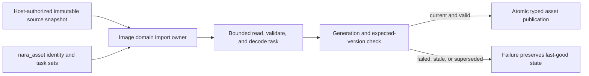

# ADR 0103: Concrete Domain-Owned Asset Import Execution

**Status**: Accepted
**Date**: 2026-08-04
**Owner**: `nara_asset`, concrete asset domains, host-authorized source reads, and runtime asset publication
**Refines**: [ADR 0007](0007-asset-identity-and-import-pipeline.md),
[ADR 0033](0033-asset-import-and-render-resource-preparation-seam.md),
[ADR 0046](0046-plugin-metadata-and-default-plugin-groups.md), and
[ADR 0095](0095-plugin-owned-specialized-domains-and-project-configuration.md)
**Extracted From**: [ADR 0087](0087-asset-dependency-import-product-and-artifact-publication-graph.md),
which remains Proposed for multi-product dependency discovery, artifact-group reconciliation, and
crash-safe group publication
**Refined By**: [ADR 0115](0115-editor-image-import-metadata-and-authoring-publication.md): Editor
Image Import Metadata and Authoring Publication
**Implementation Plan**: [Ordered UI Kernel and Engine Boundary Correction](../../plans/2026-08-04-002-refactor-ordered-ui-kernel-and-engine-boundary-correction-plan.md), NUI-U3

## Context

Nara has typed importer and imported-product abstractions plus registry metadata, but no production
host executes that registry. The only complete consumer is Image, whose domain already owns the
meaningful work: bounded source admission, task preparation, decoding, stale-result checks, and
typed runtime publication. Keeping an unconsumed registry makes registration appear to be an
executable extension contract while leaving scheduling, authority, budgets, and publication to
ad hoc code outside it.

ADR 0087 proposes a larger tracked dependency and multi-product artifact graph. The current Image
consumer neither proves that graph nor needs it. Nara therefore needs a concrete execution boundary
now without making the Proposed graph authoritative or replacing one speculative provider seam with
another.

## Decision

Asset import execution belongs to each concrete asset domain. `nara_asset` supplies shared identity,
source-change, task-ordering, and stale-publication primitives, but it does not own a generic
importer registry or erased decoder executor.

- A domain owns the entire import transaction for its product type: accepted source capability or
  immutable bytes, input and output budgets, owned task input, decode and validation, diagnostics,
  typed result, generation/version checks, and failure-atomic publication.
- Image is the first admitted path. Its importer produces backend-neutral CPU image data and never
  allocates a GPU resource or publishes through a renderer-owned store.
- `nara_asset` remains the owner of stable source/runtime identity, strict identity-first
  `AssetMeta<TSettings>` admission, reload generations, expected versions, artifact records where
  already consumed, and the scheduling sets that concrete domains join. It does not depend on
  Image, interpret image settings, compute their hash, or dispatch a domain decoder.
- The unused `TypedImporter<T>`, generic `ImportedAsset<T>`, erased importer registry, registration
  API, provider ID, and metadata that no executor consumes are removed rather than deprecated.
- Failed, cancelled, over-budget, stale, and superseded work publishes no new asset state. A prior
  verified value remains last-good according to the existing asset replacement contract.
- A shared executor seam may be reconsidered only after a second production asset domain completes
  the same end-to-end workflow and demonstrates concrete duplicated policy that cannot remain
  domain-owned. The review must compare the two landed paths and name the shared authority, error,
  task, budget, and publication semantics.
- Multi-product dependency tracking and artifact-group publication remain governed by Proposed ADR
  0087 until its own admission evidence is complete.
- ADR 0115's explicit Editor Import/Reimport lane and Host-private referenced-image hydration
  worklist are two consumers of the same Image-domain implementation. Host-owned metadata
  publication and a concrete Editor image store do not make either path a second asset domain and
  do not satisfy the shared-executor trigger.

## Alternatives Considered

### Option 1: Keep the generic registry as a future-facing placeholder

Rejected. Registration without an executing owner, authority model, or publication transaction is
a false public capability and forces consumers to infer behavior that the contract does not supply.

### Option 2: Centralize all decoding behind an erased asset-service executor

Rejected. It moves domain budgets, typed validation, and publication policy into a broad service
before two domains have demonstrated common semantics. Erasure also weakens the Rust-native type
boundary without a real dynamic consumer.

### Option 3: Keep common primitives in `nara_asset` and let each domain own execution

Selected. It preserves stable asset identity and task safety while making the only real workflow
complete and keeping future generalization evidence-driven.

## Consequences

- The generic importer traits, registry, registration examples, facade exports, and unused metadata
  are breaking deletions with no compatibility alias.
- Image becomes easier to audit because one domain owns admission through typed publication.
- A future audio, font, or model importer initially implements a concrete vertical slice. It may use
  shared asset primitives but cannot register into an executor that does not exist.
- The first Editor image consumer remains concrete: the Host may orchestrate exact capabilities and
  receipts, while `nara_image` retains settings-hash, decode, and typed commit authority.
- Accepting this decision does not accept the compound-product graph, remote import execution,
  artifact cache protocol, GPU preparation, or a plugin sandbox.

## Success Metrics

| Metric | Target | Measurement |
|---|---:|---|
| Public generic importer executors and registries | 0 | Public API and stale-symbol inspection |
| Image import path ownership | 1 concrete domain from bounded input through publication | Image import and replacement integration tests |
| Partial publication after decode, budget, cancellation, or stale-result failure | 0 cases | Hostile input and task-generation tests |
| GPU/native handles in imported Image output | 0 | Type and dependency audit |
| Shared executor readmission evidence | At least 2 complete production domain paths and one measured duplicated policy | Future ADR admission review |

## Risks and Mitigations

| Risk | Severity | Likelihood | Mitigation |
|---|---|---:|---|
| Domain import paths drift in stale-result semantics | High | Medium | Keep generation, expected-version, and task-set primitives in `nara_asset` and require the same conformance fixtures. |
| Image code gains ambient filesystem authority | High | Medium | Admit only host-authorized source capabilities or immutable bounded snapshots and audit ordinary construction paths. |
| Removing the registry appears to block future formats | Medium | Medium | Document the second-domain admission trigger and derive any later abstraction from two complete paths. |
| A failed replacement destroys the last-good image | High | Low | Validate and decode off to the side, then publish only after current generation/version checks pass. |
| ADR 0087 is accidentally treated as implemented | High | Medium | Keep its status Proposed and explicitly limit this ADR to single-domain concrete execution. |
