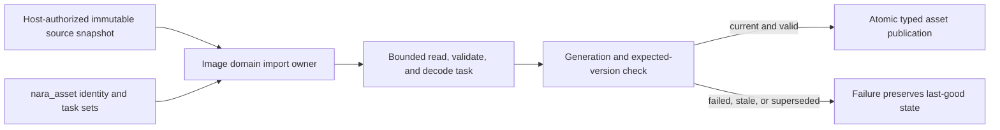

# ADR 0103: Concrete Domain-Owned Asset Import Execution

**Status**: Accepted
**Date**: 2026-08-04
**Last Revised**: 2026-10-23
**Owner**: `nara_asset`, concrete asset domains, host-authorized source reads, and runtime asset publication
**Refines**: [ADR 0007](0007-asset-identity-and-import-pipeline.md),
[ADR 0033](0033-asset-import-and-render-resource-preparation-seam.md),
[ADR 0046](0046-plugin-metadata-and-default-plugin-groups.md), and
[ADR 0095](0095-plugin-owned-specialized-domains-and-project-configuration.md)
**Extracted From**: [ADR 0087](0087-asset-dependency-import-product-and-artifact-publication-graph.md),
which remains Proposed for multi-product dependency discovery, artifact-group reconciliation, and
crash-safe group publication
**Refined By**: [ADR 0115](0115-editor-image-import-metadata-and-authoring-publication.md): Editor
Image Import Metadata and Authoring Publication
**Implementation Plan**: [Ordered UI Kernel and Engine Boundary Correction](../../plans/2026-08-04-002-refactor-ordered-ui-kernel-and-engine-boundary-correction-plan.md), NUI-U3

## Context

At the original decision, Nara had typed importer/imported-product abstractions and registry
metadata, but no production Host executed that registry. Image supplied the complete consumer:
bounded source admission, task preparation, decoding, stale-result checks and typed publication.
Keeping an unconsumed registry made registration appear to be an executable extension contract
while leaving scheduling, authority, budgets and publication to ad hoc code outside it. The later
compiled source-backed and Editor metadata refinements below add bounded workflows, not a
universal processed-product or Runtime-decode contract.

ADR 0087 proposes a larger tracked dependency and multi-product artifact graph. The current Image
consumer neither proves that graph nor needs it. Nara therefore needs a concrete execution boundary
now without making the Proposed graph authoritative or replacing one speculative provider seam with
another.

## Decision

Asset import execution belongs to each concrete asset domain. `nara_asset` supplies shared identity,
source-change, task-ordering, and stale-publication primitives, but it does not own a generic
importer registry or erased decoder executor.

Image owns three distinct facts: latest desired settings (or unresolved metadata requirement), the
current in-flight attempt, and last-good usable pixels. Accepting metadata precedes task admission;
supersession or task rejection does not discard that desired recipe. Source-only changes continue
to require current metadata until its successor publication succeeds. Shared asset mutation
baselines own only store/state association and revision checks. Image retains source identity,
recipe validation, pixel overlap accounting, and generation policy; TileSet retains dependency and
layout policy. These common checks do not introduce an importer execution framework.



- A domain owns the entire import transaction for its product type: accepted source capability or
  immutable bytes, input and output budgets, owned task input, decode and validation, diagnostics,
  typed result, generation/version checks, and failure-atomic publication.
- Image is the first admitted path. Its importer produces backend-neutral CPU image data and never
  allocates a GPU resource or publishes through a renderer-owned store.
- `nara_asset` remains the owner of stable source/runtime identity, strict identity-first
  `AssetMeta<TSettings>` admission, reload generations, expected versions, artifact records where
  already consumed, and the scheduling sets that concrete domains join. It does not depend on
  Image, interpret image settings, compute their hash, or dispatch a domain decoder.
- The unused `TypedImporter<T>`, generic `ImportedAsset<T>`, erased importer registry, registration
  API, provider ID, and metadata that no executor consumes are removed rather than deprecated.
- Failed, cancelled, over-budget, stale, and superseded work publishes no new asset state. A prior
  verified value remains last-good according to the existing asset replacement contract.
- A named importer workflow may motivate a typed owner/facet design or bounded experiment now;
  it does not need two production domains before design can begin. Freezing a reusable execution
  protocol requires evidence for the actual shared authority, errors, task custody, budgets and
  publication semantics, with comparison to representative domains where reuse is claimed. A
  second real implementation is useful evidence, not a blanket permission gate for a first owner
  contract or compound-import study.
- Multi-product dependency tracking and artifact-group publication remain governed by Proposed ADR
  0087 until its own admission evidence is complete.
- ADR 0115's explicit Editor Import/Reimport lane and Host-private referenced-image hydration
  worklist are two consumers of the same Image-domain implementation. Host-owned metadata
  publication and a concrete Editor image store do not prove that their distinct publication rules
  can be replaced by an erased shared executor.

### Source-backed project domains (2026-10-21 refinement)

The compiled product may select a `ProjectAssetDomain` through
`ProductRecipe::add_asset_domain`. This is an executing Check/Play source-content contract in the
project Host, distinct from Editor Import/Reimport and the generic importer executor rejected
above. It returns one typed CPU product per referenced source. Domain-specific parsing, settings,
semantic validation and conservative parser/product memory bounds remain domain-owned.

- Persisted `AssetSourceKind::Other` selects the exact domain. Extensions and registration order
  do not select an owner. Duplicate kind claims reject during recipe construction. Built-in Image
  and TileSet remain concrete adapters with their existing publication contracts.
- The project Host admits metadata identity, bounded immutable primary bytes and scoped auxiliary
  reads under the original Assets capability. A domain admits its own typed metadata settings.
  Its associated `Settings` type states the one settings contract shared with optional Editor
  adapters. Admission and semantic diagnostics remain domain-owned; source-only settings do not
  acquire Editor serialization or default-value requirements.
  Every auxiliary read contributes an exact source member; repeated paths share one observation
  within the source-domain load. Edges and global file/byte/work/retention limits remain Host-owned.
- The Host reserves declared work and product storage before preparation. Trusted domain code must
  honor those bounds, read every required source through the scoped context, and avoid external
  effects. CPU products and their destructors must be effect-free and must not panic. This is a
  trusted native-code contract, not allocation interception or a sandbox.
- Check executes the selected source-domain preparation, but does not run ordinary runtime plugin
  hooks. Expected failures retain the domain's bounded diagnostic. Preparation panics reject the
  candidate with a Host-authored diagnostic; panic payloads are not public diagnostic facts.
- `ProjectDomainAssets::collection::<D>()` exposes typed, immutable collections by Rust domain
  type. Heterogeneous storage is private. Consumers that retain shared product allocations retain
  the owning collection resource as well. No public erased resource store or mutable World callback
  is introduced.
- Content candidates bind the selected domain composition as well as project/schema authority.
  The Host installs the collection before gameplay startup, replaces it only after successful Scene
  commit, and publishes an empty collection when the next Scene uses no source domains. A failed
  preparation or rejected Scene transaction preserves the current collection. Clones retain their
  generation and budget until their last owner drops.
- Export consumes the existing exact source-delivery receipt and revalidates every member. Domains
  do not construct build receipts or gain directory-publication authority. Export does not execute
  the parser again to discover a different closure.

This refinement admits compiled, stateless source preparation and raw auxiliary source dependencies.
It does not by itself admit Editor import contributions, mutable native/GPU products, cross-domain prepared
product dependencies, cook artifacts, file watchers, or dynamic loading. An import-only package
has no source-backed Play support merely because it supplies an importer. The broader multi-product
graph remains Proposed; the design permission above does not qualify it or supply missing facets.

See the [qualification plan](../../plans/2026-10-21-external-asset-domain-qualification-plan.md),
[public guide](../../guides/project-asset-domains.md),
[independent consumer](../../../tests/fixtures/module-consumer/asset-domain-consumer/README.md)
and [source-export tests](../../../src/project_workflow/export/source_tests.rs).

### Explicit Editor source metadata import (2026-10-21 refinement)

A trusted source-built Editor may explicitly select an `EditorSourceAssetDomain`. This is a
metadata-authoring facet of the source-backed domain, not a generic imported-product executor.
The facet names its associated `Domain` and uses that domain's settings type and
`ProjectAssetDomain::prepare` implementation
to validate immutable primary and auxiliary sources. The Host discards the temporary CPU product
after validation; `MetadataPublished` means canonical desired metadata was published, not that
an Editor preview, GPU object or runtime collection was installed.

- Editor executable composition selects the facet and its panel before an operation starts.
  A project manifest, schema bundle, source kind or installed Cargo crate cannot activate code.
  Ordinary project Open remains data-only and does not load game Rust. The compiled Editor
  composition survives project replacement; each session owns fresh operation state.
  Complete composition construction transfers Host facets and panel factories together. A
  panel-only late installation rejects Host contributions instead of silently discarding them;
  the explicitly trusted compiled lane retains the same selection for replacement sessions.
  Selection does not create missing Host capabilities: its initial lane has no generic source
  index and does not offer metadata Import. A later ordinary authoring session uses that selection.
- A displayed-frame action names the selected source, exact domain and encoded settings. The
  contributor admits typed settings; the Host supplies only bounded source observations. A stale
  frame, unavailable owner or conflicting/invalid existing metadata rejects without overwriting
  it. Import creates canonical identity; Reimport preserves the accepted stable identity.
- This facet validates first and publishes metadata only after source preparation succeeds.
  Failure preserves the prior metadata. This is deliberately distinct from Image's durable
  desired-settings and last-good-pixel contract in ADR 0115.
- The Host reuses the existing bounded metadata scan and its identity/conflict snapshot. Facets
  do not add full-project scans or read the filesystem during frame projection. Preparation
  records one exact primary/auxiliary closure; publication revalidates those observations and
  the metadata target binding. It does not promise a project-wide atomic filesystem snapshot.
- Preparation uses the existing Editor task owner. The metadata writer enters existing runtime
  custody before any write, and close retains physical task/temporary-file cleanup. Explicit
  source and Image imports share admission to the user-action lane. Successful publication
  invalidates old metadata admission and requests one successor Browser/catalog refresh through
  the existing coalescing source index and metadata refresh owner. Retaining an old Browser
  snapshot during refresh does not authorize another import against its old sidecar binding.
- The panel retains its own settings draft, consumes immutable frames and submits ordinary
  semantic actions. Dispatch acceptance and terminal metadata publication are distinct facts.
  Neither panels nor domain callbacks receive project-directory write authority or a mutable
  Editor session/World.

This adds no durable cooked artifact, typed Editor resource cache, watcher, dynamic ABI or prepared
product graph. Image's concrete typed stores and resource-publication rules remain unchanged.
The [Editor qualification plan](../../plans/2026-10-21-editor-source-domain-import-plan.md) names
the external text consumer and required evidence.

### Typed Operation Facets and a Named Compound-Importer Study (2026-10-23 refinement)

A compiled resource package may be designed as operation-specific typed facets connected by one
release/composition identity: source/import preparation, processed Runtime decode, optional target
cook, and optional Editor settings/import contribution. Those are distinct capabilities, not a
universal executor method or an assumption that every registered resource supports every stage.
Host-private erasure may store selected heterogeneous implementations; a public `Any` store,
arbitrary mutable `World` callback or erased all-operation execution bus is not the extension
contract.

```text
trusted compiled resource package selection
    -> source/import | Runtime-decode | optional target-cook | optional Editor facet
    -> Host admits the requested operation and its exact immutable inputs
    -> typed domain candidate -> domain validation and publication
```

An independent compound atlas/text-bundle package is the named study consumer. It may explore
Editor settings, Check, source-backed Play, processed decode and Export without waiting for two
production domains, the whole ADR 0087 graph or a complete source-free packaging product. Each
operation must name its own input/identity/budget/result/publication contract. Missing Runtime or
cook facets return operation-unavailable; import registration or Check success does not imply
processed Runtime support. Tracked cross-product inputs, stable subproduct reconciliation and
artifact-group publication remain separate Proposed obligations under ADR 0083/0087.

Reusable source/import and Runtime-decode contracts belong below root project orchestration and
must not require Editor, Scene or 2D merely to express a pure importer. The root Host retains exact
source receipts, aggregate budgets and Scene commit; Image/TileSet retain their own prepared-state
and publication semantics. Do not add crates just to make a facet diagram symmetrical. Settings
are versioned domain data with trusted typed and optional authorable forms, not necessarily fields
in `nara.toml` or a universal serialization schema.

Executable composition remains an explicit trusted Host action. Project data, a source kind,
settings, a manifest, an installed crate or supplied package bytes cannot grant download, build,
activation or native execution authority. A selected facet cannot bypass data-only Open or obtain
filesystem writes, directory publication or mutable Editor/World authority through its data.

This amendment permits and bounds the study; it does not claim those facets are implemented. The
existing compiled `ProjectAssetDomain` Check/Play/source-carrying Export and selected Editor
metadata facet remain the qualified slice described above. The prospective consumer must test
absent facets, old-generation retention, importer failure, tracked cross-product inputs and a
dependency probe showing that a pure importer does not pull in Editor/Scene/2D. Shared-protocol
freeze and production/platform claims require their matching later evidence; historical plan IDs
are evidence navigation, not authorization gates for this study. See foundation reassessment
[D10](../foundation-architecture-reassessment.md#d10-resource-extension-facets) and
[D18](../foundation-architecture-reassessment.md#d18-decision-scope-evidence-and-deletion-discipline).

## Alternatives Considered

### Option 1: Keep the generic registry as a future-facing placeholder

Rejected. Registration without an executing owner, authority model, or publication transaction is
a false public capability and forces consumers to infer behavior that the contract does not supply.

### Option 2: Centralize all decoding behind an erased asset-service executor

Rejected. It moves operation-specific budgets, typed validation and publication policy into a broad
service without a demonstrated shared contract. Public erasure weakens the Rust-native boundary;
private Host storage erasure does not justify a universal public executor.

### Option 3: Keep common primitives in `nara_asset` and let each domain own execution

Selected. It preserves stable asset identity and task safety while making the only real workflow
complete at the original decision and keeping later generalization evidence-driven. Typed facets
can extend concrete workflows without reviving the unused registry or universalizing publication.

## Consequences

- The generic importer traits, registry, registration examples, facade exports, and unused metadata
  are breaking deletions with no compatibility alias.
- Image becomes easier to audit because one domain owns admission through typed publication.
- A future audio, font, or model importer initially implements a concrete vertical slice. It may use
  shared asset primitives but cannot register into an executor that does not exist.
- The first Editor image consumer remains concrete: the Host may orchestrate exact capabilities and
  receipts, while `nara_image` retains settings-hash, decode, and typed commit authority.
- Accepting this decision does not accept the compound-product graph, remote import execution,
  artifact cache protocol, GPU preparation, or a plugin sandbox.
- The typed-facet study is authorized design work, not new implementation evidence. Source-backed
  products, processed Runtime decode, cook artifacts and Editor resource publication stay distinct.

## Success Metrics

| Metric | Target | Measurement |
|---|---:|---|
| Unconsumed generic registries and universal erased executors | 0; typed operation facets are not forbidden by this count | Public API and stale-symbol inspection |
| Image import path ownership | 1 concrete domain from bounded input through publication | Image import and replacement integration tests |
| Partial publication after decode, budget, cancellation, or stale-result failure | 0 cases | Hostile input and task-generation tests |
| GPU/native handles in imported Image output | 0 | Type and dependency audit |
| Typed-facet study | Named compound consumer, explicit per-operation contracts, absent-facet failure and domain-owned publication | Bounded design/consumer review; not current implementation evidence |
| Reusable protocol freeze | Named shared authority/errors/custody/budgets/publication with representative consumer evidence for claimed reuse | Later protocol qualification, separate from permission to design |

## Risks and Mitigations

| Risk | Severity | Likelihood | Mitigation |
|---|---|---:|---|
| Domain import paths drift in stale-result semantics | High | Medium | Keep generation, expected-version, and task-set primitives in `nara_asset` and require the same conformance fixtures. |
| Image code gains ambient filesystem authority | High | Medium | Admit only host-authorized source capabilities or immutable bounded snapshots and audit ordinary construction paths. |
| Removing the registry appears to block future formats | Medium | Medium | Permit named typed owner/facet studies now; qualify reuse without making a second production domain a design gate. |
| A failed replacement destroys the last-good image | High | Low | Validate and decode off to the side, then publish only after current generation/version checks pass. |
| ADR 0087 is accidentally treated as implemented | High | Medium | Keep its status Proposed and explicitly limit this ADR to single-domain concrete execution. |
