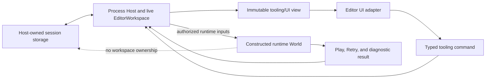

# ADR 0104: Host-Owned Editor Workspace Installation

**Status**: Accepted
**Date**: 2026-08-04
**Owner**: Process Host, Editor workspace and session persistence, tooling models, and UI adapters
**Refines**: [ADR 0015](0015-editor-tooling-and-dogfooding-boundary.md),
[ADR 0026](0026-editor-command-patch-and-undo-model.md),
[ADR 0044](0044-root-facade-and-prelude-layering-policy.md),
[ADR 0046](0046-plugin-metadata-and-default-plugin-groups.md),
[ADR 0047](0047-editor-workspace-and-scene-document-state.md),
[ADR 0079](0079-root-product-capabilities-and-placeholder-domain-retirement.md),
[ADR 0082](0082-process-host-authority-and-runtime-construction-topology.md), and
[ADR 0095](0095-plugin-owned-specialized-domains-and-project-configuration.md)
**Implementation Plan**: [Ordered UI Kernel and Engine Boundary Correction](../../plans/2026-08-04-002-refactor-ordered-ui-kernel-and-engine-boundary-correction-plan.md), NUI-U2

## Context

Nara's process Host already owns project opening, Editor workspace lifetime, session persistence,
Play construction, and Retry. `ToolingPlugin` also installs an `EditorWorkspace` resource into a
runtime ECS World and advertises tooling through runtime product capabilities. These are two live
authorities for one session with different lifetime, persistence, and failure boundaries. Keeping
them synchronized would turn a product boundary into a distributed-state protocol, while choosing
the ECS copy would give a disposable game World authority over Editor recovery and process state.

Runtime and Editor UI can share renderer-neutral algorithms and controlled widget behavior under
ADR 0102. That does not imply shared workspace identity, direct Editor mutation from a widget, or
Editor installation as a runtime plugin.

## Decision

The process Host is the sole owner of each live Editor workspace, Editor session, and persistence
transaction. Runtime Worlds receive only the authorized runtime product inputs required to run the
game; they never contain an Editor workspace copy.

- The Host creates, identifies, mutates, saves, restores, and retires Editor workspaces and sessions.
  It owns filesystem authority, persistence sequencing, recovery, and process-level diagnostics.
- `ToolingPlugin`, the runtime ECS `EditorWorkspace` resource, its plugin identity/slot/group, and
  its runtime product-capability claim are removed rather than synchronized or aliased.
- `nara_tooling` remains a pure domain module for bounded workspace models, immutable snapshots,
  typed commands, validation, persistence data/codec semantics, and diagnostics. It owns no
  `App`, ECS `World`, process lifetime, filesystem opening, window backend, or renderer.
- An Editor UI adapter receives an immutable view and controlled state. User responses produce
  typed tooling or domain commands; they never directly mutate the workspace, Scene document,
  runtime World, or persistence store.
- The Host validates and applies commands through the owning document/workspace transaction,
  derives the next view, and decides when to persist or construct a runtime product.
- Play and Retry exchange explicit immutable launch inputs and bounded results across the Host
  boundary. They do not lend Editor session authority to the runtime.
- Runtime 2D, runtime UI, headless, and desktop presentation selection do not imply Editor tooling.
  An Editor product installs its Host-owned adapter deliberately.
- A future Editor port may reuse `nara_text`, `nara_ui_kernel`, `nara_ui_widgets`, semantic facts,
  and presentation infrastructure, but it keeps a separate adapter, command vocabulary, identity,
  and session persistence from game UI.

## Alternatives Considered

### Option 1: Mirror Host and ECS workspace state with synchronization

Rejected. Two writable copies require conflict resolution, recovery ordering, and ownership rules
that add failure modes without serving a product workflow.

### Option 2: Move the Editor workspace entirely into the runtime ECS World

Rejected. Runtime Worlds are replaceable Play products and cannot own process-level Editor session,
recovery, persistence, or multi-document lifetime.

### Option 3: Keep one Host-owned workspace and command-returning adapters

Selected. It aligns authority with lifetime, keeps tooling reusable as pure models, and prevents UI
or runtime adapters from acquiring document and persistence authority.

## Consequences

- Removing `ToolingPlugin` and the runtime tooling capability is an intentional pre-1.0 API and
  product-composition break.
- Tooling tests can exercise models, commands, validation, and codecs without constructing an ECS
  World, window, or renderer.
- Editor UI frameworks become replaceable adapters around one Host-owned workflow rather than
  alternate workspace owners.
- Runtime inspection tools may receive explicit snapshots or command channels, but they do not gain
  the Editor workspace resource by being installed into a World.
- This decision does not choose a final Editor toolkit, docking policy, native multi-window policy,
  collaborative session protocol, or remote Editor architecture.

## Success Metrics

| Metric | Target | Measurement |
|---|---:|---|
| Live Editor workspace authorities per process session | 1 | Host ownership and construction-path inspection |
| Runtime Worlds containing an Editor workspace resource | 0 | Desktop, headless, Play, and Retry resource tests |
| Runtime plugin IDs, slots, groups, or product capabilities for tooling | 0 | Composition snapshots and stale-symbol inspection |
| Adapter-originated workspace mutations expressed as typed commands | 100% | Adapter API review and interaction tests |
| Open, edit, save, reopen, Play, and Retry behavior retained | All named workflows pass | Host and persistence integration suite |

## Risks and Mitigations

| Risk | Severity | Likelihood | Mitigation |
|---|---|---:|---|
| An adapter bypasses commands and mutates Host state | High | Medium | Give adapters immutable views and command sinks only; keep mutable workspace handles private. |
| Pure tooling models accidentally acquire IO or ECS dependencies | High | Medium | Enforce dependency and public API checks for `nara_tooling`. |
| Removing runtime tooling breaks Play diagnostics | Medium | Medium | Return bounded runtime results and diagnostic snapshots through the explicit Host boundary. |
| Host and persistence data drift during a failed save | High | Low | Keep persistence publication failure-atomic and retain the previous verified session state. |
| Shared UI code starts sharing Editor/game identity | High | Medium | Reuse only kernel/text/widget algorithms and require separate adapters, keys, commands, and persistence. |
