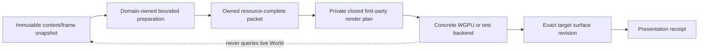

# ADR 0105: Closed First-Party Render Plan

**Status**: Accepted
**Date**: 2026-08-04
**Owner**: Renderer-neutral presentation planning, owned submitter packets, and concrete render backends
**Refines**: [ADR 0012](0012-render-crate-boundaries.md),
[ADR 0017](0017-render-graph-policy.md),
[ADR 0032](0032-render-backend-integration-boundary.md),
[ADR 0040](0040-render-resource-lifetime-and-submitter-ownership.md),
[ADR 0094](0094-minimal-render-execution-boundary-and-evidence-gated-extensions.md), and
[ADR 0096](0096-evidence-gated-render-scaling-and-upload-policy.md)
**Implementation Plan**: [Ordered UI Kernel and Engine Boundary Correction](../../plans/2026-08-04-002-refactor-ordered-ui-kernel-and-engine-boundary-correction-plan.md), NUI-U4 and NUI-U14

## Context

Nara's first-party renderer has a small static execution need, but public APIs allow arbitrary
render-phase labels and pass dependencies. Runtime UI also exposes extraction, queueing, sorting,
comparison, batching, and material-key stages as if downstream products must orchestrate the
pipeline. No production consumer builds a different topology or calls those UI stages as a coherent
extension workflow.

The new UI frame contract requires a stronger handoff: presentation must use the exact immutable
frame and resource generations captured for a packet. A backend that queries the live ECS World or
mutable asset state during submission can silently combine geometry from one frame with image or
glyph data from another. A wider public render graph would not solve that ownership error.

## Decision

Nara's stock render plan is a closed, private first-party implementation. Public domains provide
content and owned backend-neutral packets; they do not construct render topology or invoke internal
pipeline stages.

- `nara_render` owns the smallest closed first-party ordering required by admitted sprite, UI,
  clear/target, and presentation work. Its labels, dependency representation, plan builder, and
  validation remain private or crate-internal.
- Arbitrary `RenderPhaseLabel::new`, public phase/dependency insertion, and unconsumed render-plan
  graph construction are removed. Internal tests may still build hostile plans through private test
  helpers to prove deterministic rejection.
- `nara_ui_render` accepts an immutable `UiFrame` and exact prepared image/glyph snapshots and emits
  one owned backend-neutral paint packet. Extract, queue, compare, sort, batch, material-key, and
  mutable intermediate DTO APIs are deleted or made implementation-private.
- Every first-party submitter packet owns or retains the complete immutable CPU-side facts needed
  for its draw: order, geometry, clips, surface/environment revisions, resource keys and exact
  generations, plus bounded shared prepared bytes/pages where upload may still be required.
- A packet contains no ECS query, mutable asset-store reference, callback into the World, backend
  command encoder, GPU-native handle, or instruction to resolve a newer generation at submit time.
- WGPU may resolve backend-private residency for the packet's exact resource generation and device
  epoch, and may defer a bounded upload. It never rereads the live World to complete a packet.
- Missing, stale, mismatched, over-budget, or device-invalid packet content fails that presentation
  attempt without substituting current World data. Only a backend that presents the exact accepted
  packet for the matching surface/environment revision may emit its presentation receipt.
- Backend-private batching, atlasing, pipeline caches, and command encoding remain optimization
  details. Their keys cannot become a second public ordering or resource-lifetime authority.
- [OQ-001](../open-questions.md#oq-001-render-execution-model-trigger) is the only route to reopen a
  more general execution model: a real intermediate logical resource, retained/history lifetime,
  or cross-target dependency must first exceed the closed plan.

## Alternatives Considered

### Option 1: Keep a public phase/dependency graph for future render extensions

Rejected. No consumer needs it, arbitrary labels cannot provide resource ownership, and the API
would freeze implementation vocabulary before a static-plan-breaking workflow exists.

### Option 2: Expose public extract, queue, sort, and batch callbacks

Rejected. It lets external code observe or mutate half-built frame state, encourages live World
reads, and makes failure atomicity and packet identity impossible to state narrowly.

### Option 3: Use a closed private plan with owned domain packets

Selected. It gives the first-party product deterministic ordering and exact resource capture while
leaving a measurable trigger for a later execution model.

## Consequences

- Public render-topology constructors and technical UI pipeline APIs are breaking deletions without
  compatibility wrappers.
- First-party submitters integrate through product-owned packet boundaries, not arbitrary callbacks
  or dependency nodes.
- The WGPU adapter can be tested with immutable packet fixtures independently from an ECS World.
- Resource replacement after packet construction does not alter the packet; the newer generation is
  eligible only for a later packet.
- This decision does not select a general render graph, custom shader/material interface, third-party
  render-pass ABI, async-compute scheduler, or cross-frame resource allocator.

## Success Metrics

| Metric | Target | Measurement |
|---|---:|---|
| Public arbitrary render-phase/dependency constructors | 0 | Public API and compile-fail inspection |
| Public UI extract/queue/sort/batch stages | 0 | API diff and stale-symbol inspection |
| Live ECS World or mutable asset reads during backend submission | 0 | Backend dependency review and replacement-race tests |
| Packet/resource generation mixing | 0 accepted presentations | Captured-generation replacement and mismatch tests |
| First-party draw ordering | Identical across repeated runs and unrelated ECS allocation | Sprite/UI ordering fixtures |
| Receipts for rejected or mismatched packets | 0 | Surface, device-epoch, and resource-failure tests |

## Risks and Mitigations

| Risk | Severity | Likelihood | Mitigation |
|---|---|---:|---|
| The closed plan blocks the first real advanced render workflow | Medium | Low | Keep OQ-001 measurable and accept a successor only with a named static-plan-breaking consumer. |
| Resource-complete packets copy excessive image or glyph data | High | Medium | Retain bounded immutable shared snapshots and generation keys instead of copying full resources per frame. |
| Backend caches substitute a newer resource generation | Critical | Medium | Key residency by exact generation and device epoch; reject mismatches rather than consulting live state. |
| Private stages leak back through ordinary preludes | High | Medium | Add public-surface and independent-consumer checks for every presentation crate. |
| Content failure corrupts backend readiness | High | Low | Keep packet validation and content errors local; preserve device/surface state and emit no receipt. |
