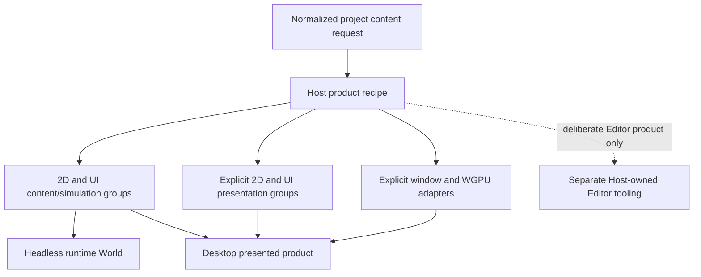

# ADR 0106: Content and Presentation Product Composition

**Status**: Accepted
**Date**: 2026-08-04
**Owner**: Root product features, project capability normalization, Host recipes, and plugin groups
**Refines**: [ADR 0005](0005-dimension-aware-runtime-with-2d-first-authoring.md),
[ADR 0044](0044-root-facade-and-prelude-layering-policy.md),
[ADR 0046](0046-plugin-metadata-and-default-plugin-groups.md),
[ADR 0056](0056-headless-runtime-and-dedicated-server-readiness.md),
[ADR 0079](0079-root-product-capabilities-and-placeholder-domain-retirement.md),
[ADR 0082](0082-process-host-authority-and-runtime-construction-topology.md), and
[ADR 0095](0095-plugin-owned-specialized-domains-and-project-configuration.md)
**Implementation Plan**: [Ordered UI Kernel and Engine Boundary Correction](../../plans/2026-08-04-002-refactor-ordered-ui-kernel-and-engine-boundary-correction-plan.md), NUI-U5 and NUI-U15

## Context

Nara currently treats `runtime-2d` as both game content/simulation and presentation: selecting it
installs render, image preparation, and sprite submission. Runtime UI has the same coupling between
authoring/interaction and UI rendering. As a result, a project cannot run the same Scene, gameplay,
sprite/tilemap facts, UI intent, and Retry authority in a truly headless Host without compiling or
resolving presentation owners.

Desktop presentation is a product choice made by the Host under a compiled capability ceiling. It
is not an intrinsic property of 2D content, UI authoring, or a project document. Editor tooling is a
separate Host-owned product under ADR 0104 and must not enter either content or presentation by
implication.

## Decision

Nara separates product composition into content/simulation, renderer-neutral presentation, and
platform/backend adapter closures. Hosts select and validate those closures explicitly before
mutating an `App`.

- `runtime-2d` is redefined as content/simulation-safe. It owns the 2D transform, image/content,
  material, sprite, tilemap, and gameplay-facing facts required by the runtime, but installs no
  render coordinator, image-preparation owner, sprite submitter, WGPU adapter, or window adapter.
- `runtime-ui` is redefined as UI authoring, text/kernel/widget behavior, normalized input intent,
  and ECS/Scene adaptation. It installs no UI renderer, GPU glyph/image owner, WGPU adapter, or
  window adapter.
- Renderer-neutral 2D presentation is an explicit product capability/group that installs the render
  coordination, image preparation, and sprite/tilemap packet-producing owners required by a real
  presented product.
- Renderer-neutral UI presentation is a separate explicit capability/group that installs UI paint
  packet construction and bounded glyph/image preparation. It does not imply 2D sprite/tilemap
  presentation.
- Window/surface ingress and WGPU submission remain separate platform/backend adapter capabilities.
  Presentation groups cannot choose an operating-system window backend or a GPU backend.
- A desktop Host recipe explicitly combines the required content groups, presentation groups,
  window adapter, and WGPU adapter exactly once. There is no hidden monolithic desktop bundle that
  bypasses normalized capability and plugin-closure validation.
- A headless Host resolves the same game content, Scene, gameplay state, and Retry command authority
  with content groups only. Its resolved plugin plan contains no window, render, image-preparation,
  sprite-submission, UI-render, WGPU, or Editor tooling owner.
- Focused headless UI-kernel tests may construct an explicit test presenter to prove receipt-gated
  interaction. That test utility is not installed by the headless product recipe.
- Compiled Cargo capabilities remain an upper bound, normalized project needs remain declarative,
  and the Host owns adapter selection. Missing or contradictory content, presentation, or adapter
  closure fails before any resource, schedule, plugin, or lifecycle mutation.
- Because Nara is pre-1.0, the old meanings of `runtime-2d` and `runtime-ui` are corrected in place.
  No legacy feature alias, duplicate plugin group, or transitional project-capability spelling keeps
  presentation implied.
- Tooling is selected only by an Editor Host recipe and remains independent from both runtime
  content and presentation composition.

## Alternatives Considered

### Option 1: Keep content features implying their default presentation stack

Rejected. It makes headless execution a subtractive special case, hides compile and runtime cost,
and prevents the same content recipe from proving product parity without presentation owners.

### Option 2: Add one monolithic desktop feature and plugin bundle

Rejected. It couples windowing, WGPU, 2D, UI, and tooling choices, obscures invalid combinations,
and recreates the fixed bundle removed by ADR 0079.

### Option 3: Compose content, presentation, and adapters explicitly

Selected. It keeps content portable, makes desktop cost and authority inspectable, and lets Hosts
choose coherent products without exposing every internal crate as a capability.

## Consequences

- Existing root feature, project capability, plugin-group, reference-game recipe, and facade
  expectations change together with no compatibility aliases.
- Independently compiled consumers can select 2D content, UI content, each presentation slice, and
  desktop adapters without importing unrelated product domains.
- Headless gameplay and Retry tests use the same content and command authorities as desktop while
  proving the absence of presentation and tooling owners.
- Presentation crates become optional consequences of a presented product rather than mandatory
  dependencies of 2D or UI data.
- This decision does not define remote rendering, browser/mobile backends, automatic backend
  selection, Editor docking/multi-window policy, or dynamic capability acquisition.

## Success Metrics

| Metric | Target | Measurement |
|---|---:|---|
| Presentation/tooling owners in the reference-game headless resolved plan | 0 | Plugin-plan snapshot and dependency checks |
| Desktop content, presentation, window, and WGPU group installation | Exactly once per required group | Desktop composition snapshot |
| `runtime-2d` dependencies on render preparation/submission or window/WGPU adapters | 0 | Locked independent-consumer Cargo tree |
| `runtime-ui` dependencies on UI rendering or window/WGPU adapters | 0 | Locked independent-consumer Cargo tree |
| Compatibility aliases preserving old implicit semantics | 0 | Feature, manifest, facade, and stale-symbol inspection |
| Headless/desktop game and Retry authority parity | Identical accepted gameplay outcomes | Host parity and reference-game integration tests |
| Invalid capability-pair mutation | 0 resources, schedules, or plugins changed | Retryable composition-failure tests |

## Risks and Mitigations

| Risk | Severity | Likelihood | Mitigation |
|---|---|---:|---|
| Desktop recipes omit a required presentation owner | High | Medium | Normalize and validate product/service closure before App mutation and test the complete desktop recipe. |
| Content crates retain hidden render dependencies | High | High initially | Enforce locked independent-consumer trees and source-level dependency audits. |
| Capability vocabulary mirrors every crate | Medium | Medium | Keep capabilities product-sized and admit a new slice only for a real independently selectable consumer. |
| Headless and desktop gameplay behavior diverge | High | Medium | Run the same content fixtures and Retry authority through Host parity tests; vary only presentation/adapters. |
| Correcting feature meanings surprises early users | Medium | High | Publish one explicit pre-1.0 migration entry and provide no alias that can silently retain the wrong closure. |
