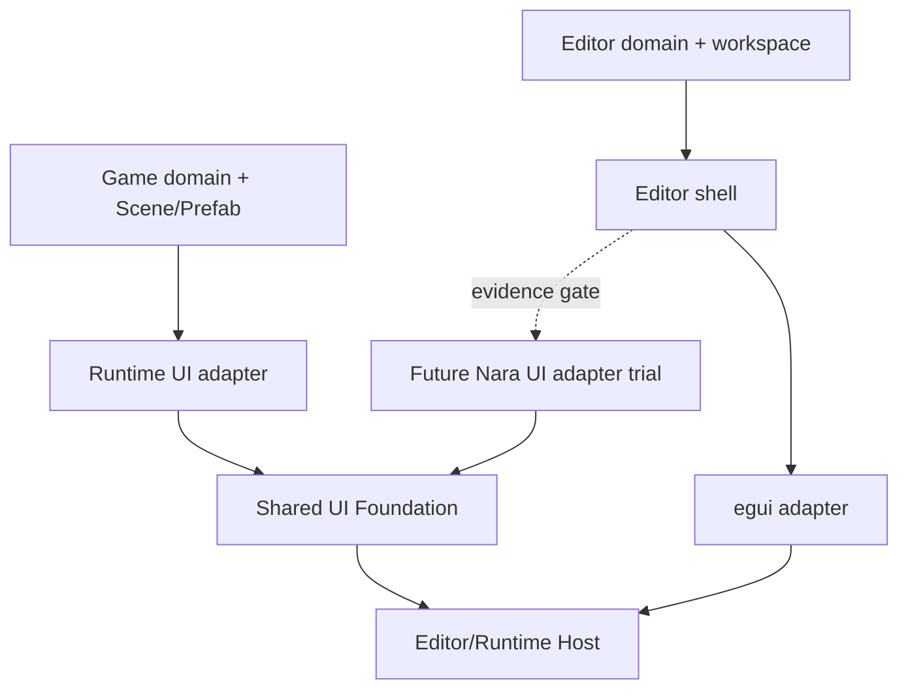

# ADR 0107: Shared UI Foundation and Independent Product Layers

**Status**: Accepted
**Date**: 2026-08-08
**Last Revised**: 2026-08-17
**Owner**: UI Foundation, Runtime UI, Editor Domain, Editor Host
**Refines**: [ADR 0102](0102-renderer-neutral-ui-text-widget-and-presented-frame-topology.md)
**Refined By**: [ADR 0111](0111-editor-scene-view-execution-and-picking-authority.md)
**Related**: [ADR 0112](0112-editor-game-view-runtime-presentation-and-input-authority.md)
**Implementation Plans**: [UI Foundation Correction](../../plans/2026-08-08-001-refactor-ui-foundation-correction-plan.md); [Editor Authoring Loop v1](../../plans/2026-08-08-003-feat-editor-foundation-workflow-plan.md); [Editor Game View v1](../../plans/2026-08-16-2157-feat-editor-game-view-v1-plan.md)
**Implementation Evidence**: [EFI-U5 Editor authoring-loop
conformance](../../knowledge/engineering/verification/2026-08/2026-08-15T233000Z-efi-u5-editor-authoring-loop-conformance-b1cd751875db4d91958a0fb9e609a04d.md),
[EGV-U5 embedded Game View product conformance](../../knowledge/engineering/verification/2026-08/2026-08-17T100847Z-egv-u5-embedded-game-view-product-conformance-9d0b0a17beef4c39bea70a8d6f025455.md)

## Context

Runtime UI and Editor UI both need layout, text, focus, semantics and presentation, but they do not
own the same product state. Runtime UI projects Scene/Prefab and game values into typed intents.
Editor UI owns documents, selection, undo, save, play and Host-coordinated Viewports. A single
top-level widget/toolkit object model would either leak Editor authority into games or make the
Editor depend on a Runtime-specific ECS authoring model.

The current UI work also demonstrated that product acceptance can expose missing shared behavior.
That pressure is useful, but allowing the Reference Game to become the primary interface-design
oracle would make expensive engine seams product-shaped before a second heterogeneous consumer
exists.

## Decision

Nara owns one shared, renderer-neutral UI Foundation and two independent product layers.

- The shared Foundation owns immutable compilation, per-surface session state, controlled widget
  reducers, semantics and backend-neutral presentation facts.
- Runtime UI owns ECS/Scene projection, typed game UI models and mapping semantic intents to game
  commands.
- Editor Domain owns document identity, revision, selection, undo, persistence and editor actions.
- Editor Shell owns logical panel placement and workspace presentation. Toolkit-generated IDs are
  transient adapter facts.
- The Host owns native windows, surfaces, seats, focus, IME, clipboard, GPU generation, Viewport
  leases and Play Runtime lifecycle.
- The first Editor shell is egui-first and has completed one bounded startup-Scene authoring
  workflow. One complete Nara UI Inspector is still required before a decision to converge the
  Editor on Nara UI.
- Runtime UI and the egui-first Editor are independent successors of a UI Foundation conformance
  baseline. Product priority may serialize them, but neither is a technical prerequisite of the
  other.
- The egui Inspector proves Editor document/action/gesture/undo/persistence and platform contracts;
  it is not a heterogeneous Nara UI consumer. A later Nara UI Inspector parity gate must consume the
  same immutable model and ordered action trace before shared widget or toolkit-convergence claims.
- Public crates are admitted for durable dependency direction. Internal lifecycle owners remain
  private modules until a second adapter or independent dependency closure makes a crate seam real.

Reference projects are comparative pressure, not implementation authority. Open-GPUI may inform
stable-key, frame-journal, virtualization and logical-docking behavior; Dear ImGui may inform
Editor adapter and viewport failure handling; Godot may inform Control and author workflows; Bevy
may inform algorithms and controlled widgets. Unity remains a secondary organization analogy until
a primary source/version and neutral assertion are pinned. Nara does not inherit external
App/Window/Entity, Node/Object/Variant, global-service, toolkit-ID or public render-topology
ownership models. The reproducible pressure matrix lives in the non-normative
[UI Foundation Design](../ui-foundation-design.md).

## Alternatives Considered

### One Godot-style UI product for games and Editor

Rejected. Nara UI does not yet own Editor-grade text editing, tables, virtualization, docking or
native multi-window integration. Forcing convergence now would delay the Editor and pollute Runtime
contracts with Editor-specific state.

### Permanent toolkit separation

Rejected. It would ship sooner, but it would duplicate text, semantics, theme and platform work and
would never expose Nara UI to a heterogeneous Editor workload.

### Shared Foundation with independent products

Accepted. It preserves common invariants while allowing the Runtime and Editor to mature at
different rates and makes eventual convergence an evidence-based decision.

## Consequences

- Two presentation stacks may coexist temporarily in the Editor process, coordinated by the Host.
- A product-local composite may remain local; it does not need a shared widget registry.
- Editor docking, multi-window and convergence decisions require focused successors.
- The Foundation Interface stays small even when its private implementation becomes large.
- Completion of the egui authoring slice validates the Editor model/action seam but does not count
  as a heterogeneous Nara UI consumer or authorize a cross-toolkit Widget trait.

## Success Metrics

- Neutral kernel/runtime/presentation consumers compile without product facts.
- Runtime UI maps typed intents without callbacks or mutable World access from widgets.
- Editor snapshots/actions contain no egui, GPUI, ImGui, native-window or ECS entity identity.
- A future Nara UI Inspector can be compared with the egui Inspector through the same Editor Domain
  snapshot/action seam.

## Risks and Mitigations

- **Two temporary presentation stacks duplicate product work.** Shared ownership stops at immutable
  facts and Host services; toolkit-local state is not generalized prematurely.
- **Runtime delivery silently blocks Editor architecture.** Both successors pin the same Foundation
  conformance baseline and remain technically independent under the one-active-plan rule.
- **egui is mistaken for Nara UI dogfood.** Editor-domain and Nara UI parity gates are recorded as
  separate evidence milestones.
- **Reference projects become architecture templates.** Only pinned observations mapped to a Nara
  invariant and neutral assertion may affect a public contract.
