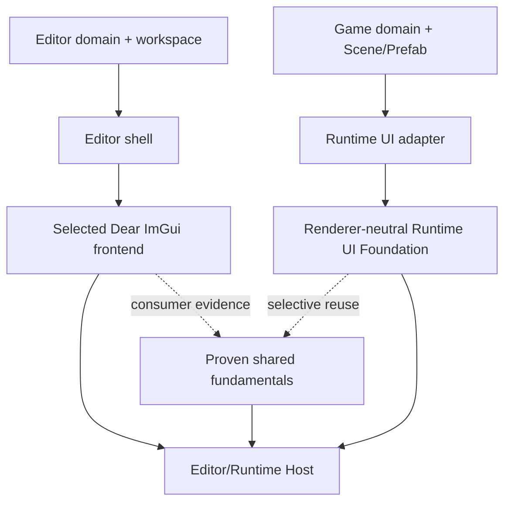

# ADR 0107: Shared UI Foundation and Independent Product Layers

**Status**: Accepted
**Date**: 2026-08-08
**Last Revised**: 2026-10-23
**Owner**: UI Foundation, Runtime UI, Editor Domain, Editor Host
**Refines**: [ADR 0102](0102-renderer-neutral-ui-text-widget-and-presented-frame-topology.md)
**Refined By**: [ADR 0111](0111-editor-scene-view-execution-and-picking-authority.md);
[ADR 0118](0118-editor-workspaces-frontends-and-creation-templates.md)
**Related**: [ADR 0112](0112-editor-game-view-runtime-presentation-and-input-authority.md)
**Implementation Plans**: [UI Foundation Correction](../../plans/2026-08-08-001-refactor-ui-foundation-correction-plan.md); [Editor Authoring Loop v1](../../plans/2026-08-08-003-feat-editor-foundation-workflow-plan.md); [Editor Game View v1](../../plans/2026-08-16-2157-feat-editor-game-view-v1-plan.md)
**Implementation Evidence**: [EFI-U5 Editor authoring-loop
conformance](../../knowledge/engineering/verification/2026-08/2026-08-15T233000Z-efi-u5-editor-authoring-loop-conformance-b1cd751875db4d91958a0fb9e609a04d.md),
[EGV-U5 embedded Game View product conformance](../../knowledge/engineering/verification/2026-08/2026-08-17T100847Z-egv-u5-embedded-game-view-product-conformance-9d0b0a17beef4c39bea70a8d6f025455.md)

## Context

Runtime UI and Editor UI both need layout, text, focus, semantics and presentation, but they do not
own the same product state. Runtime UI projects Scene/Prefab and game values into typed intents.
Editor UI owns documents, selection, undo, save, play and Host-coordinated Viewports. A single
top-level widget/toolkit object model would either leak Editor authority into games or make the
Editor depend on a Runtime-specific ECS authoring model.

The current UI work also demonstrated that product acceptance can expose missing shared behavior.
That pressure is useful, but allowing the Reference Game to become the primary interface-design
oracle would make expensive engine seams product-shaped before a second heterogeneous consumer
exists.

## Decision

Nara maintains independent Runtime UI and Editor UI products. Its renderer-neutral UI Foundation
serves Runtime UI; Editor reuse is selective and requires concrete consumer evidence. Shared
text, semantics, rendering or platform fundamentals do not imply a shared toolkit or require
every Editor control to consume the Foundation. Permanent toolkit separation is legitimate.

- The Runtime UI Foundation owns immutable compilation, per-surface session state, controlled
  widget reducers, semantics and backend-neutral presentation facts for its admitted consumers.
  These ownership rules do not make it the authority for Editor widgets or text-edit buffers.
- Runtime UI owns ECS/Scene projection, typed game UI models and mapping semantic intents to game
  commands.
- Editor Domain owns document identity, revision, selection, undo, persistence and editor actions.
- Editor Shell owns logical panel placement and workspace presentation. Toolkit-generated IDs are
  transient adapter facts.
- The Host/platform owns native windows, surfaces, seats, focus/capture arbitration, IME, clipboard,
  GPU generation, Viewport leases and Play Runtime lifecycle, with controlled adapter delegation
  under ADR 0118. Domain owners retain authoring mutation and history authority.
- The selected Dear ImGui frontend owns its text-edit buffers, invalid drafts, caret, selection,
  composition and scrolling. Runtime UI owns its own presented geometry and semantics. Sharing
  native input arbitration does not route Editor controls through game ECS actions.
- egui-first authoring and Game View records are historical bounded evidence, not the current
  frontend choice or heterogeneous Nara UI proof. Current frontend and platform scope is recorded
  in ADR 0118's implementation ledger and native qualification records.
- Runtime UI and Editor delivery are technically independent. No Nara UI Inspector is a required
  successor, and no current milestone presumes eventual toolkit convergence.
- Public crates follow demonstrated dependency direction. A first concrete owner contract can
  precede a second implementation; broader shared/portable claims need matching consumer evidence.

Domain draft basis, validation and exact edit results remain UI-neutral. Display text does not
automatically provide editable text; mature shaping or edit-buffer implementations may be reused
without importing another product's document or widget ownership. IME preedit never mutates an
authoring document. Focus loss, panel retirement and source replacement follow explicit frontend
and owner policies, with a committed composition using the normal semantic edit path.

### Evidence and non-prerequisites

A semantic tool may first plan one legal patch, preview its intent, submit it through an existing
Dear ImGui panel or window-free session, and observe the exact action result plus Undo/Save/Reopen.
That tracer does not require complete Nara UI, a second toolkit, new query/transaction APIs or a
universal Automation/Widget trait. It also does not establish a dynamic extension product.

Research/tracer results, public owner API qualification and reusable toolkit/protocol claims are
separate under ADR 0014. Native Unicode/composition, keyboard focus, DPI, detached windows and
accessibility need evidence for the capability changed. Backend hidden-window IME tests do not
prove OS candidate-window placement, and Runtime accessibility is not Editor accessibility proof.

Reference projects are comparative pressure, not implementation authority. Open-GPUI may inform
stable-key, frame-journal, virtualization and logical-docking behavior; Dear ImGui may inform
Editor adapter and viewport failure handling; Godot may inform Control and author workflows; Bevy
may inform algorithms and controlled widgets. Unity remains a secondary organization analogy until
a primary source/version and neutral assertion are pinned. Nara does not inherit external
App/Window/Entity, Node/Object/Variant, global-service, toolkit-ID or public render-topology
ownership models. The reproducible pressure matrix lives in the non-normative
[UI Foundation Design](../ui-foundation-design.md).

## Alternatives Considered

### One Godot-style UI product for games and Editor

Not selected. Nara UI has not demonstrated all Editor-grade text editing, tables, virtualization,
docking and native multi-window requirements. A future proposal may be evaluated on concrete
workflows; convergence is not the default destination.

### Permanent toolkit separation

Legitimate. Independent desktop and game toolkits can remain permanent. Duplication is a cost to
measure, not a reason to mandate convergence or an otherwise unnecessary Nara UI Inspector.

### Shared Foundation with independent products

Accepted as selective sharing. Preserve proven common invariants while letting each product own
its toolkit and mature independently. Generalize a shared service only where a concrete consumer
demonstrates value; no universal Widget model or required common retained tree follows.

## Consequences

- Separate presentation stacks may coexist permanently in the Editor process, coordinated by the Host.
- A product-local composite may remain local; it does not need a shared widget registry.
- Editor docking and native multi-window support follow ADR 0118 and matching qualification;
  any future convergence proposal is a separate product decision.
- The Foundation Interface stays small even when its private implementation becomes large.
- Historical authoring-slice evidence validates its Editor model/action seam, not heterogeneous
  Nara UI consumption, a cross-toolkit Widget trait or current native/platform support.

## Success Metrics

- Neutral kernel/runtime/presentation consumers compile without product facts.
- Runtime UI maps typed intents without callbacks or mutable World access from widgets.
- Editor snapshots/actions contain no egui, GPUI, ImGui, native-window or ECS entity identity.
- Semantic tools can exercise current document actions and exact results without toolkit parity.
- Each shared fundamental has an actual consumer, explicit ownership and scoped qualification.

## Risks and Mitigations

- **Separate presentation stacks duplicate product work.** Measure the cost and share only proven
  fundamentals; toolkit-local state is not generalized prematurely.
- **Runtime delivery silently blocks Editor architecture.** Keep semantic-tool experiments and
  Editor delivery independent of unrelated Runtime UI completion or historical plan gates.
- **Toolkit migration is mistaken for complete UI support.** Record Editor-domain, Runtime UI and
  actual native input/accessibility/platform evidence separately.
- **Reference projects become architecture templates.** Only pinned observations mapped to a Nara
  invariant and neutral assertion may affect a public contract.
