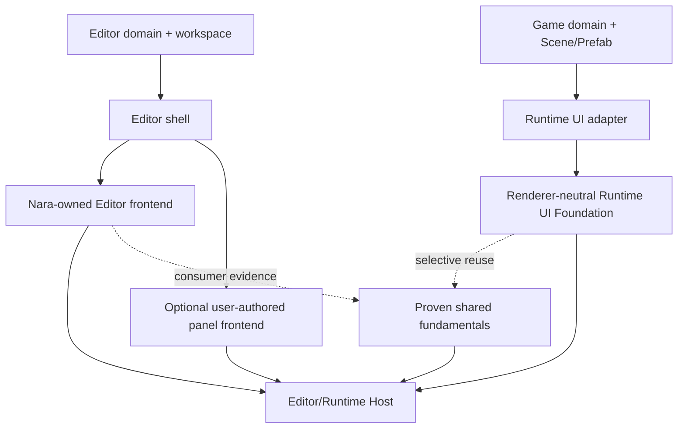

# ADR 0107: Shared UI Foundation and Independent Product Layers

**Status**: Accepted
**Date**: 2026-08-08
**Last Revised**: 2026-11-11 (independent framework and Nara-owned rendering adaptation)
**Owner**: UI Foundation, Runtime UI, Editor Domain, Editor Host
**Refines**: [ADR 0102](0102-renderer-neutral-ui-text-widget-and-presented-frame-topology.md)
**Refined By**: [ADR 0111](0111-editor-scene-view-execution-and-picking-authority.md);
[ADR 0118](0118-editor-workspaces-frontends-and-creation-templates.md)
**Related**: [ADR 0112](0112-editor-game-view-runtime-presentation-and-input-authority.md)
**Implementation Plans**: [UI Foundation Correction](../../plans/2026-08-08-001-refactor-ui-foundation-correction-plan.md); [Editor Authoring Loop v1](../../plans/2026-08-08-003-feat-editor-foundation-workflow-plan.md); [Editor Game View v1](../../plans/2026-08-16-2157-feat-editor-game-view-v1-plan.md)
**Implementation Evidence**: [EFI-U5 Editor authoring-loop
conformance](../../knowledge/engineering/verification/2026-08/2026-08-15T233000Z-efi-u5-editor-authoring-loop-conformance-b1cd751875db4d91958a0fb9e609a04d.md),
[EGV-U5 embedded Game View product conformance](../../knowledge/engineering/verification/2026-08/2026-08-17T100847Z-egv-u5-embedded-game-view-product-conformance-9d0b0a17beef4c39bea70a8d6f025455.md)

## Context

Runtime UI and Editor UI both need layout, text, focus, semantics and presentation, but they do not
own the same product state. Runtime UI projects Scene/Prefab and game values into typed intents.
Editor UI owns documents, selection, undo, save, play and Host-coordinated Viewports. Forcing those
product models into one authoring object model would leak Editor authority into games or make the
Editor depend on Runtime-specific ECS authoring. A shared neutral toolkit can still serve both
through separate adapters without merging their domain objects or live UI state.

The current UI work also demonstrated that product acceptance can expose missing shared behavior.
That pressure is useful, but allowing the Reference Game to become the primary interface-design
oracle would make expensive engine seams product-shaped before a second heterogeneous consumer
exists.

## Decision

Nara maintains independent Runtime UI and Editor UI products. Its renderer-neutral UI Foundation
serves Runtime UI; Editor reuse is selective and requires concrete consumer evidence. Shared
text, semantics, rendering or platform fundamentals do not imply a shared toolkit or require
every Editor control to consume the Foundation. Permanent toolkit separation is legitimate.

Independent product ownership does not freeze the current game-UI execution. Authored source,
occurrence identities, commands and exact presented interaction remain engine-owned when layout,
text, widget state or rendering mechanisms change. A GPUI-derived runtime is a comparison option;
it must not synchronize a second live input executor or duplicate game/document command history.
Use the same authored game workflow and measured workloads before selecting full execution reuse,
selective neutral reuse or continued independent execution. World-space/depth, player focus and
special materials remain explicit capabilities with their own consumers.

A Nara-owned, custom-drawn Editor may use a maintained UI framework. Product ownership does not
require Nara to implement every layout, text, component or platform mechanism. The November 5
clarification makes the user's existing Open-GPUI fork a primary comparison candidate, including
maintaining that framework when concrete integration requires it. This reopens framework adoption;
it does not select a new production backend or invalidate qualified Nara consumers. R11a owns the
comparison against complete workflows and total maintenance cost. Domain-neutral Editor models,
commands, document/history owners and independent Runtime UI remain separate from that choice.

Open-GPUI is an independently maintained, general-purpose UI project. Nara consumes a qualified
framework revision through an optional integration; it does not become the framework's runtime,
render graph, asset database or application model. Framework platform and renderer modules remain
usable by ordinary applications without Nara dependencies. Engine-specific View, document, content
and retirement adapters belong to Nara. A reusable framework correction motivated by those adapters
belongs to Open-GPUI and must preserve its ordinary consumers.

Window hosting, UI rendering and engine-viewport composition are separate decisions. A selected
composition can delegate native hosting to GPUI or drive a supported framework adapter from the
engine Host. Sharing a GPU device does not select the native loop, and rendering an engine viewport
inside GPUI does not require every editor control to enter the engine's render graph. Each selected
window and resource domain has one explicit owner for acquisition, submission, presentation,
input admission and retirement.

The subsequent November 11 direction makes application-owned WGPU hosting a framework
development target, with an ordinary non-Nara consumer before Nara integration. Mature GPUI UI,
layout/text and component mechanisms remain reusable while native renderer coupling may change.
The official Windows D3D11 construction is not an engine or framework public-interface constraint.
This selects an integration capability to build; it does not qualify an external driver or switch
the Editor/game UI implementation.

The first actual Nara integration uses a Nara-owned renderer adapter. Open-GPUI supplies its
coherent UI execution, Scene and renderer/atlas contracts; Nara supplies the existing engine
device, targets, encoding transaction, final submission/presentation and resource retirement.
The adapter belongs to Nara and implements the framework's public hosting interfaces. Reusing
the optional framework WGPU Scene recorder does not transfer those engine responsibilities to
the framework. A renderer contribution must not construct a second device or independently
submit the engine's composition work.

The framework Scene contract remains independent of WGPU so an application can implement its
own renderer. Start the Nara comparison by reusing the qualified recorder; replace its primitive
implementation only when a concrete engine requirement warrants the maintenance cost. Such a
replacement includes path, glyph/atlas, clip, ordering, color and resource-lifetime semantics,
not just triangles. Keep internal renderer passes private unless existing engine graph
dependencies require their exposure. This selects the adapter ownership and first integration
route, not a production toolkit or a game-runtime executor.

- The Runtime UI Foundation owns immutable compilation, per-surface session state, controlled
  widget reducers, semantics and backend-neutral presentation facts for its admitted consumers.
  These ownership rules do not make it the authority for Editor widgets or text-edit buffers.
- Runtime UI owns ECS/Scene projection, typed game UI models and mapping semantic intents to game
  commands.
- Editor Domain owns document identity, revision, selection, undo, persistence and editor actions.
- Editor Shell owns logical panel placement and workspace presentation. Toolkit-generated IDs are
  transient adapter facts.
- The Host/platform owns native windows, surfaces, seats, focus/capture arbitration, IME, clipboard,
  GPU generation, Viewport leases and Play Runtime lifecycle, with controlled adapter delegation
  under ADR 0118. Domain owners retain authoring mutation and history authority.
- Each panel frontend owns its text-edit buffers, invalid drafts, caret, selection, composition
  and scrolling. The current Dear predecessor and qualified Nara panels retain their recorded
  scope. Runtime UI owns its own presented geometry and semantics. Sharing
  native input arbitration does not route Editor controls through game ECS actions.
- egui-first authoring and Game View records are historical bounded evidence, not the current
  frontend choice or heterogeneous Nara UI proof. Current frontend and platform scope is recorded
  in ADR 0118's implementation ledger and native qualification records.
- Runtime UI and Editor delivery are technically independent. The Nara-owned Editor destination
  does not require convergence with the game's complete toolkit or adoption of its ECS adapter.
- Public crates follow demonstrated dependency direction. A first concrete owner contract can
  precede a second implementation; broader shared/portable claims need matching consumer evidence.

Domain draft basis, validation and exact edit results remain UI-neutral. Display text does not
automatically provide editable text; mature shaping or edit-buffer implementations may be reused
without importing another product's document or widget ownership. IME preedit never mutates an
authoring document. Focus loss, panel retirement and source replacement follow explicit frontend
and owner policies, with a committed composition using the normal semantic edit path.

### Dependency direction and execution model

Game UI and Editor UI are separate products over selectively shared fundamentals. The existing
`nara_text`, `nara_ui_kernel`, `nara_ui_widgets` and `nara_ui_render` boundaries may serve both
when their contracts fit. They must not acquire Editor documents, workspace placement, project
execution or a game-specific ECS dependency. `nara_ui` remains the Scene/ECS game-UI adapter;
an Editor panel must not depend on it merely to obtain text, layout, controls or presentation.
Editor component composition belongs above these fundamentals and below document-specific tools.
A separate crate is warranted by an independent dependency closure, not by this layer diagram alone.

Prefer shared mechanisms with separate product adapters when the complete consumer fits. Shared
framework execution must not make a game depend on Editor docking, workspaces, documents or theme
recipes. Shared implementation also does not merge per-root focus, text sessions or resource
lifetimes. Distinguish unstyled component behavior from appearance, and distinguish both from the
platform/render execution boundary. Existing Open-GPUI `ui-core` and component modules provide
starting points; a Base-style component split does not itself provide external runtime hosting.
Allow coherent framework execution, narrower mechanism extraction or independent execution to win
the authored-game comparison. Do not require a crate for every algorithm or duplicate a complete
stack merely to maintain independent product ownership.

An engine render graph may schedule a framework renderer as a bounded render contribution while
the framework retains its own primitive, path, text and atlas implementation. It need not reproduce
those internals as public engine graph nodes. Conversely, a framework-owned window may composite
an engine-owned output through a qualified texture adapter. Either route must retain the output's
original device identity, color/alpha facts, sampling order and retirement custody. Neither route
requires a second public render graph in Open-GPUI or a universal UI description shared by toolkits.
The native consumer comparison selects the route; a recording-only renderer is one prerequisite,
not proof of external texture import, host-driven UI execution or game-UI suitability.

State ownership, description construction and scheduling are separate choices. Nara-owned Editor
UI retains panel/control incarnations, editing state and reusable artifacts across compatible
updates. Authors may compose short-lived declarative descriptions; the implementation invalidates
the affected structure, layout, text, paint or semantics rather than requiring a complete rebuild
for every Host frame. This selects an execution contract, not a public retained-node graph,
reactive language or universal cross-toolkit Widget trait. Cache algorithms and layout storage
remain replaceable behind that contract under ADR 0109.

An optional panel frontend may use retained, immediate or hybrid internals. ADR 0118 owns its
Host attachment. Providing that attachment is a Nara responsibility; shipping an official ImGui,
egui or other toolkit extension is not required. The default Nara frontend and optional
user-authored frontends share document and Host authority without sharing their internal trees.

The finite public surface-presenter bridge in ADR0102 permits an independently authored Nara
frontend to prepare packets, return original backend outcomes and observe its exact presented
journal without importing a hidden receipt factory or the game's ECS UI adapter. It is a concrete
presentation adapter, not a new UI/component, document, platform or GPU authority. ADR0118 adds
the bounded image-backed native attachment; complete panel capabilities and the independent
Editor still need their remaining R11b consumers. The surface presenter owns
publication of presentation history only; frontend interaction, widget reducers and text-input
lifetimes remain live caller state. Completing presentation must not restore an interaction
snapshot captured during preparation.

The development route under ADR0118 keeps the ImGui reference Editor and independently composed
self-drawn successor as separate complete implementations over shared semantic owners. It does
not require a mixed first-party shell, reciprocal toolkit embedding or per-panel default swaps.
Optional product embedding remains allowed; it is separate from developing the default Editor.
The reference retires after the successor's complete qualification.

### Component extension and execution

The Nara component interface supports composing controls and authoring new components through
lower-level layout, drawing, interaction, text and semantics. Creating a component library does
not require inheriting first-party high-level controls. Foreign frontend attachment remains a
different interface under ADR0118; it need not translate its controls into Nara components.

Compatible retained component state is scoped by panel instance, parent and explicit key rather
than label, row index or transient description address. Incompatible state type/version or
document binding starts a new incarnation unless an explicit compatible migration applies.
Public layout/cache/reconciliation storage is not part of this contract. Exact Rust types and
key helpers require independent composition/custom-component consumers before freeze.

The bounded keyed-state prerequisite in `nara_ui_widgets` separates a membership pass from
explicit local updates. Exact root/parent/leaf paths select state; labels and ordering do not.
A store-local typed handle also identifies the live incarnation. Type, schema or opaque binding
changes require explicit replacement, and stale handles cannot address that replacement.
Composition reads existing state and lazily initializes new state without publishing effects;
only a successful pass adopts membership. This transaction is neither compiler acceptance nor
presentation admission. A frontend chooses the declaration scope: omitting a slot evicts its
local state, so drafts that must survive hidden controls need a longer-lived declared owner.
Skipping an existing child's composition through a compatible cache hit does not omit that
child: preserve its declared membership and dependency associations before adopting the pass.
Actual removal follows the selected eviction policy. This does not select a public replay format.
The store cannot release native focus/IME, cancel external tasks or discover fields nested inside
arbitrary user state. Those remain explicit responsibilities of the existing owners. This
prerequisite does not establish automatic dependency tracking, a general Widget trait, custom
layout/drawing, virtualization or code-reload compatibility.

The separate child-layout prerequisite under ADR0109 supplies custom intrinsic measurement and
placement over the admitted child topology. Its scoped operations return sizes/baselines and
accept exact content-relative allocations, while the private compiler retains layout storage,
text work and final projections. A user-authored layout can wrap existing controls or arbitrary
authored nodes without inheriting a component base class. Its immutable description is distinct
from keyed mutable state; construction/measurement repetition cannot publish business effects.
The captured-geometry prerequisite in ADR0102 additionally permits component-owned tessellation
to enter the original paint stream as immutable bounded triangles. A user library can combine
that geometry with ordinary controls, keeping its path vocabulary and dependencies outside the
kernel. The compiler, neutral planner and original native Feature retain mapping, clipping,
ordering, budgets and completion responsibility. Neither prerequisite closes routed canvas
gestures, final-size drawing callbacks or the complete component interface.

Nara-owned composition, measurement and painting can be skipped or repeated. Their invocation
count cannot publish document edits, spawn tasks or install subscriptions. Admitted interaction
and exact results drive explicit state/effect updates; compatible private caches may still change
during preparation. Foreign adapters retain their own event model but must not duplicate a
business effect through repeated sizing/composition. Component-owned listeners, timers and work
have scoped release/cancellation and original result identity; frame borrows cannot outlive their
scope in background work. Existing task and document owners remain authoritative.

Custom layout/drawing supplies finite constraints/placements, mapped hit/semantic facts and
resource-complete render contributions through the current owners. Scoped theme and typography
inputs have explicit invalidation dependencies. Drawing, keyboard/text behavior, semantic support
and platform integration remain separately declared capabilities. The finite Rect/Text/Mesh
vocabulary and Button/TextField reducers do not establish this complete extension interface.
These are successor design requirements. Existing qualified controlled widgets/panels retain
their bounded interfaces; independent keyed composition supplies one prerequisite, while the
complete component/custom-layout consumers remain unimplemented.

### Evidence and non-prerequisites

A semantic tool may first plan one legal patch, preview its intent, submit it through an existing
Dear ImGui panel or window-free session, and observe the exact action result plus Undo/Save/Reopen.
That tracer does not require complete Nara UI, a second toolkit, new query/transaction APIs or a
universal Automation/Widget trait. It also does not establish a dynamic extension product.

Research/tracer results, public owner API qualification and reusable toolkit/protocol claims are
separate under ADR 0014. Native Unicode/composition, keyboard focus, DPI, detached windows and
accessibility need evidence for the capability changed. Backend hidden-window IME tests do not
prove OS candidate-window placement, and Runtime accessibility is not Editor accessibility proof.

Reference projects are comparative pressure, not implementation authority. Zed GPUI is the primary
state, notification and cached-artifact reference; Open-GPUI informs reusable component composition,
stable keys, virtualization and logical docking. The pinned source study distinguishes retained
entities, short-lived descriptions, cached-view replay and layout/text/raster work; it does not
select GPUI ownership, a dependency or persistent layout storage for Nara. That historical
mechanism study does not prohibit the later maintained-Open-GPUI comparison. A selected framework
may own its Editor-local entities, windows and dispatch under the chosen Host composition; it
must not replace document, history or game-UI authority. Dear ImGui may inform
Editor density/style scopes, adapter and viewport failure handling; Godot may inform Theme,
Container and custom editor-Control workflows; Bevy may inform algorithms and controlled widgets.
The [custom-drawn Editor UI
study](../../research/2026-10-27-custom-drawn-editor-ui-boundaries.md) adds pinned Fyrox and
Xilem/Masonry source observations and the November 5 GPUI/ImGui/Godot style/layout comparison.
The [visual component prerequisite](../../plans/2026-10-23-foundation-architecture-rebaseline-plan.md#styled-source-workspace-and-component-library-prerequisite)
separates the functional source workspace from polished-library qualification. Unity 6.0's
[EditorWindow guide](https://docs.unity3d.com/6000.0/Documentation/Manual/UIE-HowTo-CreateEditorWindow.html)
grounds explicit UI reconstruction/state restoration, not automatic state survival. The user
selected Nara's own custom-drawn Editor frontend as the default destination; optional user-authored
toolkit attachment is a separate supported design target. Concrete panel-hosting, component and
performance successors remain unqualified until their public consumers pass. Current Dear
support stays until qualified replacement; this does not require a shared
game/Editor toolkit. Nara's shared document and Runtime contracts do not inherit external
App/Window/Entity, Node/Object/Variant, global-service, toolkit-ID or public render-topology
ownership models. A selected Editor adapter can use its framework's local execution model.
The reproducible pressure matrix lives in the non-normative
[UI Foundation Design](../ui-foundation-design.md).

### Scoped visual recipes and complete property controls

The [styled workspace unit](../../plans/2026-11-05-styled-source-workspace-plan.md) supplies the
first shared visual slice through real Editor and independent-library consumers. `nara_text`
owns admitted typography, actual face/line geometry and atomic retained-buffer adoption.
The kernel owns scoped measurement, layout facts and renderer-neutral output; prepared text's
draw origin does not replace its clip. `nara_ui_widgets` owns explicit immutable appearance
values and control recipes, including density/text-scale separation, state cues and measured
groups/popups. Its palette is a library vocabulary, not a central extension-role registry.
Other libraries may compose controls, add their own roles or draw through the original low-level
interfaces without inheriting first-party visuals. The original compiler's bounded compatible
plain-text cache owns no document or input authority and preserves complete candidate admission.

Editable fields retain complete editing state independently from width-dependent placement.
Composition may supply an intrinsic width preference; the existing exact child allocation
determines viewport, scroll, selection and caret geometry. Exploratory measurement remains
effect-free. Point and IME adapters use the accepted field rectangle and preserve the original
displayed-text origin and input-lifetime checks. Immutable layout-description reuse grants no
display or document authority.

Measured property and icon/label recipes compose ordinary child subtrees through that same
layout contract. They use actual text baselines, explicit icon envelopes/optical offsets and
child overflow policy, without a central widget enum, document-field registry or second painter.
The [allocation/property unit](../../plans/2026-11-05-measured-property-composition-plan.md)
records their complete independent-library and first-party qualification scope separately.

Both Editor compositions consume the original complete Inspector/draft controls from the shared
frontend controls module. Extraction removes the old Dear ownership rather than keeping a second
property preparation or history path. The independently drawn composition remains selectable and
uses the original semantic/native/image Hosts. Functional/native and fixed-content visual results
have separate scope; full component-library, default-switch, docking, multiple-window, native
preference/accessibility and R11e cost qualification remain open.

## Alternatives Considered

### One Godot-style UI product for games and Editor

Not selected. Nara UI has not demonstrated all Editor-grade text editing, tables, virtualization,
docking and native multi-window requirements. A future proposal may be evaluated on concrete
workflows; convergence is not the default destination.

### Permanent toolkit separation

Legitimate. Independent desktop and game toolkits can remain permanent. Duplication is a cost to
measure, not a reason to mandate convergence or an otherwise unnecessary Nara UI Inspector.

### Shared Foundation with independent products

Accepted as selective sharing. Preserve proven common invariants while letting each product own
its toolkit and mature independently. Generalize a shared service only where a concrete consumer
demonstrates value; no universal Widget model or required common retained tree follows.

## Consequences

- Optional user-authored presentation stacks may coexist under Host admission. The first-party
  ImGui reference is a development implementation scheduled for retirement after the independently
  composed self-drawn Editor passes complete acceptance.
- A product-local composite may remain local; it does not need a shared widget registry.
- Editor docking and native multi-window support follow ADR 0118 and matching qualification;
  any future convergence proposal is a separate product decision.
- The Foundation Interface stays small even when its private implementation becomes large.
- Historical authoring-slice evidence validates its Editor model/action seam, not heterogeneous
  Nara UI consumption, a cross-toolkit Widget trait or current native/platform support.

## Success Metrics

- Neutral kernel/runtime/presentation consumers compile without product facts.
- Runtime UI maps typed intents without callbacks or mutable World access from widgets.
- Editor snapshots/actions contain no egui, GPUI, ImGui, native-window or ECS entity identity.
- Semantic tools can exercise current document actions and exact results without toolkit parity.
- Each shared fundamental has an actual consumer, explicit ownership and scoped qualification.

## Risks and Mitigations

- **Separate presentation stacks duplicate product work.** Measure the cost and share only proven
  fundamentals; toolkit-local state is not generalized prematurely.
- **Runtime delivery silently blocks Editor architecture.** Keep semantic-tool experiments and
  Editor delivery independent of unrelated Runtime UI completion or historical plan gates.
- **Toolkit migration is mistaken for complete UI support.** Record Editor-domain, Runtime UI and
  actual native input/accessibility/platform evidence separately.
- **Reference projects become architecture templates.** Only pinned observations mapped to a Nara
  invariant and neutral assertion may affect a public contract.
