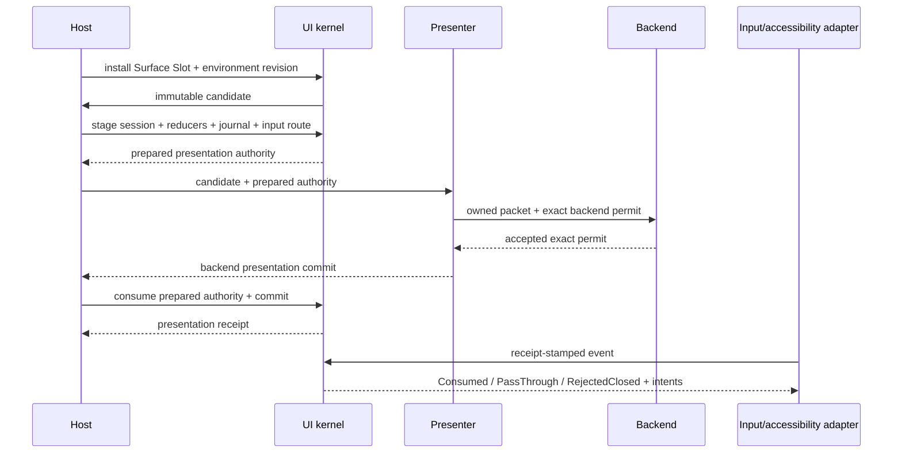

# ADR 0108: UI Surface, Presented Session, and Atomic Interaction

**Status**: Accepted
**Date**: 2026-08-08
**Amended**: 2026-08-09 by the UIF-U1 presentation-reconciliation, UIF-U3C prepared-submission and
UIF-U4C surface-lifecycle corrections; 2026-08-10 by the UIFM-U1 modal-entry-focus correction
**Owner**: UI kernel session, input routing, platform adapters, Host surface lifecycle
**Refines**: [ADR 0041](0041-input-routing-actions-text-focus-and-accessibility.md) and
[ADR 0102](0102-renderer-neutral-ui-text-widget-and-presented-frame-topology.md)
**Implementation Plan**: [UI Foundation Correction](../../plans/2026-08-08-001-refactor-ui-foundation-correction-plan.md), UIF-U1, UIF-U3C and UIF-U4C; [UI Modal Entry Focus Correction](../../plans/2026-08-10-001-refactor-ui-modal-entry-focus-correction-plan.md), UIFM-U1

## Context

An immutable frame is truthful only when paint, hit testing, focus, semantics and actions all refer
to the exact packet accepted for one surface revision. The current interaction transaction can
derive a rejection after mutating candidate session/reducer state and then commit those candidates.
Resize and scale changes can also invalidate geometry while leaving old pointer facts available.

Surface identity is currently narrower than the desktop product already needs: content origin,
letterbox mapping, route/geometry generations and retirement are split across map entries. Future
root selection, detached windows and render-to-texture composition remain pressure, but are not
public Surface Slot requirements until a product consumes them.

## Decision

The Host installs an explicit Surface Slot. The kernel owns a presented session per Surface Slot and
dispatches every normalized or accessibility action as one atomic transaction against an exact
presentation receipt.

A Surface Slot owns:

- stable `UiSurfaceId` and retirement generation;
- window/view/seat endpoint;
- slot, route, geometry and presentation generations;
- one exact `SurfaceContentTransform` for logical/physical size, content rect and safe area;
- the applied theme/font environment generations.

UIF exposes only the existing all-roots authoring scope and global theme/font environment. Generic
root selection, per-surface theme choice and capability negotiation are not Surface Slot APIs in this
baseline; render-target UI or an Editor Viewport must admit them through a focused successor.

The current Foundation admits at most one active Surface Slot for a presentation target. Multiple
slots may coexist only on distinct targets. A product that needs several independently compiled slots
composited into one target must first define target-plan aggregation and receipt mapping in a focused
successor decision; map iteration is not a compositor.

Every slot update atomically installs a new immutable slot generation. Old receipts fail closed. The
implementation may reuse private cache records only when every fact named below remains compatible:

| Changed fact | Required invalidation | Cache compatibility |
|---|---|---|
| endpoint, seat, view or presentation target | route, presentation and endpoint binding; release the old binding | root-local compile facts only when the compile environment is otherwise identical |
| `SurfaceContentTransform` | geometry, pointer position/capture, presentation and route | no layout/hit/semantic geometry reuse |
| theme or font generation | compile, text/layout, geometry, presentation and route | incompatible with prior styled/text facts |
| retirement | all routes, histories, target bindings and platform adapters; retain a tombstone generation | none |

This conservative generation rule favors coherent invalidation over field-specific public revision
APIs. More selective private reuse may be added without changing the Surface Slot Interface.

`SurfaceContentTransform` is the sole coordinate authority. The Host applies physical safe-area
insets first, uniformly fits the authored logical extent into the remaining physical surface and
records the resulting content origin/extent. Paint and semantic bounds use that forward mapping.
Input maps platform-logical coordinates to physical surface coordinates, rejects points outside the
content rect, subtracts the content origin and applies the exact inverse content scale. It never
clamps black-bar input onto a widget. Outside-content input is `PassThrough` without a modal barrier
and `RejectedClosed` with one; existing capture/hover is first cleared by a consumed reconciliation.

Interaction has exactly three dispositions:

- `Consumed`: session, reducers, journal and input finalization commit together.
- `PassThrough`: UI state is unchanged and gameplay may consume the event.
- `RejectedClosed`: only bounded rejection evidence and input finalization commit. Session, reducers
  and journal remain byte-for-byte unchanged.

If geometry invalidation, retirement or a disabled/removed target requires capture or hover cleanup,
the kernel emits a successful consumed reconciliation transaction. It is not represented as a
rejection that partially mutates state.

Reconciliation against an unpresented candidate is a staged operation: it returns a candidate
session and cleanup batch without mutating the presented session. The owning adapter may adopt that
session only together with successfully reduced widget state and matching candidate paint/semantic
facts. Any committed input invalidates an already compiled candidate. Equivalent presentation facts
may rebind an in-flight pointer gesture to the successor epoch; removal, action/enabled behavior,
geometry or modal-scope changes cancel it. A label-only change does not cancel a gesture when the
routing geometry and owning action remain identical.

The conformance baseline admits one active seat owner and one active pointer owner per Surface Slot.
Keyboard, gamepad and accessibility devices for the same player share that seat identity. A second
seat or pointer fails closed before allocating session state. Independent users require distinct
Surface Slots on distinct targets; shared-target multi-user interaction remains deferred until a
focused model is accepted.

The Surface Slot endpoint seat is admitted into candidate interaction staging before structural and
modal reconciliation. A newly presented modal therefore commits its first enabled, visible focus
target for the owning seat before final visual compilation and semantic publication, including an
initial modal and a base-to-modal transition that received no prior UI input. An initial non-modal
frame does not receive implicit focus. This focus mutation is a session/reducer presentation fact;
semantic projection remains read-only and cannot manufacture it. Endpoint replacement clears the
predecessor session and seeds only the successor endpoint seat.

All fallible history, session, reducer, journal and input-route admission completes before backend
submission. The backend acceptance is move-only and bound to the packet plus target, slot,
environment, capability and GPU generations. Consuming it performs an infallible authority swap;
ordinary consumers and the frame journal cannot mint or advance receipt authority independently.

Focus identity is independent from destination and activation eligibility. A focused stable control
that becomes disabled retains focus identity and remains the sequential/directional navigation
origin, but is excluded from destinations and every activation path. Removal, hiding, retirement or
modal-scope invalidation may clear or restore focus according to the presented session.

The focused-plus-disabled reducer state preserves the focus indicator while using disabled visual
and activation semantics; disabling cannot manufacture hover or pressed state. Re-enabling the same
stable key restores its focused visual without a synthetic focus transaction.

Semantic snapshots are read-only projections of committed session state. They cannot invent a
default focus. AccessKit actions, when enabled, are converted by the platform adapter into the same
receipt-stamped backend-neutral action before dispatch. The ingress identity includes the exact
publisher, Surface Slot and publication generation that produced the node mapping. A delayed action
from an older publication or a foreign publisher cannot be restamped onto the current receipt or
resolved through a coincidentally equal node identity.

Platform accessibility publication is one exclusive synchronous adapter transaction owned by
`WinitAccessibilityPublisher`. `publish_update` validates the exact semantic snapshot, constructs
the complete AccessKit tree and callback mapping, reserves a unique publication generation, records
that exact update, then performs an infallible mapping swap. There is no caller-supplied callback and
no publishable prepared token, so an empty or delayed callback cannot mint evidence. The receipt
proves exact Host-owned tree-record and mapping commit; it does not claim that an operating-system
client or player observed the tree. Retirement clears the record and mapping and writes a typed
postcondition tombstone for either platform-tree removal or native-window destruction.

The normalized input authority rejects a presented route that regresses an active slot, route or
geometry generation, or regresses the presentation epoch within one slot. Geometry invalidation
watermarks include the Surface Slot lineage, so presentation epochs may restart when a Host installs
a strictly newer slot generation.

Logical route invalidation and physical endpoint retirement are distinct operations. A transform or
slot update unbinds the exact UI route, clears geometry-scoped pointer positions, and preserves
platform focus plus held keys/buttons. Each held edge retains the consumer that received its press:
gameplay-owned releases return to gameplay, UI-owned releases remain UI-suppressed, and unresolved
releases follow the exact press disposition once finalized. A successor route cannot claim an edge
from a predecessor lineage. True endpoint retirement first validates the exact route when one exists,
synthesizes bounded key/button releases and pointer leave, then clears focus and all physical endpoint
state. A replacement route at the same window/seat endpoint is a typed mismatch and fails closed
before retirement mutates either owner. If a Surface Slot migrates from endpoint A to endpoint B,
held edges remain attached to the exact consumer and predecessor endpoint lineage that received each
press until a balanced release or explicit retirement cleanup completes; the successor endpoint
cannot silently absorb or discard that ownership.

Surface availability is explicit. An active slot that loses a usable target through zero extent,
missing endpoint or invalid scale becomes suspended with a successor generation. Suspension removes
packet, route, pointer/capture and accessibility authority but may retain physical held-edge ownership
until real releases arrive. Restore creates a fresh active generation and requires a fresh presented
receipt. Retirement is permanent and cannot be restored.

Authored semantics are descriptive, not an independent behavior authority. An actionable semantic
fact is published only when the exact presented behavior snapshot owns and can resolve that action.
Platform bounds use the visible intersection of node geometry, ancestor clips and the Surface Slot
content rect; an empty intersection is hidden and cannot advertise an action in this baseline.

## Alternatives Considered

### Route against the latest mutable UI state

Rejected. It can execute behavior that the player did not see and cannot make old packet, focus and
semantic facts agree.

### Separate mutation paths for pointer, focus and accessibility

Rejected. Independent paths create partial commits and divergent action eligibility.

### Exact per-surface atomic session

Accepted. It concentrates failure and ordering complexity behind one dispatch Interface.

## Consequences

- Platform adapters must retain presentation receipts and route generations.
- Reconciliation becomes an explicit typed transition rather than hidden mutation.
- Surface Slot installation/update/retirement may break existing create-only helper APIs.
- Multi-window policy remains Host-owned and is not implied by kernel support for multiple slots.

## Success Metrics

- Rejected disabled, retired, stale-receipt and stale-geometry events leave session/reducer/journal
  state unchanged.
- Resize/scale invalidation cancels capture without allowing a release on old coordinates to
  activate a new layout.
- Disabled focus, navigation origin, semantics and visual reducer state agree through re-enable.
- Two surfaces on distinct targets with different content transforms cannot overwrite each other's
  routes or session state.
- A mismatched replacement route aborts slot update or retirement without removing the Surface
  Slot, advancing its tombstone, or changing its presented session.
- Non-zero letterbox origin and fractional platform scale map paint, hit and semantic bounds through
  the same transform; transform replacement cancels old capture and pointer position.
- Black-bar input is never clamped and follows the modal/non-modal disposition rule.
- A newer Surface Slot may restart presentation epochs without inheriting stale-geometry rejection
  from the retired lineage; the old receipt remains retired.
- Transform/slot invalidation preserves held physical edges and routes each eventual release to the
  same consumer that received its press even after a successor route is published; true endpoint
  retirement emits balanced releases exactly once and permits clean endpoint reuse.
- Zero extent, missing endpoint and invalid scale suspend the slot and retire stale receipt, route,
  geometry and accessibility authority; restore requires fresh generations and presentation.
- A platform accessibility action resolves through the same receipt and intent as pointer/keyboard
  activation when the OS adapter feature is enabled.
- Stale, foreign-surface and post-retirement accessibility updates fail before replacing the exact
  committed tree record or mapping. Every receipt names a stored update; retirement clears it and
  records one typed endpoint postcondition. An attempted generation is never exposed as a receipt,
  and an older retirement generation fails likewise.

## Risks and Mitigations

- **Surface Slot becomes a speculative product registry.** UIF exposes only the fields required by
  current desktop lifecycle and exact coordinates; root selectors, theme choice and aggregation stay
  deferred.
- **Conservative generation invalidation costs extra compilation.** Private compatibility caches may
  optimize later without weakening receipt invalidation.
- **Platform accessibility is overstated.** Neutral action ingress and an OS-enabled adapter test are
  recorded separately; schema conversion alone is not OS acceptance evidence.
