# ADR 0109: Root-Local UI Compilation and Presentation Closure

**Status**: Accepted
**Date**: 2026-08-08
**Amended**: 2026-08-09 by the UIF-U2 unpresented-candidate retirement clarification
**Owner**: UI authoring builder, UI compiler, text budget, presentation planner, WGPU UI adapter
**Refines**: [ADR 0040](0040-render-resource-lifetime-and-submitter-ownership.md),
[ADR 0068](0068-global-resource-budgets-metrics-and-diagnostic-privacy.md), and
[ADR 0102](0102-renderer-neutral-ui-text-widget-and-presented-frame-topology.md)
**Implementation Plan**: [UI Foundation Correction](../../plans/2026-08-08-001-refactor-ui-foundation-correction-plan.md), UIF-U2 and UIF-U3

## Context

The current authoring builder can reject the complete snapshot when one root has a root-local style,
text or key error, even though the compiler claims root-local failure containment. The last-good
cache also retains global layer and root-sequence coordinates, so a failed reordered root can paint
at its previous location.

Presentation limits are not yet truthful frame limits: text glyph admission resets per text layout,
and atlas/primitive limits may reset per packet or root. The authoring vocabulary also exposes
corner radii that the first-party WGPU path rejects only after packet construction.

## Decision

Authoring is admitted as bounded root envelopes. Global snapshot validity is checked once; every
root then carries its current identity, layer, ordinal and either validated root input or a root-
local rejection. Source revision remains snapshot-global; surface/theme/font/environment
generations remain compile-context and cache-compatibility facts rather than duplicated envelope
fields.

Compilation is fallible at the outer boundary: it returns either a revisioned candidate or a typed
`CompileRejected` diagnostic set. Root-local failures are outcomes inside a candidate; missing or
duplicate identity, profile mismatch and shared candidate-capacity overflow return no candidate.

```mermaid
flowchart LR
    Snapshot[Global snapshot admission]
    Envelopes[Ordered Root Envelopes]
    RootCompile[Root-local compile]
    Cache[Relative last-good root facts]
    Rebind[Bind current layer + root sequence]
    Frame[Immutable frame candidate]
    Planner[Frame-global presentation planner]
    Packet[Owned resource-complete packet]

    Snapshot --> Envelopes --> RootCompile
    RootCompile --> Cache
    Cache --> Rebind
    RootCompile --> Rebind --> Frame --> Planner --> Packet
```

- Missing or duplicate stable root identity, impossible root order, compiler/profile mismatch and
  global capacity overflow remain whole-snapshot failures. These checks complete before frame
  revision, cache clock, retention or LRU state changes. A rejected current source attempt retires
  any older unpresented candidate for that surface while preserving already committed presented
  history and interaction authority.
- Style, text, layout and root-local key failures become bounded root outcomes; valid roots continue.
- A cached root stores relative layout and paint facts only. Fallback rebinds the current envelope
  layer and ordinal through the same binding path as a fresh root. It is non-interactive and
  contributes no hit, focus, behavior or semantic actions.
- Root-envelope policy, including current modal membership and barrier behavior, is never cached in
  the root body. An inert last-good modal visual retains the current barrier. A modal body failure
  without a compatible fallback/barrier rejects the candidate so the previous presented session
  remains authoritative.
- Fallback compatibility includes the surface and full layout/presentation environment. Reorder or
  layer change does not reuse stale global order because global order is never stored in the cache.
- Kernel compilation owns candidate-wide root/node/shaped-glyph/logical-paint budgets. The
  presentation planner separately owns target-plan-wide expanded-primitive, referenced-resource,
  atlas-memory and packet-retention budgets. The backend independently owns actual device uploads,
  instance buffers and residency work; there is no cross-crate mutable budget.
- Packets own immutable image/glyph bytes, exact revisions, retention leases and GPU-generation
  identity. The backend cannot re-read live gameplay assets.
- First-party authoring vocabulary must close against first-party backend capabilities. This
  baseline admits a bounded uniform corner radius for fill, image and border. The planner closes it
  into renderer-neutral rect facts and WGPU renders it; asymmetric radii remain deferred.
- Presentation returns `Presented` with a non-constructible one-shot commit, `ContentRejected`,
  `Deferred` with an exact retry identity, or `BackendFault`. Only consuming the one-shot commit can
  publish a receipt. Content rejection cannot replace last-presented state; deferred retry remains
  bound to exact candidate/target/slot/environment/capability/GPU generations; backend fault retires
  its GPU generation.

## Alternatives Considered

### Keep whole-snapshot builder validation

Rejected. It makes one malformed root suppress unrelated product surfaces and contradicts root-
local failure claims.

### Cache complete compiled roots with global order

Rejected. It makes fallback order stale after reorder/layer changes.

### Keep per-text/per-packet budgets and late backend rejection

Rejected. It is not a hard resource bound and lets legal authoring fail after expensive work.

### Root envelopes plus owner-specific budgets and one presentation planner

Accepted. It localizes content failures, preserves current order and centralizes each decision in its
own deep module without pretending CPU compilation and device residency share one budget.

## Consequences

- The snapshot builder and compiler will change together; compatibility shims are not required.
- Cache records become private root-local facts rather than reusable public frame fragments.
- Presentation may need a target-frame aggregation step before backend packet submission.
- Hard limits must be conservative enough to bound memory before allocation.

## Success Metrics

- A malformed root coexists with a valid root in one candidate.
- A root reordered or moved across layers while invalid uses current order or is absent; it never
  paints at stale global coordinates.
- Multiple text nodes and roots share one global node/glyph budget and fail according to documented
  snapshot/root atomicity; the same `UiLimits` profile cannot be interpreted once globally and once
  per root.
- Atlas dimensions/bytes are capped before allocation, planner primitive/resource budgets cannot
  multiply per packet, and backend device budgets cannot advance a receipt while deferred.
- Uniform non-zero radii for fill, image and border render through representative WGPU readback.
- Backend content rejection leaves the next valid packet presentable without device reconstruction.
- A failed Retry modal with a retained visual still blocks underlay UI and gameplay; without a safe
  modal fallback the candidate is rejected and the previous session remains presented.

## Risks and Mitigations

- **Root-local isolation conflicts with shared hard limits.** Shared candidate-budget exhaustion is
  explicitly whole-candidate rejection; local content errors alone remain isolated.
- **Fallback becomes visually truthful but interactively unsafe.** Current modal barrier policy lives
  in the envelope and is verified independently from cached inert visuals.
- **Budget ownership fragments diagnostics.** Typed compile, content, deferred and backend outcomes
  retain a common attempt identity without sharing mutable counters.
- **Corner-radius scope expands into a shape engine.** Only bounded uniform rect radii are admitted;
  asymmetric paths, shadows and arbitrary vector clipping require new evidence.
