# ADR 0109: Root-Local UI Compilation and Presentation Closure

**Status**: Accepted
**Date**: 2026-08-08
**Last Revised**: 2026-11-05 (scoped child layout, intrinsic measurement and captured geometry)
**Amended**: 2026-08-09 by the UIF-U2 unpresented-candidate retirement clarification and UIF-U2C/
UIF-U3C corrections
**Owner**: UI authoring builder, UI compiler, text budget, presentation planner, WGPU UI adapter
**Refines**: [ADR 0040](0040-render-resource-lifetime-and-submitter-ownership.md),
[ADR 0068](0068-global-resource-budgets-metrics-and-diagnostic-privacy.md), and
[ADR 0102](0102-renderer-neutral-ui-text-widget-and-presented-frame-topology.md)
**Refined By**: [ADR 0112](0112-editor-game-view-runtime-presentation-and-input-authority.md)
**Implementation Plan**: [UI Foundation Correction](../../plans/2026-08-08-001-refactor-ui-foundation-correction-plan.md), UIF-U2, UIF-U2C, UIF-U3 and UIF-U3C

## Context

The current authoring builder can reject the complete snapshot when one root has a root-local style,
text or key error, even though the compiler claims root-local failure containment. The last-good
cache also retains global layer and root-sequence coordinates, so a failed reordered root can paint
at its previous location.

Presentation limits are not yet truthful frame limits: text glyph admission resets per text layout,
and atlas/primitive limits may reset per packet or root. The authoring vocabulary also exposes
corner radii that the first-party WGPU path rejects only after packet construction.

The first UIF-U2/UIF-U3 implementation pass exposed two additional authority gaps. The immutable
authoring snapshot did not retain the profile that validated its roots, so a compiler could
reinterpret it under wider or narrower source limits. Candidate text work was charged only after a
successful layout, so repeated deterministic layout failures could perform unbounded shaping while
remaining root-local. The backend one-shot token also existed downstream of GPU submission while
the UI journal/input-route commit remained a separate public, fallible operation.

## Decision

Authoring is admitted as bounded root envelopes. Global snapshot validity is checked once; every
root then carries its current identity, layer, ordinal and either validated root input or a root-
local rejection. Source revision remains snapshot-global; surface/theme/font/environment
generations remain compile-context and cache-compatibility facts rather than duplicated envelope
fields.

Compilation is fallible at the outer boundary: it returns either a revisioned candidate or a typed
`CompileRejected` diagnostic set. Root-local failures are outcomes inside a candidate; missing or
duplicate identity, profile mismatch and shared candidate-capacity overflow return no candidate.
The snapshot stores an exact private authoring profile containing root count, source-node count,
depth and encoded-key limits. Compiler-only paint/diagnostic/cache budgets and session-only limits
remain separate and do not cause false profile mismatches.

```mermaid
flowchart LR
    Snapshot[Global snapshot admission]
    Envelopes[Ordered Root Envelopes]
    RootCompile[Root-local compile]
    Cache[Relative last-good root facts]
    Rebind[Bind current layer + root sequence]
    Frame[Immutable frame candidate]
    Planner[Frame-global presentation planner]
    Packet[Owned resource-complete packet]

    Snapshot --> Envelopes --> RootCompile
    RootCompile --> Cache
    Cache --> Rebind
    RootCompile --> Rebind --> Frame --> Planner --> Packet
```

- Missing or duplicate stable root identity, impossible root order, compiler/profile mismatch and
  global capacity overflow remain whole-snapshot failures. These checks complete before frame
  revision, cache clock, retention or LRU state changes. A rejected current source attempt retires
  any older unpresented candidate for that surface while preserving already committed presented
  history and interaction authority.
- Style, text, layout and root-local key failures become bounded root outcomes; valid roots continue.
- Every unique text request reserves candidate input-work bytes before the text engine runs. A
  deterministic failed request is cached for that candidate so repeated measurement/paint callbacks
  neither reshape nor recharge it. Successful output glyphs are counted separately; Unicode scalar
  count is an input-work fact, not a shaped-glyph fact.
- A cached root stores relative layout and paint facts only. Fallback rebinds the current envelope
  layer and ordinal through the same binding path as a fresh root. It is non-interactive and
  contributes no hit, focus, behavior or semantic actions.
- Root-envelope policy, including current modal membership and barrier behavior, is never cached in
  the root body. An inert last-good modal visual retains the current barrier. A modal body failure
  without a compatible fallback/barrier is the explicit root-local safety escalation
  `CompileRejected::ModalFallbackUnavailable`; it rejects the candidate so the previous presented
  session remains authoritative.
- Fallback compatibility includes the surface and full layout/presentation environment. Reorder or
  layer change does not reuse stale global order because global order is never stored in the cache.
- Kernel compilation owns candidate-wide root/node/shaped-glyph/logical-paint budgets. The
  presentation planner separately owns target-plan-wide expanded-primitive, referenced-resource,
  atlas-memory and packet-retention budgets. The backend independently owns actual device uploads,
  instance buffers and residency work; there is no cross-crate mutable budget.
- Packets own immutable image/glyph bytes, exact revisions, retention leases and GPU-generation
  identity. The backend cannot re-read live gameplay assets.
- First-party authoring vocabulary must close against first-party backend capabilities. This
  baseline admits a bounded uniform corner radius for fill, image and border. The planner closes it
  into renderer-neutral rect facts and WGPU renders it; asymmetric radii remain deferred.
- Before backend submit, the runtime stages the exact presented history, interaction/reducer state
  and input route, including every fallible capacity, conflict and generation reservation. Backend
  submission returns `Presented` with a non-constructible one-shot commit, `Deferred` with an exact
  retry identity, or `BackendFault`; planning may return `ContentRejected`. Consuming a presented
  commit performs an infallible authority swap. Content rejection cannot replace last-presented
  state; deferred retry remains bound to exact candidate/target/slot/environment/capability/GPU
  generations and is superseded by a newer admitted attempt. Target faults retire their target or
  slot; device loss retires its GPU generation. The backend-outcome queue has one Host consumer;
  every issued permit is consumed exactly once or closed fail-closed before its owner retires.

### Invalidation and performance ownership

Last-good fallback is a correctness mechanism, not evidence of incremental layout or low idle
cost. Nara-owned Editor consumers require reusable work with explicit structural, layout, text,
paint and semantic dependencies. A paint-only change must not force unrelated text measurement
or layout. Dynamic View output may request composition without rebuilding an unchanged panel.
Private persistent layout storage, subtree reuse or description reconstruction may evolve behind
the same immutable frame, exact presentation and failure contracts.

Each cache needs an owning lifetime, complete dependency key, bounded retained bytes and an
invalidation/eviction policy. Font/fallback and metrics affect text/layout; scale and placement
affect raster realization; theme colors affect paint. Revision labels alone cannot hide changed
content. Failed work and stale generations cannot publish a new active route. Reuse must preserve
the current hit/focus/semantic projection rather than treating inert fallback as an active cache.

Compiler, planner, backend and Host scheduling report their own work and costs. Hard node/glyph/
atlas limits do not establish a frame-time or memory SLA, and frame reuse checked after rebuilding
descriptions does not establish zero idle work. R11 fixes numeric workload/hardware budgets before
optimization, measures cold/warm and static/dynamic cases, and keeps collection, comparison,
layout, shaping, raster, upload, composition and presentation attribution separate. These are
target contracts; the current compiler's root cache does not qualify the full successor.

### Custom child layout

An authored node may retain an immutable native-process `UiCustomLayout` description. It replaces
that node's inner Flex arrangement while the compiler keeps outer sizing/padding, the admitted
child topology and all frame projections. The callback receives available content constraints
and scoped access to the current direct children: measure a child subtree, place its exact outer
rectangle relative to the container's content origin, or explicitly hide it. No layout arena,
Taffy identity or mutable product state escapes. A custom container puts intrinsic text in a
child rather than combining two competing intrinsic owners on the same node.

Child measurement may repeat under different constraints before final placement. Definite space
is a wrapping/percentage basis, not an exact requested child size. Final placement resolves that
subtree at its exact allocated outer size; its own padding and descendant rules remain active.
An exact-width exploratory query overrides the child's authored width, including percentages,
while height remains authored/intrinsic. It supplies height and baseline for later placement at
that same width; ordinary available-space queries retain their existing meaning. Insets must fit,
and this query shares the original child-request poisoning and work accounting. A container must
not measure at one authored width, then force another width while retaining a stale wrapped height.
Every direct child must be placed or hidden once per callback; invalid index/geometry, repeated
placement, measurement after placement or a swallowed child-request failure refuses the root.
Optional first horizontal baselines are measurements, not fabricated from bounding-box height.
The same resolved geometry supplies painting, clip, hits, focus and semantic facts.
Wrapping plain text distinguishes min-content from natural width through the text owner's
shaper metrics. Prepared text keeps its immutable layout and reports its actual first line.
Ordinary containers propagate the first visible in-flow child's genuine baseline in authored
order; an empty box wrapper returns none. Taffy's synthesized box baseline stays private.
An ordinary Flex container's own painted text does not turn its child-based layout into a text
leaf or supply a synthetic public baseline.

An intrinsic-width query is distinct from requesting a drawable min-content layout. It uses the
same tree and text owner, retains real intermediate dimensions/baselines for nested containers,
and returns only the child's outer width. Source, grapheme, scale, glyph and candidate layout-work
limits remain active; intermediate text line storage is bounded by admitted source/glyph input.
The original output line limit applies to regular measurement and final painting. Width
observations cannot satisfy drawable requests or populate final geometry caches. Both kinds share
the compiler's bounded request retention and still charge candidate admission on cache hits.
This distinction lets a finite paragraph fit its final allocation without making an exploratory
minimum-word-width layout a prerequisite for publishing those final lines.

Callbacks are repeatable preparation. Changed captured inputs require a new immutable description;
clones share nominal identity, which is not semantic content equality or a reload codec. No
document edit, task, subscription or native input effect may depend on callback invocation count.
Snapshots retain callback code until released; compiled frames, retained root visuals and packets
retain resolved facts only. Dynamic executable unload still requires its separate code-custody
contract. Callback errors and captured unwind are bounded root-local layout failures; arbitrary
infinite native code is outside the operation-budget guarantee.

One compiler-candidate work counter charges each reached layout dispatch, custom invocation and
child measure/place/hide request, including cache hits and work in later rejected roots. The
owner-local limit can reduce the hard ceiling. Overflow rejects the entire candidate without
publishing revisions/cache changes, while cumulative work remains observable. This count bounds
cooperative requests, not elapsed time or payload allocation. Existing text source/glyph and
paint/resource limits remain separate original-owner budgets. Private compile-local Taffy
storage/dispatch may change without changing the public component contract; no persistent tree
or performance improvement follows from this interface alone.

### Geometry source and output admission

Immutable custom meshes have both source and output budgets. Snapshot root envelopes retain
complete source vertex/index occurrence counts even if later root-local validation rejects the
body. Hidden geometry and shared meshes are admitted before layout/visibility shortcuts. The
compiler separately charges the candidate's emitted and retained fallback geometry, so a
combination of fresh roots and last-good output cannot multiply the hard aggregate ceilings.
Owner-local profiles may reduce 65,536 vertices and 196,608 indices per candidate; each receiver
retains its own admission responsibility. Invalid mesh construction is a typed caller error;
shared-budget overflow rejects the entire candidate without advancing publication or caches.

The presentation planner preflights geometry counts before staging atlas/image resources and
charges the transformed vertex/index payload in its retained packet bytes. Native buffers and
pipeline wrappers remain subject to the original render preparation reservations and physical
completion custody. These budgets bound admitted facts, not arbitrary user tessellation time,
allocator overhead, driver memory or total process retention.

### Root Failure Algebra

| Local state | Compatible fallback | Barrier | Outcome |
|---|---|---|---|
| non-modal failure | yes | no | inert retained root outcome |
| non-modal failure | no | no | absent root outcome |
| modal failure | yes | required | inert retained visual plus current envelope barrier |
| modal failure | no | required | whole-candidate `ModalFallbackUnavailable` |
| identity/profile/shared budget failure | irrelevant | irrelevant | whole-candidate rejection |

## Alternatives Considered

### Keep whole-snapshot builder validation

Rejected. It makes one malformed root suppress unrelated product surfaces and contradicts root-
local failure claims.

### Cache complete compiled roots with global order

Rejected. It makes fallback order stale after reorder/layer changes.

### Keep per-text/per-packet budgets and late backend rejection

Rejected. It is not a hard resource bound and lets legal authoring fail after expensive work.

### Root envelopes plus owner-specific budgets and one presentation planner

Accepted. It localizes content failures, preserves current order and centralizes each decision in its
own deep module without pretending CPU compilation and device residency share one budget.

## Consequences

- The snapshot builder and compiler will change together; compatibility shims are not required.
- Cache records become private root-local facts rather than reusable public frame fragments.
- Presentation may need a target-frame aggregation step before backend packet submission.
- Hard limits must be conservative enough to bound memory before allocation.

## Success Metrics

- A malformed root coexists with a valid root in one candidate.
- A root reordered or moved across layers while invalid uses current order or is absent; it never
  paints at stale global coordinates.
- Multiple text nodes and roots share one global node/glyph budget and fail according to documented
  snapshot/root atomicity; builder and compiler profile mismatch rejects in both directions before
  state mutation, while compile-only budget changes do not create false mismatch.
- Distinct failed text requests consume candidate input work until the limit rejects the candidate;
  an identical failed request is shaped and charged once, and failed compilation preserves revision,
  last-good cache and LRU order.
- Atlas dimensions/bytes are capped before allocation, planner primitive/resource budgets cannot
  multiply per packet, and backend device budgets cannot advance a receipt while deferred.
- Uniform non-zero radii for fill, image and border render through representative WGPU readback.
- Backend content rejection leaves the next valid packet presentable without device reconstruction.
- A backend-accepted packet has no fallible post-submit receipt or input-route publication arm, and
  a deferred older attempt cannot commit after a newer attempt supersedes it.
- A failed Retry modal with a retained visual still blocks underlay UI and gameplay; without a safe
  modal fallback the candidate is rejected and the previous session remains presented.

## Risks and Mitigations

- **Root-local isolation conflicts with shared hard limits.** Shared candidate-budget exhaustion is
  explicitly whole-candidate rejection; local content errors alone remain isolated.
- **Fallback becomes visually truthful but interactively unsafe.** Current modal barrier policy lives
  in the envelope and is verified independently from cached inert visuals.
- **Budget ownership fragments diagnostics.** Typed compile, content, deferred and backend outcomes
  retain a common attempt identity without sharing mutable counters.
- **Corner-radius scope expands into a shape engine.** Only bounded uniform rect radii are admitted;
  asymmetric paths, shadows and arbitrary vector clipping require new evidence.
