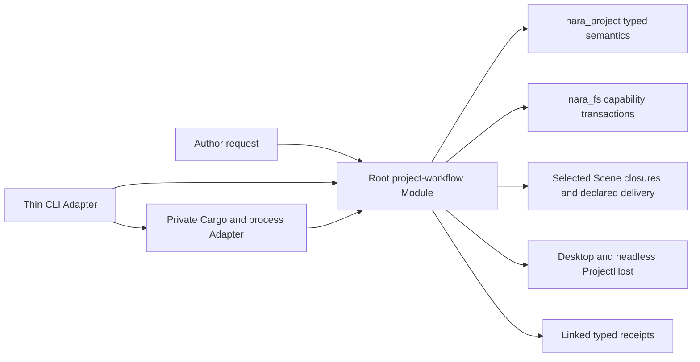

# ADR 0110: First-Party Project Workflow and Source-Carrying Export

**Status**: Accepted
**Date**: 2026-08-14
**Amended**: 2026-08-14 by the FPER implementation-readiness review for profile-bound runtime
lineages, capability-derived local dependency relations, parent-owned cross-process evidence,
creation terminality, build-input freshness and startup-closure ownership
**Amended**: 2026-10-16 by the First 2D Author Workflow for repository-external local projects
**Amended**: 2026-10-21 by finite declared Scene delivery for the persistent two-level consumer
**Amended**: 2026-10-21 by explicit complete-frame headless execution
**Amended**: 2026-10-30 by finite authored Scene data capture and original Product travel admission
**Amended**: 2026-10-31 by explicit Cargo selection and captured executable ownership
**Amended**: 2026-10-31 by finite cooked-content assembly and captured Player package binding
**Amended**: 2026-11-01 by explicit physical event-loop custody across sequential desktop actions
**Owner**: root product workflow, `nara_project`, `nara_fs`, project content and Runtime Hosts
**Refines**: [ADR 0020](0020-project-layout-and-package-format.md),
[ADR 0035](0035-project-manifest-and-runtime-settings-authority.md),
[ADR 0070](0070-capability-oriented-filesystem-substrate.md), and
[ADR 0079](0079-root-product-capabilities-and-placeholder-domain-retirement.md)
**Related proposals**: [ADR 0083](0083-durable-project-asset-and-document-entity-identity.md),
[ADR 0086](0086-rust-project-build-and-executable-generation.md),
[ADR 0088](0088-target-build-cook-package-and-runtime-content-catalog.md),
[ADR 0090](0090-unavailable-schema-and-lossless-authoring.md), and
[ADR 0091](0091-editor-persistence-recovery-and-concurrent-writer-policy.md)
**Implementation Plans**: [Capability Directory Publication Foundation](../../plans/2026-08-14-001-refactor-capability-directory-publication-foundation-plan.md)
and [Fresh Project, Source-Carrying Export, and Explicit Repair](../../plans/2026-08-14-002-feat-fresh-project-source-carrying-export-and-repair-plan.md)

## Context

Nara can ingest, run and package the Reference Game, but it has no first-party product entry that
creates an ordinary project in an authorized destination. A new author must understand Cargo
features, product capabilities, schema composition, product recipes and project layout before the
first run. Existing Reference Game Python tools package one fixed project and cannot become the
generic project-creation or export authority.

The first real creation workflow also needs two failure-sensitive operations that existing product
code cannot safely reproduce: old-or-absent directory publication and an explicit repair after the
selected startup Scene is moved. ADR 0070 already reserves the directory primitive and requires
typed guarantee tiers. Proposed artifact, asset-identity and recovery ADRs describe stronger future
systems, but none is accepted authority for this first workflow.

The decision must therefore make a useful product without claiming that Nara already owns complete
project inventory, cooked runtime catalogs, automatic asset identity recovery or lossless unknown
schema editing.

## Decision

Nara adopts one first-party `desktop-2d/v1` starter and one root project-workflow Module. The Module
owns concrete creation, check, source-carrying declared-content export and startup-selection repair
transactions. A thin CLI owns argument parsing and terminal rendering; a separate private
Cargo/process Adapter owns invocation and JSON artifact selection. Future Editor UI may call the
same Module, but no Editor dependency or contribution seam is added by this decision.

### Explicit Cargo Selection And Captured Build Results

The compiled native build Host selects package, binary, Cargo profile, target triple,
default-feature policy, requested features and actual Cargo/rustc tools explicitly. Cargo
metadata owns the selected manifest/package/target and its workspace-level feature observation.
The selected `compiler-artifact` supplies actual compiled features, which can differ from that
observation. Cargo decides target eligibility, including dependency-qualified `required-features`;
Nara does not implement feature closure or infer code enablement from product profile labels. Build-only
target artifacts are separate from native product qualification, Host activation and Runtime
Ready. A foreign-target build can finish without an available runner and must not execute
its output on the build Host.

The pure selection/invocation/incremental decoder belongs to `project_workflow::cargo`. Native
finite execution belongs to `project_tooling::cargo_build`; the Editor keeps its supervised
process and cancellation owner while consuming the same facts. Remove fixed desktop decoder
types and duplicate artifact selectors. Starter defaults remain explicit adapter policy:
the closed source Export still selects its two roles, while other trusted callers may select
custom package/bin/profile/features independently of that starter.

The native build result captures exact selected executable bytes, digest/length, actual tool
observations, requested/resolved features and a finite declared-input revision. Original Cargo
paths are transient facts, never immutable output authority or persisted public diagnostics.
Each captured result remains unchanged if Cargo overwrites its original output. Source Export
owns those captured bytes through staging rather than reopening a mutable Cargo output file.
Its native product observations and exact source/startup agreements remain separately required.

Failed Cargo compilation also preserves actual process status, bounded structured diagnostics
with explicit truncation/loss facts and any protocol rejection. A nonzero exit does not discard
the already captured machine stream before interpreting its diagnostics. Raw output remains
temporary under the same work admission; escaped failure summaries use retained allowance.
Unconfirmed physical child cleanup keeps its separate original custody.

Every build uses an existing lockfile with `--locked`. Initial creation of a starter lockfile
is an explicit Cargo authoring action before build, not an unlocked-build fallback. The Host
revalidates its selected input inventory before/after work and at return, including manifest,
lock and selected target source. This proves its stated per-file envelope, not simultaneous
workspace capture, hermetic compilation or interception of ambient trusted build-script,
proc-macro, configuration/native-tool/environment inputs. Exact inventory and unsupported
inputs remain visible in provenance. The
[implementation plan](../../plans/2026-10-31-explicit-cargo-build-selection-plan.md) owns actual
consumer/native qualification; this contract selection alone does not mark that work complete.

This bounded refinement extracts explicit target builds from Proposed ADR 0086. General target
activation/last-good records, complete packaged Player delivery, remote runners and executable
hermeticity remain separate. It introduces no new package resolver, universal exporter,
execution kernel, ABI or Runtime Cargo dependency.

### Finite Cooked Player Delivery

The finite delivery owner composes already verified artifact groups, concrete Scene/Input/
TileSet encoders and the original Runtime catalog/base admission. Required and Reference edges
both impose delivery membership; their Immediate/Deferred semantics govern current preparation.
Complete pre-publication deep validation is distinct from authenticated demand-time pack reads.
Every delivered member must belong to that validated closure; surplus group members reject unless
explicitly selected through actual roots or dependencies. A validation report for fewer members
cannot qualify a larger package. Native resource publication and gameplay effects remain separate.
The assembler owns deterministic portable member facts and explicit allocation bounds, not source
import execution, a universal cooker, a build scheduler or another Runtime loader.

Cooked content is fixed before the selected Player build. A bounded generated Rust input carries
an independently expected catalog digest/length, content target/profile and relative pack location.
The trusted Player explicitly compiles and uses that input with its own selected recipe. The
package binder finds its exact canonical relative path in captured Cargo provenance and compares
digest/length with this content preparation. It compares the complete expected Cargo package,
binary, profile, target, default-feature policy and requested features; actual compiled features
and tool observations remain separate recorded facts. Cargo and content profiles stay independent.
The Player does not accept a manifest or argument that overrides its compiled expectation.
This is a trusted implementation contract, not proof that arbitrary code consumed the input,
hermetic compilation, global freshness or remote authenticity. The catalog never includes the final
executable digest; the delivery manifest records both afterward, without a digest cycle.

One package owner stages exact captured executable bytes, the original admitted v1 pack and a
bounded delivery manifest through existing capability-relative directory publication. Success
means complete directory publication with its actual durability evidence. Errors preserve clean
rejection, orphaned candidate or unresolved begin outcomes; no recursive name-based cleanup is
introduced. Original code/content captures remain valid independently of mutable build/cache paths.
The compiled Host retains its complete finite content observation/selection envelope and controls
current-selection fences before/after Cargo, before staging and immediately before publication.
Code inputs and content observations remain separate. Package bounds include their own retained
content, generated input, captured executable/provenance, encoding metadata and each admitted
next-owner work promise. Shared allocations retain original leases; equal digests do not merge
independent copies. Pack writing is streamed, with an independently computed expected digest and
exact staged-file verification. Memory/work and staged disk-byte bounds are distinct.

`package.json` uses the shared canonical version-one `player_package` envelope and is complete
before directory publication. Physical filesystem receipts remain in the external return value,
not a postpublication manifest rewrite. No callback failure after
publication can erase the publication receipt. Delivery does not activate a Host, promote last-good,
or qualify a foreign target. Extra native libraries require explicit finite members before support
is claimed; output-directory scanning cannot discover a package closure.

This adopts only the consumed local single-Player/base-pack boundary from Proposed ADR 0088.
Source-carrying Export remains available. Reusable prebuilt Player trust, patch/mount-set services,
general remote execution and target-runner qualification remain separate. The
[cooked Player plan](../../plans/2026-10-31-cooked-player-delivery-plan.md) owns implementation and
actual consumer qualification; selecting this contract alone does not mark it complete.

### Starter and dependency authority

- `desktop-2d/v1` is a closed, source-controlled starter. One creation request produces matching
  generated binaries, Cargo features, `nara.toml` capabilities, ProductRecipe, built-in schema and
  initial content. Starter member bytes are compiled into the workflow Module rather than discovered
  through a runtime checkout-relative path. The generated Cargo manifest declares its own
  `[workspace]` with resolver `3`, preventing accidental membership in an ancestor checkout workspace.
  The starter CLI exposes no per-layer override surface.
- Existing direct-App and advanced product-composition Interfaces remain independent code-first
  authorities and are not narrowed by project creation.
- Dependency distribution is a separate typed fact. Local creation names the selected Nara checkout
  and destination parent relative to one authorized common-ancestor directory capability. Both
  endpoints are derived in that same capability session and revalidated before staging and after
  publication. The workflow derives the relative Cargo path from these coordinates and the future
  child, rather than accepting a caller-supplied native or Cargo path as proof. The CLI resolves its
  explicit native arguments to this relation; cross-volume roots or an inaccessible common ancestor
  fail before publication without an absolute dependency fallback. An immutable Git URL plus exact
  revision remains the portable alternative. Branch heads and implicit network fallback are
  forbidden. A local-path project is explicitly location-bound.
- Starter version, manifest schema version, Scene envelope version and Nara dependency identity are
  distinct receipt facts.

### Filesystem transaction authority

- Project creation and export use ADR 0070's capability-relative same-parent directory publication.
  Product code owns the finite member plan and validates every member before publication;
  `nara_fs` alone owns native directory creation, source/parent proof, atomic no-replace naming,
  sync facts and cleanup/orphan outcomes.
- Version-one strict handle-bound publication is Windows x86-64 on a runtime-proven local NTFS
  parent. Linux x86-64 kernel 5.6+ on a runtime-proven local ext4 parent is supported only under the
  `TrustedLocal` cooperative-writer tier: the parent/mount and destination no-overwrite facts are
  proven, while source binding remains explicitly `NameBound`.
- Unsupported or unproven filesystems fail before staging. No implementation falls back to an
  ambient path, destination precheck followed by rename, overwrite or unsafe recursive cleanup.
- Publication receipts separate source binding, parent authorization, conflict protection,
  atomicity, identity evidence and durability progress. They prove externally atomic visibility,
  not universal crash durability.
- Creation success is distinct from directory publication. The workflow reopens the published tree
  through ordinary project authority; failure retains the directory and publication receipt as
  published-but-unadmitted, and only successful admission creates a creation success receipt.

### Check, runtime and export authority

- Created projects use the ordinary
  `ingest_project_manifest -> product closure -> ProjectContentLoader -> ProjectHost` path. There is
  no starter-only loader or hidden provider list.
- Version one is complete-schema-only. Missing providers or unknown manifest/schema fields fail
  closed for check, repair and export.
- Desktop and presentation-free headless binaries consume the same manifest byte digest,
  ProductRecipe, schema composition and startup-source content digest. Each product retains its own
  profile-bound `ProjectSettingsLineage`; neither lineage is presented as the other's identity. A
  bounded desktop verification mode requires an exact first-party presented receipt matching the
  admitted startup content and live backend generation within a product-owned timeout, uses the real
  Winit/WGPU path and exits through normal App/Host shutdown; initialization alone or a test-private
  presenter cannot satisfy product evidence.
- A caller may transfer one explicitly owned native event loop between fully retired desktop
  actions. Source and processed actions retain their normal independent recipe, Schema, content
  and residency admission. Only terminal cleanup returns the physical loop; incomplete native
  retirement retains it. A source failure before native startup preserves an unused supplied loop.
  This is sequential process-local hosting, not live replacement of content or execution authority.
- The project-content owner produces a bounded `ProjectContentClosureReceipt` for one explicitly
  selected Scene and its required dependencies. Selection does not change manifest or settings
  lineage, and the snapshot binds the selected Scene path. `StartupContentClosureReceipt` is
  available only for the effective default Scene and remains the executable startup agreement.
- Project-wide `[content] scenes` declares at most 64 additional Scene paths relative to the
  effective `paths.scenes`. Startup is an implicit root; duplicate explicit entries and invalid
  paths reject. Profiles may change the directory or startup selection, but not this global list.
- Source Scene references capture a finite data closure through the same source owner and
  production Prefab compiler. Self-edges, back-edges and diamonds visit each canonical Scene
  once; the structural Prefab cycle rules remain independent. Raw authored documents, effective
  compiled candidates, actual reader bindings and source/metadata receipts retain distinct facts.
  The immutable source-content owner keeps the flat dependency documents alive through escaped
  `SceneSource` values; it creates no dependency Worlds or recursive Scene owners. Only the
  requested root is instantiated. An original primary Scene Product request resolves real
  metadata in preparation, then separately requires startup or declared-root admission.
  Dependency membership alone cannot authorize travel. Ready publication uses the original
  request, captured source, exact plan/context and complete current Scene receipt without another
  source discovery pass.
- Strict Check validates startup and every declared Scene with the same bounded loader. It returns
  a separate `ProjectContentDeliveryReceipt`: sorted roots, exact deduplicated member facts and a
  delivery digest, bound to one project, manifest and schema authority. Differing kind/digest facts
  for the same path reject. The owner loads roots sequentially and independently charges retained
  union facts, without keeping all decoded Scene/Image values or generation leases resident.
- Export consumes the delivery receipt and reopens every exact member through `nara_fs`; it does
  not rediscover dependencies. Pre-staging and pre-publication revalidation cover the complete
  union. Startup product observations remain distinct from the delivery plan and do not prove
  that a later Scene has already been activated. Source receipts are bounded observations, not a
  simultaneous filesystem snapshot or runtime-residency grant.
- Exact Cargo artifacts are selected from one `cargo build --locked` JSON stream by invocation,
  workspace/manifest, package, binary target, triple, named profile and normalized features. A private
  build-input revision binds the closed five-file inventory: `Cargo.toml`, `Cargo.lock`,
  `src/lib.rs`, `src/bin/headless.rs` and `src/bin/desktop.rs`; changed captured inputs reject
  export before publication. Cargo compiles ordinary modules and local dependency crates without
  an engine-owned Rust resolver. This additional observation does not capture every module,
  local dependency, build-script, environment or procedural-macro input. Executable digests own
  the actual delivered runtime bytes; neither `--locked` nor this revision freezes all sources.
- A build receipt revalidates its executable startup observations against the current manifest,
  startup content, closure plan, authoring bundle and schema fingerprint. Fresh Check results
  cannot retarget an earlier build observation to changed startup content merely because Rust
  inputs and executable bytes remain unchanged. A change exclusive to another declared Scene
  does not require claiming that the executable already activated that Scene.
- The artifact is a **source-carrying declared-content export**: selected executables plus an
  executable-relative `project/` tree for startup and explicitly declared Scene roots. It may contain
  source manifests, Scene/Prefab documents, images, metadata and schema facts. It does not claim to
  contain undeclared and unreferenced project content, and it is neither a complete
  project backup nor a cooked/source-free catalog. ADR 0088 remains Proposed.
- The unreleased compiled-project tool protocol uses canonical version 1 and reports
  `content_members` for Check and Export. Superseded startup-only and string-failure response
  shapes reject; no compatibility reader is retained.
- Compiled-tool failure preserves a read-only operation/stage classification, bounded safe domain
  code/severity/summary records and explicit upstream/projection loss through bootstrap and public
  callers. CLI formatting is a sink, not the public result contract. General diagnostic fields,
  arbitrary Error/Debug/source strings and runtime capability identities are not transported.
  The [failure projection design](../compiled-project-failure-projection-design.md) specifies
  eight records, 96-byte codes, 256-byte UTF-8 summaries, 16 KiB encoded failures and the separate
  64 KiB stdout ceiling. A narrow missing-startup hint reuses existing project-relative and public
  identifier admission, counts withheld values and preserves a selected profile or an explicit
  placeholder. It grants no repair authority. JSON outcome and process exit must agree in both
  directions; diagnostic omission never turns an operation failure into success.
- Static projection preserves the owning physical outcome: Schema refresh distinguishes
  rejected/failed/uncertain publication from independent pending cleanup; published Repair
  distinguishes failed Check from changed prepared facts or incomplete publication evidence.
  Repair content failures reuse the bounded report projection. The admitted repair hint is
  publicly inspectable without parsing terminal prose and has no unbounded deserialization API.
- Schema refresh replaces the selected compiled recipe's owner declarations while retaining
  complete admitted current/predecessor catalogs for every existing owner absent from that recipe.
  Project-adopted metadata is not disposable generated output. Compose the complete successor
  through Reflect's ordinary bounded bundle admission, including reserved/tombstone claims;
  collisions or invalid existing bundles refuse before publication, including explicit write.
  Missing bundles may be created from the recipe. Check remains read-only and successful
  no-change refresh keeps the existing leaf. Retained metadata grants neither a native binding
  nor executable approval. Owner removal and value migration require separate explicit operations.
- All member and source-change validation precedes directory publication. Process acceptance occurs
  afterward. A published candidate that fails acceptance remains present and is reported as
  published-but-unaccepted; no rollback or in-place acceptance retry is claimed.

### Compiled source-domain members

ADR 0103's source-domain refinement lets the same compiled recipe prepare typed CPU content for
Check and Play. The project Host records primary sources, metadata and domain-reported auxiliary
sources in the existing closure receipt. Delivery union and Export digest revalidation consume
these members without a new exporter registry, domain parser invocation during Export, or weaker
build agreement. A source-domain extension does not gain authority to construct build receipts.
See the [public guide](../../guides/project-asset-domains.md) and
[qualification](../../plans/2026-10-21-external-asset-domain-qualification-plan.md).

### Explicit repair authority

- The first repair operation handles only a stale `startup.default_scene` selection after the
  selected Scene is moved. The replacement is an author-supplied logical path relative to the
  effective `paths.scenes` directory.
- A diagnostic issue is session-scoped evidence, not portable mutation authority. A separate repair
  command reruns the authoritative check under its current project capability before preparing the
  manifest mutation; cross-process evidence links persistent manifest/content digests and the parent
  attempt identity instead of serializing capability or settings-lineage identities.
- Repair does not infer a rename, preserve an asset stable ID, search candidates, move metadata,
  rewrite arbitrary references or perform Fix All.
- `nara_project` owns pure typed manifest mutation and deterministic serialization of every modeled
  field. Version one guarantees semantic preservation of modeled fields only. Unknown fields fail
  closed; comments, field order and original formatting are not preserved.
- First-party manifest writers use the existing exclusive cooperative lock. The repair validates
  the expected manifest identity/digest, replacement Scene digest and complete startup closure,
  then publishes through `nara_fs`. The receipt reports the actual replacement proof tier and does
  not claim strong compare-and-swap against non-cooperating writers.
- A fresh authoritative check follows manifest publication. If the project no longer matches the
  prepared Scene/closure facts, the result is published-but-not-repaired, not a success receipt.

### Headless execution

Headless product actions select exact fixed transactions or complete managed frames explicitly.
`HeadlessRunIntent::new` retains exact stepping: entering that mode performs paused maintenance,
then each step executes one fixed transaction. It does not collect ordinary local gameplay input
or run normal frame updates. `HeadlessRunIntent::frames` drives the existing Runtime/App frame
transaction with a supplied real delta, including TaskUpdate and PreUpdate. App-owned time scale,
clamping, debt and catch-up policy remain authoritative; a frame may contain zero or multiple fixed
ticks. A zero delta still permits frame maintenance. Async Scene consumers use complete frames.

The selected tick/frame count bounds scheduled iterations, not wall-clock execution or filesystem
latency. Terminal predicates and exit requests are observed after a completed iteration; reaching
the bound without a required terminal match reports the corresponding tick/frame limit and uses
the same retained cleanup owner. This does not change Editor exact-step semantics in ADR 0039.

### Evidence authority

The [selected reference-demand successor](../reference-validity-and-load-demand-design.md)
distinguishes current startup preparation from strict saved-source validation/delivery. Both
Immediate and Deferred mandatory references participate in complete Check/Export, including
dependency-only targets. A resolved Deferred source binding alone cannot certify its payload or
auxiliary Products. Retain separate immediate startup and full delivery observations, actual
production compiler/importer checks, bounded disposal and exact receipt revalidation. This is
implemented under the [CP3 plan](../../plans/2026-10-30-reference-validity-and-load-demand-plan.md),
with [strict delivery/publication qualification](../../knowledge/engineering/verification/2026-10/2026-10-30T172312Z-reference-validity-and-current-demand-production-replacement-qualification-b16511fa33a74c2b808270394b28bf62.md).
The preceding finite eager-source evidence keeps its original scope; target cooking and packaged
Player execution remain separate.

Product validation uses one parent-owned machine-readable trajectory. The parent workflow issues
one trajectory identity and predecessor-bound attempt identity for each child process, then accepts
an observation only when it matches the exact executable digest, manifest digest, product profile
and startup-content digest that the parent validated. Session-scoped filesystem identities remain
local evidence and are never presented as cross-process identity. Create, manifest, closure,
desktop, headless, Cargo artifact, export, issue, repair and re-export receipts must consume their
exact predecessors. Independent fixtures or hashes cannot be combined to manufacture a complete
workflow. The generated project includes a minimal public author guide; command count and completion
time are observed without becoming frozen SLAs.

## Alternatives Considered

### Option A: Generalize the Reference Game Python package tools

**Pros**: Reuses existing archive and smoke orchestration.

**Cons**: Those tools own one fixed layout and would need to duplicate Rust manifest, schema,
content-closure and capability semantics. They would become a second product authority.

**Decision**: Rejected. They remain fixed historical fixtures.

### Option B: Implement a complete cooked/source-free export first

**Pros**: Closer to a final shipping artifact and simpler runtime reads.

**Cons**: Requires the still-unaccepted artifact catalog, mount, dynamic content, cook and recovery
contracts from ADR 0088 and related proposals before Nara has a fresh-project workflow.

**Decision**: Rejected for version one. The source-carrying startup closure is the honest current
product boundary.

### Option C: Copy a static starter and leave Cargo/product choices to the author

**Pros**: Very small implementation.

**Cons**: Preserves the exact usability failure: Cargo features, manifest capabilities, recipe and
schema can diverge before first run, and no typed receipt identifies the chosen dependency source.

**Decision**: Rejected. The starter request owns one closed product plan.

### Option D: Build a generic template/export/repair plugin framework

**Pros**: Appears extensible and could host future products.

**Cons**: There is one first-party starter, one Cargo Adapter, one export shape and one repair case.
Registries, erased providers and callbacks would freeze speculation instead of hiding complexity.

**Decision**: Rejected. Concrete deep Modules precede generalization.

## Consequences

- Nara gains an author-facing project entry and delivery/recovery trajectory without changing
  Runtime Host, ECS, Scene/Prefab or UI ownership.
- The root facade gains one cohesive project-workflow Module. CLI, Cargo and process details remain
  private Adapters; `nara_project` and `nara_fs` stay lower-level owners.
- Local-path starters support sibling and descendant development projects on a usable shared
  filesystem, but remain location-bound. Immutable Git sources cover portable creation without
  inventing a package registry.
- Version-one export is intentionally narrower than complete project packaging. Dynamic content or
  full project inventory must create new evidence before broadening the claim.
- Manifest repair may canonically reformat modeled TOML and rejects unknown fields. Lossless opaque
  editing remains an ADR 0090 question.
- Linux directory publication has a weaker, explicit source-binding tier than Windows. The product
  does not translate that into a broad boolean safety claim.

## Success Metrics

- One public command creates a normal project with zero manual Cargo/manifest/recipe alignment edits.
- One linked product trajectory reaches desktop, headless, export, arbitrary-CWD execution, typed
  failure, explicit repair and re-export.
- Pre-publication failures produce zero partial or overwritten final destinations.
- No Reference Game identity, Python product policy, template registry, exporter SPI, generic
  importer or repair callback bus enters the project-workflow public Interface.
- Export and repair evidence never claims complete-project, cooked, automatic-rebind, lossless
  unknown-schema or strong non-cooperative-CAS semantics.

## Risks and Mitigations

- **Risk: the root workflow becomes a shallow coordinator.** Keep concrete transaction state and
  typed outcomes in one deep Module; prove a minimal non-CLI consumer and keep process/toolkit types
  private.
- **Risk: dependency selection becomes a package manager or trusts an ambient path.** Admit only a
  capability-proven common-ancestor local relation or immutable Git source with one closed value type;
  add no resolver/provider registry and accept no caller-authored local Cargo path.
- **Risk: startup closure is mistaken for full export.** Use the precise product name, member receipt
  and negative dynamic/unreferenced-content tests; ADR 0088 remains Proposed.
- **Risk: Linux proof is overstated.** Bind receipt facts to the runtime parent/mount and preserve
  `NameBound` plus `TrustedLocal`; do not claim handle-bound strict source identity.
- **Risk: repair silently loses data or races content.** Reject unknown fields, guarantee only
  semantic preservation of modeled fields, use cooperative locking, bind exact digests and require
  a post-publication authoritative check.
- **Risk: one workflow creates too many generic seams.** Public-inventory review rejects template,
  exporter, build, process and diagnostic registries until a second real workflow demonstrates
  duplicated policy.
