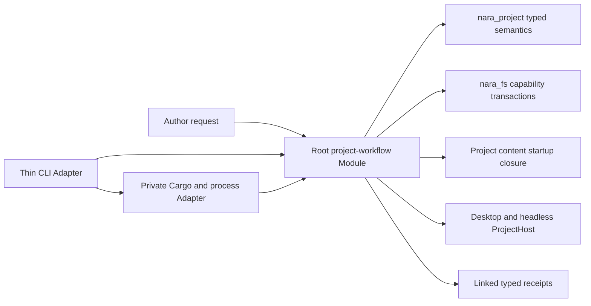

# ADR 0110: First-Party Project Workflow and Source-Carrying Export

**Status**: Accepted
**Date**: 2026-08-14
**Amended**: 2026-08-14 by the FPER implementation-readiness review for profile-bound runtime
lineages, capability-derived local dependency relations, parent-owned cross-process evidence,
creation terminality, build-input freshness and startup-closure ownership
**Owner**: root product workflow, `nara_project`, `nara_fs`, project content and Runtime Hosts
**Refines**: [ADR 0020](0020-project-layout-and-package-format.md),
[ADR 0035](0035-project-manifest-and-runtime-settings-authority.md),
[ADR 0070](0070-capability-oriented-filesystem-substrate.md), and
[ADR 0079](0079-root-product-capabilities-and-placeholder-domain-retirement.md)
**Related proposals**: [ADR 0083](0083-durable-project-asset-and-document-entity-identity.md),
[ADR 0086](0086-rust-project-build-and-executable-generation.md),
[ADR 0088](0088-target-build-cook-package-and-runtime-content-catalog.md),
[ADR 0090](0090-unavailable-schema-and-lossless-authoring.md), and
[ADR 0091](0091-editor-persistence-recovery-and-concurrent-writer-policy.md)
**Implementation Plans**: [Capability Directory Publication Foundation](../../plans/2026-08-14-001-refactor-capability-directory-publication-foundation-plan.md)
and [Fresh Project, Source-Carrying Export, and Explicit Repair](../../plans/2026-08-14-002-feat-fresh-project-source-carrying-export-and-repair-plan.md)

## Context

Nara can ingest, run and package the Reference Game, but it has no first-party product entry that
creates an ordinary project in an authorized destination. A new author must understand Cargo
features, product capabilities, schema composition, product recipes and project layout before the
first run. Existing Reference Game Python tools package one fixed project and cannot become the
generic project-creation or export authority.

The first real creation workflow also needs two failure-sensitive operations that existing product
code cannot safely reproduce: old-or-absent directory publication and an explicit repair after the
selected startup Scene is moved. ADR 0070 already reserves the directory primitive and requires
typed guarantee tiers. Proposed artifact, asset-identity and recovery ADRs describe stronger future
systems, but none is accepted authority for this first workflow.

The decision must therefore make a useful product without claiming that Nara already owns complete
project inventory, cooked runtime catalogs, automatic asset identity recovery or lossless unknown
schema editing.

## Decision

Nara adopts one first-party `desktop-2d/v1` starter and one root project-workflow Module. The Module
owns concrete creation, check, source-carrying startup-closure export and startup-selection repair
transactions. A thin CLI owns argument parsing and terminal rendering; a separate private
Cargo/process Adapter owns invocation and JSON artifact selection. Future Editor UI may call the
same Module, but no Editor dependency or contribution seam is added by this decision.

### Starter and dependency authority

- `desktop-2d/v1` is a closed, source-controlled starter. One creation request produces matching
  generated binaries, Cargo features, `nara.toml` capabilities, ProductRecipe, built-in schema and
  initial content. Starter member bytes are compiled into the workflow Module rather than discovered
  through a runtime checkout-relative path. The generated Cargo manifest declares its own
  `[workspace]` with resolver `3`, preventing accidental membership in an ancestor checkout workspace.
  The starter CLI exposes no per-layer override surface.
- Existing direct-App and advanced product-composition Interfaces remain independent code-first
  authorities and are not narrowed by project creation.
- Dependency distribution is a separate typed fact. Version one accepts either an authorized local
  Nara checkout whose destination parent is proven as a descendant of that checkout capability, or
  an immutable Git URL plus exact revision. The workflow Module derives the Cargo path from the
  capability-relative descendant relation and future child name; it never accepts a caller-supplied
  native or Cargo path as proof. Absolute checkout paths, branch heads and implicit network fallback
  are forbidden. A local-path project is explicitly location-bound.
- Starter version, manifest schema version, Scene envelope version and Nara dependency identity are
  distinct receipt facts.

### Filesystem transaction authority

- Project creation and export use ADR 0070's capability-relative same-parent directory publication.
  Product code owns the finite member plan and validates every member before publication;
  `nara_fs` alone owns native directory creation, source/parent proof, atomic no-replace naming,
  sync facts and cleanup/orphan outcomes.
- Version-one strict handle-bound publication is Windows x86-64 on a runtime-proven local NTFS
  parent. Linux x86-64 kernel 5.6+ on a runtime-proven local ext4 parent is supported only under the
  `TrustedLocal` cooperative-writer tier: the parent/mount and destination no-overwrite facts are
  proven, while source binding remains explicitly `NameBound`.
- Unsupported or unproven filesystems fail before staging. No implementation falls back to an
  ambient path, destination precheck followed by rename, overwrite or unsafe recursive cleanup.
- Publication receipts separate source binding, parent authorization, conflict protection,
  atomicity, identity evidence and durability progress. They prove externally atomic visibility,
  not universal crash durability.
- Creation success is distinct from directory publication. The workflow reopens the published tree
  through ordinary project authority; failure retains the directory and publication receipt as
  published-but-unadmitted, and only successful admission creates a creation success receipt.

### Check, runtime and export authority

- Created projects use the ordinary
  `ingest_project_manifest -> product closure -> ProjectContentLoader -> ProjectHost` path. There is
  no starter-only loader or hidden provider list.
- Version one is complete-schema-only. Missing providers or unknown manifest/schema fields fail
  closed for check, repair and export.
- Desktop and presentation-free headless binaries consume the same manifest byte digest,
  ProductRecipe, schema composition and startup-source content digest. Each product retains its own
  profile-bound `ProjectSettingsLineage`; neither lineage is presented as the other's identity. A
  bounded desktop verification mode requires an exact first-party presented receipt matching the
  admitted startup content and live backend generation within a product-owned timeout, uses the real
  Winit/WGPU path and exits through normal App/Host shutdown; initialization alone or a test-private
  presenter cannot satisfy product evidence.
- The project-content owner produces the exact bounded `StartupContentClosureReceipt`: ordered logical
  paths, member kinds, byte lengths, digests, source/content revision and manifest/schema facts. Export
  consumes that receipt and reopens bytes through `nara_fs`; it does not rediscover dependencies.
- Exact Cargo artifacts are selected from one `cargo build --locked` JSON stream by invocation,
  workspace/manifest, package, binary target, triple, named profile and normalized features. A private
  build-input revision binds the application Cargo manifest, `Cargo.lock` and generated Rust sources;
  stale inputs reject export before publication.
- The artifact is a **source-carrying startup-closure export**: selected executables plus an
  executable-relative `project/` tree sufficient for the admitted startup path. It may contain
  source manifests, Scene/Prefab documents, images, metadata and schema facts. It does not claim to
  contain unreferenced or dynamically requested project content, and it is neither a complete
  project backup nor a cooked/source-free catalog. ADR 0088 remains Proposed.
- All member and source-change validation precedes directory publication. Process acceptance occurs
  afterward. A published candidate that fails acceptance remains present and is reported as
  published-but-unaccepted; no rollback or in-place acceptance retry is claimed.

### Explicit repair authority

- The first repair operation handles only a stale `startup.default_scene` selection after the
  selected Scene is moved. The replacement is an author-supplied logical path relative to the
  effective `paths.scenes` directory.
- A diagnostic issue is session-scoped evidence, not portable mutation authority. A separate repair
  command reruns the authoritative check under its current project capability before preparing the
  manifest mutation; cross-process evidence links persistent manifest/content digests and the parent
  attempt identity instead of serializing capability or settings-lineage identities.
- Repair does not infer a rename, preserve an asset stable ID, search candidates, move metadata,
  rewrite arbitrary references or perform Fix All.
- `nara_project` owns pure typed manifest mutation and deterministic serialization of every modeled
  field. Version one guarantees semantic preservation of modeled fields only. Unknown fields fail
  closed; comments, field order and original formatting are not preserved.
- First-party manifest writers use the existing exclusive cooperative lock. The repair validates
  the expected manifest identity/digest, replacement Scene digest and complete startup closure,
  then publishes through `nara_fs`. The receipt reports the actual replacement proof tier and does
  not claim strong compare-and-swap against non-cooperating writers.
- A fresh authoritative check follows manifest publication. If the project no longer matches the
  prepared Scene/closure facts, the result is published-but-not-repaired, not a success receipt.

### Evidence authority

Product validation uses one parent-owned machine-readable trajectory. The parent workflow issues
one trajectory identity and predecessor-bound attempt identity for each child process, then accepts
an observation only when it matches the exact executable digest, manifest digest, product profile
and startup-content digest that the parent validated. Session-scoped filesystem identities remain
local evidence and are never presented as cross-process identity. Create, manifest, closure,
desktop, headless, Cargo artifact, export, issue, repair and re-export receipts must consume their
exact predecessors. Independent fixtures or hashes cannot be combined to manufacture a complete
workflow. The generated project includes a minimal public author guide; command count and completion
time are observed without becoming frozen SLAs.

## Alternatives Considered

### Option A: Generalize the Reference Game Python package tools

**Pros**: Reuses existing archive and smoke orchestration.

**Cons**: Those tools own one fixed layout and would need to duplicate Rust manifest, schema,
content-closure and capability semantics. They would become a second product authority.

**Decision**: Rejected. They remain fixed historical fixtures.

### Option B: Implement a complete cooked/source-free export first

**Pros**: Closer to a final shipping artifact and simpler runtime reads.

**Cons**: Requires the still-unaccepted artifact catalog, mount, dynamic content, cook and recovery
contracts from ADR 0088 and related proposals before Nara has a fresh-project workflow.

**Decision**: Rejected for version one. The source-carrying startup closure is the honest current
product boundary.

### Option C: Copy a static starter and leave Cargo/product choices to the author

**Pros**: Very small implementation.

**Cons**: Preserves the exact usability failure: Cargo features, manifest capabilities, recipe and
schema can diverge before first run, and no typed receipt identifies the chosen dependency source.

**Decision**: Rejected. The starter request owns one closed product plan.

### Option D: Build a generic template/export/repair plugin framework

**Pros**: Appears extensible and could host future products.

**Cons**: There is one first-party starter, one Cargo Adapter, one export shape and one repair case.
Registries, erased providers and callbacks would freeze speculation instead of hiding complexity.

**Decision**: Rejected. Concrete deep Modules precede generalization.

## Consequences

- Nara gains an author-facing project entry and delivery/recovery trajectory without changing
  Runtime Host, ECS, Scene/Prefab or UI ownership.
- The root facade gains one cohesive project-workflow Module. CLI, Cargo and process details remain
  private Adapters; `nara_project` and `nara_fs` stay lower-level owners.
- Local-path starters are useful for descendant source-checkout development but intentionally
  location-bound. Immutable Git sources cover portable creation without inventing a package
  registry.
- Version-one export is intentionally narrower than complete project packaging. Dynamic content or
  full project inventory must create new evidence before broadening the claim.
- Manifest repair may canonically reformat modeled TOML and rejects unknown fields. Lossless opaque
  editing remains an ADR 0090 question.
- Linux directory publication has a weaker, explicit source-binding tier than Windows. The product
  does not translate that into a broad boolean safety claim.

## Success Metrics

- One public command creates a normal project with zero manual Cargo/manifest/recipe alignment edits.
- One linked product trajectory reaches desktop, headless, export, arbitrary-CWD execution, typed
  failure, explicit repair and re-export.
- Pre-publication failures produce zero partial or overwritten final destinations.
- No Reference Game identity, Python product policy, template registry, exporter SPI, generic
  importer or repair callback bus enters the project-workflow public Interface.
- Export and repair evidence never claims complete-project, cooked, automatic-rebind, lossless
  unknown-schema or strong non-cooperative-CAS semantics.

## Risks and Mitigations

- **Risk: the root workflow becomes a shallow coordinator.** Keep concrete transaction state and
  typed outcomes in one deep Module; prove a minimal non-CLI consumer and keep process/toolkit types
  private.
- **Risk: dependency selection becomes a package manager or trusts an ambient path.** Admit only a
  capability-proven descendant local relation or immutable Git source with one closed value type;
  add no resolver/provider registry and accept no caller-authored local Cargo path.
- **Risk: startup closure is mistaken for full export.** Use the precise product name, member receipt
  and negative dynamic/unreferenced-content tests; ADR 0088 remains Proposed.
- **Risk: Linux proof is overstated.** Bind receipt facts to the runtime parent/mount and preserve
  `NameBound` plus `TrustedLocal`; do not claim handle-bound strict source identity.
- **Risk: repair silently loses data or races content.** Reject unknown fields, guarantee only
  semantic preservation of modeled fields, use cooperative locking, bind exact digests and require
  a post-publication authoritative check.
- **Risk: one workflow creates too many generic seams.** Public-inventory review rejects template,
  exporter, build, process and diagnostic registries until a second real workflow demonstrates
  duplicated policy.
