# ADR 0111: Editor Scene View Execution and Picking Authority

**Status**: Accepted
**Date**: 2026-08-16
**Last Revised**: 2026-11-01 (native compositor facts and immutable interaction mapping)
**Owner**: Editor Host, `nara_render`, and `nara_render_wgpu`
**Refines**: [ADR 0017](0017-render-graph-policy.md),
[ADR 0040](0040-render-resource-lifetime-and-submitter-ownership.md),
[ADR 0078](0078-render-host-affinity-webgpu-initialization-and-device-recovery.md),
[ADR 0094](0094-minimal-render-execution-boundary-and-evidence-gated-extensions.md),
[ADR 0105](0105-closed-first-party-render-plan.md), and
[ADR 0107](0107-shared-ui-foundation-and-independent-product-layers.md)
**Refined By**: [ADR 0112](0112-editor-game-view-runtime-presentation-and-input-authority.md)
**Current Unit**: [Render Composition And Host Execution](../../plans/2026-10-31-render-composition-and-host-execution-plan.md)
**Selected Design**: [Render Host Ownership And Production Transition](../render-host-ownership-design.md), implementation step3
**Current Implementation Evidence**: [Immutable outputs, owned producers and original native prefixes](../../knowledge/engineering/verification/2026-10/2026-10-31T121248Z-immutable-render-outputs-owning-producers-and-original-native-prefix-qualification-1b4de7f4305740698abba87b589f9459.md)
and [shared stock composition with actual native Scene effects](../../knowledge/engineering/verification/2026-11/2026-11-01T013746Z-shared-stock-composition-original-captures-and-native-scene-effects-qualification-2f250ecb33b24b5091f28a141cd6b244.md)
**Historical Implementation Plan**: [Editor Scene Composition and Scene View v1](../../plans/2026-08-16-1440-feat-editor-scene-view-and-composition-plan.md)
**Historical Initial Implementation**: `1f97c48` (`feat(editor): establish scene view gpu execution`)
**Historical Completed Implementation**: `f99de44` (`feat(editor): prove scene authoring trajectory`)
**Historical Implementation Evidence**: [ESV-U1 Editor Scene View execution contract](../../knowledge/engineering/verification/2026-08/2026-08-16T084916Z-esv-u1-editor-scene-view-execution-contract-1de9903b1b7b4623a0633b2a6565e0b0.md),
[ESV-U3 through ESV-U5 Scene View product conformance](../../knowledge/engineering/verification/2026-08/2026-08-16T121124Z-esv-u3-through-esv-u5-scene-view-product-conformance-b8ad1393f7f945b3984d9847b37cc7ba.md)

The October 31 revision accepts the output, display and retirement contracts below before their
step3 implementation. The historical evidence qualifies its original workflow, not immutable
outputs, producer-local completion, no-surface execution or recovery. Responsibility names here
do not freeze replacement Rust API names. Proposed [ADR 0121](0121-composable-render-programs-and-host-execution.md)
remains Proposed; this revision does not qualify or accept its graph/Feature contract.

## Context

The historical first native Editor replaced `egui_wgpu::winit::Painter`, which hid a second WGPU
lifetime, with one private `WgpuEditorExecution`. Its fixed Scene-image-to-window transaction
resolved the original OQ-001/OQ-022 tracer without requiring a public graph. That implementation
reused one writable texture and admitted only its latest submission receipt.

The current Dear toolkit adapter shares Nara's device authority and joins actual texture bindings
with window presentation. Independent Scene, Canvas and Game consumers now require different
capture rates, retained predecessor pixels and producer retirement while another view progresses.
Cloning a view of the reusable texture preserves its allocation, but later writes change its
pixels. A target configuration generation therefore cannot identify a retained output version.
Image-level sample deduplication also cannot distinguish two displays of the same pixels when
only one is allowed to complete interaction.

## Decision

The native Editor Host owns the concrete render Host and its toolkit renderer. One device owner
serves independently admitted producers, immutable image outputs and exact display occurrences.
Target configuration, output storage, interaction authority and submitted-work retirement have
separate lifetimes. `EditorProjectSession` remains renderer-neutral and owns no native window,
surface, GPU object or toolkit texture registration. It may retain backend-neutral content and
geometry presentation facts without acquiring native submission or display authority.

A published image retains the exact selected program-resource owner, including its original
semantic/color interpretation, allocation guard and epoch facts. Reducing a complete publication
to its image does not discard that meaning or retain the whole program, scratch, reports or CPU
capture. A typed read-only lease from the image must match that original semantic marker; it cannot
relabel final composite as Scene color. The ordinary program import then applies the same original
Host/epoch, descriptor, budget and submission rules. This enables retained Scene-image composition
and numeric observation through declared Features without another readback or native submitter API.

```mermaid
flowchart LR
    Snapshot[Accepted edit-world snapshot]
    Candidate[Exact producer capture]
    Output[Publish immutable output lease]
    Display[Select exact output for a display occurrence]
    Toolkit[Bind occurrence and sample exact output]
    Window[Submit and present destination window]
    Composite[Exact output and occurrence composite receipt]
    Pick[Revision-bound pick action]

    Snapshot --> Candidate --> Output --> Display --> Toolkit --> Window --> Composite
    Composite --> Pick
```

### One execution authority

Scene and authoring Canvas capture construction may select a typed renderer through the shared
stock boundary in [ADR0094](0094-minimal-render-execution-boundary-and-evidence-gated-extensions.md#shared-stock-program-construction).
Each accepted input retains its original definition and captured parameters. The Scene candidate
retains exact geometry/provenance for picking independently of the renderer's capture type; a
default-policy downcast is not picking authority. Effects preserve the selected mapping contract,
and a materially different geometric mapping needs its own explicit tooling support. This does not
grant a generic data-only Editor permission to execute arbitrary project Rust.

- One concrete render Host owns the instance, adapter, device, queue, epochs, admitted targets,
  serialized native submissions and actual completion custody. Runtime, Editor and offscreen
  consumers use that same device and stock drawing implementation; no second offscreen backend
  or GPU owner inside a gameplay World is introduced.
- Normal device initialization can start without any surface, hidden window or event loop. A later
  window is checked against the selected live adapter before configuration. Incompatibility causes a
  target-local refusal or explicit Host reconstruction requirement, not silent replacement of a
  healthy device used by another producer. Offscreen GPU execution is distinct from content-only
  Headless execution.
- The toolkit renderer, currently Dear, is private adapter state bound to this Host and epoch. Its
  scoped native operations obey the Host's resource and submission protocol. The adapter cannot
  independently select another device authority. This contract also applies to Nara-drawn
  composition without requiring an embedded toolkit.
- Raw WGPU values do not enter `EditorProjectSession`, `EditorFrameModel`, Editor actions,
  persistent documents, or public gameplay-facing APIs.

### Configuration admission and producer identity

Target configuration remains a two-phase prepare/commit operation. Preparation validates the
exact source, target descriptor and Host/epoch, and admits a private allocation. The inactive
reservation exposes no published pixels, toolkit image registration, composite or input route.
After all fallible configuration work, a matching reservation can be activated by an infallible
owner-local commit. This admission does not promise that a future draw, output registration or
window present will succeed. Future toolkit image bindings belong to actual published outputs
and their display occurrences, never to an unrendered configuration reservation.

One accepted disposable Scene projection binds its document/revision, omission facts, identity
domain and render-source generation together. Reserve the producer generation when its preview
owner is installed, before any Scene publication. A rejected projection cannot relabel last-good.
The same preview owner retains its producer and monotonic frame stream across Scene identity
epochs, source switches and image-only refresh. Scene, Canvas and Game may coexist with independent
producer clocks and outputs; there is no global Scene-or-Game slot or one-image allocation limit.
Concrete product capacity remains explicitly bounded and qualified by its consumers.

- Producer replacement, Scene identity epochs, configuration generations, physical output versions,
  toolkit bindings and composite presentations are distinct lifetimes. Stable configuration does
  not imply stable pixels. Repainting unchanged content may reuse an output without new drawing.
- A producer's successful admission watermark advances only when its output publishes after
  successful native submission admission in the current epoch. Preparation, a rejected attempt or
  a failed submit cannot consume that successful-publication watermark. Attempts retain exact
  capture identity; one producer's frame index never advances another's clock.
- Stock `RenderFramePacket` retains exactly one tagged `Window` or `Image` target. A target names
  the drawing destination configuration; it does not confer ownership of previously generated
  pixels or restrict the number of independently retained outputs or display occurrences.
- Packet producer identity is `RenderFrameSourceGeneration`. Managed runtimes retain their opaque
  `RuntimeGeneration`; the private Editor receives a separate process-local generation and never
  creates a fake runtime merely to render edit state.
- Output format, extent, usages and initialized content are admitted facts. This ownership decision
  does not authorize unimplemented formats, resource accesses or an unbounded target catalogue.

### Immutable outputs and exact display receipts

Each successfully published output owns immutable physical texture/view storage with a Host-issued
identity binding Host, device epoch, non-reused producer incarnation, capture, logical output slot
and non-reused output version. A successor cannot overwrite a retained predecessor's storage.
An output lease keeps its exact pixels alive and charged through producer advancement, resize or
close. These changes may revoke interaction or default display selection without invalidating a
retained output's passive sampling authority in its live epoch. Device loss revokes that authority.

Composition receives the exact output lease. A latest-output choice resolves once at composite
admission and pins that version. Neither a receipt lookup through the current target nor a cloned
native handle substitutes for the lease. Ordinary sampling is Host-validated and grants no writable
target. Exact-WGPU adapters remain trusted native Rust and obey the immutable-import protocol;
native handle cloning alone is not a type-system proof against undeclared writes.

Each display admission combines a Host-issued, non-reused occurrence selecting one exact output
with the compositor's immutable destination, placement, clip, DPI/content mapping and interactive
or passive role. Each toolkit external binding
is associated with one occurrence. Two same-window mirrors of the same output must be distinguishable
in actual draw dependencies; image equality and window filtering are insufficient. Changing the
selected output or mapping requires newly admitted occurrence facts rather than silently retargeting
an existing binding.

The native Host's `WgpuImageDisplay` owns only the exact output and occurrence. Its
`WgpuImageCompositeReceipt` proves the trusted compositor registered that occurrence's actual,
non-fully-clipped sample in the returned window presentation. The compositor/interaction owner
retains an immutable destination, placement, clip, DPI/content mapping, role and external-binding
snapshot with that occurrence, and joins that original snapshot with the Host receipt. It cannot
substitute the current mapping or use one occurrence for two independently positioned mirrors.
Changing destination/mapping/role admits a new occurrence. The Host neither parses command buffers
nor proves shader inverses; the same split applies to Nara-drawn composition without a toolkit.

The serialized display transaction is:

1. publish or retain the exact submitted output;
2. admit its display occurrence and register the corresponding toolkit binding;
3. verify actual, non-clipped drawing samples that occurrence's exact binding and output;
4. submit and present the actual destination window;
5. issue the Host sample/present receipt, then join it to the original immutable compositor mapping
   and binding snapshot before granting interaction authority.

Image publication does not count as surface presentation or physical GPU completion. A missing
lease, unsampled occurrence, revoked epoch or mismatched destination cannot establish a composite.
A valid retained predecessor is not stale merely because a newer output exists. Redisplaying it
does not advance producer publication or history and does not create a new UI completion permit.

Scene picking retains the accepted candidate's geometry and binds document revision, preview
generation, exact output version, occurrence/mapping, toolkit binding, actual window presentation
and Host/epoch. A candidate has no input authority before this composite join. An invalidated
presentation cannot regain input authority through a content-cache hit; restoring identical
last-good content requires fresh accepted presentation authority. Scene identity epoch replacement
retains the shared task/image owner required by ADR 0115; it is not full Runtime replacement.

Scene image and picking receipts identify the Host's retained Scene preview binding and that
document's exact revision in the same immutable frame, not the active Inspector document (which
may be a Prefab or extension). Showing a retained inactive Scene does not grant selection or
mutation authority: geometry input is disabled until that Scene is explicitly active. Switching
to an ordinary Prefab must not invalidate an otherwise current Scene receipt merely by comparing
it with the Prefab identity. Closing the bound source without another explicit binding retires its
default display and input authority; it must not silently select another retained Scene. Separate
consumers may keep passive output leases. UI Prefab Canvas preserves its own authority and priority,
retaining the displayed candidate's compiled hit geometry and exact document/revision/gesture
identity. An old output never authorizes picking or mutation against a newer source revision.

### Submission custody, producer close and reconstruction

Reserve native submitted-prefix custody before attempting submission, with no post-submit allocation
needed to retain the actual textures, buffers and imported Image versions. Record custody within
the same serialized native submission segment, conservatively retaining uses after a failed submit
attempt. Successful output publication and physical custody are independent: failure cannot publish
an output, advance its history or successful watermark, but cannot erase possible native uses.
Telemetry configuration, sample capacity and missing observation data do not determine retirement.

Producer close stops new admission, settles original one-shot UI obligations through their original
owners, then freezes that producer's submitted prefix. Close completes when that frozen prefix
physically completes while other producers may continue submitting. Retained outputs remain alive
and charged to their actual consumers after producer close. Whole-queue drain belongs to final
Host shutdown, not routine view or producer close. Device loss revokes authority without inventing
physical completion; original native custody survives namespace cleanup as required by ADR 0078.

Reconstruction inputs are retained explicitly and independently of GPU output lifetime. Recovery
uses the exact immutable CPU capture facts or same-generation decode custody and creates new-epoch
outputs and display bindings. It does not resolve current source/assets as the meaning of an old
capture, reuse old GPU history or replay UI completion permissions. Once those original inputs are
released, recovery reports unavailable even if an old output lease remains held.

### Failure and replacement

- Resize or target-local invalidation replaces the affected configuration and revokes incompatible
  display/input facts. It does not overwrite or release separately retained output versions or
  retire another producer.
- Surface timeout, occlusion, outdated state and surface loss remain target-local outcomes. They
  establish no successful composite for the affected occurrence, even if its output or a passive
  mirror was successfully rendered elsewhere.
- Device loss or backend unavailability revokes old-epoch output, registration, composite and
  input authority. Owner reconstruction preserves the authoritative Editor document/session and
  original native retirement responsibilities; new Ready does not validate old receipts. Toolkit
  GPU state is recreated under the selected replacement owner/epoch.
- Native execution may remain serial with synchronous native initialization. ADR 0078 continues
  to require browser-async initialization; this decision neither mandates a render thread nor
  introduces async work into the authoritative Editor document domain.

### Scope and qualification

The original OQ-001 fixed-edge resolution remains historical evidence for its tracer. This revision
accepts explicit output/display/custody ownership for the named step3 consumers without selecting
the graph, external Feature or alternate policy contract of Proposed ADR 0121. The current unit
owns that subsequent comparison and qualification.

OQ-022's Editor device ownership remains selected. ADR 0112 specializes Game completion/input and
ADR 0114 owns the standalone supervised placement. Coexisting views and passive mirrors do not
grant arbitrary project code loading, a remote transport or an unlimited number of Play runtimes.
Step3 still requires actual no-window drawing/readback/close, retained A1/A2 pixels, A retirement
while B progresses, designated-display UI completion, picking, and loss/recovery qualification
through the current unit. Historical tests do not establish these new outcomes.

## Alternatives Considered

### Retain the historical independent toolkit GPU owner

Rejected. The original Painter concealed a second device/surface lifecycle and prevented exact
Scene-to-window epoch joins. Toolkit selection does not change this ownership requirement.

### Reuse one writable texture with latest-receipt validation

Superseded for retained-output consumers. This supported the historical serial latest-only tracer,
but neither its target generation nor a cloned view preserves predecessor pixels. It also couples
display validity to producer progress and close.

### Give edit, Play and offscreen consumers separate backends

Rejected for this shared-device workflow. Edit preview remains derived state rather than a fake
Runtime. Separate backends duplicate Ready/loss/retirement and prevent direct exact-version imports.

### Share exact outputs and distinguish display occurrences

Accepted. Immutable storage, original submission custody and occurrence-specific sampling support
the actual retained Scene/Canvas/Game consumers. Graph/Feature API selection remains separately
Proposed and must not be inferred from this ownership decision.

## Consequences

- Configuration reservations and toolkit output registrations become separate operations. Each
  retained output costs actual physical storage until its leases and native uses are released.
- Scene, Canvas and Game presenters and toolkit registrations retain exact output leases. Their
  input decisions continue using original document/runtime and displayed geometry gates.
- A displayed output may outlive its producer; its lifetime does not keep that producer's UI
  permissions or input route alive. Independent producer retirement does not drain the whole Host.
- The historical tracer used image then window submissions. New submission/registration and
  retention costs must be measured through the selected consumers; the old count is not a fixed
  scheduler contract or a performance claim for step3.
- No compatibility reader, old latest-target path or second backend is required for this unreleased
  engine. Names and public extension policy remain owned by the selected implementation and its
  separate qualification.

## Success Metrics

The following are required step3 evidence, not completed qualification claims.

| Metric | Target | Required evidence |
|---|---:|---|
| Device authorities per shared Host | 1 | Runtime/Editor/no-surface consumers use the same owner and stock drawing path |
| Hidden windows or event loops required for no-surface boot | 0 | Normal Ready, real drawing/readback, later-window validation and close |
| Targets per `RenderFramePacket` | exactly 1 | packet construction tests |
| Image submissions reported as surface presents | 0 | separate image and window receipts |
| Retained predecessor pixels changed by producer advance, resize or close | 0 | Different A1/A2 pixels retained and actually sampled |
| Composites lacking the exact output, occurrence and destination presentation | 0 | Real same-window mirrors, clipped/unsampled and foreign-epoch refusal |
| Picks admitted from mismatched document, output or mapping | 0 | Retained inactive Scene, bound-source Close and displayed Canvas geometry traces |
| Successful-publication watermark advances on failed attempts | 0 | Native validation/submission failure and exact-capture retry traces |
| Whole-queue drains required to close one producer | 0 | Frozen A prefix completes while B continues submitting |
| Recovery through current stores or replayed UI permissions | 0 | Original inputs retained independently; released-input recovery unavailable |
| Runtime packets requiring Editor preview identity | 0 | distinct closed producer generations |

## Risks and Mitigations

| Risk | Severity | Mitigation |
|---|---|---|
| A new frame overwrites pixels held by an older output | Critical | Distinct immutable physical versions and composition through exact leases. |
| A passive mirror completes another display's interaction | Critical | One Host-issued occurrence per binding and an exact designated completion join. |
| Failed submission loses resource custody or advances publication | Critical | Pre-reserve original native prefix custody and keep it independent of logical success and telemetry. |
| Producer close stalls unrelated views or frees retained output | High | Freeze and await only its prefix; keep output leases independently owned and charged. |
| Device replacement revives old pixels as interaction authority | Critical | Revoke the old epoch; reconstruct only exact retained inputs into new identities. |
| Trusted native access mutates an immutable import | High | Enforce the Host import/encoding protocol; do not treat native handle cloning as a sandbox. |
| Preview rendering silently becomes Play | High | Preserve the independent preview producer and document/geometry gates. |
