# ADR 0111: Editor Scene View Execution and Picking Authority

**Status**: Accepted
**Date**: 2026-08-16
**Owner**: Editor Host, `nara_render`, and `nara_render_wgpu`
**Refines**: [ADR 0017](0017-render-graph-policy.md),
[ADR 0040](0040-render-resource-lifetime-and-submitter-ownership.md),
[ADR 0078](0078-render-host-affinity-webgpu-initialization-and-device-recovery.md),
[ADR 0094](0094-minimal-render-execution-boundary-and-evidence-gated-extensions.md),
[ADR 0105](0105-closed-first-party-render-plan.md), and
[ADR 0107](0107-shared-ui-foundation-and-independent-product-layers.md)
**Implementation Plan**: [Editor Scene Composition and Scene View v1](../../plans/2026-08-16-1440-feat-editor-scene-view-and-composition-plan.md)
**Initial Implementation**: `1f97c48` (`feat(editor): establish scene view gpu execution`)
**Completed Implementation**: `f99de44` (`feat(editor): prove scene authoring trajectory`)
**Implementation Evidence**: [ESV-U1 Editor Scene View execution contract](../../knowledge/engineering/verification/2026-08/2026-08-16T084916Z-esv-u1-editor-scene-view-execution-contract-1de9903b1b7b4623a0633b2a6565e0b0.md),
[ESV-U3 through ESV-U5 Scene View product conformance](../../knowledge/engineering/verification/2026-08/2026-08-16T121124Z-esv-u3-through-esv-u5-scene-view-product-conformance-b8ad1393f7f945b3984d9847b37cc7ba.md)

## Context

The first native Editor can edit and persist a startup Scene, but it previously used
`egui_wgpu::winit::Painter`, which created and hid a second WGPU lifetime outside Nara's render
authority. A Scene View needs one offscreen image target whose exact submitted generation is then
sampled by egui before the Editor window is presented. It must not make the Editor Domain own GPU
objects, treat edit preview as a Play runtime, or introduce a general RenderGraph merely because
the first concrete cross-target edge now exists.

This workflow triggered OQ-001 and OQ-022. The implementation tracer demonstrated that the
workflow fits a smaller model: two one-target submissions serialized by one private execution
owner, with one fixed dependency edge and one exact composite receipt.

## Decision

The private `NativeEditorHost` owns one `WgpuEditorExecution` and one egui renderer bound to that
execution's backend instance and device epoch. `EditorProjectSession` remains renderer-neutral and
owns no window, surface, WGPU, egui texture, or presentation receipt.

```mermaid
flowchart LR
    Snapshot[Accepted edit-world snapshot]
    Candidate[One image-target RenderFramePacket]
    SceneSubmit[Submit Scene image]
    ImageReceipt[Submitted image receipt]
    Egui[Register and sample exact texture generation]
    Window[Submit and present Editor window]
    Composite[Composite presented receipt]
    Pick[Revision-bound pick action]

    Snapshot --> Candidate --> SceneSubmit --> ImageReceipt --> Egui --> Window --> Composite
    Composite --> Pick
```

### One execution authority

- `WgpuEditorExecution` owns the Editor window surface, one Scene image texture, instance, device,
  queue, target generations, submission order, and composite presentation generation.
- The low-level egui renderer is private Editor product state. It may borrow scoped Device/Queue
  access only while the execution owner is driving one operation; it cannot create another
  instance, adapter, device, queue, or surface.
- The existing runtime WGPU path remains window-only. It rejects image packets rather than
  implicitly becoming a multi-target runtime scheduler.
- Raw WGPU values do not enter `EditorProjectSession`, `EditorFrameModel`, Editor actions,
  persistent documents, or public gameplay-facing APIs.

### One-target packets and producer identity

- `RenderFramePacket` contains exactly one tagged `Window` or `Image` target.
- Window packet behavior remains unchanged. An image packet names one exact `RenderImage2d`
  handle and a non-zero origin-aligned physical extent.
- Packet producer identity is `RenderFrameSourceGeneration`. Managed runtimes retain their opaque
  `RuntimeGeneration`; the private Editor receives a separate process-local generation and never
  creates a fake runtime merely to render edit state.
- The admitted Editor image descriptor is fixed to `Rgba8Unorm` with
  `RENDER_ATTACHMENT | TEXTURE_BINDING`. Broader format, usage, target catalogs, or public viewport
  descriptors require a later consumer and decision.

### Fixed transaction and exact receipt

The execution order is fixed and serialized:

1. submit one Scene image packet;
2. bind that image target generation to one egui texture registration generation;
3. verify the tessellated egui frame samples that exact texture identity;
4. submit and present the Editor window;
5. construct a composite receipt only after all prior steps succeed in the same backend
   instance/device epoch.

Image submission does not count as a surface present. A missing, stale, unsampled, foreign-epoch,
or retired image receipt cannot advance the composite presentation generation. Future picking
must bind document revision, preview generation, image target generation, texture registration
generation, window surface generation, backend instance, device epoch, and composite presentation
generation. A current candidate is display work, not input authority, until the composite receipt
exists.

### Failure and replacement

- Resize or target-local invalidation retires only the Scene image target and its egui binding. A
  replacement receives a strictly newer target and texture-registration generation in the same
  live backend namespace.
- Surface timeout, occlusion, outdated state, and loss remain target-local outcomes. They do not
  publish a composite receipt.
- The current WGPU backend's device-loss state is terminal. Device loss or backend unavailability
  replaces the complete `WgpuEditorExecution`, egui renderer/context, and GPU bindings. The Editor
  document/session remains live, and no receipt from the old backend instance/epoch is reusable.
- This native first implementation is synchronous at its private WGPU initialization boundary.
  It does not change ADR 0078's browser-async requirements or introduce an async Editor domain.

### Scope of OQ resolution

OQ-001 is resolved only for this first fixed cross-target workflow. The selected answer is direct
serialized ordering inside one deep private module, not a graph. A future history resource,
computed dependency set, or independent multi-target schedule that cannot fit this fixed edge must
open a new focused question and ADR.

OQ-022 is resolved for the edit-world Scene View: the Editor Host owns the shared device domain and
private targets. This does not decide future Game View/Play placement, multiple isolated runtime
views, detached windows, public renderer replacement, or third-party exact-WGPU access.

## Alternatives Considered

### Keep egui Painter as an independent GPU owner

Rejected. It hides a second device/surface lifecycle, prevents exact Scene-to-window epoch joins,
and makes device recovery split across unrelated owners.

### Give each edit or Play runtime an independent renderer

Rejected for Scene View. Edit preview is derived from the accepted document and is not a runtime.
Independent devices also prevent cheap, exact sampling of the Scene target in the Editor window.
Future Game View placement remains a separate decision.

### Add a public RenderGraph or generic multi-target scheduler

Rejected. The observed dependency is one static edge with no computed resource lifetime or
external topology consumer. A graph would expose substantially more policy than this workflow
requires.

### Use one private fixed execution transaction

Accepted. It closes ownership, target, epoch, ordering, and recovery without expanding the public
renderer topology.

## Consequences

- The private Editor no longer depends on Painter-owned GPU lifecycle or its `winit` feature.
- `nara_render` now admits one exact image target and distinguishes managed-runtime and private
  preview producer generations without exposing Editor domain state.
- The Editor performs two queue submissions for the fixed tracer/Scene transaction: image first,
  window second. This cost is explicit and may be measured before any optimization.
- Scene View composition, preview materialization, camera control, and picking remain later units
  of the same product plan. This ADR fixes their authority and receipt boundary, not their widget
  design.
- Game View, docking, multi-window, RenderGraph, async render workers, and public exact-WGPU access
  remain outside this decision.

## Success Metrics

| Metric | Target | Evidence |
|---|---:|---|
| GPU authorities in one Editor window | 1 | `WgpuEditorExecution` and removal of Painter |
| Targets per `RenderFramePacket` | exactly 1 | packet construction tests |
| Image submissions reported as surface presents | 0 | separate image and window receipts |
| Composite receipts without exact image sample and window present | 0 | exact-join tests and native tracer |
| Runtime packets requiring Editor preview identity | 0 | distinct closed producer generations |
| Public RenderGraph/Viewport/target registry types added | 0 | API and diff review |

## Risks and Mitigations

| Risk | Severity | Mitigation |
|---|---|---|
| The private callback becomes ambient raw-WGPU interop | High | Keep it doc-hidden, scoped, first-party, and owned by the fixed Editor execution; require a separate ADR for external access. |
| A stale egui texture survives resize or device replacement | Critical | Bind texture registration to target generation plus backend instance/epoch and retire the binding with its owner. |
| The fixed edge grows into an implicit graph | High | Admit only Scene image then Editor window; a second computed edge requires a new focused decision. |
| Preview rendering silently becomes Play | High | Use an independent preview source generation and keep runtime lifecycle/state out of the Scene View owner. |
| Device replacement loses transient toolkit state | Medium | Replace egui renderer/context with the GPU owner while preserving the authoritative Editor session and document. |
