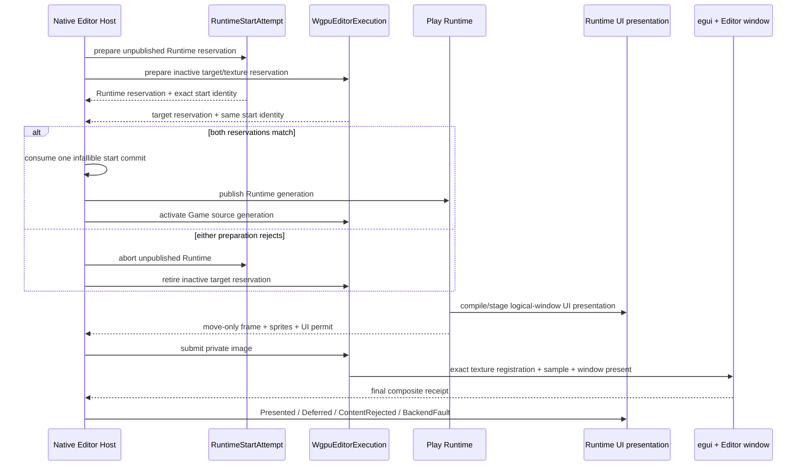

# ADR 0112: Editor Game View Runtime Presentation and Input Authority

**Status**: Accepted
**Date**: 2026-08-16
**Last Revised**: 2026-08-18
**Owner**: Editor Host, executable Runtime owner, Runtime UI presentation, `nara_render`, and
`nara_render_wgpu`
**Refines**: [ADR 0108](0108-ui-surface-presented-session-and-atomic-interaction.md),
[ADR 0109](0109-root-local-ui-compilation-and-presentation-closure.md), and
[ADR 0111](0111-editor-scene-view-execution-and-picking-authority.md)
**Refined By**: [ADR 0114](0114-standalone-generic-editor-authoring-and-execution-boundary.md)
**Related**: [ADR 0034](0034-editor-play-mode-world-boundary.md),
[ADR 0076](0076-play-runtime-debug-control-and-observation.md),
[ADR 0082](0082-process-host-authority-and-runtime-construction-topology.md),
[ADR 0084](0084-executable-runtime-ownership-and-isolation.md), and
[ADR 0107](0107-shared-ui-foundation-and-independent-product-layers.md)
**Implementation Plan**: [Editor Game View v1](../../plans/2026-08-16-2157-feat-editor-game-view-v1-plan.md), EGV-U1 through EGV-U5
**Initial Implementation**: `8942bbb` (`feat(editor): establish game view presentation authority`)
**Completed Implementation**: `b5697f3` (`feat(editor): prove embedded Game View workflow`)
**Implementation Evidence**: [EGV-U1 Game View presentation authority](../../knowledge/engineering/verification/2026-08/2026-08-16T172400Z-egv-u1-game-view-presentation-authority-ee246fd4862d4f0fb06423f9f6bbd9a0.md),
[EGV-U5 embedded Game View product conformance](../../knowledge/engineering/verification/2026-08/2026-08-17T100847Z-egv-u5-embedded-game-view-product-conformance-9d0b0a17beef4c39bea70a8d6f025455.md)

## Context

ADR 0111 proved one private Scene-image-to-egui-to-Editor-window transaction under one
`WgpuEditorExecution`. The Editor also owns an isolated in-process Play Runtime, but that Runtime
currently has no product-visible output inside the Editor. A Game View must connect these existing
owners without giving Play another native window or GPU, exposing its `World`, or inventing a
general RenderGraph or target registry.

The first Game View must preserve Runtime UI as well as sprites. Runtime UI is compiled and routed
against one logical primary window, stages exact interaction and receipt authority before backend
submission, and requires every move-only backend permit to reach exactly one terminal outcome. The
Editor image is therefore an execution detail, not a replacement UI Surface identity.

Play startup also crosses two independently fallible owners: `RuntimeStartAttempt` prepares the
unpublished Runtime, while the native Editor GPU owner prepares the target and texture
registration. Publishing either side before the other is admitted would leave a runnable Runtime
without its promised Game product or a target with no owning Runtime.

This decision selects the first bounded in-process placement. ADR 0114 later retains that placement
as an explicitly trusted first-party Adapter while selecting a supervised project process as the
ordinary standalone Editor product boundary. OQ-039 remains open for the exact local transport,
crash-isolated or remote placement contract, and OQ-040 continues to own live edit.

## Decision

The private Editor Host owns one fixed Game View bridge between one managed Play Runtime and the
existing single Editor GPU execution. The bridge preserves logical-window producer identity,
transfers one move-only renderer-neutral candidate, and returns exact presentation outcomes. Only
the final Editor-window composite receipt may commit Runtime UI presentation or admit gameplay
input.

### Two-phase Game start admission

- `RuntimeStartAttempt` owns the unpublished Runtime reservation and its obligation ledger.
- `WgpuEditorExecution` owns one inactive target/texture-registration reservation. Preparation may
  allocate or configure private GPU state, but it exposes no active source, public texture ID,
  composite receipt or input route.
- Both reservations carry the same exact document revision, profile/recipe lineage, runtime
  generation, logical-window request, backend instance and device epoch.
- One private Host commit consumes both move-only reservations. All fallible work completes before
  this boundary; publication and target activation are infallible state swaps inside one Editor
  frame transaction.
- Rejection, identity mismatch or abandonment aborts both reservations. Scene View remains active,
  and no runnable Runtime or Game target becomes externally authoritative.

This specializes ADR 0082's inactive external reservations and ADR 0084's unpublished Runtime
publication for the first Game View. It does not create a public cross-domain transaction type.

### Private Play placement

The exact selected project profile remains the capability authority and the launching
`EditorProjectIntent` remains the recipe authority. A root-private Editor Play placement policy
branches before ordinary profile required-slot construction:

- Play installs its logical window, renderer-neutral sprite/UI producers and private Game bridge;
- the Editor Host externally owns native event-loop and GPU presentation requirements;
- WGPU backend/submitter, Winit runner and platform-accessibility required slots are never
  materialized inside Play and are not added then disabled;
- shipping desktop/headless plans and direct-App composition remain unchanged.

The generic `nara-editor` does not discover or load arbitrary project Rust code. A compiled
first-party product may call the private Editor entry with its already typed intent and recipe.

### Logical window and private image mapping

- Camera, Runtime UI Surface Slot, normalized input and renderer-neutral packets retain the
  profile's logical `WindowId::PRIMARY` and logical resolution.
- The active Game target is one private `RenderImage2d` owned by `WgpuEditorExecution`.
- Mapping the logical-window packet to that image occurs only inside the private Editor execution.
  No public `UiSurfaceEndpoint::Image`, image Surface catalogue or target aggregation is added.
- Scene Preview and Game Runtime are mutually exclusive source streams over one target slot.
  Handoff retires the predecessor target, texture registration, composite receipt, pending retry
  and input route before admitting the successor; a zero-target transition is valid.

### Move-only Runtime UI rendezvous

- A Game candidate binds runtime/source generation, logical-window frame identity, renderer-neutral
  frame and sprite work, and the exact prepared Runtime UI backend submission when installed.
- Runtime UI outcome capacity is reserved before the candidate leaves the Runtime. The Host returns
  exactly one terminal outcome before another candidate, replacement or Runtime retirement.
- `Presented` is committed only after exact image submission, matching egui texture sampling and
  successful Editor-window presentation in one backend instance/device epoch.
- `Deferred` returns the exact retry authority to the Runtime. Only that eligible identity may be
  reinstated and exported again; source/runtime/device supersession terminalizes it.
- Content rejection, target fault, device fault, Stop, Close, Exit and supersession consume or
  return every permit exactly once. Image-only success never mints a UI receipt.

### Presented authority and input

The Host composes one private Game presented stamp from the existing WGPU composite receipt plus
runtime generation, source revision, logical/render frame, geometry/content-transform generation
and committed Runtime UI receipt. It does not copy these fields into an independently advanceable
parallel receipt.

Gameplay input is admitted only against a compatible final Game stamp. A later unit may keep one
stable runtime/viewport/geometry/input-route capture lease across compatible receipt progression,
but stale, foreign, image-only, unpresented or retired generations fail closed. ADR 0108 continues
to own the Runtime UI session transaction and logical-window content transform.

### Failure and replacement

- Target-local resize, zero extent, deferral or content rejection retires or suspends only the Game
  target and presentation/input authority; a healthy Running Runtime may continue its bounded
  lifecycle cadence.
- Runtime fault remains a Runtime lifecycle outcome and never automatically restarts or writes back.
- Device loss replaces the whole Editor GPU owner, egui renderer/context and target registrations.
  No receipt or retry from the retired backend instance/device epoch is reusable.
- This first native implementation remains synchronous inside the private Editor event-loop/GPU
  transaction. It adds no async render worker and does not alter browser-async requirements.

### Scope of OQ resolution

OQ-039 remains open for the exact second-placement transport and session protocol. ADR 0114 selects
the supervised-process product boundary for ordinary standalone Editor execution, while this
in-process placement remains a private typed trusted Adapter rather than a public transport or
universal runtime session Interface. OQ-040 remains open; accepted edits make the active Runtime out
of date and require Restart unless the existing explicit, bounded Apply Changes path supports the
exact edit.

## Alternatives Considered

### Run the ordinary desktop product inside the Editor

Rejected. It would create another native window/event-loop/GPU owner or require unsafe ownership
sharing, and its window presentation receipt would not prove what the Editor window displayed.

### Ship sprite-only Game View first

Rejected. Runtime UI is an existing product capability with move-only presentation and input
authority. Omitting it would validate a bridge that immediately fails on the Reference Game.

### Add a public image UI endpoint, target registry or RenderGraph

Rejected. The observed topology is still one fixed source image sampled by one Editor window. A
public scheduler or image-Surface model exposes policy that no second consumer requires.

### Use one private fixed bridge with exact reservations and receipts

Accepted. It deepens the existing Host, Runtime UI and Editor GPU owners while keeping the new
placement narrow, failure-atomic and removable if later evidence selects a different topology.

## Consequences

- Play startup gains one private inactive target reservation and coordinated commit, but no public
  transaction abstraction.
- `WgpuEditorExecution` generalizes private Scene-specific naming to one active viewport source and
  retains capacity for at most one image target.
- Runtime UI gains one focused Host-external completion rendezvous while keeping its logical Surface
  Slot, prepared state, retry identity and exact receipt authority.
- The Editor pays one offscreen Game submission before its existing window submission. This cost is
  explicit and measured by the product canary before broader optimization.
- Child process, remote transport, live edit, multiple Game Views, relative mouse, gamepad and
  embedded platform accessibility remain separate trigger-gated work.

## Success Metrics

| Metric | Target | Evidence |
|---|---:|---|
| Partially published Runtime/target starts | 0 | reservation mismatch/failure tests |
| Native or WGPU owners inside Play Runtime | 0 | private placement and requested-subset tests |
| Active Scene-or-Game image targets | at most 1 | source-handoff and retirement tests |
| Runtime UI permits without one terminal outcome | 0 | outcome/retry/supersession tests |
| UI receipts or input routes from image-only success | 0 | exact composite join tests |
| Public RenderGraph, target registry or image Surface endpoint added | 0 | API and diff review |

## Risks and Mitigations

| Risk | Severity | Mitigation |
|---|---|---|
| Runtime publishes before target admission | Critical | Require matching move-only reservations and one infallible Host commit after all fallible work. |
| Private placement becomes a second product-composition authority | Critical | Branch before required-slot materialization while preserving exact normalized capability/profile/recipe lineage. |
| Runtime UI permit is stranded outside the Runtime | Critical | Reserve outcome capacity before export and require exactly one terminal return or explicit supersession. |
| Image submission is mistaken for visible authority | Critical | Commit UI/input only from the exact Editor-window composite receipt. |
| Logical window is rewritten into a public image endpoint | High | Keep Camera/UI/input identity logical-window based and map only inside private WGPU execution. |
| Fixed bridge grows into a general scheduler | High | Admit only one mutually exclusive Scene/Game source; require a new consumer and ADR for broader topology. |
