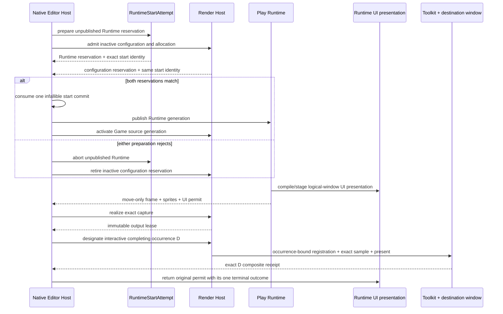

# ADR 0112: Editor Game View Runtime Presentation and Input Authority

**Status**: Accepted
**Date**: 2026-08-16
**Last Revised**: 2026-10-31
**Owner**: Editor Host, executable Runtime owner, Runtime UI presentation, `nara_render`, and
`nara_render_wgpu`
**Refines**: [ADR 0108](0108-ui-surface-presented-session-and-atomic-interaction.md),
[ADR 0109](0109-root-local-ui-compilation-and-presentation-closure.md), and
[ADR 0111](0111-editor-scene-view-execution-and-picking-authority.md)
**Refined By**: [ADR 0114](0114-standalone-generic-editor-authoring-and-execution-boundary.md)
**Related**: [ADR 0034](0034-editor-play-mode-world-boundary.md),
[ADR 0076](0076-play-runtime-debug-control-and-observation.md),
[ADR 0082](0082-process-host-authority-and-runtime-construction-topology.md),
[ADR 0084](0084-executable-runtime-ownership-and-isolation.md), and
[ADR 0107](0107-shared-ui-foundation-and-independent-product-layers.md)
**Current Unit**: [Render Composition And Host Execution](../../plans/2026-10-31-render-composition-and-host-execution-plan.md)
**Selected Design**: [Render Host Ownership And Production Transition](../render-host-ownership-design.md), implementation step3
**Current Implementation Evidence**: [Exact output/display completion and native owner qualification](../../knowledge/engineering/verification/2026-10/2026-10-31T121248Z-immutable-render-outputs-owning-producers-and-original-native-prefix-qualification-1b4de7f4305740698abba87b589f9459.md)
**Historical Implementation Plan**: [Editor Game View v1](../../plans/2026-08-16-2157-feat-editor-game-view-v1-plan.md), EGV-U1 through EGV-U5
**Historical Initial Implementation**: `8942bbb` (`feat(editor): establish game view presentation authority`)
**Historical Completed Implementation**: `b5697f3` (`feat(editor): prove embedded Game View workflow`)
**Historical Implementation Evidence**: [EGV-U1 Game View presentation authority](../../knowledge/engineering/verification/2026-08/2026-08-16T172400Z-egv-u1-game-view-presentation-authority-ee246fd4862d4f0fb06423f9f6bbd9a0.md),
[EGV-U5 embedded Game View product conformance](../../knowledge/engineering/verification/2026-08/2026-08-17T100847Z-egv-u5-embedded-game-view-product-conformance-9d0b0a17beef4c39bea70a8d6f025455.md)

The October 31 revision accepts the step3 Game output/display/completion contracts before their
implementation. Historical implementation and evidence retain their original single-slot,
latest-texture scope. They do not qualify immutable output retention, designated mirrors or
producer-local physical completion. Responsibility names do not freeze replacement Rust API names.
Proposed [ADR 0121](0121-composable-render-programs-and-host-execution.md) remains Proposed.

## Context

The historical ADR 0111 tracer proved one Scene-image-to-toolkit-to-window transaction under
`WgpuEditorExecution`. The original Game View joined an isolated in-process Play Runtime to that
owner without creating another native window or GPU. Later Editor consumers use the Dear toolkit
and independent Scene/Game views. The October 31 revision of ADR 0111 separates configuration,
immutable output versions, display occurrences and physical submitted-prefix custody.

Game View must preserve Runtime UI as well as sprites. Runtime UI is compiled and routed
against one logical primary window, stages exact interaction and receipt authority before backend
submission, and requires every move-only backend permit to reach exactly one terminal outcome. The
Editor image is therefore an execution detail, not a replacement UI Surface identity.

Immutable outputs may be retained and mirrored independently of Runtime progress or close. Two
displays can sample identical pixels while only one owns the Runtime UI completion rendezvous.
Comparing only an image receipt, even with a destination-window filter, cannot identify that
designated display when mirrors share a window.

Play startup still crosses two independently fallible owners: `RuntimeStartAttempt` prepares an
unpublished Runtime, while the render Host admits its inactive configuration and allocation.
Future output pixels and toolkit registrations cannot be promised by that configuration reservation.

## Decision

The private Editor Host connects its managed Play Runtime to the common render Host through the
existing finite candidate/completion bridge. The bridge preserves logical-window producer identity
and original one-shot permissions. Successful rendering publishes an immutable output lease. Only
the exact designated interactive display's final composite may complete Runtime UI presentation;
gameplay input additionally requires the original Runtime, source, geometry and mapping gates.
Passive output retention or another occurrence's presentation grants neither authority.

### Two-phase Game start admission

- `RuntimeStartAttempt` owns the unpublished Runtime reservation and its obligation ledger.
- The render Host owns an inactive configuration reservation with an admitted private allocation.
  Preparation validates and allocates configuration resources, but exposes no active source,
  published output, future toolkit image registration, composite receipt or input route.
- Both reservations carry the same exact document revision, profile/recipe lineage, runtime
  generation, logical-window request, backend instance and device epoch.
- One private Host commit consumes both move-only reservations. All fallible start/configuration
  work completes before this boundary; Runtime publication and configuration activation are
  infallible owner-local state swaps. Subsequent draw, output registration or present failure is
  a separate outcome and does not retroactively turn configuration admission into pixel publication.
- Rejection, identity mismatch or abandonment aborts both reservations without disturbing another
  live Scene/Canvas/Game producer. No partially admitted Runtime or Game configuration becomes
  externally authoritative.

This specializes ADR 0082's inactive external reservations and ADR 0084's unpublished Runtime
publication. It does not create a public cross-domain transaction type.

### Private Play placement

The exact selected project profile remains the capability authority and the launching
`EditorProjectIntent` remains the recipe authority. A root-private Editor Play placement policy
branches before ordinary profile required-slot construction:

- Play installs its logical window, renderer-neutral sprite/UI producers and private Game bridge;
- the Editor Host externally owns native event-loop and GPU presentation requirements;
- WGPU backend/submitter, Winit runner and platform-accessibility required slots are never
  materialized inside Play and are not added then disabled;
- shipping desktop/headless plans and direct-App composition remain unchanged.

The generic `nara-editor` does not discover or load arbitrary project Rust code. A compiled
first-party product may call the private Editor entry with its already typed intent and recipe.

### Logical window, independent producers and exact outputs

- Camera, Runtime UI Surface Slot, normalized input and renderer-neutral packets retain the
  profile's logical `WindowId::PRIMARY` and logical resolution.
- The render Host owns the admitted image configuration and immutable output storage. Mapping the
  logical-window packet to its image output is a private placement operation. It does not rewrite
  the logical UI Surface into a public image endpoint or add native GPU ownership to Play.
- Scene, Canvas and Game retain independent producers, capture/publication clocks and output leases
  under the same device owner. They may coexist and progress at different rates; they are not
  mutually exclusive streams over one global target slot. Concrete Runtime/view capacity is still
  bounded by admitted product workflows, not implicitly unlimited.
- Each published output identifies Host/epoch, producer incarnation, capture, logical output slot
  and non-reused output version, with immutable physical storage as defined by ADR 0111. Composition
  receives its exact lease, never a latest-target receipt lookup. A latest-output selection pins
  the selected version once at composite admission.
- Producer advancement, resize, source replacement or close cannot overwrite a retained output.
  Other consumers may keep sampling it passively in its live epoch. The original Runtime's input
  route, UI retry and completion authority are independently revoked or settled on supersession
  and close; the retained output cannot redirect them to a replacement Runtime.

### Move-only Runtime UI rendezvous

- A Game candidate binds runtime/source generation, logical-window frame identity, renderer-neutral
  frame and sprite work, and the exact prepared Runtime UI backend submission when installed.
- Runtime UI outcome capacity is reserved before the candidate leaves the Runtime. Replayable
  capture/output custody is separate from the original move-only completion permission. Cloning or
  retaining pixels cannot clone that permission. Every issued permit reaches exactly one terminal
  outcome or is returned unchanged to its original owner for an eligible completion/retry.
- The Runtime UI submission designates exactly one Host-issued interactive completing display
  occurrence and attempt. That occurrence pins the exact output, actual destination, mapping and
  role. Each toolkit external binding belongs to one occurrence, so same-window passive mirrors
  remain distinguishable in actual drawing dependencies.
- `Presented` requires successful publication of that exact output, actual sampling of the
  designated occurrence's binding, and successful destination-window presentation in the same
  Host/epoch. Image equality or window-only filtering is insufficient. A different mirror's
  composite returns the original move-only permit unchanged; it does not consume, defer, fail or
  complete that permit. Repainting an already completed occurrence cannot complete it twice.
- `Deferred` returns the exact retry authority to the Runtime. Only that eligible identity may be
  reinstated and exported again; source/runtime/device supersession terminalizes it. Hiding or
  failing the designated display settles or revokes its own pending completion through original
  connection rules, independently of any live passive mirror.
- Content rejection, target fault, device fault, Stop, Close, Exit and supersession consume or
  return every permit exactly once. Image-only success never mints a UI receipt. A rejected result
  retains its original permission and identity; a successful return followed by a Runtime fault
  is reconciled once and must not be replayed as an unconsumed completion.

### Presented authority and input

The Host composes one private Game presented stamp from the actual output/occurrence composite
receipt plus Runtime generation, bound document/source revision, logical/render frame,
geometry/content-transform generation and committed Runtime UI receipt. It does not copy those
facts into an independently advanceable parallel receipt. The display's exact mapping, destination
and designated interactive role are part of this join; the active Inspector document is not a
substitute for the Runtime's bound source.

Gameplay input is admitted only against a compatible final Game stamp. A stable
Runtime/view/geometry/input-route capture lease may span compatible pixel and receipt progression;
each new output need not release held keys or pointer capture. Output retention alone grants no
capture. A newly composited successor occurrence for the same interactive view/route may preserve
capture after compatibility validation; its output version and occurrence identity need not equal
the predecessor's. Runtime/source/epoch, interactive route or mapping incompatibility revokes or
revalidates the route through its existing gates before further input is accepted. Stale, foreign,
passive, image-only, unpresented or retired authority fails closed. ADR 0108 continues to own the
Runtime UI session transaction and logical-window content transform.

Scene/Canvas picking preserves the original document/revision and displayed-candidate geometry
gates from ADR 0111. A passive retained Game image cannot acquire their editing authority or become
the current Runtime's UI geometry.

### Publication, producer retirement and recovery

The render Host follows ADR 0111's per-producer publication watermark and original native prefix
custody. Only successful output publication advances that producer's successful watermark.
Pre-reserved native custody conservatively covers failed submit attempts independently of output
success, UI completion and telemetry. A failed attempt cannot publish pixels or advance history.

Stopping or closing Game first stops new capture and settles its pending original one-shot
obligations through the lifecycle-gated Runtime completion owner. Freeze and await Game's own
submitted prefix for physical retirement while Scene/Canvas or other admitted producers continue
submitting. Whole-queue drain is reserved for final render Host shutdown. Independently retained
Game outputs remain alive and charged after that producer retires, with no live Game input or UI
completion permission attached.

Recovery uses separately retained exact reconstruction input and issues a new epoch/output
identity. It cannot replay the original UI permit, revive an old presented stamp or read current
source/assets as an old capture's meaning. Released original input makes recovery unavailable.
ADR 0111's no-surface initialization and later-window validation use this same device owner and
drawing path; Game placement does not introduce a second offscreen backend.

### Failure and replacement

- Target-local resize, zero extent, deferral or content rejection retires or suspends only the Game
  configuration and incompatible presentation/input authority. Separately retained outputs remain
  passively sampleable in the live epoch; a healthy Running Runtime may continue its bounded cadence.
- Runtime fault remains a Runtime lifecycle outcome and never automatically restarts or writes back.
- Device loss revokes old-epoch output, binding, composite, retry and input authority. Reconstructing
  the render owner and toolkit GPU state does not fabricate physical completion or revive a prior
  Runtime UI permission. The Editor document/session remains authoritative and live.
- Native execution may remain serial and synchronously initialized. No render thread or async
  Editor document model is required, and ADR 0078's browser-async requirements remain unchanged.

### Scope of OQ resolution

OQ-039 remains open for the exact second-placement transport and session protocol. ADR 0114 selects
the supervised-process product boundary for ordinary standalone Editor execution, while this
in-process placement remains a private typed trusted Adapter rather than a public transport or
universal Runtime session interface. OQ-040 remains open; accepted edits make the active Runtime out
of date and require Restart unless the existing explicit, bounded Apply Changes path supports the
exact edit. This revision does not promote Proposed ADR 0121 or qualify graph/Feature composition,
remote placement or arbitrary simultaneous Play runtimes. Step3 output/occurrence/retirement claims
require the current unit's actual consumer and native qualification.

## Alternatives Considered

### Run the ordinary desktop product inside the Editor

Rejected. It would create another native window/event-loop/GPU owner or require unsafe ownership
sharing, and its window presentation receipt would not prove what the Editor window displayed.

### Ship sprite-only Game View first

Rejected. Runtime UI is an existing product capability with move-only presentation and input
authority. Omitting it would validate a bridge that immediately fails on the Reference Game.

### Treat any matching image or destination window as UI completion

Rejected. A passive mirror can sample identical pixels in the same window while the designated
interactive display is hidden or fails. That composite cannot consume another occurrence's permit.

### Keep one mutually exclusive Scene-or-Game texture slot

Superseded. Independent producer clocks and retained outputs require simultaneous consumers without
allowing one view's advance or retirement to invalidate another view's pixels.

### Preserve logical-window UI with exact output and designated display completion

Accepted. Configuration/Runtime admission remains coordinated, and the original finite bridge
returns exact one-shot outcomes. Output sharing does not add a public image UI Surface endpoint,
universal transport or general scheduler. Proposed ADR 0121 owns the separate Feature/graph choice.

## Consequences

- Play start retains a private inactive configuration/allocation reservation and coordinated commit.
  Registration of an actual output/occurrence happens later and can fail independently.
- Scene, Canvas and Game use the common device owner with independent publication and retirement.
  Concrete output storage, registrations and retained inputs require bounded ownership/accounting.
- Runtime UI preserves its logical Surface Slot, prepared state and retry identity. The original
  move-only completion additionally binds its designated interactive display occurrence.
- Compatible pixel progression can preserve input capture; passive mirrors and old output leases
  cannot revive a retired Runtime or route. Producer retirement may finish before consumers drop
  retained pixels, without waiting for the whole Host queue to empty.
- The historical image-then-window submission cost remains historical evidence. The current unit
  measures and qualifies retained-output composition rather than promising that original count.
- ADR 0114's supervised product boundary remains selected. Remote transport, live edit, additional
  simultaneous Play runtimes, relative mouse, gamepad and embedded platform accessibility require
  their own complete consumer support. Neither compatibility paths nor a second renderer are
  required for this unreleased engine.

## Success Metrics

The following are required step3 evidence, not completed qualification claims.

| Metric | Target | Required evidence |
|---|---:|---|
| Partially published Runtime/target starts | 0 | reservation mismatch/failure tests |
| Toolkit image registrations published by configuration admission | 0 | Admission commits without future output bindings |
| Native or WGPU owners inside Play Runtime | 0 | private placement and requested-subset tests |
| Runtime UI permits without one terminal outcome | 0 | outcome/retry/supersession tests |
| UI receipts or input routes from image-only success | 0 | exact composite join tests |
| UI completions caused by a non-designated mirror | 0 | Same-window D/M traces return the original permit unchanged |
| Repeated terminal completions from repaint | 0 | Repeated designated/passive composite traces |
| Compatible output advances that unnecessarily release input capture | 0 | Held-key/pointer tests across presented pixel progression |
| Unrelated producers blocked by Game retirement | 0 | Frozen Game prefix completes while Scene/Canvas submissions continue |
| Old-epoch receipts or replayed UI permits admitted after recovery | 0 | Actual loss/recovery and released-input refusal |
| Logical UI Surface identities rewritten into native image endpoints | 0 | Logical-window mapping and input conformance |

## Risks and Mitigations

| Risk | Severity | Mitigation |
|---|---|---|
| Runtime publishes before configuration admission | Critical | Match move-only reservations and commit after all fallible start/configuration work. |
| Private placement becomes a second product-composition authority | Critical | Branch before required-slot materialization while preserving exact normalized capability/profile/recipe lineage. |
| Runtime UI permit is stranded or cloned with retained pixels | Critical | Reserve outcomes before export; keep the original move-only completion separate from output leases. |
| A mirror consumes the interactive display's completion | Critical | Bind one designated occurrence/attempt, exact output, mapping and actual destination; return mismatched permissions unchanged. |
| Image submission is mistaken for interactive presentation | Critical | Commit UI/input only through the designated composite and original Runtime gates. |
| Output progression spuriously releases held input | High | Preserve compatible Runtime/view/geometry routes while validating each exact presented stamp. |
| Game close stalls Scene or frees passively retained pixels | High | Settle original permissions, freeze Game's own prefix and retain output leases independently. |
| Loss/recovery replays old UI or reconstructs changed content | Critical | Revoke the old epoch and use explicitly retained exact inputs without original completion permissions. |
| Logical window is rewritten into a public image endpoint | High | Keep Camera/UI/input identity logical-window based and map only inside the render Host. |
