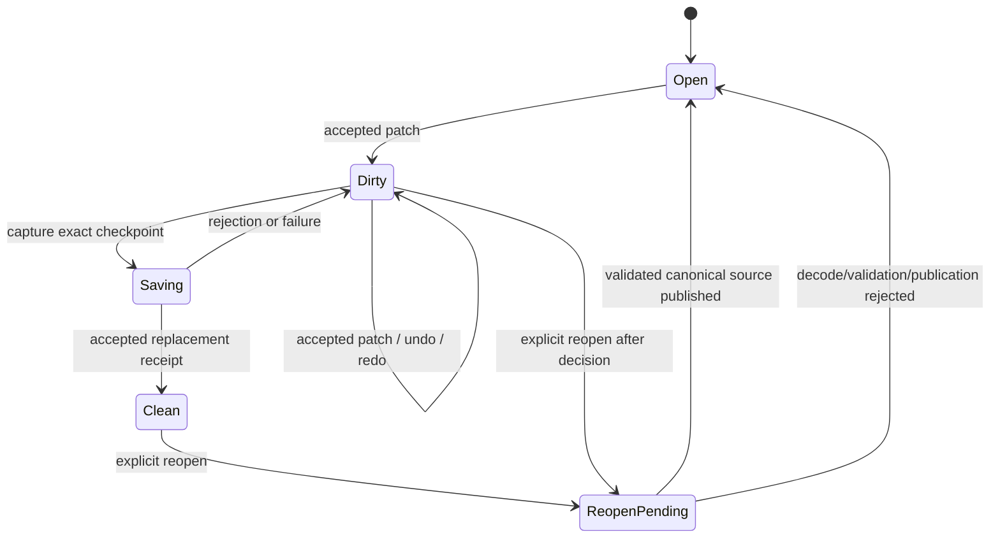

# ADR 0113: Editor UI Prefab Authoring and Canvas Authority

**Status**: Accepted
**Date**: 2026-08-17
**Last Revised**: 2026-08-18
**Amended**: 2026-08-18 to make the exact U2 authoring projection the single Canvas source
authority, separate receipt-backed Prefab persistence from immutable project-content generation
publication, and admit source-local ordered entity structure through ordinary Prefab history
**Owner**: `nara_scene`, `nara_tooling`, project Host, and the private Editor execution owner
**Refines**: [ADR 0026](0026-editor-command-patch-and-undo-model.md), [ADR 0047](0047-editor-workspace-and-scene-document-state.md), [ADR 0101](0101-ordered-persistent-placement-and-runtime-projection.md), [ADR 0107](0107-shared-ui-foundation-and-independent-product-layers.md), and [ADR 0111](0111-editor-scene-view-execution-and-picking-authority.md)
**Refined By**: None
**Implementation Plan**: [Editor UI Prefab Authoring and Canvas v1](../../plans/2026-08-17-1930-feat-editor-ui-prefab-authoring-and-canvas-v1-plan.md), EUA-U1 through EUA-U5; [Editor UI Prefab Structural Composition v1](../../plans/2026-08-18-0848-feat-editor-ui-prefab-structural-composition-v1-plan.md), EUSC-U1 through EUSC-U5

## Context

Nara already has persistent `SceneDocument` and `PrefabDocument` values, canonical Prefab
encoding, bounded Scene authoring history, an editor workspace, and a private Scene/Game image
execution owner. The missing product path is editing a UI Prefab and seeing the accepted unsaved
source in a Canvas before saving it back to the project.

The first implementation must not make a Prefab look editable by silently instantiating it as a
Scene and later serializing the expanded value. That would lose the source kind, canonical root
order, source path, and the distinction between Prefab content and Scene instance facts. It would
also give the Editor window an accidental UI resolution authority and make a future Nara UI panel
disagree with Runtime UI.

## Decision

### 1. Prefab source is a first-class authoring document

`PrefabDocument` is opened, revised, selected, saved, and reopened as a Prefab. A Prefab authoring
session owns the canonical Prefab value and applies `ScenePatchDocument` operations directly to
that source shape. The implementation may share a private patch/history core with
`SceneAuthoringSession`, but it must not expose a generic public document trait, synthetic Scene
conversion, or a second history authority.

Each open document has a closed kind (`Scene` or `Prefab`), an editor document identity, a source
binding, a monotonic authoring revision, an opaque content-state identity, a saved checkpoint, a
selection set, and an external-reload state. Mutation, Undo, and Redo require the exact document
identity and base revision. Navigation actions do not invent a revision.

Source-local Prefab structure uses the same ordered `ScenePatchDocument` transaction and history
authority as other Prefab edits. Prefab authoring admits complete `AddEntity`, `RemoveEntity`,
`RestoreEntity`, and `MoveEntity` operations with exact stable placement preconditions while
continuing to reject independent `AddComponent`, `RemoveComponent`, and `ReplaceComponent`
operations. Each accepted transaction validates and canonicalizes an unpublished Prefab candidate,
admits its inverse and history cost, and only then publishes the document, monotonic revision, and
branch-safe content state together. Scene and Prefab retain nominal public document types; only
private ordered-record mechanics are shared, and no Prefab-to-Scene mutation roundtrip is an
authoring boundary.

Successful Reopen creates a new session lineage and clears history, selection, drafts, and
transient preview state. A failed Reopen leaves the previous slot unchanged.

### 2. Persistence remains Host-owned and kind-bound

The concrete Host owns filesystem capabilities, canonical encoding, source identity, and the
linear save checkpoint. A Prefab checkpoint can only be committed by a Prefab persistence lane and
a Scene checkpoint can only be committed by a Scene lane. A receipt-backed save advances the
saved content state only for the captured revision/content state; later accepted edits remain
dirty.

The workspace and toolkit adapters cannot manufacture a saved checkpoint, reinterpret a Scene
receipt as a Prefab receipt, or fall back to the currently active document when an action's target
is absent.

### 3. The primary authored UI surface is a project fact

The effective project settings may contain one optional primary UI surface profile with a finite,
positive authored logical width and height plus a bounded safe-area policy. Root product lowering
validates and publishes this immutable profile before Runtime UI or Editor UI contributions are
installed. Runtime and Editor each derive their own target transform from the same profile and
the current Host target.

The profile is not a Prefab field, an egui preference, a window-size fallback, or a Reference Game
constant. Missing or invalid profile data makes the UI Canvas unavailable while leaving the
Hierarchy and Inspector usable. Multiple named profiles and a general surface registry remain
deferred.

### 4. Toolkit and Canvas ownership stay separated

egui remains the first Editor shell. Nara UI owns the accepted authored UI projection and Canvas
candidate in a private Editor producer. The shared seam is one immutable authoring frame paired
with one ordered, revision-bound action trace; no shared public Widget trait or toolkit-owned
document state is introduced.

The Canvas is one mutually exclusive producer in the existing private Authoring/Game target
topology. It gains input authority only from the exact final Editor composite receipt for the
visible document revision, target generation, texture registration, device epoch, and window
generation. A candidate, offscreen submission, stale receipt, or image-only success cannot select
or mutate a Prefab.

### 5. Saved source and project content publish as separate generations

An accepted Prefab Save receipt advances the document's saved checkpoint, but does not mutate or
replace the current `ProjectContentSnapshot`. The project Host uses the receipt's exact normalized
Prefab path and published digest to load and validate a complete successor content closure through
ordinary capabilities. Only a successful full load may atomically replace the Editor snapshot and
its Scene/UI preview owners with a non-reused content generation.

The current Editor snapshot, every immutable Runtime snapshot, and a successor candidate share one
content budget host. At most two distinct content revisions may remain retained. A third-generation
attempt rejects before publication and releases all candidate charges. Source mismatch, invalid
content, capacity rejection, or preview replacement failure leaves the saved file honest, retains
the last-good snapshot, and publishes typed `RefreshPending` or `Stale` Editor facts.

A running Runtime never observes the replacement in place. Dirty Prefab content and pending or
stale project content mark it out of date. Stop remains available, while new Play/Restart requires
clean Prefab source and current project content. After a successful refresh, an explicit Restart or
fresh Play start binds the successor snapshot.

## Alternatives Considered

### Instantiate Prefab into a synthetic Scene

Rejected. It obscures source kind and path, risks writing expanded data back to the wrong file, and
cannot preserve Prefab-specific canonical ownership.

### Let egui own the editable UI model and use Nara UI only at runtime

Rejected. The shell would invent a second layout, selection, and field authority, making Canvas
preview differ from Runtime UI and preventing a later Nara UI panel from consuming the same facts.

### Make the Editor window or a global surface registry own the logical UI extent

Rejected. Window size is a Host fact and varies per target; authored logical extent is a product
fact. Combining them makes runtime, Canvas, and future render targets disagree.

### Add a generic public document/history trait now

Rejected. The current consumers are exactly Scene and Prefab. A private shared mechanics module
can remove duplicated implementation without freezing a public abstraction before a second
heterogeneous document consumer exists.

## Consequences

- `nara_tooling` becomes document-kind aware while retaining explicit Scene-only composition and
  Play actions.
- The Host needs separate Scene and Prefab persistence lanes and must rebuild a project content
  snapshot after a successful Prefab save; a running Runtime never changes in place.
- The Editor pays a small amount of explicit source/revision identity plumbing in exchange for
  stale-input safety and exact Save/Reopen behavior.
- The private Canvas can reuse the existing WGPU execution owner without adding a public image
  Surface, RenderGraph, docking system, or multi-window scheduler.
- A future Nara UI Inspector can replace or coexist with egui by consuming the same authoring
  frame and action trace.

## Success Metrics

| Metric | Target | Evidence |
|---|---:|---|
| Prefab source preservation | No Prefab edit is persisted through a synthetic Scene | `nara_scene` authoring tests and canonical roundtrip test |
| Stale mutation rejection | 100% of document mutations require exact kind and base revision | `nara_tooling` workspace tests |
| Save authority | Only accepted, kind-matching receipts advance saved state | Editor persistence tests |
| Selection authority | One workspace selection owner per open document | tooling/API review and tests |
| Surface authority | Runtime and Canvas consume one effective project profile | project lowering tests |
| Canvas input safety | Candidate/stale/retired facts never select or mutate | private Canvas transaction tests |
| Content publication | Save digest mismatch or a third retained revision never replaces last-good content | project-content and Editor Host refresh tests |
| Runtime freshness | A running Runtime remains immutable and only explicit Restart consumes the successor snapshot | Reference Game Editor trajectory |

## Risks and Mitigations

| Risk | Severity | Mitigation |
|---|---|---|
| Patch logic is duplicated between Scene and Prefab | High | Extract only a private document-neutral mechanics core; keep public document types nominal. |
| Save receipt is applied to the wrong document kind | Critical | Bind checkpoints and persistence lanes to closed document kind and source identity. |
| Editor window silently becomes UI resolution authority | High | Store one validated profile in effective project settings and derive target transforms at each consumer. |
| Unsaved Canvas preview mutates Runtime or persistence state | Critical | Compile a private candidate from the exact authoring projection and require the final composite receipt for input authority. |
| Save succeeds but successor content cannot publish | High | Keep persistence and content freshness separate, retain last-good previews, expose typed remediation, and block new Play/Restart. |
| Early generic abstractions freeze the wrong toolkit boundary | Medium | Keep the authoring frame/action seam private or narrow until a second consumer proves the need. |

## Implementation Evidence

EUA-U1 through EUA-U5 are implemented at `dc7ea07`, `16b0d30`, `bca3e62`, `155d147`, and
`ed9f1cd`. The final conformance record is
`docs/knowledge/engineering/verification/2026-08/2026-08-17T233048Z-eua-u5-saved-prefab-content-refresh-and-runtime-restart-conformance-cf11b0c7d23a44e7b127b41199ee4ee7.md`.
It proves the focused Prefab session, workspace, persistence, authoring frame, private Canvas,
bounded immutable content generations, and same-source Save-to-Restart trajectory.
