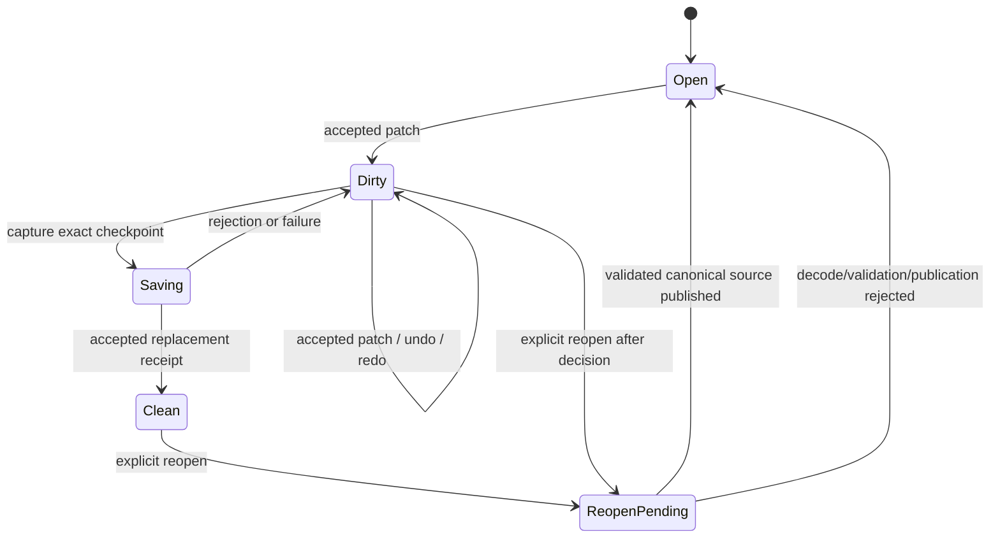

# ADR 0113: Editor UI Prefab Authoring and Canvas Authority

**Status**: Accepted
**Date**: 2026-08-17
**Last Revised**: 2026-10-23
**Amended**: 2026-08-18 to make the exact U2 authoring projection the single Canvas source
authority, separate receipt-backed Prefab persistence from immutable project-content generation
publication, admit source-local ordered entity structure through ordinary Prefab history, and close
first-party UI structural composition through exact frame-lowered transactions
**Owner**: `nara_scene`, `nara_tooling`, project Host, and the private Editor execution owner
**Refines**: [ADR 0026](0026-editor-command-patch-and-undo-model.md), [ADR 0047](0047-editor-workspace-and-scene-document-state.md), [ADR 0101](0101-ordered-persistent-placement-and-runtime-projection.md), [ADR 0107](0107-shared-ui-foundation-and-independent-product-layers.md), and [ADR 0111](0111-editor-scene-view-execution-and-picking-authority.md)
**Refined By**: [ADR 0117](0117-2d-foundation-ownership-and-authoring-contracts.md): revision-based
semantic edits and presented geometry; [ADR 0118](0118-editor-workspaces-frontends-and-creation-templates.md):
independent document domains, ordinary structural authoring, selected frontend and independent views
**Implementation Plan**: [Editor UI Prefab Authoring and Canvas v1](../../plans/2026-08-17-1930-feat-editor-ui-prefab-authoring-and-canvas-v1-plan.md), EUA-U1 through EUA-U5; [Editor UI Prefab Structural Composition v1](../../plans/2026-08-18-0848-feat-editor-ui-prefab-structural-composition-v1-plan.md), EUSC-U1 through EUSC-U5

## Context

The original UI Prefab slice extended persistent `SceneDocument` and `PrefabDocument` values,
canonical Prefab encoding, bounded Scene authoring history, the workspace and private Scene/Game
image execution. It established editing a UI Prefab and seeing accepted unsaved source in a Canvas
before saving it back to the project.

The first implementation must not make a Prefab look editable by silently instantiating it as a
Scene and later serializing the expanded value. That would lose the source kind, canonical root
order, source path, and the distinction between Prefab content and Scene instance facts. It would
also give the Editor window an accidental UI resolution authority and make Canvas preview disagree
with Runtime UI. The original implementation used egui; the selected Dear ImGui frontend and
independent workspace/view lifecycle now follow ADR 0118 without changing Prefab source authority.

## Decision

### 1. Prefab source is a first-class authoring document

`PrefabDocument` is opened, revised, selected, saved, and reopened as a Prefab. A Prefab authoring
session owns the canonical Prefab value and applies `ScenePatchDocument` operations directly to
that source shape. It may share private patch/history mechanics with `SceneAuthoringSession`, but
must not use synthetic Scene conversion or a competing history authority. ADR 0118 admits the
typed `EditorExtensionDocument` boundary for independent non-Scene domains; Scene and Prefab retain
their existing typed owners rather than passing through a second generic transaction layer.

Each open Scene or Prefab retains its source kind, editor document identity, source binding,
monotonic authoring revision, opaque content-state identity, saved checkpoint, selection set and
external-reload state. Mutation, Undo and Redo require the exact document incarnation and base
revision. Navigation does not invent a revision. Scene and Prefab are not the permanently closed
set of workspace document domains: ADR 0118's explicitly registered extension owners retain their
own content/history while sharing workspace revision, dirty-state and persistence lifecycle facts.

Source-local Prefab structure uses the same ordered `ScenePatchDocument` transaction and history
authority as other Prefab edits. The specialized UI Prefab slice admits complete `AddEntity`,
`RemoveEntity`, `RestoreEntity` and `MoveEntity` operations with exact stable placement preconditions;
its structural recipes do not grant arbitrary component composition. ADR 0118 separately admits
ordinary Scene/Prefab component and structural authoring with its exact catalog, unavailable-record
and reference-preservation gates. Each accepted transaction validates and canonicalizes an
unpublished Prefab candidate, admits its inverse and history cost, and only then publishes the
document, monotonic revision and branch-safe content state together. Scene and Prefab retain
nominal public types while sharing applicable revision primitives and private ordered-record
mechanics. No Prefab-to-Scene mutation roundtrip is an authoring boundary.

Successful Reopen creates a new session lineage and clears history, selection, drafts, and
transient preview state. A failed Reopen leaves the previous slot unchanged.

### 2. Persistence remains Host-owned and kind-bound

The concrete Host owns filesystem capabilities, canonical encoding, source identity, and the
linear save checkpoint. A Prefab checkpoint can only be committed by a Prefab persistence lane and
a Scene checkpoint can only be committed by a Scene lane. A receipt-backed save advances the
saved content state only for the captured revision/content state; later accepted edits remain
dirty.

The workspace and toolkit adapters cannot manufacture a saved checkpoint, reinterpret a Scene
receipt as a Prefab receipt, or fall back to the currently active document when an action's target
is absent.

### 3. The primary authored UI surface is a project fact

The effective project settings may contain one optional primary UI surface profile with a finite,
positive authored logical width and height plus a bounded safe-area policy. Root product lowering
validates and publishes this immutable profile before Runtime UI or Editor UI contributions are
installed. Runtime and Editor each derive their own target transform from the same profile and
the current Host target.

The profile is not a Prefab field, a toolkit preference, a window-size fallback, or a Reference Game
constant. Missing or invalid profile data makes the UI Canvas unavailable while leaving the
Hierarchy and Inspector usable. Multiple named profiles and a general surface registry remain
deferred.

### 4. Toolkit and Canvas ownership stay separated

Dear ImGui is the selected Editor frontend under ADR 0118. Nara UI owns the accepted authored UI
projection and Canvas candidate in a private Editor producer; it does not own the Editor toolkit.
The seam carries immutable authoring facts and revision-bound actions. An ordered action trace
is not an atomic batch; each cohesive edit uses its owning document transaction. No universal
Widget or Automation trait, toolkit-owned document state or future Nara UI Inspector is required.

The Canvas uses the independent render-view lifecycle refined by ADRs 0117/0118, not a permanent
mutually exclusive Authoring/Game slot. It gains geometric input authority only from the exact
final Editor composite receipt for the visible document revision, target generation, texture
registration, device epoch and window generation. A candidate, offscreen submission, stale receipt,
or image-only success cannot select or mutate a Prefab through geometric input. Non-geometric
property and structural commands use
the exact document/source incarnation, admitted schema and base revision; they do not require a
presentation receipt. A window-free semantic tool need not forge Canvas authority or wait for
complete Nara UI to exercise a legal edit and observe its exact result, Undo and persistence.

### 5. Saved source and project content publish as separate generations

An accepted Prefab Save receipt advances the document's saved checkpoint, but does not mutate or
replace the current `ProjectContentSnapshot`. The project Host uses the receipt's exact normalized
Prefab path and published digest to load and validate a complete successor content closure through
ordinary capabilities. Only a successful full load may atomically replace the Editor snapshot and
its Scene/UI preview owners with a non-reused content generation.

The current Editor snapshot, every immutable Runtime snapshot, and a successor candidate share one
content budget host. At most two distinct content revisions may remain retained. A third-generation
attempt rejects before publication and releases all candidate charges. Source mismatch, invalid
content, capacity rejection, or preview replacement failure leaves the saved file honest, retains
the last-good snapshot, and publishes typed `RefreshPending` or `Stale` Editor facts.

A running Runtime never observes the replacement in place. In the trusted in-process preview
placement, dirty Prefab content and pending/stale project content mark it out of date; a new
start or Restart retains that placement's clean-source and current-content admission. Stop remains
available. Ordinary external Play instead admits saved source under ADR 0116: unsaved edits do not
redefine its receipt, and Restart requires exact equality with the running generation's source
receipt. Neither placement silently substitutes unsaved Canvas content for its admitted source.

### 6. Specialized UI structural composition is finite, source-local, and owner-gated

The specialized v1 `nara_ui` slice owns a finite first-party composition catalog for Container,
Text, Image and Button. This is not a permanently closed workspace document or extension model.
Each catalog entry lowers to a complete source recipe; adapters cannot assemble partial component
sets, invent schema fields, or allocate persistent entity identities. Placement choices come from
the complete ordered Prefab source topology, exclude protected roots, descendants, cycles, and
hidden mixed-content subtrees, and retain exact parent and sibling-anchor preconditions.

For this specialized catalog, `EditorUiAuthoringFrame` is the lowering authority. `nara_tooling`
allocates the stable identity and atomically publishes the accepted Prefab patch, one history
record, revision, selection and content state. The selected frontend submits the returned
document- and revision-bound mutation unchanged; it does not build raw structure patches or
repair stale placements.

Persistent UI brushes distinguish semantic role and image forms. Image brushes store a canonical
asset reference, and the accepted predecessor migration rewrites legacy brush data before normal
authoring. The ordinary project-content loader discovers that reference even when the new UI node
is the image's only startup-closure dependency. Save, content refresh, Reopen, and explicit Runtime
Restart therefore consume the same canonical source instead of an Editor-only cache.

Every accepted structural publication retires the predecessor authoring frame and Canvas geometric
input authority. Preview resumes from the successor source revision; Canvas picking/manipulation
authority resumes only after the matching final Editor composite receipt is presented. Semantic
selection remains with the workspace owner and does not depend on a presentation receipt.

## Alternatives Considered

### Instantiate Prefab into a synthetic Scene

Rejected. It obscures source kind and path, risks writing expanded data back to the wrong file, and
cannot preserve Prefab-specific canonical ownership.

### Let the Editor toolkit own the editable UI model and use Nara UI only at runtime

Rejected. The shell would invent a second layout, selection, and field authority, making Canvas
preview differ from Runtime UI. Toolkit independence does not require a second domain authority.

### Make the Editor window or a global surface registry own the logical UI extent

Rejected. Window size is a Host fact and varies per target; authored logical extent is a product
fact. Combining them makes runtime, Canvas, and future render targets disagree.

### Route every document through one generic mutation/history layer

Rejected. Scene and Prefab keep their typed owners and may share private mechanics. ADR 0118 now
admits an independent typed extension-document owner with domain-owned commands/history and shared
workspace lifecycle. This supersedes the original two-kind/no-public-document-trait restriction;
it does not introduce a universal document transaction, Automation service or Widget hierarchy.

## Consequences

- `nara_tooling` retains source-domain-aware admission; extension documents do not acquire Scene
  composition, Canvas or Play authority merely by joining the workspace lifecycle.
- The Host needs separate Scene and Prefab persistence lanes and must rebuild a project content
  snapshot after a successful Prefab save; a running Runtime never changes in place.
- The Editor pays a small amount of explicit source/revision identity plumbing in exchange for
  stale-input safety and exact Save/Reopen behavior.
- The private Canvas reuses the WGPU execution owner and ADR 0118's render-view/Host handoff;
  this authoring contract adds no public render scheduler or generic toolkit layer.
- Domain-owned history and Canvas authority survive frontend changes. Permanent Editor/game
  toolkit separation remains legitimate under ADR 0107.

## Success Metrics

| Metric | Target | Evidence |
|---|---:|---|
| Prefab source preservation | No Prefab edit is persisted through a synthetic Scene | `nara_scene` authoring tests and canonical roundtrip test |
| Stale mutation rejection | 100% of document mutations require exact kind and base revision | `nara_tooling` workspace tests |
| Save authority | Only accepted, kind-matching receipts advance saved state | Editor persistence tests |
| Selection authority | One workspace selection owner per open document | tooling/API review and tests |
| Surface authority | Runtime and Canvas consume one effective project profile | project lowering tests |
| Canvas input safety | Candidate/stale/retired facts never select or mutate | private Canvas transaction tests |
| Content publication | Save digest mismatch or a third retained revision never replaces last-good content | project-content and Editor Host refresh tests |
| Trusted runtime freshness | In-process source refresh never mutates a running Runtime; explicit Restart consumes the successor snapshot | Reference Game Editor trajectory |
| Structural composition | Create, move, and subtree delete publish one exact Prefab transaction and one history record | Scene, tooling, Adapter, and Reference Game trajectory tests |
| Structural Canvas safety | A predecessor receipt cannot pick after structure publication; the exact successor can | Native Editor UI Canvas canary |
| Image dependency retention | A migrated image brush remains in the startup closure when the created UI node is its sole reference | Reference Game Save/Reopen/Restart trajectory |

## Risks and Mitigations

| Risk | Severity | Mitigation |
|---|---|---|
| Patch logic is duplicated between Scene and Prefab | High | Extract only a private document-neutral mechanics core; keep public document types nominal. |
| Save receipt is applied to the wrong document domain | Critical | Bind checkpoints and persistence lanes to the exact typed owner, source identity and captured content state. |
| Editor window silently becomes UI resolution authority | High | Store one validated profile in effective project settings and derive target transforms at each consumer. |
| Unsaved Canvas preview mutates Runtime or persistence state | Critical | Compile from the exact authoring projection; require final composite evidence for geometric input and owner revision/schema admission for semantic edits. |
| Save succeeds but successor content cannot publish | High | Keep persistence and content freshness separate, retain last-good previews and typed remediation, and enforce each Play placement's source-admission rules. |
| Early generic abstractions freeze the wrong toolkit boundary | Medium | Use the concrete typed owner and current frame/action seam; require scoped consumer evidence for broader shared claims. |
| A closed catalog becomes a premature plugin registry | Medium | Keep the four complete recipes first-party and private; require a focused successor before extensibility. |
| Structural edits leave stale Canvas authority alive | Critical | Retire the predecessor frame on publication and require the exact successor composite receipt. |

## Implementation Evidence

The records below are historical evidence for the original egui-era slices and their recorded
native scope, not fresh qualification of today's frontend, all document domains or platform
support. ADR 0118 and the [implementation ledger](implementation-status.md) track the subsequent
Dear ImGui, independent-domain and render-view work. This revision changes contracts only; it
does not claim new editing, extension or native capabilities have been implemented.

EUA-U1 through EUA-U5 are implemented at `dc7ea07`, `16b0d30`, `bca3e62`, `155d147`, and
`ed9f1cd`. The final conformance record is
`docs/knowledge/engineering/verification/2026-08/2026-08-17T233048Z-eua-u5-saved-prefab-content-refresh-and-runtime-restart-conformance-cf11b0c7d23a44e7b127b41199ee4ee7.md`.
It proves the focused Prefab session, workspace, persistence, authoring frame, private Canvas,
bounded immutable content generations, and same-source Save-to-Restart trajectory.

EUSC-U1 through EUSC-U5 are implemented at `fb66b84`, `4a6cd14`, `278b986`, `9540deb`, and
`993a793`. The final conformance record is
`docs/knowledge/engineering/verification/2026-08/2026-08-18T072626Z-eusc-u5-persisted-ui-structure-and-native-canvas-conformance-436c589870ba4f3c83548d349caa6d4c.md`.
It proves failure-atomic ordered Prefab structure, the closed four-kind catalog and semantic brush
migration, exact Host and Adapter transactions, one real persisted source-to-Runtime trajectory,
and one exact native Canvas successor presentation.
