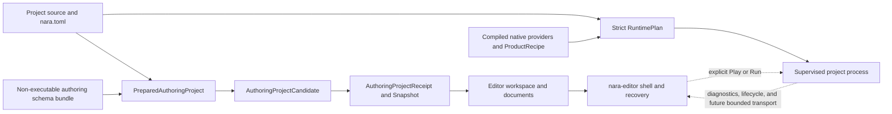
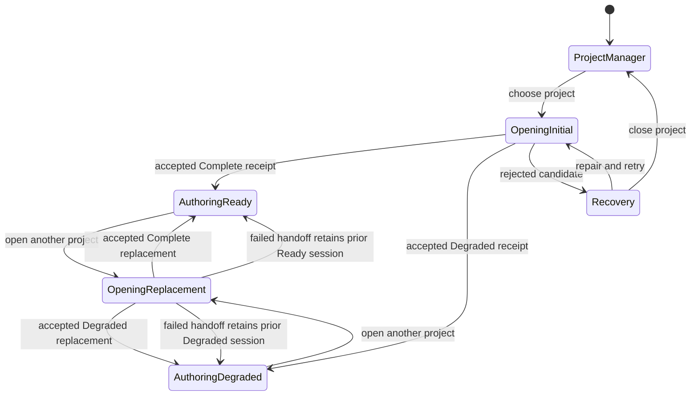

# ADR 0114: Standalone Generic Editor Authoring and Execution Boundary

**Status**: Accepted
**Date**: 2026-08-18
**Last Revised**: 2026-10-16
**Owner**: Private `nara-editor`, project Host, `nara_project`, `nara_reflect`, `nara_scene`,
`nara_tooling`, and project workflow owners
**Refines**: [ADR 0090](0090-unavailable-schema-and-lossless-authoring.md) and
[ADR 0112](0112-editor-game-view-runtime-presentation-and-input-authority.md)
**Related**: [ADR 0006](0006-scene-and-prefab-data-model.md),
[ADR 0026](0026-editor-command-patch-and-undo-model.md),
[ADR 0047](0047-editor-workspace-and-scene-document-state.md),
[ADR 0079](0079-root-product-capabilities-and-placeholder-domain-retirement.md),
[ADR 0081](0081-schema-source-stable-identity-catalog-and-runtime-binding.md),
[ADR 0082](0082-process-host-authority-and-runtime-construction-topology.md),
[ADR 0084](0084-executable-runtime-ownership-and-isolation.md),
[ADR 0093](0093-rust-authoring-hot-iteration-and-optional-scripting-adapters.md),
[ADR 0104](0104-host-owned-editor-workspace-installation.md),
[ADR 0110](0110-first-party-project-workflow-and-source-carrying-export.md),
[ADR 0111](0111-editor-scene-view-execution-and-picking-authority.md), and
[ADR 0113](0113-editor-ui-prefab-authoring-and-canvas-authority.md)
**Implementation Plans**: completed [Standalone Generic Editor Project Open and Recovery](../../plans/2026-08-18-2158-feat-standalone-generic-editor-project-open-and-recovery-plan.md), SGE-U1 through SGE-U5; completed [Editor Project Browser and Source Index v1](../../plans/2026-08-19-001-feat-editor-project-browser-and-source-index-v1-plan.md), EPB-U0 through EPB-U5

## Context

Nara now ships one private `nara-editor` executable with a Host-owned workspace, Scene and Prefab
documents, Undo/Redo, persistence, Scene View, UI Canvas, and an embedded Game View. The product is
not yet project-generic: opening a project still resolves a complete executable `RuntimePlan`,
loads project content against its native component registry, and opens the startup Scene only after
that Runtime composition succeeds.

That coupling makes the installed Editor unusable when project Rust is not linked into the Editor,
does not compile, or supplies a persistent component whose native provider is unavailable. The
Reference Game demonstrates the failure: the generic `nara-editor` starts with an empty
`ProductRecipe`, encounters project-owned persistent components, and exits before showing the
Editor shell with `scene.file-unknown-component`.

Building a project-specific Editor executable would mask this failure but would not create a mature
Editor product. Ordinary source browsing, repair, Scene/Prefab/UI editing, Undo, Save, and Reopen
must not depend on compiling or loading project gameplay code. Conversely, accepting unavailable
types for authoring must not weaken Runtime, Play, Check, Cook, or Export admission.

The product also needs a durable execution boundary. A long-lived generic Editor should supervise
project execution rather than load arbitrary project Rust into its own fault domain. ADR 0112's
bounded in-process Game View remains useful evidence and a trusted first-party Adapter, but it must
not define the ordinary product identity.

## Decision

Nara will ship one standalone, project-generic `nara-editor`. Project open and source authoring use
a non-executable Authoring Project contract. Runtime construction remains a separate, strict
executable contract. Ordinary Play and Run will use a supervised project process; the existing
in-process placement is retained only as an explicitly trusted Adapter. Until that supervised Host
is implemented, ordinary Play and Run report an explicit unavailable state rather than falling back
to the trusted Adapter.

### One installed Editor product

- `nara-editor` is the default first-party Editor product and opens every compatible project
  without compiling or linking a project-specific Editor binary.
- The Editor process owns workspace, document sessions, selection, history, dirty state, save and
  recovery policy, shell, windows, input, GPU execution, and extension admission.
- A statically compiled first-party or project companion may reuse the same Editor product as an
  explicitly trusted advanced Adapter. It is never required for ordinary Open, Recovery, source
  editing, or Save.
- Project source, manifests, schema data, Scene/Prefab files, or packages cannot grant executable
  trust or cause the Editor to compile, install, load, or run code without an explicit Host action.

### Authoring and Runtime are different admission products

The Host owns two nominally distinct admission products:

| Product | Inputs | Completeness rule | Permitted result |
|---|---|---|---|
| Authoring Project transaction | `PreparedAuthoringProject` binds the project manifest, exact root capability, non-executable schema bundle, aggregate budget, bounded source documents, and explicit source dependencies; immutable source candidates produce `AuthoringProjectCandidate` and `AuthoringProjectSnapshot`; atomic publication returns `AuthoringProjectReceipt` | Understood file/value grammar; record readiness may be Complete or Degraded | Open, inspect, preserve, and perform only operation-gated edits |
| `RuntimePlan` | Product profile, `ProductRecipe`, native providers/codecs, complete frozen registry, executable and content identities | Every required record, migration, binding, and capability is Available | Check, Play, Run, Cook, Export, and Runtime spawn |

The Authoring Project transaction is not a flag on `ProjectContentLoader` and is not a weakened
`RuntimePlan`. The two products may share bounded file readers, persistent envelopes, generic value
codecs, stable identities, schema catalogs, and Scene/Prefab document mechanics. They do not share
completeness, native binding, executable composition, or publication authority. Only an
`AuthoringProjectReceipt` may install its immutable snapshot into `EditorProjectSession`.

The Authoring transaction retains exact bundle fingerprint, owner lineage, project-root binding,
source revision, open-attempt generation, aggregate budget use, and diagnostic generation. Every
dependency is read through the same exact root capability rather than validated and later reopened
by ambient name. It never creates a `ComponentRegistry`, calls a native codec, constructs an ECS
`World`, or publishes runtime content.

`AuthoringProjectSnapshot` is the immutable source authority for the installed workspace,
persistence, Scene View, UI Canvas, and prepared authoring assets. It owns the startup Scene and
explicit Scene/Prefab/UI/asset closure, source digests and provenance, readiness, Adapter
compatibility receipts, canonical unavailable-record manifests, and budget use. Typed previews
project only facts admitted by exact Adapter receipts; unavailable records remain visible document
facts and diagnostics rather than placeholder runtime objects.

### Non-executable authoring schema bundle

Each project may publish a versioned, bounded Authoring Schema Bundle composed only of data:

- an owned, bounded `PersistentComponentSchemaOwnerId` distinct from the static executable-provider
  `ComponentSchemaOwnerId`, plus stable component identities;
- owner-local current catalog generations, complete immediate predecessor catalogs when generation is
  greater than one, predecessor fingerprints, tombstones, aliases, fields, generic value kinds,
  defaults, and declared reference capabilities;
- bounded authoring metadata already expressible by accepted first-party descriptors;
- a canonical composition identity and source digest.

The bundle contains no Rust type identity, function pointer, trait object, native codec,
`PluginDefinition`, executable path, dynamic library, script callback, toolkit object, GPU handle,
or ambient filesystem path. Loading it grants no executable authority.

The Editor treats a missing, stale, or partially incompatible bundle as an authoring-readiness
fact. It does not silently substitute native providers from whichever features happened to be
compiled into the Editor. A project-controlled owner ID or fingerprint is identity evidence, not
authorization to activate a first-party typed Adapter. Such an Adapter requires a Host-issued
compatibility receipt bound to the exact owner, catalog fingerprint, supported generation, and
Adapter generation. Runtime composition independently proves exact selected definitions and that
every reachable source record is bound; a project-wide bundle may be a bounded superset across
profiles.

### Lossless degraded authoring

The ordinary Editor also installs the finite engine-owned data Adapter admitted by
ADR 0090's 2026-10-16 refinement. Exact schema data grants only supported data
inspection/editing, never native execution. Its compatibility receipt uses owned
persistent catalog identity, separate from trusted executable-provider evidence.
Open and external Play re-admission construct the same Adapter basis; browser
documents and Reopen retain that basis. Field candidates validate complete schema
coverage and numeric domains before publication.

Native preview support is an independent capability. A data-editable record without
that support remains in the source and is explicitly omitted from the first-party
typed preview. Play/Check still validate against the compiled project's exact
Runtime registry. A successful authoring edit cannot assert project-specific
invariants absent from the finite descriptor.

ADR 0090 is accepted and owns record readiness, semantic preservation, operation gates, and strict
Runtime rejection. The generic Editor applies that contract as follows:

- `Available` records may use their admitted typed Inspector and domain tools.
- `KnownUnbound`, `UnknownSchema`, `Unmigratable`, and `FutureSchema` records remain complete
  bounded semantic records at the document layer when the enclosing format and generic value
  grammar are understood.
- Unavailable records are visible with exact diagnostics and read-only or operation-specific
  capability reasons. They never become placeholder ECS components.
- Save and Reopen preserve one canonical unavailable-record manifest and retain the document's
  Degraded state. That manifest includes total cardinality plus each record's source document,
  owning entity or slot, semantic placement/order, owner/component identity, schema version,
  complete generic value, and explicit references. The Editor never reports Runtime readiness
  merely because authoring succeeded.
- Unknown top-level envelopes, document operations, value tags, record boundaries, or exceeded
  budgets remain Rejected. The shell stays available, but that document is not opened or
  overwritten.

### Shell and project recovery precede document admission

The native Editor shell starts before project composition or startup-document admission. Opening a
path produces a project-session state rather than deciding whether the process may exist:

- `ProjectManager` exposes a bounded path/profile/Open/Exit surface; `ProjectManager` and recovery
  diagnostics are Editor-owned states, not process exit paths.
- A rejected project or startup document does not destroy a previously open last-good workspace.
- Runtime readiness is an orthogonal frame fact, not another application state. In the first Generic
  Open/Recovery slice, ordinary Play and Run remain explicitly unavailable.
- The completed Generic Open slice may open the manifest-selected startup Scene and its explicit
  Scene/Prefab/UI dependency closure. The completed Project Browser successor adds read-only,
  manual-refresh discovery across manifest-declared source roots through `nara_fs`'s bounded
  handle-bound enumeration contract. The browser remains a non-executable Authoring product and
  does not inherit Runtime closure authority.
- Every admitted path is project-relative and opened through the same exact `DirectoryCapability`.
  One attempt-wide budget bounds unique files, edges, depth, path bytes, handles, encoded and decoded
  bytes, decode work, diagnostics, and retained candidates; cycles and duplicates are charged
  deterministically.

### Execution isolation

- The ordinary product direction is for Play and Run to build or select one immutable executable
  generation and launch it as a supervised child process. The Editor will own cancellation, startup
  handshake, logs, Stop, Restart, crash detection, timeout, and orphan cleanup.
- The child must prove exact project, profile, schema, content, executable, and protocol identities
  before the Editor accepts lifecycle, input, or future frame observations.
- Build failure keeps the Editor and authoring workspace alive and retains the last-good executable
  as an explicit, never-silent choice.
- OQ-039 continues to own the exact versioned local control, observation, frame, and input protocol.
  This ADR selects the process boundary and product responsibility, not a universal transport.
- ADR 0112's in-process bridge remains supported for trusted first-party canaries and specialized
  compiled companions. It is not the generic Editor's fallback when a project build or handshake
  fails.

### Extension boundary

This decision does not create an Editor plugin framework. The product direction is staged:

1. data-only, Host-rendered declarative contributions;
2. capability-specific supervised process extensions after a concrete tracer exists;
3. optional evidence-gated Wasm Adapters using the same semantic action model;
4. explicitly trusted native companions for advanced first-party use.

OQ-031 retains the package, contribution, lifecycle, and trust decision. No raw Rust dynamic
library, universal `EditorPlugin` trait, callback DSL, mutable `World`, egui context, window handle,
or WGPU handle becomes part of this ADR.

## Alternatives Considered

### Compile one Editor executable per project

**Pros**: Native Rust types, codecs, gameplay code, and custom tools are directly available.

**Cons**: Project compile failures and toolchain latency block ordinary Open and Recovery; every
project inherits Editor ABI, crash, and restart coupling.

**Decision**: Rejected as the default product. Retained only as an opt-in trusted companion.

### Load project Rust dynamic libraries into the generic Editor

**Pros**: One Editor executable can discover native types without statically relinking itself.

**Cons**: Rust has no stable language ABI; allocator, compiler, dependency, panic, unload, and
memory-safety failures enter the long-lived Editor process. It still cannot open a project whose
code does not build.

**Decision**: Rejected as an ordinary extension or authoring mechanism.

### Keep complete native Runtime composition as the project-open gate

**Pros**: Simplest type model and strongest immediate runtime certainty.

**Cons**: Conflates source authoring with execution, prevents recovery, and makes the standalone
Editor project-specific in practice.

**Decision**: Rejected for Editor Open; retained for Runtime, Check, Play, Run, Cook, and Export.

### Standalone schema-first Editor plus supervised Runtime process

**Pros**: One install opens and repairs projects without builds, preserves unavailable records,
isolates project execution, and fits Nara's stable IDs, Host-owned state, and failure-atomic
publication model.

**Cons**: Requires a real data-only schema artifact, degraded operation gates, and a later bounded
child-process protocol.

**Decision**: Accepted.

## Consequences

- `EditorProjectSession::open` can no longer require `RuntimePlan` or `ProjectContentLoader` success
  before the shell exists.
- The root project Host gains one private Authoring Project deep Module; no new public authoring
  crate or universal loader Interface is required.
- Project creation and first-party projects must publish a data-only authoring schema bundle beside
  source, independent of their executable provider registration.
- Scene/Prefab decode must separate generic semantic preservation from native migration/binding
  availability while keeping unknown wire shapes rejected.
- Current complete-schema-only Editor tests and assumptions are removed rather than preserved by a
  compatibility path.
- Provider-capable Runtime, Check, Play, Run, Cook, and Export remain stricter than Editor Open. They
  may consume the same source but cannot consume a Degraded Authoring receipt as executable
  authority. The first Generic Open/Recovery slice does not claim an ordinary Runtime launch.
- Capability-bound read-only project browsing is implemented by the completed EPB plan. Importer
  execution, source mutation, external Play transport, live edit, animation/shader tools, docking,
  and executable Editor extensions remain separate successor work.

## Success Metrics

| Metric | Target | Evidence |
|---|---:|---|
| Installed Editor products required per project | 1 generic `nara-editor` | built-in starter, clean-room custom-owner, and Reference Game launch tests |
| Project Rust/native providers required for Open | 0 | open with project build deliberately broken or provider absent |
| Preservable unavailable records lost, moved, duplicated, or rewritten | 0 | canonical unavailable-record-manifest Save/Reopen fixtures |
| Runtime starts from Degraded authoring | 0 | provider-capable Check/Play/Run/Cook/Export rejection tests |
| Editor process exits because project admission fails | 0 | Project Manager/recovery trajectory |
| Project code loaded into ordinary Editor process | 0 | dependency and process-boundary review |
| New project-wide ambient filesystem scans | 0 | `nara_fs` boundary review |

## Risks and Mitigations

| Risk | Severity | Likelihood | Mitigation |
|---|---|---:|---|
| Data-only catalog drifts from native runtime providers | Critical | Medium | Preserve owner lineage; provider-capable Runtime proves exact selected definitions and reachable-record coverage rather than trusting whole-bundle equality. |
| Project-controlled identity spoofs a first-party typed Adapter | Critical | Medium | Treat bundle identity as data and require a Host-issued compatibility receipt bound to owner, catalog, supported generation, and Adapter generation. |
| "Degraded" becomes a permissive best-effort loader | Critical | Medium | Reuse ADR 0090's closed readiness states and operation matrix; reject unknown wire/document boundaries. |
| Editor accidentally reports a project as runnable | Critical | Medium | Keep Authoring and Runtime receipt types nominally separate; require Complete native Runtime admission at execution boundaries. |
| Generic Editor grows a second runtime composition system | High | Medium | Share value/schema codecs only; prohibit native registry, `World`, and executable plugin lowering in Authoring Project. |
| Project Manager scope expands into an ambient Asset Browser | High | High | Admit only manifest-declared roots through `nara_fs` handle-bound enumeration; keep traversal budgets, immutable publication, and Open revalidation in the Host. |
| Child-process direction triggers a speculative transport framework | High | Medium | Leave exact protocol under OQ-039 and require one external-window Play tracer before extracting shared transport. |
| Declarative metadata becomes an embedded programming language | High | Medium | Keep contributions finite and Host-rendered; move executable behavior to capability-specific isolated extensions. |
| Trusted in-process Adapter silently becomes the default again | High | Medium | Label it advanced/trusted, exclude it from generic Open, and prove Reference Game authoring through the ordinary binary. |

## Implementation Evidence Required

The decision is implemented only when one clean generic Editor binary:

1. opens the generated first-party starter, one clean-room custom-owner project, and Reference Game
   without linking their project crates;
2. remains open when project Rust is deliberately unbuildable;
3. opens one Complete and one Degraded Scene/Prefab, preserves unavailable records through
   Save/Reopen, and rejects an unknown wire shape without overwrite;
4. lets one preservation-safe scalar edit commit while the canonical unavailable-record manifest
   remains identical;
5. keeps provider-capable Check, Play, Run, Cook, and Export strict and mutation-free for the same
   Degraded source, while ordinary Editor Play/Run is explicitly unavailable until its supervised
   Host exists;
6. exposes project and document recovery inside the shell instead of exiting the process.

External process Play and extension hosting require their own focused evidence. Project-wide
browsing is implemented only by the completed EPB plan and does not retroactively broaden the
completed Generic Open and Recovery implementation.

## Citations

Comparative research and official-source links are recorded in
[Standalone generic editor product model](../../knowledge/engineering/standalone-generic-editor-product-model-research.md).
