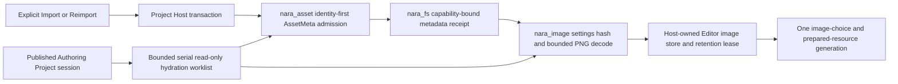

# ADR 0115: Editor Image Import Metadata and Authoring Publication

**Status**: Accepted
**Date**: 2026-08-20
**Last Revised**: 2026-10-20 (metadata publication retirement custody)
**Owner**: `nara_asset`, `nara_image`, the project Host, UI-neutral tooling, and private Editor
authoring adapters
**Refines**: [ADR 0033](0033-asset-import-and-render-resource-preparation-seam.md),
[ADR 0051](0051-persistent-file-envelope-migration-and-golden-fixtures.md), and
[ADR 0103](0103-concrete-domain-owned-asset-import-execution.md)
**Builds On**: [ADR 0070](0070-capability-oriented-filesystem-substrate.md),
[ADR 0104](0104-host-owned-editor-workspace-installation.md),
[ADR 0113](0113-editor-ui-prefab-authoring-and-canvas-authority.md), and
[ADR 0114](0114-standalone-generic-editor-authoring-and-execution-boundary.md)
**Implementation Plan**: [Editor Image Import and Reimport v1](../../plans/2026-08-20-001-feat-editor-image-import-and-reimport-v1-plan.md)

## Context

The standalone Editor can browse project sources and author UI Prefabs, and the Image domain can
decode bounded PNG input into backend-neutral pixels. These paths do not yet form one user-owned
Import/Reimport transaction. Existing asset metadata carries a flat, untyped payload, the source
index proves discovery rather than current file bytes, and no Host-owned Editor image store binds
accepted pixels to the authoring choices and prepared resources that consume them.

Extending the unused generic importer design would obscure the actual owners. The first product is
one PNG workflow with one per-image setting, not a provider ecosystem, watcher, durable artifact
cache, or second execution runtime. Reopen also has different scheduling needs from an explicit
user action: referenced images should become available without eagerly decoding every image in the
project or blocking publication of the Authoring Project session.

## Decision

Nara will implement one concrete, explicit Editor PNG Import/Reimport workflow. `nara_asset` owns
strict identity-first metadata admission and typed metadata composition. `nara_image` owns the
image recipe, settings hash, PNG decode, and prepared-image commit. The project Host owns all
filesystem capabilities, metadata publication, source-index and metadata-catalog generations, the
transaction state, and one concrete session-local Editor image store.



### 1. Metadata is identity-first and settings are domain-owned

`nara_asset` owns the generic composition `AssetMeta<TSettings>`. It validates the persistent
envelope and the nested asset identity before a concrete domain admits `settings`. The asset
portion owns the stable asset ID, canonical project-relative source path, and source kind. It does
not interpret image settings or compute an image settings hash.

The only canonical `asset_meta` version-1 payload shape is:

```json
{
  "kind": "asset_meta",
  "format_version": 1,
  "engine_min_version": "0.1.0",
  "generator": {
    "name": "nara",
    "version": "0.1.0"
  },
  "payload": {
    "asset": {
      "stable_id": "2f0d71c7-14fc-4ed4-b48b-1c61bba8b97f",
      "path": "textures/player.png",
      "source_kind": "image"
    },
    "settings": {
      "color_space": "srgb"
    }
  }
}
```

For Image metadata, `settings` is exactly `ImageImportSettings`; version 1 admits `srgb` or
`linear` as `color_space` and no other image setting. `nara_image` owns that type, its canonical
encoding, its hash, the PNG recipe version, decode validation, and the typed prepared-image commit.
The settings hash is derived from canonical settings and is not an independently writable metadata
field.

The prior flat `payload.stable_id`, `payload.path`, and `payload.source_kind` shape is a superseded
unreleased draft. Readers, structs, tests, and fixtures for that shape are deleted in the same unit
that installs the typed shape. There is no flat-reader fallback, version alias, or in-memory
migration. The two repository metadata fixtures
`reference-game/assets/textures/player.png.meta` and
`reference-game/assets/textures/tiny-dungeon.png.meta` are rewritten atomically with their
consumers and `crates/nara_asset/tests/meta_format.rs` contract tests.

### 2. The Host owns one explicit, receipt-bound transaction

Import and Reimport share one active user-action lane. A second request while that lane is active is
rejected rather than queued. Editing a draft setting does not mutate source or metadata; only the
explicit action begins a transaction.

The private runtime custody owner registers the concrete metadata publication Host before its
first write. The import transaction retains a handle before borrowing it, so a terminal failure
or unwind after publication cannot discard identity-bound temporary cleanup. Runtime close stays
incomplete until that registered cleanup retires, including after the Editor caller is abandoned.
New publication is rejected after close admission shuts. This registration uses the existing
finite file-retirement owner; it does not retain the entire image catalog or add a job framework.

Once publication has no cleanup obligation, the transaction retires its mutable Host. Pending
image decoding retains only the exact parent/name read capability and accepted metadata binding.
Completion opens that source afresh and verifies its identity and digest before admitting pixels.
Retiring write authority therefore does not weaken late source/metadata replacement detection.

Before metadata publication, the Host binds the request to the current project session and attempt,
selected logical source, source-index generation, metadata-catalog generation, exact capability,
and observed source and metadata identities and digests. Initial Import may create a missing
sidecar only after the bounded current catalog proves that the selected source has no stable-ID,
path, or sidecar conflict. Invalid, mismatched, or conflicting current metadata is never repaired
or overwritten implicitly.

The source-index and metadata-catalog generations gate only this pre-receipt admission. Once the
capability-bound create or replace receipt publishes metadata, the Host does not reject its own
success merely because that publication advances a catalog generation. Post-receipt decode and
commit instead remain bound to:

- the same project session and import attempt;
- the exact source and metadata object identities and digests admitted by the receipt path;
- the exact settings hash and source hash; and
- the expected current asset version.

Any mismatch, cancellation, stale result, decode failure, or capacity failure publishes no
successor pixels. A successful metadata receipt makes the desired recipe durable even when later
decode or commit fails; in that case the exact prior accepted pixels remain last-good and
availability reports the divergence rather than claiming freshness.

Every metadata publication latches one required successor catalog refresh. If a scan is already
active, the Host retains one coalesced follow-up refresh and runs it after the active scan; the
in-flight scan cannot consume or erase the publication's refresh obligation.

A catalog entry proves bounded discovery and metadata admission, not freshness of source bytes.
Source freshness is `Unknown` until the exact source capability is read and hashed for the current
attempt. If current metadata becomes invalid or conflicting, or if its identity/path binding drifts,
the Host retires the previous pixels from authoring choices and prepared resources. This safety
retirement is distinct from a recoverable decode failure under the same admitted identity, which
preserves last-good.

Retirement updates the single managed authoring runtime's typed Image value, usable state,
prepared resources and Scene content revision before publishing subsequent projections. The Host
also cancels ineligible explicit/hydration work, so a late completion cannot restore revoked
authority. Immutable identity reservations may remain for same-identity recovery; resolution and
retained allocation alone authorize neither pixels nor a new preview packet.

If runtime revocation itself fails, the completed catalog still installs and ineligible choices
retire. The session records a terminal Image publication failure: it retires Scene candidates,
rejects further Image publication and rejects explicit requests before metadata writes. Task
cleanup remains owned and valid selected UI images can still project. Reopening the project
creates a fresh managed runtime; a failed revocation is not silently retried as a completed scan.

### 3. Accepted pixels are session-retained authoring state

The concrete Editor image store is Host-private and scoped to one Authoring Project session. Every
accepted pixel allocation carries a long-lived retention lease for as long as the image can appear
in Editor authoring choices or prepared resources. Candidate publication accounts for overlap with
the existing last-good value before commit.

Version 1 has no eviction policy. If the store cannot retain the complete successor without
breaking its image-count or byte limits, it rejects the successor and preserves the exact
last-good image and authoring generation. It never evicts an accepted image to make an import
appear successful.

A successful commit publishes the image choice and prepared image in the same accepted authoring
generation. A choice is not interactive without its matching prepared resource, and a stale
prepared resource cannot authorize a Canvas mutation.

### 4. Reopen hydration is separate, bounded, and read-only

After the Host publishes an Authoring Project session, it may populate one Host-private bounded
serial hydration worklist for images referenced by the admitted authoring documents. Hydration
uses the existing task runtime and the same `nara_image` recipe, limits, identity checks, store, and
publication contract. It does not write or repair metadata.

The explicit Import/Reimport lane and the hydration worklist are distinct. Hydration never occupies
the user-action lane, and the user lane never turns into an unbounded reopen queue. Selecting a
Ready but session-unhydrated referenced image may request or prioritize its read-only hydration.
The Host does not eagerly decode every catalogued project image.

An explicit request can enter while hydration is queued or running. At admission it supersedes
same-source hydration, including queued work, and pauses unrelated hydration publication while
the user attempt is pending. Superseded task outputs cannot publish; task cancellation and
physical cleanup remain with the existing runtime. Each accepted last-good change can publish a
complete image catalog without waiting for the entire hydration worklist to drain.

Recoverable Scene or UI preview replacement failure may retire or retry that preview candidate, but
it does not close the shared task pools or the Editor image store. Only project replacement or
Editor shutdown cancels, drains, and closes the authoring runtime and its image leases.

### 5. Scope remains concrete

This decision does not add a generic importer registry, erased executor, watcher, durable
`.nara/import-cache` publication, project plugin, second task runtime, batch import, thumbnail
pipeline, another image format, or multi-product artifact graph. It does not compile, link, or load
project Rust into the standalone Editor.

The explicit user lane and reopen hydration are two Host consumers of the same Image-domain recipe,
not two asset domains. They therefore do not satisfy ADR 0103's second-production-domain trigger
for a shared executor.

## Alternatives Considered

### Add a generic importer registry and executor first

Rejected. One concrete Image product supplies no second-domain evidence for erased dispatch,
shared provider lifecycle, or a generic publication protocol. It would revive the capability
removed by ADR 0103.

### Decode every catalogued image during project open

Rejected. It makes discovery imply freshness, delays session publication, consumes memory for
unreferenced assets, and couples ordinary Open to an unbounded amount of image work.

### Evict accepted images when an import needs capacity

Rejected for version 1. Eviction can make existing authoring choices disappear in order to admit a
new candidate and weakens last-good behavior. Explicit capacity rejection is simpler and truthful.

### Use one concrete Host transaction and Image-domain recipe

Selected. It completes the user workflow through real owners, preserves strict filesystem and
publication authority, and leaves generalization evidence-gated.

## Consequences

- The unreleased flat `asset_meta` version-1 shape is a breaking deletion. Repository metadata
  fixtures and all consumers move atomically to the nested typed shape.
- Durable desired metadata may temporarily be newer than accepted session pixels. Tooling must
  expose desired settings and availability as separate facts.
- Reopen can publish a usable workspace before all referenced images are hydrated; image choices
  remain non-interactive until their exact prepared resources exist.
- The Host gains explicit transaction, refresh-latch, hydration-worklist, store, and retention-lease
  state. `nara_asset`, `nara_image`, tooling, egui, and rendering do not gain filesystem authority.
- Without a durable artifact cache, each new Editor session may need to decode referenced PNGs
  again. That cost is accepted for version 1 and remains bounded and serial.
- Source or metadata identity drift retires unsafe authoring resources even when old pixels remain
  allocated until their lease is released.

## Success Metrics

| Metric | Target | Evidence |
|---|---:|---|
| Canonical Image metadata payload shapes written and accepted | 1 nested `asset` plus typed `settings` shape | format golden, roundtrip, and rejection tests |
| Flat version-1 metadata readers or fixtures retained | 0 | stale-symbol and fixture inspection |
| Concurrent explicit Editor image attempts | at most 1 | Host transaction tests |
| Post-receipt commits with mismatched session, attempt, identity, digest, hash, or asset version | 0 | stale/conflict integration tests |
| Metadata publications lost behind an active scan | 0 | successor-refresh latch tests |
| Unsafe choices retained after metadata identity/path drift | 0 | catalog and authoring retirement tests |
| Accepted images evicted to admit a successor | 0 | store-capacity and last-good tests |
| Unreferenced catalog images decoded during Reopen | 0 | bounded hydration tests |
| Generic importer executors, project plugins, or additional task runtimes introduced | 0 | API and dependency inspection |
| Project Rust required for ordinary Import, Reimport, or referenced Reopen | 0 | standalone Editor trajectory |

## Risks and Mitigations

| Risk | Severity | Likelihood | Mitigation |
|---|---|---:|---|
| Durable desired settings diverge from last-good pixels after decode failure | High | Medium | Model desired recipe and availability independently; preserve the exact prior image and report stale state. |
| Metadata publication invalidates itself through a newer catalog generation | High | Medium | Limit generation gates to pre-receipt admission and use receipt-bound post-publication guards. |
| A completed scan hides freshly published metadata | High | Medium | Latch one coalesced successor refresh even while a scan is active. |
| Retained stale identity is offered to authoring | Critical | Low | Retire choices and prepared resources on invalid, conflicting, or drifted identity/path metadata. |
| Session memory grows beyond the configured image budget | High | Medium | Charge long-lived leases, admit overlap before commit, reject on exhaustion, and add no eviction policy in version 1. |
| Reopen hydration delays or destabilizes ordinary project Open | High | Medium | Publish the session first, hydrate only referenced images on a bounded serial worklist, and keep selection-triggered hydration read-only. |
| Preview recovery closes shared authoring infrastructure | High | Low | Keep preview replacement failure local; close task pools and the store only for project replacement or Editor shutdown. |
| The first Editor consumer is treated as evidence for a generic executor | High | Medium | Preserve ADR 0103's second-domain trigger and name both lanes as consumers of the same Image domain. |

## Implementation Evidence Required

Implementation must prove the canonical metadata reset and strict consumers, one receipt-bound Host
transaction with last-good retention, UI-neutral exact actions, same-generation image choices and
prepared resources, bounded referenced-image hydration, and one standalone Editor trajectory. The
implementation ledger advances only when the corresponding code and verification anchors exist.

## Citations

- [ADR 0033: Asset Import and Render Resource Preparation Seam](0033-asset-import-and-render-resource-preparation-seam.md)
- [ADR 0051: Persistent File Envelope, Migration, and Golden Fixtures](0051-persistent-file-envelope-migration-and-golden-fixtures.md)
- [ADR 0070: Capability-Oriented Filesystem Substrate](0070-capability-oriented-filesystem-substrate.md)
- [ADR 0103: Concrete Domain-Owned Asset Import Execution](0103-concrete-domain-owned-asset-import-execution.md)
- [ADR 0113: Editor UI Prefab Authoring and Canvas Authority](0113-editor-ui-prefab-authoring-and-canvas-authority.md)
- [ADR 0114: Standalone Generic Editor Authoring and Execution Boundary](0114-standalone-generic-editor-authoring-and-execution-boundary.md)
