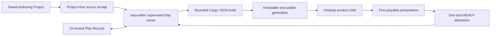

# ADR 0116: Standalone Supervised Editor Play

**Status**: Accepted
**Date**: 2026-08-21
**Owner**: private `nara-editor`, the project Host, executable product Hosts, UI-neutral tooling,
and platform process adapters
**Refines**: [ADR 0082](0082-process-host-authority-and-runtime-construction-topology.md),
[ADR 0084](0084-executable-runtime-ownership-and-isolation.md),
[ADR 0112](0112-editor-game-view-runtime-presentation-and-input-authority.md), and
[ADR 0114](0114-standalone-generic-editor-authoring-and-execution-boundary.md)
**Builds On**: [ADR 0052](0052-task-backpressure-cancellation-and-long-running-diagnostics.md)
and [ADR 0110](0110-first-party-project-workflow-and-source-carrying-export.md)
**Implementation Plan**: [Standalone Supervised Play v1](../../plans/2026-08-21-001-feat-standalone-supervised-play-v1-plan.md)

## Context

The standalone `nara-editor` can open a generic project without compiling project Rust, preserve
degraded Scene and Prefab data, browse project sources, edit and save documents, and import images.
ADR 0114 selected a supervised project process as the ordinary Play and Run boundary, but left the
concrete local protocol under OQ-039. Ordinary generic Editor Play therefore still reports an
explicit unavailable state.

The existing in-process Game View cannot become the generic fallback. It is an explicitly trusted
first-party Adapter whose Runtime, GPU, input, and presentation owners are compiled together.
Loading arbitrary project Rust into the long-lived Editor would erase the fault-isolation and
generic-authoring boundary established by ADR 0114.

The first useful external placement does not require a general runtime-session transport. It needs
one exact build, one immutable executable generation, one child-only startup attestation, bounded
diagnostics, and truthful process cleanup. The design must also avoid treating Cargo's mutable
target output, the process CWD, `current_exe` inference, or native process identity as durable
project authority.

## Decision

Nara will implement one private standalone-Editor Play placement that builds and supervises one
local external desktop product process. The child owns its native window and executable Runtime.
The Editor owns build orchestration, immutable executable generations, process-tree authority,
bounded logs, startup admission, Stop, Restart, and close/replacement cleanup.



### Versioned product eligibility

A desktop profile opts into this placement only through the exact manifest declaration:

```toml
[profiles.desktop.execution]
contract = "desktop-supervised-play/v1"
```

The declaration is profile-local and versioned. Missing or unknown values keep the project fully
editable but publish a typed external-Play unavailable reason and repair guidance before Cargo is
invoked. Nara does not infer support from a binary name, source-text marker, successful build, or
legacy entry-point shape. The starter and Reference Game publish the matching product-side launch
and attestation hook.

### Persistent source receipt and launch context

Before a Play request can reach the private process owner, the project Host publishes one
capability-free `EditorExternalPlaySourceReceipt`. It contains only bounded persistent facts:

- project stable identity and selected profile;
- exact execution-contract and launch-context versions;
- manifest, authoring-schema, saved authoring-source, and selected-product facts;
- canonical relative source paths and content digests; and
- the fixed trusted desktop build selection needed by this version.

The receipt never contains a `DirectoryCapability`, `FileIdentity`, native handle, process ID, raw
absolute root, or process-local settings lineage. Equality is semantic equality of the complete
receipt, not equality of one aggregate hash. It is the source-eligibility authority for normal
Play and the explicit last-good choice.

Each launch uses a separate session envelope with a fresh nonce. Development generations receive
the normalized project root, selected profile, generation identity, source receipt, and nonce over
one child-only inherited bootstrap endpoint. Packaged products retain their sibling `project/`
layout when no supervised development context is present. CWD is never project identity, and a
development generation never falls back to its compile-time manifest directory or executable
location.

### Immutable generation and activation evidence

Cargo output is only an input to publication. The running executable is copied into an
Editor-owned immutable generation and bound to its executable digest, trusted target selection,
captured build-input observations, source receipt, and launch-context version. The executable
digest is the runtime byte authority for version one; this decision does not claim a complete
reproducible closure of every Rust module, build-script input, environment input, or procedural
macro.

On supported Linux x86-64 hosts, the Host selects generation storage from the standard user cache location:
an absolute, nonempty `XDG_CACHE_HOME`, otherwise an absolute `HOME` plus `.cache`.
The cache base must be a physical directory owned by the effective user without group/other
write access; the engine-owned child must additionally have mode `0700`. Existing unsafe
permissions or symbolic links are rejected rather than repaired. This location does not grant
filesystem support: publication still proves the exact ADR 0070 tier and fails closed elsewhere.
Generations remain unique to one Editor run, with the existing marker locks, physical cleanup
and bounded stale-store scavenging; the cache location does not enable reuse across Editor runs.

The immutable generation excludes the per-launch nonce. Restart first readmits the current saved
source closure and compares it with the running generation's source receipt. Divergence or failed
source admission rejects Restart before requesting cleanup, preserving the running child. When the
receipts match, Restart launches the exact same generation under a fresh nonce after complete
cleanup. A new successful Play build publishes a successor generation and cannot mutate an active
one. Build completion alone does not make a generation last-good.

After the child publishes its strict Runtime, it arms one value-only activation observer. The
observer emits exactly one bounded READY attestation only after the primary window and surface
exist and the first playable frame has been presented. READY echoes the source, generation,
executable, product, protocol, and nonce facts and contributes the strict Runtime schema/content
receipt that only the compiled child can publish. Duplicate, malformed, oversized, mismatched,
late, EOF-before-ready, or pre-present exit outcomes never become `Running`.

The bootstrap endpoint closes after the one attestation. stdout and stderr are diagnostics, not an
authority channel. This decision adds no post-start command channel, frame transport, remote
endpoint, authentication framework, or public runtime-session Interface.

### One lifecycle through a value-only effect seam

The Host remains the Play lifecycle authority. It admits the frame-bound neutral action and emits
one generation-stamped `EditorExternalPlayRequest` plus the exact source receipt. The private owner
held by `PublishedEditorProject` performs Cargo and OS effects and returns only bounded,
generation-stamped observations. The Host applies observations before publishing the next Editor
frame.

`EditorProjectSession`, `TrustedCompiledEditorLane`, and `nara_tooling` do not own `Child`, Job,
process-group, pipe, Winit, capability, or raw-path state. The external placement reuses the
existing Play lifecycle and distinguishes preparation, startup, running, normal exit, fault,
stopping, retirement-incomplete, and close-incomplete outcomes. Pause, Resume, Step, and embedded
Game View are unavailable with typed external-placement reasons.

Authoring remains available while the external child runs. Saved-source divergence marks the
running generation out of date but does not mutate it. Restart is unavailable after observed
divergence and rechecks actual saved files when requested, even if the published availability is
stale. Unsaved edits do not redefine saved-source identity. Stop followed by Play targets current
saved source; this decision adds no old-source snapshot mechanism. The child's strict receipt and
READY checks still reject a source race after Host admission. A failed current Play may expose
`Run Last Good` only when the current source receipt exactly equals the generation's accepted
source receipt. That choice is explicit and never restores old project data.

### Private process and diagnostic authority

The Editor uses a small number of dedicated synchronous workers plus bounded queues and native
event-loop wakeups. It does not add Tokio, a public async API, a public process trait, or a second
task runtime. Cargo and game output use continuously drained, platform-cancellable I/O and bounded
memory-only rings with explicit truncation. Raw output is purged on project replacement and Editor
exit and never enters project files, telemetry, receipts, crash attachments, or verification
records verbatim.

Every spawned build or game owner reaches an explicit cleanup receipt. Drop is best effort and is
not clean-stop evidence. Restart, project replacement, and Editor exit retain an incomplete owner
and cannot create a conflicting child.

Platform guarantees are deliberately asymmetric:

- Windows 10 / Server 2016 or newer uses an extended native startup path that installs the
  non-breakaway kill-on-close Job and exact inherited-handle allowlist before project code can
  execute. Completion requires zero active Job processes and terminated pipe owners.
- The supported Unix path uses close-on-exec with an exact descriptor allowlist, one process group,
  bounded TERM/KILL, and direct-child reap. It does not claim containment after Editor hard kill or
  deliberate descendant escape from the group.
- Unsupported or unprovable setups publish typed unavailable state rather than running
  unsupervised.

## Scope of OQ Resolution

OQ-039 is resolved only for this one local external-window desktop placement and one-shot startup
attestation. It remains open for embedded external frame transport, post-start controls, live edit,
remote targets, reconnect, high-frequency observation, multiple simultaneous children, and a
general transport or runtime-session Interface. OQ-040 continues to own live edit, and OQ-041
continues to own incremental observation and remote command sessions.

## Alternatives Considered

### Load project Rust into the generic Editor

Rejected. It breaks the generic authoring and fault-isolation boundary, makes the Editor depend on
project compilation, and turns arbitrary project code into long-lived Editor authority.

### Reuse the trusted in-process Game View

Rejected as the ordinary fallback. Its fixed first-party composition remains useful for canaries
and specialized compiled companions, but it does not prove generic project isolation.

### Introduce a general IPC or runtime-session framework

Rejected. One local child and one startup attestation do not justify transport negotiation,
reconnect, subscription, command correlation, frame streaming, or public provider abstractions.

### Use one private supervised child with one-shot READY

Accepted. It closes the ordinary edit-to-result loop while preserving current Host, Runtime,
tooling, and platform ownership boundaries.

## Consequences

- The standalone Editor remains one installed generic binary and does not compile or load project
  Rust during Open, browse, edit, import, or Save.
- Project manifests gain one profile-local execution-contract field. This is an intentional
  pre-1.0 source contract; no compatibility detector or alias is retained.
- The private Editor gains build, generation, handshake, process, log, and cleanup Modules. These
  are product implementation details, not a new public framework.
- Development product entry points gain an explicit supervised launch-context path while packaged
  sibling-project behavior remains intact.
- The existing trusted in-process Game View and its exact presentation/input semantics remain
  unchanged.
- Windows and supported Unix expose different, explicit cleanup guarantees.

## Success Metrics

| Metric | Target | Evidence |
|---|---:|---|
| Project Rust loaded in the standalone Editor | 0 | dependency and native trajectory inspection |
| External Play attempts without exact profile declaration | 0 | manifest and availability tests |
| Running child outside an immutable generation | 0 | artifact publication and launch tests |
| Running state before exact first presentation and READY | 0 | activation and timeout tests |
| Spawned owners without explicit reap/reader termination evidence | 0 | process and cleanup tests |
| Silent last-good fallback | 0 | lifecycle and UI tests |
| Public process, IPC, async-runtime, or runtime-session framework added | 0 | API and dependency review |

## Risks and Mitigations

| Risk | Severity | Mitigation |
|---|---|---|
| The Editor and Host become competing lifecycle authorities | Critical | Use one value-only request/observation seam and apply observations before frame publication. |
| READY reports Runtime startup before the user-visible product exists | Critical | Arm after Runtime publication but emit only from the first successful playable presentation. |
| Windows project code executes before Job containment | Critical | Use the extended startup Job-list and inherited-handle attributes; reject any fallback path. |
| Output readers block cleanup after descendants retain writers | High | Use platform-cancellable I/O and include reader termination in the cleanup receipt. |
| Mutable Cargo output changes beneath a running session | High | Copy and atomically publish an immutable generation before launch. |
| Last-good runs against different saved source | High | Require complete source-receipt equality and expose the action explicitly. |
| The first child grows into a universal transport | High | Keep READY one-shot and require a separately accepted decision for every post-start channel. |

## Implementation Evidence Required

Implementation must prove the capability-free source receipt and exact execution declaration,
private cancellable process ownership, unique Cargo artifact publication, first-present READY,
value-only lifecycle integration, responsive native wakeup, one clean-room contract trajectory, one
real Reference Game trajectory, and final process cleanup. The implementation ledger advances by
SPL unit only when the corresponding focused verification exists.

## Citations

- [ADR 0052: Task Backpressure, Cancellation, and Long-Running Diagnostics](0052-task-backpressure-cancellation-and-long-running-diagnostics.md)
- [ADR 0082: Process Host Authority and Runtime Construction Topology](0082-process-host-authority-and-runtime-construction-topology.md)
- [ADR 0084: Executable Runtime Ownership and Isolation](0084-executable-runtime-ownership-and-isolation.md)
- [ADR 0110: First-Party Project Workflow and Source-Carrying Export](0110-first-party-project-workflow-and-source-carrying-export.md)
- [ADR 0112: Editor Game View Runtime Presentation and Input Authority](0112-editor-game-view-runtime-presentation-and-input-authority.md)
- [ADR 0114: Standalone Generic Editor Authoring and Execution Boundary](0114-standalone-generic-editor-authoring-and-execution-boundary.md)
- [OQ-039: Editor Play Placement and Local Transport](../open-questions.md)
