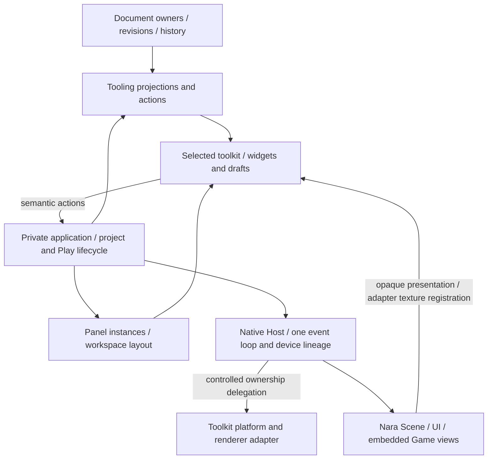

# ADR 0118: Editor Workspaces, Frontends, and Creation Templates

**Status**: Accepted
**Date**: 2026-10-16
**Last Revised**: 2026-10-26 (retained authoring predecessors and native graphics retirement)
**Owner**: Private Editor product, tooling, reflection and document-domain owners
**Refines**: [0015](0015-editor-tooling-and-dogfooding-boundary.md), [0081](0081-schema-source-stable-identity-catalog-and-runtime-binding.md), [0090](0090-unavailable-schema-and-lossless-authoring.md), [0107](0107-shared-ui-foundation-and-independent-product-layers.md), [0113](0113-editor-ui-prefab-authoring-and-canvas-authority.md), [0114](0114-standalone-generic-editor-authoring-and-execution-boundary.md)
**Related**: [0117](0117-2d-foundation-ownership-and-authoring-contracts.md)
**Implementation Plan**: [Editor Foundation and Frontends](../../plans/2026-10-16-1229-refactor-editor-foundation-and-frontends-plan.md)

## Context

The user authorized fearless editor/module refactoring and asked to evaluate dear-imgui-rs 0.20.0 before a possible custom Nara-rendered editor.
Existing tooling already owns semantic frames/actions, document revisions, history and persistence independently from egui.
The private application still embeds egui panels/drafts, while native presentation assumes one window and one active viewport slot.
Generic component composition is also incomplete: field editing works, but the authoring path cannot construct ordinary custom components from its data catalog.

Godot, Unity and Unreal provide useful examples of document editing, dockable workspaces, targeted extensions and rendering reuse, but use different UI architectures.
Their maturity does not prove that Nara should unify game/editor widgets or that the selected Rust backend meets native input and window requirements.

## Decision

### Preserve semantic owners; replace private product coupling

Document identity, accepted revisions, source kind, selection, history, dirty state and persistence remain with the existing workspace/document owners.
The private application owns project opening/recovery/replacement and execution lifecycle without selected-toolkit types.
A frontend owns widgets, toolkit IDs and transient drafts, consumes semantic models and emits the existing action vocabulary.
It does not gain mutable document, World, process or GPU authority.

Document mutation remains revision-based; geometric input remains bound to the actual presented frame under ADR 0117.
No universal widget tree, generic command transport, parallel undo system or Editor kernel crate is required.
Future custom UI reuses these semantic boundaries and render-view handoff, but may replace all widget, layout, focus and docking code.
Sharing rendering does not require sharing the runtime game's complete UI toolkit.

### Independent document domains share the workspace lifecycle

A trusted source-built non-Scene document owner implements `EditorExtensionDocument` with typed
commands, an immutable typed view, a bounded codec and its own inverse/history storage. The
Workspace retains document identity, monotonic accepted revisions, saved content checkpoints,
dirty/history projections and ordinary Save/Discard/Cancel arbitration. Domain content-state
identity follows Undo/Redo, while a forward branch receives a fresh identity. Scene and Prefab
keep their existing typed owners and share the source-incarnation/revision primitives; they do
not pass their mutation or native admission through a second generic transaction layer.

The product session registers the finite owner set explicitly and opens project-relative sources
through its existing filesystem capability. Registration and opening are also available to a
trusted embedded application for the current published project session. This is not project-code
discovery, automatic session replacement registration, or a dynamic plugin mechanism. An
extension action erases only a domain-typed command targeted at the exact open owner and live
revision, not an arbitrary service invocation. A panel receives no mutable document or filesystem
writer; hiding/closing its draft never removes the document or its history.

Source namespaces remain explicit: extension locators are project-relative, while Scene/Prefab
locators retain their configured source scopes. The Host excludes duplicate publication ownership
by reserved path and actual current file identity across these namespaces, including filesystem
case aliases. Existing publication capabilities retain the actual parent directory, so source
exclusion follows atomic Save replacement and parent-directory renames without global path
lowercasing or another source registry.

Scene/Prefab exact-source activation uses the Host's project-relative publication path rather
than raw Workspace locators from different configured source scopes. Browser and anchored Open
of one Prefab reuse the same slot/history; a different path alias is rejected. Extension duplicate
Open retains its explicit `SourceAlreadyOpen` result. All three admission paths share exclusion
over current retained targets, including rechecks immediately before source publication.
Opening a distinct Scene/Prefab source adds its own slot and concrete persistence Host without
closing another same-kind source. Anchored Prefab Open follows the same cardinality policy in
Authoring and TrustedCompiled sessions. Pending workspace intents fence every Open ingress;
neither a new source nor exact-source activation bypasses an admitted Close/Exit.

Save captures the exact encoded content state. The existing background publication Host and
linear receipt acknowledgement own disk writes and dirty checkpoint advancement. A later edit
remains dirty when the older capture saves. Reopen transports only a read-only source capability
and pure codec work, then revalidates the exact document/source/revision before owner-thread
publication and file-binding reconciliation. Reopen starts a new incarnation and resets history;
stale or failed preparation leaves the current content and history unchanged. Whole-session close
retires every extension publication registration through the existing Host-custody shutdown
participant before the session reports Complete. A failed document Close/Save preserves the open
document and its file custody for another explicit decision. Physical Host custody survives task
completion and panel retirement through the existing close participant.

Persistence adapters use ADR 0047's exact attempt correlation. The observed terminal supplies the
identity for acknowledgment; a deferred button/tool action must not sample the latest result to
replace that identity. Admission, immediate published rejection, nonpublishing refusal and exact
acknowledgment have distinct outcomes. A stale frame may acknowledge its still-current exact
terminal, but cannot dismiss a successor. No result bus, observer registry or payload-free
acknowledgment substitutes for the concrete owner. Source/file receipts remain separate proofs.

Scene and Prefab file custody is also keyed by the exact open document, using their concrete
lane types rather than an erased document store. An operation retains its captured Host instead
of resolving another same-kind lane at completion. Document storage, active navigation, Scene
preview binding and executable startup are distinct responsibilities. Scene preview retains the
last successfully explicitly selected Scene under ADR 0047, published read-only in the same
immutable frame as its document revision. Tree/Inspector still follow the active document.
`Back to Scene` uses this binding rather than the first Scene, and explicit selector re-selection
can restore an empty binding. A bound but inactive Scene may remain displayed; geometric input
requires explicit activation as well as the existing presented receipt. No bound Scene and no
active UI Canvas retires the old Scene presentation. Additive same-kind Open remains a separate
workflow; persistence-map iteration order never supplies navigation authority.

The small independently compiled dialogue consumer and its public tests determine this boundary.
The [document extension guide](../../guides/editor-documents.md) records the supported workflow
and verification scope. It does not establish generic graph editing, domain-native resources,
unbounded codecs, asynchronous extension traits, or native pixel/input qualification.

### Native local workspaces use cooperative filesystem authority

When a user selects a local project through the native launch configuration or Project Manager,
the native Host issues one `ReadWrite + TrustedLocal` project-root capability on every platform.
Initial Open, replacement and the explicitly compiled companion use this same filesystem policy;
the Host does not infer trust from the operating system or retry a refused strict write at a weaker
tier. This is the local developer-workspace contract permitted by
[ADR 0070](0070-capability-oriented-filesystem-substrate.md).

Save retains capability-bound access, identity/digest checks, atomic name publication and the
existing receipt-bound acknowledgement. Concurrent non-cooperating writers can still race a
name-bound replacement; conflict detection does not promise atomic prevention of every overwrite.
Receipts retain the actual platform guarantees. Linux replacement remains `NameBound`, and Unix
temporary-file discard can remain unsupported with a recoverable orphan.

This filesystem choice grants no project-code execution permission. Ordinary Open remains
data-only; Play and trusted compiled integration retain their separate explicit admission.
Lower Hosts continue to honor caller-issued `Untrusted` and `Recovery` capabilities without
conversion. Their unsupported strict operations still fail closed under ADR 0070. Frontends and
project content cannot widen these capabilities or select filesystem trust.

### Panels, layouts and render views are distinct

An editor panel kind, its open instance, its document target, its render-view instance and its native window have different identities and lifetimes.
Closing or relocating a panel does not close its document, discard history or change source dirty state.
Workspace layout is user preference state, separate from project assets.
Stable panel identities survive frontend changes; toolkit-specific layout blobs may reset to a usable default with a reason.

Panel registration begins as finite trusted Rust contributions compiled into the Editor composition.
Existing built-ins and one separate sample use the same lifecycle.
A contribution consumes read-only projections and submits admitted actions; toolkit-specific painting belongs in an optional frontend companion.
Ordinary project Open still does not compile/load arbitrary project Rust, native libraries or callbacks.
This decision establishes no stable plugin ABI or dynamic hot-unload policy.

The native composition admits each descriptor and per-instance frontend factory as one pair;
admission failure cannot leave a partial contribution installed. Frontend state is owned by each
panel instance. Close, hide, target/resolved-document change, project replacement and layout reset
retire its drafts; moving/docking the panel preserves them. GPU reconstruction moves the retained
frontend, including its factories and instance state, instead of reinstalling contributions.

The source-built composition is consumed once to construct the application and frontend with
their complete selected Host facets. Ordinary native execution reuses that construction; the
explicit trusted compiled lane retains that selection for replacement sessions; its initial
source-index capability remains unavailable, so selection does not enable metadata authoring there.
The separate late-panel installation operation preserves its atomic workspace admission and
rejects selected Host facets before mutation. It cannot silently discard an executable's Host
configuration. See the [extension ergonomics plan](../../plans/2026-10-22-public-extension-ergonomics-plan.md).
Completed project replacement requests presentation even when no action or persistence result
changed during its final poll. Waiting on unchanged owners alone remains quiet.

### Complete field edits through exact owner results

A normal field editor accepts the resolved panel document, authored entity and stable component/
field identity. Its frontend owns transient input and feedback; the document owner still validates
and publishes the existing semantic action. Private widget/draft identity excludes the monotonic
document revision. Submission basis retains the exact revision and admitted schema/source meaning.
Ordinary Save does not replace that meaning; source/session replacement must not alias it merely
because a locator is equal. Read-only owner projections supply these facts.

Invalid text and unfinished structured input remain drafts. A dirty draft retains its basis when
unrelated edits advance the revision, and requires explicit current-value review/reapply before a
new submission. Schema/source incompatibility cannot reinterpret old input. Collapse or temporary
unselection is not panel retirement or proof that an unprojected field was deleted. Draft storage
is finite; capacity rejects new input before admission rather than silently evicting unsaved input.
The actual panel lifecycle above still retires its state. No second document or undo authority is
created, and shared schema validation does not imply arbitrary native readiness.

A source-built panel can submit several existing actions and receive an opaque local ID for each
accepted enqueue. Immediate failure queues no action. Dispatch completion is delivered at most
once to the originating live panel incarnation, after painting borrows release, application drive
and actual project/target/layout reconciliation. The callback receives no UI, World or dispatch
context. Helper-owned requests have one private controller recipient, not an additional custom
callback. A committed action is not rolled back when its observer retires.

The frontend carries exact original action slots through closing filters and whole-batch rejection.
Its public prepared submission is move-only, bound to that frontend and project/candidate cycle,
and consumed only by the matching frontend. A newer candidate invalidates an unconsumed one;
late/foreign consumption cannot mutate or settle another candidate. Dropping it runs no user code;
the next frontend cycle settles outstanding observation or final retirement releases it. Native
presentation seals the candidate after final Canvas/pick provenance. Direct non-frontend batch
consumers retain their ordinary report path and cannot settle frontend observations.

Direct `EditorApplication::submit_and_drive` returns an owned `EditorApplicationSubmission`.
It contains one immediate action dispatch result per original input position and the separate
subsequent drive update. Closing filters preserve holes as explicit Closing results; a missing
workspace and whole-batch rejection are distinguished from domain outcomes for actions actually
dispatched. Later submissions, frame advances and project retirement cannot overwrite a retained
result. The owner moves its existing report into the return value rather than introducing a
mutable latest-result slot, diagnostic lookup, polling ticket or second execution route.

Direct Application preparation retains the document owner's move-only candidate, forward patch
and inverse without publication. Commit consumes it through the same document/history owner and
rechecks project lifetime and specialized document-domain admission. Closing and replacement do
not redirect an old candidate to a new workspace. These prepared document edits are distinct from
the frontend's paint/presentation submission and do not grant a panel a private workspace getter.

Named-document entity queries use the existing action/outcome and panel observation routing.
Their continuation binds the exact workspace, document kind, source incarnation, revision and
Schema admission. Querying a non-active source never changes navigation or selection. Bounded
direct-record enumeration is not expanded Prefab/field/project query support or a latency bound
for normal frame publication.

Further authoring projections retain the same named-source and exact-result responsibilities.
Actual component/root discovery is separate from copying selected values; borrowed source views
do not grant a panel mutable document access. Owned observations distinguish defaulted, omitted
and explicit-null values, and preserve unavailable-record readiness without interpreting its
payload as editable data. Continuations fix the complete entity/component/projection target;
aggregate copied metadata includes page/continuation identity, not only each row separately.
The [bounded read design](../authoring-read-projection-design.md) is an implementation experiment,
not a claim that root-query actions or prepared panel submission are already qualified.

Source-built panels may borrow finite, read-only preparation access during paint. The existing
Session may also return a bounded selector-directed property observation through that read-only
borrow, without action/result multi-frame choreography just to read a scalar. Empty selector steps
use the same operation for roots. Read failures retain exact basis/scan/copy refusals, publish
nothing and grant no mutation authority. Session and document owners validate the exact captured
document-query basis and return an owned,
unpublished candidate; panels do not acquire mutable Session, document or persistence access.
Preparation and inspecting the candidate's patch/inverse publish nothing. Dropping a retained
candidate cancels before submission. Commit consumes that same candidate through the existing
ordered action routing and panel-incarnation result delivery; it never re-prepares from a patch.
Candidate-bearing commands are move-only. Queue refusal returns the unqueued candidate, while
successful construction reports retain the actual source-owner mapping. Neither a candidate
registry nor another history, preview validator or result-inference path is introduced.

This completion means dispatch, not eventual Save/Play completion. Several actions remain ordered;
same-basis document writes can conflict and are never silently rebased. A cohesive multi-field
operation uses one existing atomic patch. No generic bus, polling-ticket framework, asynchronous
panel trait or public controller state machine is introduced.

Save completion is observed through the existing persistence projection across frames. The native
Host schedules maintenance while persistence is pending and requests presentation when its state
changes; unchanged polls alone do not require repaint. Close/Exit retain and retry their intent
after an already admitted Save. Project replacement waits for that Save before preparing source
bytes, including replacement by the same project. Physical file and task retirement remain with
their existing owners under ADRs 0047/0052; the frontend never interprets task cancellation as a
successful save or rollback.
The same pending maintenance and retained Close/Exit/replacement policy observes owned Reopen
preparation. Opening keeps authoring controls disabled and rejects new Play/Restart/RunLastGood
admission at the Host, including frame-bound and external routes. Native codec affinity and
exact source/revision publication stay with the existing document owner. Switching an already
open active tab does not retarget an admitted operation.
Physical session close is monotonic: its first attempt closes new-work admission even while an
already admitted Save/Reopen is still preparing. A caller may observe or acknowledge results and
retry cleanup, but cannot reopen file or Play admission on that closing or stopped session.
Scene/Prefab Host cleanup remains registered across idle operation periods and transfers explicitly
when content refresh replaces the authoring runtime; frontend retirement does not release it.

An authoring content successor does not make its predecessor physically retired. The Session
retains at most one complete replaced Runtime or rejected post-start candidate and drives its
existing close protocol independently from content freshness. While that owner remains pending,
another content refresh may retain new source obligations but cannot construct another Runtime.
The live successor's transferred file Hosts remain usable. Failed candidate admission preserves
the incumbent snapshot, image catalog and exact file custody; final custody transfer occurs only
after other publication checks, under exclusive owner access.

Authoring retirement has its own immutable frame pending fact. Native Hosts schedule maintenance
for it and pending content refresh even when no presentation is requested; unchanged retirement
polls do not create redraw cadence. Content-state changes are observable frontend updates rather
than being inferred from persistence completion. Final Session close waits for every retained
authoring owner. Disjoint physical task reports collapse into a bounded summary exactly once;
terminal cleanup failure remains separate from physical completion and is retained in diagnostics
and the final close receipt. Dropping an incomplete Session still uses quarantine as an abnormal
safety fallback, not normal-completion evidence. Initial App/Open construction failure and the
selected lazy product deployment retain their separately required qualification.

Project Open separates transportable startup-closure preparation from session publication. Its
linear attempt owns the exact project/schema capabilities, budgets and prepared result. Background
reads, decode, dependency traversal and pure schema classification may remain pending across
several advances in the same phase. Only an actual completed result can advance to publication;
native Adapter admission, Plugin/registry construction and Workspace/session creation remain on
the owner thread. Cancelling an attempt revokes its publication interest without claiming that an
OS read stopped. A bounded preparation owner retains running captures through the existing task
retirement path. Unchanged pending polls need maintenance, not repeated presentation. Retained
replacement projects and persistence-before-preparation/Save-before-refresh ordering stay intact.

Project Browser scan preparation runs as one finite owned attempt on the existing I/O task pool.
Its generation reservation, absolute budgets, capability-bound paths and final lineage checks
remain with the source-index owner. The owner polls progress without waiting, preserves last-good
snapshots on refusal and publishes only an actual completed matching attempt. Public Refresh
coalesces without spawning duplicate work; internal publication can reserve one successor scan.
Logical cancellation never certifies physical capture disposal or session close completion.

Browser document Open exposes request-specific preparation, physical cancellation and terminal
results in the public frame. Native maintenance polls pending work without repainting unchanged
polls. Panels can cancel preparation and acknowledge only the exact terminal request through the
ordinary action port; the dispatch callback still reports dispatch rather than eventual Open.
Opening B does not consult or retire an unrelated A; Save/Discard/Cancel belongs to explicit
Close/Exit. File reads, pure classification and Host binding can leave the owner thread;
Workspace mutation and source publication stay with their current owner under ADR 0047.
Admitted Close/Exit cancels pending preparation but retains its independent decision/retry outcome.
Cancelled or rejected
prepared Hosts retire through existing Host custody rather than accumulating until project exit.

The native Host retains one event loop, device-creation authority and accountable close/recovery lifecycle.
It may delegate secondary window/surface ownership to the selected platform/renderer adapter with explicit shutdown ordering.
The adapter uses the engine-created GPU lineage rather than a second device/runtime.
The concrete Host keeps live graphics and a retained retiring predecessor distinct. It admits no
replacement until the predecessor's drain, renderer, view and platform phases complete, including
after partial initialization. Retirement retains the primary window and event loop; normal Exit
waits for semantic Session close and native completion before ending the loop. The old frontend
and saved pre-teardown layout move to a successor only after physical retirement. Native graphics
belong to this Editor Host, not to a Play Runtime's obligation ledger.

Close retains bounded error facts separately from physical completion, including SDK errors exposed
after teardown. Repeated observations do not erase an earlier error; truncation and capacity loss
are explicit. A terminal event-loop failure receives one finite local cleanup attempt. If native
custody still cannot retire without that lost driver, the product terminates rather than destroying
unfinished SDK state or reporting clean shutdown. This does not promise arbitrary SDK recovery,
exception containment or a general native quarantine service.
The private toolkit adapter must own the renderer and external texture registrations it certifies;
caller-supplied observation metadata alone cannot grant Nara presentation authority.
Delegated presentation receipts identify the exact native registration and UI attempt observed by
that owner. They do not invent internal surface configuration generations that the backend does
not expose. Host-owned primary surfaces retain their own acquisition/configuration identity.
Independent Nara view instances retain their own targets, displayed mappings, input capture and resource retirement.
An external Play process is not an embedded shared-device render view.

### Creation templates do not change decoding defaults

Generated entity IDs and creation publication are owned by Scene/Prefab sessions, not a panel or
Workspace ordinal allocator. Published authoring uses admitted creation data; registry-backed
native creation retains its separate native validation. Both use the same private source-ID
generation policy and return the accepted authored ID. The
[construction design](../authoring-construction-design.md) records retained transaction-local
drafts and their separately scoped qualification; ordinary creation alone does not establish them.

Direct Application construction carries the source-owned prepared candidate through the existing
project Session and specialized UI Prefab checks at prepare and commit. Application returns its
owned dispatch observation and subsequent drive together with IDs only for successful publication.
NotDispatched lifecycle refusal remains distinct from a dispatched domain rejection. The mapping
is an immutable observation of that publication, not current existence after Undo/Reopen/retirement.
These direct hooks do not imply registered-panel prepared hooks or installable-tool qualification.

A component schema may publish one optional complete `authoring_initial_value` in the existing bounded generic value grammar.
It is creation-only data, validated through the canonical complete schema/value validator at catalog admission and copied for an explicit creation transaction.
Its presence grants neither native execution nor project-specific invariants absent from the descriptor.
No template means no generic creation capability; the Editor does not fabricate zeros, empty references or callbacks.

Field `default_value` retains its existing missing-field compatibility meaning.
A creation template never makes a required stored field optional.
Present template metadata affects catalog fingerprint/generation and exact authoring capability identity; absent metadata preserves old fingerprints.
A template-only change advances catalog generation without changing component wire version or stored-record decode semantics.
Same-version lineage comparison excludes creation-only metadata while catalog identity includes it.

The first derive extension accepts only explicitly typed finite scalar literal initializers through the existing sealed codecs.
If a component opts in, every field must be covered.
Manual schema owners may publish complete values for already-admitted built-ins using existing reference semantics.
Arbitrary expressions, native `Default` callbacks and a new reference sentinel policy are not introduced.

### Generic structural authoring is document-owned

The ordinary authoring path admits empty-entity insertion and adding/removing current, data-editable component records by stable component identity.
Preparation, inverse construction, complete candidate validation and one revision/history publication stay inside the existing Scene/Prefab owners.
They do not require a fake native registry.
Creation validates the exact retained catalog basis, template and document revision; removal is an explicit command with a complete inverse.

The initial construction slice preserves the complete unavailable-record manifest through each
operation and inverse. The ordinary structural refinement below defines explicit topology changes;
neither construction nor moving grants unknown/future/unsupported record mutation or deletion.
Scene and Prefab share tree/Inspector projections while retaining source kind, independent persistence and specialized UI Prefab domain gates.
Successful data authoring does not assert native preview or strict Runtime readiness.

#### Ordinary structural workflow refinement (2026-10-20)

Ordinary Scene and non-specialized Prefab documents also admit explicit stable-ID reparent/reorder
and source-local subtree deletion. One structural operation, its complete inverse, final shape/
reference validation and history budgets stay inside the existing document owner. No native codec,
project callback, reference remapping or second history is introduced.

Reparent/reorder preserves record identity, source location, owner, version, payload, references and
cardinality, including unavailable records. Only source-local placement and nested-patch anchor
placement may change as the exact consequence of the admitted topology operation. The owner
compares an operation-relative expected unavailable manifest with the candidate; it never globally
ignores placement. This also accounts for an adjacent record whose previous-sibling anchor changes.
Other edits retain their existing exact preservation rule unless their explicit topology operation
changes such an anchor. The complete post-operation manifest becomes the next session authority.

Explicit subtree deletion requires a Complete authoring document and no Prefab instance anchors
anywhere in that document. This closes source-local reference semantics without resolving another
source or guessing unknown records. Candidate classification validates surviving effective values,
including defaulted and recursively declared local references; a dangling inbound reference rejects
the whole transaction. Entity deletion owns entity presence separately from component field-edit
capability and does not invoke a component removal callback. Unknown/future/unbound records remain
a deletion barrier. Prefab-instance/source-closure deletion requires a separately demonstrated
workflow. Specialized UI Prefab structural rules remain separate.

Undo alone may restore the exact deleted records/subtree and placement. It cannot grant the public
patch caller arbitrary record restoration. The established history-only removal of an exact empty
insertion remains admitted in Degraded documents; the inverse chain cannot broaden public Delete.
Rejection leaves document, revision, selection and history unchanged; successful deletion selects
the surviving parent or clears a removed root selection through the existing action/result port.

### Evaluate Dear ImGui through a real workflow

The initial researched baseline is dear-imgui-rs `v0.20.0` at `af2942c78651b280d18af621de55b5462bb1e10a`.
Use the direct Winit/WGPU backends under Nara's Host; `dear-app` at that version rejects multi-viewport configuration.
Matching WGPU 30 and Winit 0.30.13 versions establish compatibility evidence, not a successful integration claim.

Existing dependency versions are not architecture constraints.
Breaking upgrades are allowed when they remove concrete correctness, integration or maintenance obstacles; migrate callers, toolchain/MSRV and related dependency families together, then remove obsolete old-API paths.
Prefer coherent supported stable releases, and record the exact selected cohort before freezing new interfaces.
A newer chosen release requires fresh checks of the capabilities affected by the change; this tag study is not evidence for another release's native behavior.
An unreleased/beta route needs a concrete stable-release blocker, not merely a newer version number.

Docking within a window, native detached windows and multiple Nara render views are separate capabilities.
The pinned native multi-viewport backend is experimental, supports Windows/macOS/X11 routes and rejects Wayland.
In-window docking remains the baseline where detachment is unavailable.
At the initial 0.20.0 research baseline, IME commits are implemented but preedit is ignored;
system accessibility parity is not established by that research. Newer composition support is
qualified separately in the implementation ledger.

The replacement becomes the default only after the plan's actual Nara texture, authoring, input, lifecycle and feature-parity gates pass.
If a mandatory capability fails, retain the current production frontend and resolve the concrete blocker before porting the rest.
Passing one probe does not claim a complete replacement or native support on untested platforms.
Once replacement parity passes, remove the superseded frontend rather than preserving a permanent compatibility product.

## Alternatives Considered

1. **Replace widget calls directly.** Fast initially, but preserves egui-shaped application state, singleton views and built-in composition restrictions. Rejected as the architecture strategy.
2. **Build a complete Nara editor UI or universal widget abstraction first.** Offers direct renderer reuse, but creates a large independent toolkit project before the editor workflows establish its requirements. Deferred custom widgets; universal abstraction rejected.
3. **Keep semantic owners, replace private coupling, then qualify Dear ImGui.** Chosen because it improves the current product even if the candidate backend fails, while exposing native lifecycle and authoring constraints before a full port.
4. **Load project Rust for creation/Inspector defaults.** Rejected because it changes ordinary Open into executable hosting and makes data authoring depend on successful project compilation. Pure creation templates preserve the existing isolation contract.

## Consequences

The private application, platform facade, viewport slot and built-in component composition APIs may break without compatibility wrappers.
All affected consumers and fixtures migrate together; source/catalog changes are documented rather than silently rewritten at runtime.
Data catalogs gain optional creation metadata, while document wire semantics and strict Runtime admission remain independently meaningful.

Frontend widgets and layout payloads are intentionally replaceable work.
The reusable investment is document semantics, tooling models/actions, panel identity and native/render ownership, not a promise that future custom UI will need no rewrite.
The qualification probe and complete migration are separate milestones, and an unsuccessful candidate does not invalidate completed boundary improvements.

## Success Metrics

| Outcome | Evidence required |
|---|---|
| GUI-independent application | No selected-toolkit types in application/project state; existing project lifecycle tests pass |
| Useful source extension | A separately compiled panel installs, acts and closes through the same path as built-ins |
| Generic construction | Custom component add/remove/Undo/Save/Reopen succeeds in Scene and Prefab without project execution |
| Ordinary structure | Stable-ID reparent/reorder preserves unavailable semantics; reference-safe subtree Delete and exact Undo/Redo survive Save/Reopen and ordinary Check/Play |
| Independent render views | Concurrent actual Scene/Game rendering with correct focus, resize and retirement |
| Qualified replacement | Full parity matrix plus exact native/backend acceptance, not a demo |
| Controlled scope | No competing history, generic widget IR, dynamic ABI or abandoned production frontend |

## Risks and Mitigations

| Risk | Decision |
|---|---|
| Experimental native windows fail on a target backend | Keep docking usable, publish capability reasons and qualify each native profile |
| Toolkit migration loses ordinary Editor capabilities | Inventory and exercise the existing full workflow before selecting the default |
| Delegated surfaces compete with engine presentation | Integrate one backend route with explicit primary/secondary ownership and retirement |
| Creation metadata weakens stored-data validation | Separate templates from field defaults and test lineage/decode behavior independently |
| Extensibility turns Open into arbitrary code execution | Restrict this slice to trusted source-built contributions; retain data-only project admission |
| Future-proofing becomes a new framework | Require real built-in/sample consumers and remove speculative abstractions and obsolete paths |

## Sources

- [Pinned Dear ImGui research](../../research/2026-10-16-editor-foundation/dear-imgui-020.md).
- [Mature editor research](../../research/2026-10-16-editor-foundation/mature-editors.md).
- [Nara source boundary research](../../research/2026-10-16-editor-foundation/nara-module-seams.md).
- [Dependency cohort research](../../research/2026-10-16-editor-foundation/dependency-cohort.md).

Acceptance records the architecture/evaluation route, not implementation completion or an unconditional backend adoption.
