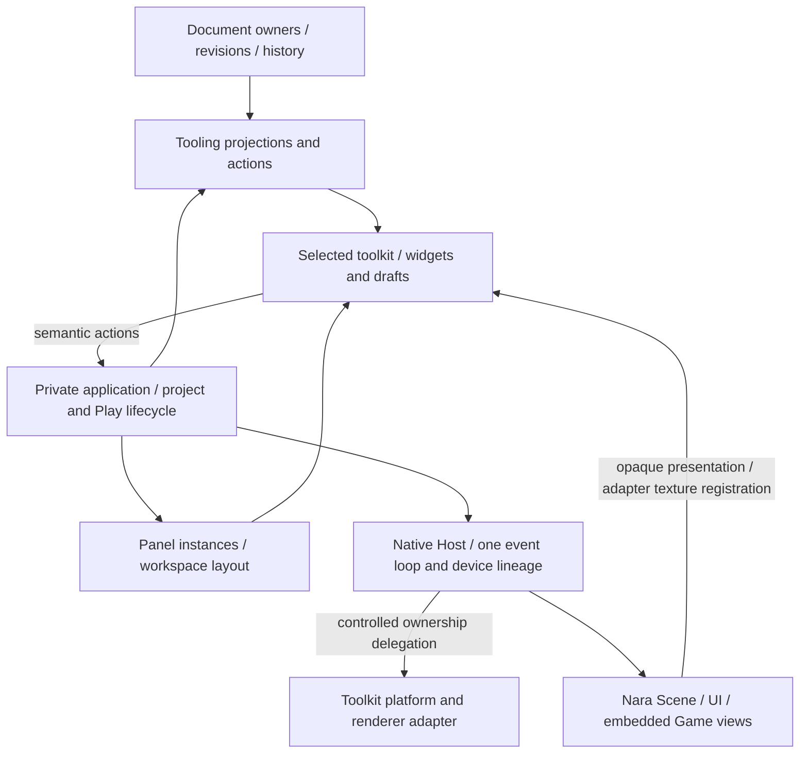

# ADR 0118: Editor Workspaces, Frontends, and Creation Templates

**Status**: Accepted
**Date**: 2026-10-16
**Last Revised**: 2026-10-20 (owned Save observation and native lifecycle coordination)
**Owner**: Private Editor product, tooling, reflection and Scene/Prefab document owners
**Refines**: [0015](0015-editor-tooling-and-dogfooding-boundary.md), [0081](0081-schema-source-stable-identity-catalog-and-runtime-binding.md), [0090](0090-unavailable-schema-and-lossless-authoring.md), [0114](0114-standalone-generic-editor-authoring-and-execution-boundary.md)
**Related**: [0117](0117-2d-foundation-ownership-and-authoring-contracts.md)
**Implementation Plan**: [Editor Foundation and Frontends](../../plans/2026-10-16-1229-refactor-editor-foundation-and-frontends-plan.md)

## Context

The user authorized fearless editor/module refactoring and asked to evaluate dear-imgui-rs 0.20.0 before a possible custom Nara-rendered editor.
Existing tooling already owns semantic frames/actions, document revisions, history and persistence independently from egui.
The private application still embeds egui panels/drafts, while native presentation assumes one window and one active viewport slot.
Generic component composition is also incomplete: field editing works, but the authoring path cannot construct ordinary custom components from its data catalog.

Godot, Unity and Unreal provide useful examples of document editing, dockable workspaces, targeted extensions and rendering reuse, but use different UI architectures.
Their maturity does not prove that Nara should unify game/editor widgets or that the selected Rust backend meets native input and window requirements.

## Decision

### Preserve semantic owners; replace private product coupling

Document identity, accepted revisions, source kind, selection, history, dirty state and persistence remain with the existing workspace/document owners.
The private application owns project opening/recovery/replacement and execution lifecycle without selected-toolkit types.
A frontend owns widgets, toolkit IDs and transient drafts, consumes semantic models and emits the existing action vocabulary.
It does not gain mutable document, World, process or GPU authority.

Document mutation remains revision-based; geometric input remains bound to the actual presented frame under ADR 0117.
No universal widget tree, generic command transport, parallel undo system or Editor kernel crate is required.
Future custom UI reuses these semantic boundaries and render-view handoff, but may replace all widget, layout, focus and docking code.
Sharing rendering does not require sharing the runtime game's complete UI toolkit.

### Panels, layouts and render views are distinct

An editor panel kind, its open instance, its document target, its render-view instance and its native window have different identities and lifetimes.
Closing or relocating a panel does not close its document, discard history or change source dirty state.
Workspace layout is user preference state, separate from project assets.
Stable panel identities survive frontend changes; toolkit-specific layout blobs may reset to a usable default with a reason.

Panel registration begins as finite trusted Rust contributions compiled into the Editor composition.
Existing built-ins and one separate sample use the same lifecycle.
A contribution consumes read-only projections and submits admitted actions; toolkit-specific painting belongs in an optional frontend companion.
Ordinary project Open still does not compile/load arbitrary project Rust, native libraries or callbacks.
This decision establishes no stable plugin ABI or dynamic hot-unload policy.

The native composition admits each descriptor and per-instance frontend factory as one pair;
admission failure cannot leave a partial contribution installed. Frontend state is owned by each
panel instance. Close, hide, target/resolved-document change, project replacement and layout reset
retire its drafts; moving/docking the panel preserves them. GPU reconstruction moves the retained
frontend, including its factories and instance state, instead of reinstalling contributions.

### Complete field edits through exact owner results

A normal field editor accepts the resolved panel document, authored entity and stable component/
field identity. Its frontend owns transient input and feedback; the document owner still validates
and publishes the existing semantic action. Private widget/draft identity excludes the monotonic
document revision. Submission basis retains the exact revision and admitted schema/source meaning.
Ordinary Save does not replace that meaning; source/session replacement must not alias it merely
because a locator is equal. Read-only owner projections supply these facts.

Invalid text and unfinished structured input remain drafts. A dirty draft retains its basis when
unrelated edits advance the revision, and requires explicit current-value review/reapply before a
new submission. Schema/source incompatibility cannot reinterpret old input. Collapse or temporary
unselection is not panel retirement or proof that an unprojected field was deleted. Draft storage
is finite; capacity rejects new input before admission rather than silently evicting unsaved input.
The actual panel lifecycle above still retires its state. No second document or undo authority is
created, and shared schema validation does not imply arbitrary native readiness.

A source-built panel can submit several existing actions and receive an opaque local ID for each
accepted enqueue. Immediate failure queues no action. Dispatch completion is delivered at most
once to the originating live panel incarnation, after painting borrows release, application drive
and actual project/target/layout reconciliation. The callback receives no UI, World or dispatch
context. Helper-owned requests have one private controller recipient, not an additional custom
callback. A committed action is not rolled back when its observer retires.

The frontend carries exact original action slots through closing filters and whole-batch rejection.
Its public prepared submission is move-only, bound to that frontend and project/candidate cycle,
and consumed only by the matching frontend. A newer candidate invalidates an unconsumed one;
late/foreign consumption cannot mutate or settle another candidate. Dropping it runs no user code;
the next frontend cycle settles outstanding observation or final retirement releases it. Native
presentation seals the candidate after final Canvas/pick provenance. Direct non-frontend batch
consumers retain their ordinary report path and cannot settle frontend observations.

This completion means dispatch, not eventual Save/Play completion. Several actions remain ordered;
same-basis document writes can conflict and are never silently rebased. A cohesive multi-field
operation uses one existing atomic patch. No generic bus, polling-ticket framework, asynchronous
panel trait or public controller state machine is introduced.

Save completion is observed through the existing persistence projection across frames. The native
Host schedules maintenance while persistence is pending and requests presentation when its state
changes; unchanged polls alone do not require repaint. Close/Exit retain and retry their intent
after an already admitted Save. Project replacement waits for that Save before preparing source
bytes, including replacement by the same project. Physical file and task retirement remain with
their existing owners under ADRs 0047/0052; the frontend never interprets task cancellation as a
successful save or rollback.
The same pending maintenance and retained Close/Exit/replacement policy observes owned Reopen
preparation. Opening keeps authoring controls disabled and rejects new Play/Restart/RunLastGood
admission at the Host, including frame-bound and external routes. Native codec affinity and
exact source/revision publication stay with the existing document owner. Switching an already
open active tab does not retarget an admitted operation.
Physical session close is monotonic: its first attempt closes new-work admission even while an
already admitted Save/Reopen is still preparing. A caller may observe or acknowledge results and
retry cleanup, but cannot reopen file or Play admission on that closing or stopped session.
Scene/Prefab Host cleanup remains registered across idle operation periods and transfers explicitly
when content refresh replaces the authoring runtime; frontend retirement does not release it.

Project Open separates transportable startup-closure preparation from session publication. Its
linear attempt owns the exact project/schema capabilities, budgets and prepared result. Background
reads, decode, dependency traversal and pure schema classification may remain pending across
several advances in the same phase. Only an actual completed result can advance to publication;
native Adapter admission, Plugin/registry construction and Workspace/session creation remain on
the owner thread. Cancelling an attempt revokes its publication interest without claiming that an
OS read stopped. A bounded preparation owner retains running captures through the existing task
retirement path. Unchanged pending polls need maintenance, not repeated presentation. Retained
replacement projects and persistence-before-preparation/Save-before-refresh ordering stay intact.

The native Host retains one event loop, device-creation authority and accountable close/recovery lifecycle.
It may delegate secondary window/surface ownership to the selected platform/renderer adapter with explicit shutdown ordering.
The adapter uses the engine-created GPU lineage rather than a second device/runtime.
The private toolkit adapter must own the renderer and external texture registrations it certifies;
caller-supplied observation metadata alone cannot grant Nara presentation authority.
Delegated presentation receipts identify the exact native registration and UI attempt observed by
that owner. They do not invent internal surface configuration generations that the backend does
not expose. Host-owned primary surfaces retain their own acquisition/configuration identity.
Independent Nara view instances retain their own targets, displayed mappings, input capture and resource retirement.
An external Play process is not an embedded shared-device render view.

### Creation templates do not change decoding defaults

A component schema may publish one optional complete `authoring_initial_value` in the existing bounded generic value grammar.
It is creation-only data, validated through the canonical complete schema/value validator at catalog admission and copied for an explicit creation transaction.
Its presence grants neither native execution nor project-specific invariants absent from the descriptor.
No template means no generic creation capability; the Editor does not fabricate zeros, empty references or callbacks.

Field `default_value` retains its existing missing-field compatibility meaning.
A creation template never makes a required stored field optional.
Present template metadata affects catalog fingerprint/generation and exact authoring capability identity; absent metadata preserves old fingerprints.
A template-only change advances catalog generation without changing component wire version or stored-record decode semantics.
Same-version lineage comparison excludes creation-only metadata while catalog identity includes it.

The first derive extension accepts only explicitly typed finite scalar literal initializers through the existing sealed codecs.
If a component opts in, every field must be covered.
Manual schema owners may publish complete values for already-admitted built-ins using existing reference semantics.
Arbitrary expressions, native `Default` callbacks and a new reference sentinel policy are not introduced.

### Generic structural authoring is document-owned

The ordinary authoring path admits empty-entity insertion and adding/removing current, data-editable component records by stable component identity.
Preparation, inverse construction, complete candidate validation and one revision/history publication stay inside the existing Scene/Prefab owners.
They do not require a fake native registry.
Creation validates the exact retained catalog basis, template and document revision; removal is an explicit command with a complete inverse.

Each admitted operation and inverse preserves the complete unavailable-record manifest, including placement, identities, values and references.
Unknown/future/unsupported record mutation and deletion remain unavailable in this finite slice.
Broader entity deletion/reference closure is not admitted by implication.
Scene and Prefab share tree/Inspector projections while retaining source kind, independent persistence and specialized UI Prefab domain gates.
Successful data authoring does not assert native preview or strict Runtime readiness.

### Evaluate Dear ImGui through a real workflow

The initial researched baseline is dear-imgui-rs `v0.20.0` at `af2942c78651b280d18af621de55b5462bb1e10a`.
Use the direct Winit/WGPU backends under Nara's Host; `dear-app` at that version rejects multi-viewport configuration.
Matching WGPU 30 and Winit 0.30.13 versions establish compatibility evidence, not a successful integration claim.

Existing dependency versions are not architecture constraints.
Breaking upgrades are allowed when they remove concrete correctness, integration or maintenance obstacles; migrate callers, toolchain/MSRV and related dependency families together, then remove obsolete old-API paths.
Prefer coherent supported stable releases, and record the exact selected cohort before freezing new interfaces.
A newer chosen release requires fresh checks of the capabilities affected by the change; this tag study is not evidence for another release's native behavior.
An unreleased/beta route needs a concrete stable-release blocker, not merely a newer version number.

Docking within a window, native detached windows and multiple Nara render views are separate capabilities.
The pinned native multi-viewport backend is experimental, supports Windows/macOS/X11 routes and rejects Wayland.
In-window docking remains the baseline where detachment is unavailable.
At the initial 0.20.0 research baseline, IME commits are implemented but preedit is ignored;
system accessibility parity is not established by that research. Newer composition support is
qualified separately in the implementation ledger.

The replacement becomes the default only after the plan's actual Nara texture, authoring, input, lifecycle and feature-parity gates pass.
If a mandatory capability fails, retain the current production frontend and resolve the concrete blocker before porting the rest.
Passing one probe does not claim a complete replacement or native support on untested platforms.
Once replacement parity passes, remove the superseded frontend rather than preserving a permanent compatibility product.

## Alternatives Considered

1. **Replace widget calls directly.** Fast initially, but preserves egui-shaped application state, singleton views and built-in composition restrictions. Rejected as the architecture strategy.
2. **Build a complete Nara editor UI or universal widget abstraction first.** Offers direct renderer reuse, but creates a large independent toolkit project before the editor workflows establish its requirements. Deferred custom widgets; universal abstraction rejected.
3. **Keep semantic owners, replace private coupling, then qualify Dear ImGui.** Chosen because it improves the current product even if the candidate backend fails, while exposing native lifecycle and authoring constraints before a full port.
4. **Load project Rust for creation/Inspector defaults.** Rejected because it changes ordinary Open into executable hosting and makes data authoring depend on successful project compilation. Pure creation templates preserve the existing isolation contract.

## Consequences

The private application, platform facade, viewport slot and built-in component composition APIs may break without compatibility wrappers.
All affected consumers and fixtures migrate together; source/catalog changes are documented rather than silently rewritten at runtime.
Data catalogs gain optional creation metadata, while document wire semantics and strict Runtime admission remain independently meaningful.

Frontend widgets and layout payloads are intentionally replaceable work.
The reusable investment is document semantics, tooling models/actions, panel identity and native/render ownership, not a promise that future custom UI will need no rewrite.
The qualification probe and complete migration are separate milestones, and an unsuccessful candidate does not invalidate completed boundary improvements.

## Success Metrics

| Outcome | Evidence required |
|---|---|
| GUI-independent application | No selected-toolkit types in application/project state; existing project lifecycle tests pass |
| Useful source extension | A separately compiled panel installs, acts and closes through the same path as built-ins |
| Generic construction | Custom component add/remove/Undo/Save/Reopen succeeds in Scene and Prefab without project execution |
| Independent render views | Concurrent actual Scene/Game rendering with correct focus, resize and retirement |
| Qualified replacement | Full parity matrix plus exact native/backend acceptance, not a demo |
| Controlled scope | No competing history, generic widget IR, dynamic ABI or abandoned production frontend |

## Risks and Mitigations

| Risk | Decision |
|---|---|
| Experimental native windows fail on a target backend | Keep docking usable, publish capability reasons and qualify each native profile |
| Toolkit migration loses ordinary Editor capabilities | Inventory and exercise the existing full workflow before selecting the default |
| Delegated surfaces compete with engine presentation | Integrate one backend route with explicit primary/secondary ownership and retirement |
| Creation metadata weakens stored-data validation | Separate templates from field defaults and test lineage/decode behavior independently |
| Extensibility turns Open into arbitrary code execution | Restrict this slice to trusted source-built contributions; retain data-only project admission |
| Future-proofing becomes a new framework | Require real built-in/sample consumers and remove speculative abstractions and obsolete paths |

## Sources

- [Pinned Dear ImGui research](../../research/2026-10-16-editor-foundation/dear-imgui-020.md).
- [Mature editor research](../../research/2026-10-16-editor-foundation/mature-editors.md).
- [Nara source boundary research](../../research/2026-10-16-editor-foundation/nara-module-seams.md).
- [Dependency cohort research](../../research/2026-10-16-editor-foundation/dependency-cohort.md).

Acceptance records the architecture/evaluation route, not implementation completion or an unconditional backend adoption.
